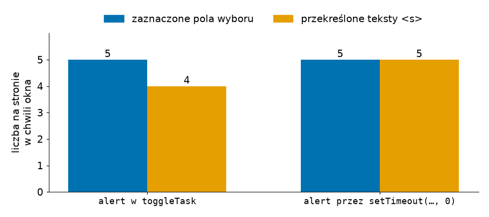

# Rozszerzenia do slajdu 05: Efekt: kod, który działa po renderze

Powrót: [`slide_05_useeffect.md`](../slide_05_useeffect.md)

## Rozszerzenie: komunikat po ostatnim zadaniu

Pytanie o przyczynę jest trudniejsze wtedy, gdy zdarzenie zostawia ślad w stanie. Przypuśćmy, że po zaznaczeniu ostatniego zadania aplikacja ma pokazać gratulacje. Efekt zależny od `pending` wygląda na naturalne miejsce:

```jsx
// Przykład spoza demo: gratulacje w efekcie obok efektu tytułu (logika jednego zdarzenia w efekcie, błąd)
useEffect(() => {
  if (pending === 0) alert("All tasks done!"); // efekt zna liczbę, ale nie powód jej zmiany
}, [pending]);
// → cztery zadania zaznaczone, piąte usunięte przyciskiem „Delete”: okno „All tasks done!”
```

Efekt widzi tylko liczbę, więc gratuluje także po usunięciu ostatniego niewykonanego zadania, choć nikt niczego nie skończył. Gdyby lista była zapisywana w przeglądarce i wczytywana po odświeżeniu strony, komunikat pokazywałby się przy każdym wczytaniu listy bez niewykonanych zadań, bo efekt wykonuje się po pierwszym renderze z zerem. Dokumentacja streszcza to regułą:

> **„Efektów używa się tylko dla kodu, który ma się wykonać dlatego, że komponent został wyświetlony użytkownikowi.”**
>
> *„Use Effects only for code that should run because the component was displayed to the user.”*
>
> — dokumentacja React, *You Might Not Need an Effect*

Gratulacje należą więc do `toggleTask`. Procedura zna nową listę, którą sama oblicza, i wie, że przyczyną jest zaznaczenie:

```jsx
// Przykład spoza demo: gratulacje w procedurze zaznaczenia
function toggleTask(id) {
  const next = tasks.map((t) => (t.id === id ? { ...t, done: !t.done } : t));
  setTasks(next);
  if (next.every((t) => t.done)) alert("All tasks done!"); // every: true, gdy warunek spełnia każdy element
}
// → zaznaczenie piątego zadania: okno „All tasks done!”; usunięcie ostatniego niewykonanego: brak okna
```

## Rozszerzenie: efekt przed malowaniem ekranu

Dokumentacja `useEffect` w React 19 rozróżnia efekty według tego, co je wywołało.

> **„Jeśli efekt został wywołany interakcją (na przykład kliknięciem), React może uruchomić go, zanim przeglądarka namaluje zaktualizowany ekran. Dzięki temu wynik efektu może zostać zauważony przez system zdarzeń.”**
>
> *„If your Effect is caused by an interaction (like a click), React may run your Effect before the browser paints the updated screen. This ensures that the result of the Effect can be observed by the event system.”*
>
> — dokumentacja React, *useEffect*

Pierwsze wykonanie efektu tytułu, zaraz po montowaniu, nie wynika z żadnej interakcji. Każde następne wynika już z kliknięcia, bo `pending` zmienia się wyłącznie przy zaznaczeniu, dodaniu albo usunięciu zadania. Kolejność widać po funkcji `requestAnimationFrame`, którą przeglądarka wywołuje tuż przed malowaniem następnej klatki ekranu:

```jsx
// Przykład spoza demo: efekt po kliknięciu a następna klatka ekranu
function toggleTask(id) {
  requestAnimationFrame(() => console.log("frame")); // wywołanie tuż przed malowaniem klatki
  setTasks(tasks.map((t) => (t.id === id ? { ...t, done: !t.done } : t)));
}
useEffect(() => {
  console.log("effect", pending);
}, [pending]);
// → zaznaczenie pierwszego zadania: effect 4, potem frame
```

Dla zmiany `document.title` kolejność nie ma znaczenia. Ma ją dla `alert`, który blokuje stronę. Okno z procedury `toggleTask` otwiera się nawet przed renderem: piąte pole jest już zaznaczone, a jego tekst jeszcze nie jest przekreślony. Dokumentacja radzi w takim przypadku odłożyć pracę przez `setTimeout`:

```jsx
// Przykład spoza demo: gratulacje odłożone za malowanie ekranu
if (next.every((t) => t.done)) setTimeout(() => alert("All tasks done!"), 0); // 0 ms: po bieżącej pracy przeglądarki
// → okno po zaznaczeniu piątego zadania: na stronie pięć przekreśleń (bez setTimeout cztery)
```

## Rysunek 2.9 — strona w chwili okna „All tasks done!”



Na Rysunku 2.9 słupki pokazują stan strony w chwili, gdy okno `alert` ją zatrzymało. Trzy próby dały ten sam wynik. Niebieski słupek liczy zmianę, którą przeglądarka nanosi sama, a pomarańczowy zmianę, która wymaga renderu Reacta.

Odwrotną potrzebę, czyli efekt wykonany zawsze przed malowaniem, obsługuje `useLayoutEffect`. Dokumentacja pisze, że ogromna większość efektów go nie potrzebuje (*„this shouldn't be needed for the vast majority of Effects”*). Wyjątkiem jest pomiar elementu, którego wynik ma się pokazać na ekranie od razu:

```jsx
// Przykład spoza demo: wysokość listy zmierzona przed malowaniem ekranu
import { useState, useEffect, useLayoutEffect } from "react";

const [height, setHeight] = useState(0);
useLayoutEffect(() => {
  // DOM jest już zatwierdzony, a ekran jeszcze nie namalowany; offsetHeight to wysokość w pikselach
  setHeight(document.querySelector("ul").offsetHeight);
}, [tasks]);

// w JSX pod listą:
<p>List height: {height}px</p>
// → pięć zadań: List height: 110px; po dodaniu szóstego: 132px; po usunięciu dwóch: 88px
```

Pierwsza klatka po kliknięciu „Add” pokazuje już 132px. Na serwerze efekt się nie wykonuje, więc HTML strony ma „List height: 0px” aż do hydratacji.
