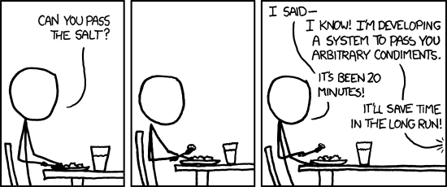

# Rozszerzenia do slajdu 11: Hook złożony z hooków: `useTasks`

Powrót: [`slide_11_usetasks.md`](../slide_11_usetasks.md)

## Rozszerzenie: część hooka, która nie musi być hookiem

Nie wszystko w `useTasks` korzysta z Reacta. Hooki wywołują tylko dwie pierwsze linie. Wyliczenie `visibleTasks` z listy i filtra to zwykłe przekształcenie tablicy. Dokumentacja (*Reusing Logic with Custom Hooks*) rozstrzyga taki przypadek krótko: funkcje, które nie wywołują hooków, nie muszą być hookami (*„Functions that don't call Hooks don't need to be Hooks”*). Jej przykład to `getSorted(items)` w miejsce `useSorted(items)`.

```js
// Przykład spoza demo: logika filtra z useTasks jako zwykła funkcja, dane w argumentach, wynik w return
export function getVisibleTasks(tasks, filter) {
  if (filter === "active") return tasks.filter((t) => !t.done);
  if (filter === "done") return tasks.filter((t) => t.done);
  return tasks;
}
```

Taką funkcję sprawdza się jednym wywołaniem, bez Reacta i bez przeglądarki, i można ją wywołać w dowolnym miejscu, także w warunku. Hook zostaje cieńszy: trzyma stan i woła `getVisibleTasks(tasks, filter)`. Kryterium jest mechaniczne. Kod wywołujący hook należy do hooka albo komponentu. Kod zwracający JSX jest komponentem. Pozostałe obliczenia mogą być zwykłymi funkcjami.

## Rozszerzenie: kiedy wydzielać hook, a kiedy nie

Bugl w *Learn React Hooks* radzi, żeby najpierw napisać komponent, a hook wydzielić dopiero wtedy, gdy podobny kod pojawia się w kilku komponentach. Pozwala to uniknąć przedwczesnego definiowania hooków i niepotrzebnej złożoności projektu. Task Board przeszedł dokładnie tę drogę. Dokumentacja dodaje wskazówkę co do nazwy: hook ma odpowiadać konkretnemu zastosowaniu, a jego nazwa mówi, co robi, co przyjmuje i co zwraca. Według dokumentacji kłopot z wyborem jasnej nazwy może oznaczać, że efekt jest zbyt spleciony z resztą logiki komponentu i nie nadaje się jeszcze do wydzielenia.

Dokumentacja przestrzega też przed wydzielaniem hooka z każdego powtórzonego fragmentu. Trochę powtórzeń jest w porządku, a hook opakowujący jedno wywołanie `useState` jest prawdopodobnie zbędny.



*Przerywnik: xkcd 974 „The General Problem”. Autor: Randall Munroe, licencja CC BY-NC 2.5, <https://xkcd.com/974/>.* Hook wydzielony na zapas, zanim ten sam kod pojawi się w drugim komponencie, jest takim systemem do podawania dowolnych przypraw.

Ta sama strona podaje sygnał w drugą stronę. Każdy efekt oznacza wyjście poza Reacta, więc przy każdym napisanym efekcie można zapytać, czy nie byłby czytelniejszy w hooku, który nazywa zamiar. `useLocalStorage` jest przykładem tej sytuacji: nazwa mówi, gdzie trafia wartość. Tak samo da się wydzielić efekt z tytułem karty.

```js
// Przykład spoza demo: efekt z tytułem karty jako hook nazwany od zamiaru.
import { useEffect } from "react";

export function usePendingTitle(pending) {
  useEffect(() => {
    document.title = pending > 0 ? `(${pending}) Task Board` : "Task Board";
    return () => { document.title = "Task Board"; }; // sprzątanie przy odmontowaniu
  }, [pending]);
}

// w TaskBoard zamiast całego efektu z tytułem:
usePendingTitle(counts.pending);
```

```text
dwa z pięciu zadań zaznaczone → tytuł karty: (3) Task Board
wszystkie zaznaczone          → tytuł karty: Task Board
```

Wywołanie zostaje w `TaskBoard`, bo tytuł dotyczy tej strony, a tablica zależności i sprzątanie chowają się w hooku. Dokumentacja ostrzega za to przed hookami opakowującymi sam `useEffect` pod ogólną nazwą, bo nazwa hooka ma mówić, co robi, a nie kiedy się wykonuje.
