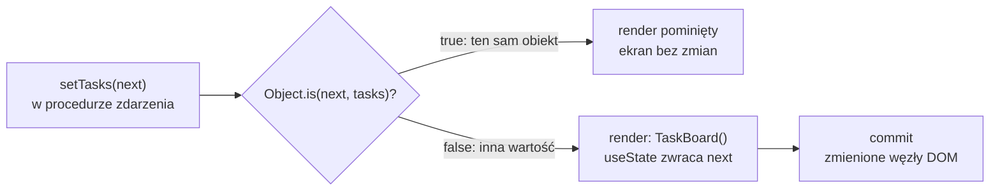

# Lista zadań, która zaczyna pamiętać

## Lista, która niczego nie pamięta

**Task Board** to lista zadań w Next.js. Pierwsza wersja wyświetla pięć zadań. Nie da się dopisać nowego, odhaczyć wykonanego ani usunąć zbędnego. Zakładka przeglądarki nie wie, ile pracy zostało, a odświeżenie strony przywraca wszystko do punktu wyjścia. Komponent musi więc zapamiętywać dane między kolejnymi wywołaniami, a część z nich przenosić poza Reacta: do tytułu karty i do pamięci przeglądarki.

## Pliki aplikacji

Projekt powstaje kreatorem `create-next-app` w wersji 16.4.0, bez Tailwinda, lintera i React Compilera, czyli narzędzia, które samo dopisuje do komponentów optymalizacje. Aplikacja ma pokazywać samego Reacta, bez dodatków. Zadania startowe leżą w zwykłym module `app/data/initialTasks.js`:

```js
// Zwykły moduł z danymi: bez pobierania z sieci, bez Reacta.
export const initialTasks = [
  { id: 1, text: "Przeczytaj dokumentację React 19", done: false },
  { id: 2, text: "Zbuduj komponent TaskBoard",        done: false },
  { id: 3, text: "Napisz własny hook",                done: false },
  { id: 4, text: "Zrozum useEffect i cleanup",        done: false },
  { id: 5, text: "Użyj useRef do focusu",             done: false },
];
```

Każde zadanie ma trzy pola: `id` odróżnia je od pozostałych, `text` to treść, a `done` mówi, czy zadanie jest wykonane. Plik `app/layout.jsx` ustawia tytuł karty przez obiekt `metadata`. Next.js zamienia go na znacznik `<title>` w HTML:

```jsx
// Fragment app/layout.jsx: tytuł i opis strony dla całej aplikacji.
export const metadata = {
  title: "Task Board — Demo L02",
  description: "Live-coding demo: state and hooks (React 19 + Next.js 16)",
};
```

Strona główna `app/page.jsx` importuje komponent i dane:

```jsx
// Komponent serwerowy: dostaje dane z modułu i przekazuje je propsem dalej.
import TaskBoard from "./components/TaskBoard";
import { initialTasks } from "./data/initialTasks";

export default function Home() {
  return (
    <main>
      <h1>Task Board</h1>
      <TaskBoard initialTasks={initialTasks} />
    </main>
  );
}
```

Pierwsza wersja `app/components/TaskBoard.jsx` wyświetla tylko listę:

```jsx
"use client"; // ten plik i wszystko, co importuje, trafia do przeglądarki
// Szkielet: statyczna lista, jeszcze bez hooków.

export default function TaskBoard({ initialTasks }) {
  return (
    <div>
      <ul>
        {initialTasks.map((task) => (
          <li key={task.id}>{task.text}</li> // key: stały identyfikator wiersza
        ))}
      </ul>
    </div>
  );
}
```

## Serwer przekazuje dane, przeglądarka je zmienia

`Home` jest komponentem serwerowym, a `TaskBoard` z dyrektywą `"use client"` komponentem klienckim. Podział wynika z tego, co każdy z nich robi. `Home` tylko składa stronę z gotowych danych. `TaskBoard` ma reagować na kliknięcia i pamiętać zmiany, a hooki działają wyłącznie w komponentach klienckich. Tablica `initialTasks` przechodzi przez granicę między nimi jako prop, więc musi dać się zserializować, czyli zapisać jako dane wysyłane razem ze stroną. Zwykłe obiekty z napisami, liczbami i wartościami logicznymi spełniają ten warunek. Szkielet nie ma jeszcze stanu, więc dyrektywa stoi na zapas: kolejne wersje dodadzą hooki.

## Interfejs zmieniany ręcznie

Bez Reacta licznik kliknięć wymaga dwóch rzeczy: zmiennej z liczbą i kodu, który po każdej zmianie przepisze ją do strony.

```js
// Licznik bez Reacta: dane i ekran aktualizuje się osobno.
let count = 0;
const button = document.querySelector("button");
button.addEventListener("click", () => {
  count = count + 1;                           // 1. zmiana danych
  button.textContent = `Kliknięcia: ${count}`; // 2. ręczny zapis do DOM
});
```

Zmiana węzła DOM od razu zmienia wyświetlaną stronę. Kod imperatywny, czyli lista kroków do wykonania, musi pamiętać o kroku 2 przy każdej zmianie danych. Gdy ta sama liczba pojawia się w trzech miejscach strony, każde z nich trzeba przepisać osobno. Ten sam licznik w Reakcie wygląda tak:

```jsx
// Ten sam licznik w Reakcie: setter zgłasza zmianę, JSX opisuje wynik.
import { useState } from "react";

function Counter() {
  // useState(0) daje parę: bieżącą wartość count i setter setCount, który ją zmienia
  // () => ... to funkcja strzałkowa, krótki zapis funkcji wywoływanej po kliknięciu
  const [count, setCount] = useState(0);
  return <button onClick={() => setCount(count + 1)}>Kliknięcia: {count}</button>;
}
```

Kroku 2 tu nie ma. JSX opisuje, jak przycisk wygląda dla dowolnej wartości `count`, a przepisaniem wyniku do DOM zajmuje się React. Zostaje tylko krok 1, ale w innej postaci: zamiast przypisania do zmiennej pada wywołanie `setCount`. Oba programy po dwóch kliknięciach pokazują „Kliknięcia: 2”. Różnią się tym, kto pilnuje zgodności ekranu z danymi.

## Propsy płyną z zewnątrz, stan należy do komponentu

Szkielet pokazuje pięć zadań, ale nie pozwala niczego zmienić. Lista ma rosnąć po kliknięciu „Add”, zadanie ma zmieniać status po zaznaczeniu pola, a pole tekstowe ma pamiętać wpisane litery. Takie dane nazywa się **stanem** (*state*). Robin Wieruch w *The Road to React* rozdziela oba pojęcia według celu. Propsy przekazują informacje w dół drzewa, a stan służy do „zmiany informacji w czasie” (*„to modify information over time”*). Maximilian Schwarzmüller w *React Key Concepts* ujmuje tę samą różnicę słowami „dane zewnętrzne” i „dane wewnętrzne”.

## Dlaczego zwykła zmienna nie wystarczy

Najprostszy pomysł to zmienna `let tasks = initialTasks` w ciele komponentu, której nową tablicę przypisuje się w procedurze kliknięcia.

```jsx
// Ilustracja spoza demo: zwykła zmienna zamiast stanu.
function TaskBoard({ initialTasks }) {
  let tasks = initialTasks; // powstaje od nowa przy każdym wywołaniu komponentu
  const newTask = { id: 6, text: "Kupić mleko", done: false };
  return (
    // [...tasks, newTask]: nowa tablica ze starymi elementami i newTask na końcu
    <button onClick={() => { tasks = [...tasks, newTask]; }}> {/* React o zmianie nie wie */}
      Add ({tasks.length})
    </button>
  );
}
```

Po kliknięciu zmienna ma już sześć elementów, ale przycisk nadal pokazuje „Add (5)”. Dokumentacja Reacta (*State: A Component's Memory*) podaje dwa powody:

1. **Zmienne lokalne nie przetrwają między renderami.** Gdy React renderuje komponent drugi raz, robi to od zera i nie bierze pod uwagę zmian w zmiennych lokalnych.
2. **Zmiana zmiennej lokalnej nie wywołuje renderu.** React nie wie, że powinien ponownie wywołać komponent z nowymi danymi.

Schwarzmüller zauważa, że React nie śledzi zwykłych zmiennych ani zmian ich wartości, więc nie mają one wpływu na interfejs.

Stan różni się od propsów jeszcze jedną cechą. Dokumentacja pisze, że stan jest „w pełni prywatny dla komponentu, który go deklaruje” (*„fully private to the component declaring it”*), i dodaje, że rodzic nie może go zmienić. `Home` przekazuje `initialTasks`, ale nie ma dostępu do listy, którą `TaskBoard` zbuduje z tej wartości.

Potrzebne są więc dwie rzeczy: **pamięć poza funkcją komponentu**, która przetrwa kolejne wywołania, i **sposób zgłoszenia zmiany**, po którym React ponownie wywoła komponent. <u>Stan to dane, które React przechowuje za komponent i po których zmianie renderuje go ponownie</u>.

## Hook: funkcja, która podłącza komponent do Reacta

Oba wymagania spełnia `useState`. To pierwszy **hook** (*Hook*), czyli specjalna funkcja Reacta wywoływana w ciele komponentu. Schwarzmüller definiuje hooki tak:

> **„Hooki to specjalne funkcje, których można używać wyłącznie wewnątrz komponentów Reacta (albo wewnątrz innych hooków). Dodają one specjalne możliwości i zachowania do komponentów, w których się ich używa.”**
>
> *„These are special functions that can only be used inside of React components (or inside of other Hooks […]). Hooks add special features and behaviors to the React components in which they are used.”*
>
> — Maximilian Schwarzmüller, *React Key Concepts*

Alex Banks i Eve Porcello w *Learning React* tłumaczą samą nazwę. Hook pozwala „podpiąć” (*hook up*) funkcjonalność do komponentu. Według dokumentacji Reacta hooki pozwalają korzystać z różnych funkcji Reacta z poziomu komponentów (*„Hooks let you use different React features from your components”*). Nazwy wszystkich hooków zaczynają się od `use`, a wywołuje się je w ciele komponentu, nie w procedurach obsługi zdarzeń.

## Pierwszy hook w `TaskBoard`

Druga wersja `app/components/TaskBoard.jsx` przenosi listę zadań do stanu. Nowe linie wyglądają tak:

```jsx
import { useState } from "react"; // hook to zwykła funkcja eksportowana przez pakiet react

// wewnątrz TaskBoard, przed return:
// useState zwraca parę [bieżąca wartość, setter]. Komponent wykonuje się
// przy każdym renderze od nowa, ale wartość stanu React przechowuje u siebie.
const [tasks, setTasks] = useState(initialTasks);

// w JSX, wewnątrz <div>: odczyt stanu zamiast propsa
<p>Tasks in state: {tasks.length}</p>
<ul>
  {tasks.map((task) => (
    <li key={task.id}>{task.text}</li>
  ))}
</ul>
```

Od linii z `useState` lista należy do komponentu. Akapit nad listą pokazuje długość stanu, na starcie 5, a lista renderuje te same zadania co szkielet, tyle że z `tasks` zamiast z propsa.

## Para: wartość i funkcja, która ją zmienia

`useState` przyjmuje jeden argument i zwraca tablicę z dokładnie dwoma elementami. Pierwszy to **bieżąca wartość stanu**. Drugi to **setter** (*set function*). Wieruch opisuje tę parę jako odczyt i zapis: pierwszy element służy do odczytu stanu, drugi do jego zmiany (*state updater function*).

Zapis `const [tasks, setTasks] = ...` to **destrukturyzacja tablicy** (*array destructuring*): pierwszy element trafia do `tasks`, drugi do `setTasks`. Nazwy nadaje programista, a React zna tylko pozycje. Dzięki temu dwa wywołania `useState` w jednym komponencie mogą nazwać swoje pary dowolnie, na przykład `[tasks, setTasks]` i `[text, setText]`.

Wywołanie `setTasks` z nową listą sprawia, że React ponownie wywoła funkcję `TaskBoard` z nową wartością `tasks`. Banks i Porcello uważają tę zdolność wywołania renderu za najważniejszą cechę hooków.

## Wartość początkowa działa tylko raz

Linia `useState(initialTasks)` wykonuje się w każdym renderze, ale React bierze jej argument pod uwagę tylko przy pierwszym, bo stan przechowuje u siebie. Gdyby `Home` przekazał później inną tablicę w propsie `initialTasks`, lista w `TaskBoard` by się więc nie zmieniła.

Dokumentacja (*Choosing the State Structure*) opisuje ten przypadek jako „lustrzane odbicie” propsa w stanie (*mirroring props in state*) i uznaje go za źródło pomyłek. Wyjątek dopuszcza tylko wtedy, gdy ignorowanie późniejszych zmian jest zamierzone. Zaleca wtedy konwencję nazw: prop zaczyna się od `initial` albo `default`, żeby czytelnik od razu wiedział, że jego nowe wartości nie mają znaczenia. `initialTasks` stosuje dokładnie tę konwencję. <u>Prop o nazwie `initial…` dostarcza tylko wartość startową stanu</u>.

## Co może być stanem

`useState` nie narzuca typu. Schwarzmüller podkreśla, że stanem może być dowolna wartość JavaScriptu: napis z pola formularza, liczba w rodzaju sumy koszyka, wartość logiczna albo obiekt czy tablica. Wieruch dodaje, że komponent może wywołać `useState` dowolnie wiele razy. Każde wywołanie tworzy osobny **fragment stanu** (*state slice*) z własnym setterem. Obok `tasks` pojawi się napis `text` dla pola tekstowego, a później napis `filter` dla wybranego filtra.

Setter nie łączy nowej wartości ze starą. Schwarzmüller pisze, że każda wartość przekazana do settera „nadpisze poprzednio zapisaną wartość” (*„will overwrite the previously stored value”*). Obiekt z jednym polem przekazany do settera usuwa drugie pole stanu:

```jsx
// Przykład spoza TaskBoard: setter zastępuje cały obiekt, niczego nie łączy.
function Pair() {
  const [x, setX] = useState({ a: 1, b: 2 });
  return (
    <>
      <button onClick={() => setX({ a: 5 })}>Tylko a</button>         {/* x to { a: 5 }, pola b już nie ma */}
      <button onClick={() => setX({ ...x, a: 5 })}>a i b</button>    {/* { ...x } kopiuje pola x: { a: 5, b: 2 } */}
    </>
  );
}
```

Dokumentacja (*Choosing the State Structure*) radzi grupować w jednej zmiennej stanu wartości, które zawsze zmieniają się razem. Lista zadań i treść pola tekstowego zmieniają się niezależnie, dlatego trafią do osobnych wywołań.

## Setter pyta, czy wartość jest nowa

Setter niczego nie rysuje. Zgłasza Reactowi zmianę, a dalej idzie znany ciąg: render, czyli wywołanie funkcji `TaskBoard`, w którym `useState` zwraca już nową wartość, i zatwierdzenie (*commit*) różnic w DOM. Z tego podziału wynika miejsce każdego hooka. `useState` działa w renderze: oddaje wartość i setter. Setter działa poza renderem, w procedurze obsługi zdarzenia. Stan żyje w Reakcie, a DOM jest jego odbiciem po ostatnim zatwierdzeniu.

Przed renderem React wykonuje jedno sprawdzenie, którego nie widać w kodzie komponentu. Funkcja `Object.is` porównuje nową wartość z bieżącą podobnie jak `===`: liczby i napisy po treści, a tablice i obiekty po tym, czy to ten sam obiekt w pamięci. Gdy wynik to `true`, React uznaje, że nic się nie zmieniło, i renderu nie wykonuje.

## Rysunek 2.1 — decyzja po wywołaniu settera



Na Rysunku 2.1 lewy prostokąt to wywołanie settera, na przykład w procedurze obsługi kliknięcia. Romb to porównanie, które React wykonuje przed renderem. Górna gałąź kończy się bez renderu. Trafia na nią każde wywołanie, w którym nowa wartość jest dokładnie tym samym obiektem co bieżąca, nawet jeśli w międzyczasie zmieniła się jej zawartość. Dolna gałąź prowadzi przez render do zatwierdzenia zmian.

## Ta sama tablica to brak zmiany

Dokumentacja `useState` opisuje porównanie z rysunku:

> **„Jeśli nowa wartość jest identyczna z bieżącym stanem według porównania `Object.is`, React pominie ponowne renderowanie komponentu i jego dzieci. To jest optymalizacja.”**
>
> *„If the new value you provide is identical to the current `state`, as determined by an `Object.is` comparison, React will skip re-rendering the component and its children. This is an optimization.”*
>
> — dokumentacja React, *useState*

Wynik porównania zależy od rodzaju wartości. Tejas Kumar w *Fluent React* dzieli wartości JavaScriptu na dwie grupy. **Wartości proste**, czyli prymitywy (u Kumara *scalars*): liczby, napisy i wartości logiczne, porównuje się po treści. **Typy referencyjne** (*reference types*), czyli obiekty, tablice i funkcje, porównuje się po adresie w pamięci.

> **„Przy porównaniu typy nieskalarne, czyli referencyjne, są porównywane według referencji do pamięci, a nie według zawartości.”**
>
> *„When it comes to comparison, nonscalar types are compared by their memory reference, not by their content.”*
>
> — Tejas Kumar, *Fluent React*

Kumar podaje przykład: `"a" === "a"` daje `true`, a `[1, 2, 3] === [1, 2, 3]` daje `false`, bo powstały dwie różne tablice o tej samej treści. MDN podaje jedyne różnice między `Object.is` a `===`: `Object.is(NaN, NaN)` daje `true`, a `Object.is(-0, 0)` daje `false`. **Dla tablicy „identyczna” znaczy „ten sam obiekt w pamięci”.**

Ten przypadek daje **mutacja**, czyli zmiana istniejącej tablicy zamiast utworzenia nowej. Metoda `push` dopisuje element do tablicy, na której ją wywołano:

```jsx
{/* ŹLE (w JSX TaskBoard, pod listą): push zmienia istniejącą tablicę,
    a setter dostaje ten sam obiekt. Object.is zwraca true, więc React pomija render. */}
<button onClick={() => {
  tasks.push({ id: 99, text: "Mutacja!", done: false });
  setTasks(tasks);
}}>Push</button>
```

Po kliknięciu licznik „Tasks in state” zostaje na 5, choć tablica w pamięci ma już sześć elementów. Gdy w tej samej procedurze padnie wywołanie innego settera, na przykład czyszczenie pola tekstowego, render i tak nastąpi, a zmutowana tablica pokaże się z sześcioma zadaniami. Przez to błąd wygląda na losowy: ta sama linia z `push` raz zmienia ekran, a raz nie.

> 💡 **Zapamiętaj:** propsy to dane od rodzica, a dane zmieniające się w czasie trzyma się w stanie. `useState` zwraca bieżącą wartość i setter. <u>Setter z tą samą tablicą nie wywołuje renderu</u>.

