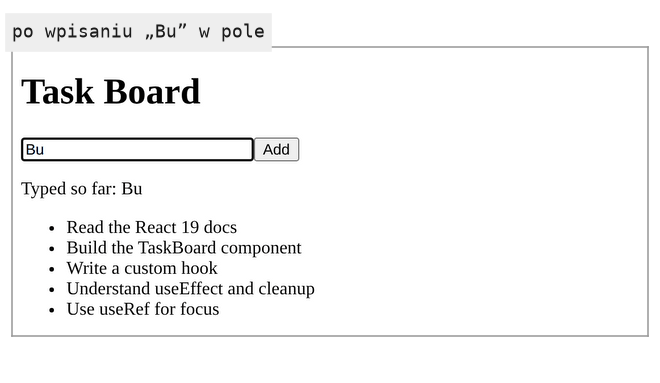
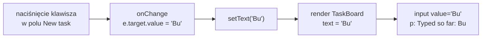

# Pole tekstowe, którym steruje stan

## Drugi stan: treść wpisywana w pole

Żeby dodać zadanie, aplikacja musi najpierw wiedzieć, co użytkownik wpisał. Trzecia wersja `TaskBoard.jsx` dostaje pole tekstowe, przycisk i drugą zmienną stanu. Nowe linie wyglądają tak:

```jsx
// Drugi, niezależny fragment stanu. Pole na starcie jest puste, więc stan startuje od "".
const [text, setText] = useState("");

// w JSX, wewnątrz <div>, nad listą:
<input
  value={text}                               // pole pokazuje zawsze to, co jest w stanie
  onChange={(e) => setText(e.target.value)}  // strzałka dostaje obiekt zdarzenia e;
                                             // e.target.value to bieżąca treść pola
  placeholder="New task..."
/>
<button>Add</button>                         {/* bez procedury kliknięcia: na razie tylko odczyt pola */}
<p>Typed so far: {text}</p>                  {/* ten sam stan drugi raz, litera po literze */}
```

Przycisk „Add” nie ma jeszcze procedury kliknięcia, więc tekst zostaje w polu.

## Rysunek 2.2 — pole po wpisaniu „Bu”



Na Rysunku 2.2 pole i akapit pokazują to samo „Bu”, bo czytają jedną zmienną `text`.

## Zdarzenie i procedura obsługi

**Zdarzenie** (*event*) to sygnał przeglądarki, że coś się stało: kliknięcie, naciśnięcie klawisza, zmiana treści pola. **Procedura obsługi zdarzenia** (*event handler*) to funkcja, którą przeglądarka ma wywołać, gdy sygnał nadejdzie. W JSX przekazuje się ją propsem o nazwie `on` plus nazwa zdarzenia: `onClick`, `onChange`, `onBlur`. Dokumentacja Reacta (*Responding to Events*) opisuje konwencję nazw procedur: zaczynają się od `handle`, po którym stoi nazwa zdarzenia, na przykład `handleClick`.

Prop dostaje funkcję, a nie wynik jej wywołania. Schwarzmüller w *React Key Concepts* wskazuje różnicę między dwoma zapisami:

> **„Między `evaluateEmail` a `evaluateEmail()` jest subtelna różnica. Pierwszy to wskaźnik do funkcji, drugi faktycznie ją wykonuje (i zwraca jej wynik, jeśli jakiś jest).”**
>
> *„There’s a subtle difference between `evaluateEmail` and `evaluateEmail()`. The first is a pointer to the function; the second actually executes the function (and yields the return value, if any).”*
>
> — Maximilian Schwarzmüller, *React Key Concepts*

Różnicę widać na dwóch przyciskach:

```jsx
// Przykład spoza TaskBoard: przekazanie funkcji i jej wywołanie.
function Hello() {
  function handleClick(e) {
    console.log("clicked:", e.type);        // e: obiekt zdarzenia, e.type to "click"
  }
  function handleWrong() {
    console.log("called during render");
  }
  return (
    <>
      <button onClick={handleClick}>Good</button>  {/* React wywoła funkcję po kliknięciu */}
      <button onClick={handleWrong()}>Bad</button>   {/* wywołanie już w renderze; prop dostaje undefined */}
    </>
  );
}
```

Komunikat „called during render” pojawia się w konsoli od razu, bez żadnego kliknięcia. Kliknięcie przycisku „Bad” nie robi potem nic, bo `handleWrong()` zwraca `undefined` i taka wartość trafia do `onClick`. Dokumentacja tłumaczy przyczynę: JavaScript w nawiasach klamrowych JSX wykonuje się od razu (*„JavaScript inside the JSX `{` and `}` executes right away”*), więc nawiasy wywołania uruchamiają funkcję podczas renderu. Gorzej, gdy wywołana tak funkcja zmienia stan. W liczniku z `useState(0)` zapis `onClick={setCount(count + 1)}` ustawia stan w każdym renderze, a każde ustawienie wywołuje kolejny render. React przerywa tę pętlę wyjątkiem „Too many re-renders. React limits the number of renders to prevent an infinite loop.”

Procedura dostaje od Reacta jeden argument, **obiekt zdarzenia**. Dokumentacja pisze, że zgodnie z konwencją nazywa się go `e` i odczytuje z niego informacje o zdarzeniu. Banks i Porcello wyjaśniają jego najważniejsze pole: `event.target` to referencja do elementu DOM, który zgłosił zdarzenie. Dla pola tekstowego `e.target.value` jest więc jego bieżącą treścią.

Gdy procedura potrzebuje własnego argumentu, na przykład identyfikatora zadania, przekazuje się **funkcję strzałkową** (*arrow function*), czyli krótki zapis funkcji `(parametry) => wyrażenie`. Zapis `onClick={() => removeItem(3)}` przekazuje nową funkcję, która dopiero po kliknięciu wywoła `removeItem(3)`. Strzałka w `onChange` pola tekstowego robi to samo: odbiera `e` i przekazuje `e.target.value` do settera.

## Domknięcie: funkcja pamięta miejsce, w którym powstała

Strzałka `() => removeItem(3)` wykona się długo po tym, jak render się skończył. Mimo to zna liczbę 3. Ten mechanizm JavaScriptu nazywa się **domknięciem** (*closure*). MDN definiuje go tak:

> **„Domknięcie to połączenie funkcji z referencjami do otaczającego ją stanu (środowiska leksykalnego). Innymi słowy, domknięcie daje funkcji dostęp do zewnętrznego zakresu. W JavaScripcie domknięcia powstają za każdym razem, gdy tworzona jest funkcja, w chwili jej tworzenia.”**
>
> *„A closure is the combination of a function bundled together (enclosed) with references to its surrounding state (the lexical environment). In other words, a closure gives a function access to its outer scope. In JavaScript, closures are created every time a function is created, at function creation time.”*
>
> — MDN Web Docs, *Closures*

Najkrótszy przykład nie potrzebuje Reacta:

```js
// Funkcja zwraca funkcję, która pamięta parametr id.
function makeDelete(id) {
  return () => console.log(`delete task ${id}`);
}
const deleteThird = makeDelete(3);
deleteThird(); // "delete task 3", choć makeDelete już się zakończyła
```

Wywołanie `makeDelete(3)` dawno się skończyło, a zwrócona funkcja nadal widzi `id` równe 3. W komponencie działa to tak samo. Każdy render tworzy własne procedury obsługi, a każda z nich pamięta propsy, stan i zmienne lokalne z renderu, w którym powstała. Dokumentacja ujmuje to krótko: procedury są deklarowane wewnątrz komponentu, więc mają dostęp do jego propsów (*„they have access to the component's props”*). Strzałka w `onChange` widzi `setText` z tego samego renderu, a strzałki w wierszach listy zapamiętają identyfikatory swoich zadań.

## Pole niekontrolowane: dwa źródła prawdy

Pole `<input>` bez atrybutu `value` trzyma wpisany tekst w węźle DOM, poza wiedzą Reacta. Wieruch nazywa to **wewnętrznym stanem** (*internal state*) elementu HTML. Taki układ ma dwa źródła prawdy. Treść pola leży w DOM, a komponent może mieć jej kopię w stanie, aktualizowaną przez `onChange`. Obie kopie mogą się rozjechać. Wieruch pokazuje to na wyszukiwarce, której stan startuje od napisu `'React'`:

```jsx
// Przykład spoza TaskBoard: stan i pole bez value.
import { useState } from "react";

function Search() {
  const [query, setQuery] = useState("React");
  return (
    <>
      <input onChange={(e) => setQuery(e.target.value)} /> {/* pole na ekranie: puste */}
      <p>Szukam: {query}</p>                                 {/* akapit: „Szukam: React” */}
    </>
  );
}
```

Lista filtruje się według `'React'`, a pole jest puste, bo nikt mu tej wartości nie przekazał. Dopiero pierwsza wpisana litera zrównuje oba stany.

Dokumentacja Reacta opisuje to samo od strony definicji. Pole bez `value` jest **niekontrolowane** (*uncontrolled*). Nawet zapis `<input defaultValue="..." />` określa tylko wartość początkową:

> **„Twój JSX określa tylko wartość początkową. Nie decyduje o tym, jaka wartość ma być w polu teraz.”**
>
> *„[…] your JSX only specifies the initial value. It does not control what the value should be right now.”*
>
> — dokumentacja React, *&lt;input&gt;*

## Pole kontrolowane: jedno źródło prawdy

Przekazanie `value={text}` odwraca ten układ. Pole przestaje decydować o swojej treści i pokazuje to, co dostało od Reacta. Takie pole nazywa się **kontrolowanym** (*controlled*). Banks i Porcello opisują różnicę tak:

> **„W komponencie kontrolowanym wartościami formularza zarządza React, a nie DOM. Nie wymagają one refów. Nie wymagają pisania kodu imperatywnego.”**
>
> *„In a controlled component, the from values are managed by React and not the DOM. They do not require us to use refs. They do not require us to write imperative code.”*
>
> — Alex Banks, Eve Porcello, *Learning React*

Schwarzmüller nazywa ten układ **wiązaniem dwukierunkowym** (*two-way binding*): wartość jest ustawiana przez pole i odczytywana do pola z tego samego źródła. Zapis wygląda na nieskończoną pętlę, ale zmiana w polu wywołuje jeden render, a render tylko przepisuje do pola wartość, która już tam jest. Korzyść widać, gdy treść pola trzeba zmienić z kodu. Schwarzmüller pokazuje przycisk „Reset”, który wywołuje `setEmail('')`. Bez wiązania stan byłby pusty, a pole na ekranie nadal pokazywałoby ostatni wpis. W Task Board po kliknięciu „Add” pole ma się wyczyścić, a do tego wystarczy `setText("")`.

## Rysunek 2.3 — jedna litera w polu kontrolowanym



Na Rysunku 2.3 pole zawiera już literę „B”, a użytkownik naciska „u”. Przeglądarka zgłasza zdarzenie, w którym `e.target.value` ma wartość `'Bu'`. Procedura `onChange` przekazuje ją do settera, React renderuje komponent, a JSX ustawia polu `value='Bu'`. Nowy tekst trzeba odczytać z `e.target`. Procedura powstała w poprzednim renderze, więc zmienna `text`, którą widzi jako domknięcie, ma wartość z tamtego renderu, czyli samo „K”.

## `onChange` w Reakcie i `change` w HTML

Nazwa zdarzenia może mylić osoby znające czysty HTML. W przeglądarce zdarzenie `change` pola tekstowego zgłaszane jest dopiero po opuszczeniu pola. MDN opisuje je słowami „gdy element traci fokus po zmianie wartości” (*„When the element loses focus after its value was changed”*). React zachowuje się inaczej. Dokumentacja `<input>` pisze, że `onChange` uruchamia się natychmiast po zmianie wartości przez użytkownika, na przykład przy każdym naciśnięciu klawisza, i działa jak zdarzenie `input` przeglądarki. Dlatego akapit „Typed so far” nadąża za każdą literą.

## Kontrakt pola kontrolowanego

Dokumentacja `<input>` stawia polu kontrolowanemu jeden twardy warunek:

> **„Każde kontrolowane pole potrzebuje procedury obsługi `onChange`, która od razu, bez odkładania na później, aktualizuje wartość przechowywaną dla pola.”**
>
> *„Every controlled input needs an `onChange` event handler that synchronously updates its backing value.”*
>
> — dokumentacja React, *&lt;input&gt;*

Gdy pole dostaje `value`, React wymusza tę wartość przy każdym renderze. Jeśli stan nie zostanie zaktualizowany w `onChange`, React po każdym naciśnięciu klawisza przywróci w polu podaną wartość. Pole z `value` i bez `onChange` jest więc w praktyce polem tylko do odczytu. React ostrzega o tym w konsoli i podpowiada dwie poprawne drogi: `defaultValue` dla pola niekontrolowanego albo `readOnly` dla pola, które naprawdę ma być tylko do odczytu.

Pole nie może też w trakcie życia przechodzić z trybu niekontrolowanego w kontrolowany ani odwrotnie, a `value` nie powinno być `undefined` ani `null`. Dokumentacja zaleca, żeby pole puste na starcie dostało stan zainicjowany pustym napisem. Pole z `value={undefined}` byłoby dla Reacta niekontrolowane, a po pierwszej literze stałoby się kontrolowane. <u>Pole kontrolowane dostaje `value` ze stanu i `onChange`, który ten stan aktualizuje</u>.

## Czego setter w `onChange` nie może zrobić

Kontrakt ma drugą połowę, mniej oczywistą. Dokumentacja `<input>` opisuje ją przy objawie, w którym kursor w polu przeskakuje na początek po każdym naciśnięciu klawisza.

> **„Jeśli pole jest kontrolowane, w trakcie `onChange` trzeba zaktualizować jego zmienną stanu do wartości pola odczytanej z DOM.”**
>
> *„If you control an input, you must update its state variable to the input's value from the DOM during `onChange`.”*
>
> — dokumentacja React, *&lt;input&gt;*

Ta sama strona pokazuje dwie procedury, które łamią ten warunek:

```jsx
// Przykład spoza TaskBoard: obie procedury dokumentacja <input> oznacza jako błędne.
// Stoją w komponencie, który ma const [text, setText] = useState("") i <input value={text} />.
function handleChange(e) {
  setText(e.target.value.toUpperCase()); // stan różni się od treści pola w DOM
}

function handleChangeLater(e) {
  setTimeout(() => setText(e.target.value), 100); // stan zmienia się dopiero po 100 ms
}
```

W obu przypadkach render przywraca w polu treść inną niż ta, którą użytkownik właśnie wpisał.

`TaskBoard` przestrzega tego warunku w miejscu, które łatwo przeoczyć. Usuwanie spacji można by wpisać do `onChange` jako `setText(e.target.value.trim())`. Wtedy spacja wpisana po słowie „Buy” znikałaby od razu, bo stan dostałby napis bez niej, a render wpisałby go z powrotem do pola. Drugiego słowa nie dałoby się oddzielić od pierwszego. Dlatego `trim()`, metoda usuwająca spacje z brzegów napisu, stoi w procedurze dodawania zadania i działa dopiero przy kliknięciu „Add”. <u>Przekształcenie treści należy do chwili jej użycia, a `onChange` przepisuje wartość bez zmian</u>.

## Pole wyboru, ten sam kontrakt

**Pole wyboru** (`type="checkbox"`) przyjmuje tę samą umowę, ale jest sterowane propsem `checked`, który przyjmuje wartość logiczną. Dokumentacja przypomina, że w procedurze trzeba odczytać `e.target.checked` zamiast `e.target.value` (*„You need to read `e.target.checked` rather than `e.target.value` for checkboxes”*). Prop `checked` musi przez całe życie pola być wartością logiczną:

```jsx
// Przykład spoza TaskBoard: pole wyboru kontrolowane stanem.
import { useState } from "react";

function Agree() {
  const [agree, setAgree] = useState(false);
  return <input type="checkbox" checked={agree} onChange={(e) => setAgree(e.target.checked)} />;
}
```

## Koszt: render po każdej literze

Pole kontrolowane renderuje komponent przy każdym znaku. Banks i Porcello piszą, że komponenty kontrolowane renderują się „bardzo często” (*„rerendered, a lot”*). Dodają, że React jest przygotowany na taką pracę, i ostrzegają tylko przed umieszczaniem w takim komponencie długich i kosztownych obliczeń. W `TaskBoard` każda litera wywołuje całą funkcję komponentu, łącznie z `tasks.map(...)`. Przy pięciu zadaniach nie ma to znaczenia. Gdy render po każdej literze zaczyna spowalniać stronę, dokumentacja `<input>` radzi przenieść stan pola do możliwie małego komponentu. Przy pisaniu renderuje się wtedy tylko jego część drzewa.

## Kiedy pole niekontrolowane

Schwarzmüller i Banks z Porcello pokazują też drugą drogę: pole bez `value`, którego treść odczytuje się przez ref, czyli bezpośrednie odwołanie do węzła DOM, dopiero przy wysłaniu formularza. Banks i Porcello nazywają ją kodem imperatywnym, bo program bezpośrednio czyta i zmienia właściwości węzłów DOM. Schwarzmüller uznaje takie pole za wystarczające, gdy wartości trzeba tylko zebrać. Gdy logika rośnie, na przykład pole trzeba wyczyścić z kodu, zaleca komponent kontrolowany. Task Board potrzebuje treści pola do wyświetlenia pod polem i do wyczyszczenia go po dodaniu zadania, więc oba wymagania przemawiają za polem kontrolowanym.

## Rozszerzenie: delegowanie zdarzeń

Zapis `onChange={...}` przypomina atrybut HTML, ale React nie dopina tej funkcji do węzła `<input>`. Mechanizm opiera się na tym, że zdarzenie przechodzi od elementu, który je zgłosił, kolejno przez jego przodków w drzewie DOM, aż do korzenia dokumentu. To przejście w górę nazywa się **bąbelkowaniem** (*bubbling*). Procedura przy rodzicu dostaje więc także kliknięcia jego dzieci:

```jsx
// Przykład spoza demo: kliknięcie „Add” dociera do procedury rodzica
<div onClick={(e) => console.log("div:", e.target.textContent)}> {/* e.target: kliknięty element */}
  <input value={text} onChange={(e) => setText(e.target.value)} placeholder="New task..." />
  <button>Add</button>                                            {/* przycisk bez własnej procedury */}
</div>
// → kliknięcie „Add”: div: Add
```

Kumar w *Fluent React* opisuje, jak React z tego korzysta. Zamiast słuchacza przy każdym przycisku React trzyma słuchacze każdego typu zdarzenia w korzeniu aplikacji. Gdy zdarzenie tam dotrze, React ustala, z którego komponentu pochodzi, i wywołuje zdefiniowane w nim procedury. Takie rozwiązanie nazywa się **delegowaniem zdarzeń** (*event delegation*). Kumar uzasadnia je mniejszym zużyciem pamięci i krótszym przygotowaniem strony. Słuchaczy widać w konsoli Chrome DevTools:

```js
// Przykład spoza demo: gdzie wiszą słuchacze zdarzeń pola „New task...”
Object.keys(getEventListeners(document.querySelector("input"))); // → ["invalid"]: invalid nie bąbelkuje
getEventListeners(document).input.length; // → 2: jeden dla zejścia zdarzenia w dół drzewa, drugi dla bąbelkowania
```

W Next.js korzeniem aplikacji jest cały dokument. Pole z `onChange` nie ma własnego słuchacza zdarzeń `input` ani `change`.

Z delegowania wynika niski koszt strzałek. Nowa strzałka w każdym renderze nie oznacza nowego słuchacza w przeglądarce. Kumar zauważa, że przy elementach wbudowanych, takich jak `button` czy `input`, React po prostu podmienia starą funkcję na nową i niczego nie porównuje.

> 💡 **Zapamiętaj:** prop `onClick` dostaje funkcję, a nie jej wynik. Procedura pamięta wartości z renderu, w którym powstała. W polu kontrolowanym jedynym źródłem treści jest stan: pole pokazuje `value`, a `onChange` przy każdym znaku zgłasza nową treść do settera.

