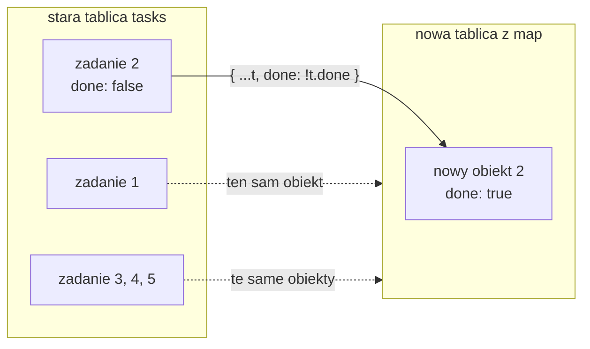

# Nowa tablica zamiast zmienionej

## Dodawanie zadania

Pole tekstowe zna już treść nowego zadania. Przycisk „Add” ma dopisać ją na końcu listy, a pole ma się wyczyścić. Setter `setTasks` potrzebuje do tego nowej tablicy, bo tablica zmieniona przez `push` jest nadal tym samym obiektem, a ten setter pomija. Nową tablicę i nowe obiekty buduje się w JavaScripcie kilkoma zapisami, które w `TaskBoard` wracają w każdej operacji na liście.

## Rozwinięcie tablicy i obiektu

**Składnia rozwinięcia** (*spread syntax*) to trzy kropki przed tablicą albo obiektem. W nowym literale tablicy `[...a]` wstawia po kolei wszystkie elementy `a`, a w nowym literale obiektu `{...o}` przepisuje wszystkie pola `o`:

```js
// Rozwinięcie tablicy: nowa tablica ze starymi elementami i jednym nowym.
const a = [1, 2];
const b = [...a, 3];        // [1, 2, 3]
console.log(a, a === b);    // [1, 2] false: a bez zmian, b to inny obiekt

// Rozwinięcie obiektu: pola kopiowane po kolei, późniejsze nadpisują wcześniejsze.
const task = { id: 1, text: "Milk", done: false };
const copy = { ...task, done: true }; // { id: 1, text: "Milk", done: true }
```

Kolejność ma znaczenie. W `{ ...task, done: true }` pole `done` stoi po rozwinięciu, więc nadpisuje wartość skopiowaną z `task`. Zapis `{ done: true, ...task }` dałby z powrotem `done: false`. Oryginał w obu przypadkach zostaje nietknięty.

## `trim` i `Date.now`

Dwie drobne metody przygotowują dane nowego zadania:

```js
"  Buy milk  ".trim(); // "Buy milk": spacje z początku i końca znikają
"   ".trim();             // "": same spacje dają pusty napis
!"   ".trim();            // true: pusty napis jest fałszywy, więc ! daje true
Date.now();               // np. 1792337908573: milisekundy od 1 stycznia 1970 roku
```

Pusty napis jest w JavaScripcie wartością fałszywą (*falsy*), czyli w warunku działa jak `false`. Zapis `if (!text.trim())` odrzuca więc zarówno puste pole, jak i pole z samymi spacjami.

## `addTask` w `TaskBoard`

Czwarta wersja `TaskBoard.jsx` dopisuje funkcję `addTask` i podpina ją do przycisku. Nowe linie wyglądają tak:

```jsx
// addTask: NOWA tablica (rozwinięcie + nowy element), bez mutacji starej.
function addTask() {
  if (!text.trim()) return; // puste pole albo same spacje: nic nie dodawać
  setTasks([...tasks, { id: Date.now(), text: text.trim(), done: false }]);
  setText(""); // pole kontrolowane: pusty stan to puste pole na ekranie
}

// w JSX: przekazanie funkcji, nie jej wywołanie
<button onClick={addTask}>Add</button>
// akapit <p>Typed so far: {text}</p> z poprzedniej wersji usuwa się
```

Dla wpisu „  Buy milk  ” procedura dopisuje szósty wiersz „Buy milk” bez spacji i czyści pole. Akapit „Typed so far” służył tylko do pokazania, że stan `text` nadąża za każdą literą, więc w tej wersji wypada.

Nowe zadanie dostaje `id: Date.now()`. Dwa kliknięcia „Add” w tej samej milisekundzie są w praktyce niemożliwe, więc w tej aplikacji liczba wystarcza jako unikalny klucz. Nie jest to identyfikator odporny na kolizje ani bezpieczny kryptograficznie. W aplikacji z serwerem identyfikator nadaje zwykle baza danych.

## Tablica w stanie jest tylko do odczytu

Zapis `[...tasks, nowe]` wygląda na okrężną drogę. Prościej byłoby wywołać `tasks.push(nowe)`. Wybór kopii wynika z **niemutowalności** (*immutability*): zamiast zmieniać istniejącą tablicę, buduje się jej zmienioną kopię. Banks i Porcello w *Learning React* pokazują dokładnie ten zapis: `[...list, { title }]` kopiuje listę do nowej tablicy i dopisuje nowy element. Metoda `push` zmieniłaby tablicę oryginalną, a razem z nią każdą zmienną, która na nią wskazuje.

Dokumentacja Reacta przenosi tę zasadę na stan.

> **„Tablice w stanie Reacta należy traktować jako tylko do odczytu. Oznacza to, że nie należy przypisywać elementów w tablicy, jak `arr[0] = 'bird'`, ani używać metod, które zmieniają tablicę, takich jak `push()` i `pop()`.”**
>
> *„[…] you should treat arrays in React state as read-only. This means that you shouldn't reassign items inside an array like `arr[0] = 'bird'`, and you also shouldn't use methods that mutate the array, such as `push()` and `pop()`.”*
>
> — dokumentacja React, *Updating Arrays in State*

Ta sama strona zawiera tabelę operacji na tablicach. Lewa kolumna to metody, których przy stanie się unika, a prawa to ich niemutujące odpowiedniki.

| Operacja | unikać (zmienia tablicę) | stosować (zwraca nową tablicę) |
|---|---|---|
| dodawanie | `push`, `unshift` | `concat`, `[...arr]` |
| usuwanie | `pop`, `shift`, `splice` | `filter`, `slice` |
| podmiana | `splice`, `arr[i] = ...` | `map` |
| sortowanie | `reverse`, `sort` | najpierw kopia tablicy |

Dwie metody z prawej kolumny nie pojawią się w `TaskBoard`, ale działają tak samo jak rozwinięcie:

```js
[1, 2].concat(3);          // [1, 2, 3]: nowa tablica z dopisanym elementem
[1, 2, 3, 4].slice(1, 3);  // [2, 3]: nowa tablica z elementów od indeksu 1 do 3 (bez 3)
```

W `TaskBoard` dodawanie korzysta z rozwinięcia, podmiana z `map`, a usuwanie z `filter`.

## `map`: nowa tablica element po elemencie

Metoda `map` wywołuje podaną funkcję dla każdego elementu i z jej wyników składa nową tablicę tej samej długości:

```js
[1, 2, 3].map((n) => n * 10);              // [10, 20, 30]
[{ id: 1 }, { id: 2 }].map((t) => t.id);   // [1, 2]: z każdego obiektu jedno pole
```

Ta sama metoda zamienia w JSX tablicę zadań na tablicę elementów `<li>`. Przy podmianie funkcja zwraca dla jednego elementu nowy obiekt, a dla pozostałych ten sam obiekt, który dostała.

## Oznaczanie zadania jako wykonanego

Piąta wersja dodaje pole wyboru przy każdym zadaniu i funkcję `toggleTask`:

```jsx
// toggleTask: map zwraca NOWĄ tablicę; tylko pasujące zadanie dostaje nowy obiekt
// (rozwinięcie + odwrócona flaga done), pozostałe zostają tymi samymi obiektami.
function toggleTask(id) {
  setTasks(
    tasks.map((t) => (t.id === id ? { ...t, done: !t.done } : t))
  );
}

// w JSX, w wierszu listy:
<li key={task.id}>
  <input
    type="checkbox"
    checked={task.done}                   // pole wyboru kontrolowane przez stan
    onChange={() => toggleTask(task.id)}  // strzałka pamięta task z tego wiersza
  />
  {task.done ? <s>{task.text}</s> : task.text} {/* warunek ? gdy prawda : gdy fałsz; <s> przekreśla */}
</li>
```

**Operator warunkowy** `warunek ? a : b` daje `a`, gdy warunek jest prawdziwy, i `b` w przeciwnym razie. Zadanie z `done: true` dostaje więc treść owiniętą w `<s>`, czyli przekreśloną, a pozostałe wiersze się nie zmieniają. Strzałka w `onChange` jest potrzebna, bo sam zapis `toggleTask(task.id)` wykonałby się w trakcie renderu. Każdy wiersz dostaje własną strzałkę, która jako domknięcie zna `task` ze swojego przebiegu `map`. Banks i Porcello pokazują ten sam przypadek: zmianę jednego obiektu w tablicy obiektów bez zmiany tablicy źródłowej.

## Rysunek 2.4 — tablica przed zaznaczeniem zadania 2 i po nim



Na Rysunku 2.4 lewa ramka to tablica sprzed kliknięcia, a prawa to wynik `map`. Ciągła strzałka prowadzi od zadania 2 do jego kopii z odwróconą flagą `done`. Przerywane strzałki oznaczają, że pozostałe cztery zadania nie są kopiowane. Nowa tablica wskazuje te same obiekty co stara. Powstają więc dokładnie dwa nowe obiekty: tablica i jedno zadanie. Stara tablica i stary obiekt zadania 2 zostają w pamięci nienaruszone.

Ta technika ma nazwę **współdzielenia struktury**: nowa wersja danych korzysta z niezmienionych części starej, zamiast kopiować wszystko. Przy pięciu zadaniach oszczędność jest pomijalna, ale przy tysiącu zadań zmiana jednego z nich nadal tworzy tylko jedną nową tablicę i jeden nowy obiekt.

## Kopia jest płytka

Rozwinięcie kopiuje tylko jeden poziom. Dokumentacja (*Updating Objects in State*) pisze, że składnia rozwinięcia jest „płytka” (*„shallow”*): kopiuje rzeczy tylko o jeden poziom w głąb. Dlatego jest szybka. Oznacza to jednak, że nowa tablica `[...tasks]` zawiera te same obiekty zadań co stara.

> **„Nawet po skopiowaniu tablicy nie wolno bezpośrednio zmieniać elementów, które się w niej znajdują. Kopiowanie jest płytkie: nowa tablica zawiera te same elementy co oryginalna.”**
>
> *„[…] even if you copy an array, you can't mutate existing items inside of it directly. This is because copying is shallow—the new array will contain the same items as the original one.”*
>
> — dokumentacja React, *Updating Arrays in State*

Ta sama płytkość pozwala napisać `toggleTask`, który wygląda na poprawny. Metoda `find` zwraca pierwszy element tablicy spełniający warunek, czyli sam obiekt zadania, a nie jego kopię:

```jsx
// ŹLE (w TaskBoard): nowa tablica, ale zmieniony obiekt jest tym samym obiektem co w starym stanie.
function toggleTask(id) {
  const task = tasks.find((t) => t.id === id); // find: pierwszy element spełniający warunek
  task.done = !task.done;                      // mutacja obiektu ze starej tablicy
  setTasks([...tasks]);                        // nowa tablica, więc render i tak nastąpi
}
```

Tablica jest nowa, więc React wykrywa zmianę, a pole wyboru się zaznacza. Konsola milczy, a tryb ścisły tego nie wykrywa, bo zmiana zachodzi w procedurze obsługi zdarzenia. Obiekt zadania jest jednak tym samym obiektem, który należał do poprzedniej wersji stanu. Tablica sprzed kliknięcia ma więc przy zadaniu 2 wartość `done: true`, czyli poprzednia wersja „widzi” zmianę, której w niej być nie powinno. <u>Zmieniać należy zawsze kopię: nowa tablica i nowy obiekt dla każdego zmienianego elementu</u>.

## Po co ta dyscyplina

Dokumentacja Reacta (*Updating Objects in State*) wymienia powody, dla których stanu się nie mutuje. Trzy z nich mają znaczenie od razu:

- **Debugowanie.** Gdy stan nie jest mutowany, wcześniejsze wpisy z `console.log` nie zostają zamazane przez późniejsze zmiany. Widać, jak stan zmieniał się między renderami.
- **Optymalizacje.** Strategie optymalizacji w Reakcie pomijają pracę, gdy poprzednie propsy lub stan są takie same jak następne. Bez mutacji wystarcza porównanie `prevObj === obj`: jeśli to ten sam obiekt, nic w nim nie mogło się zmienić. React potrafi wtedy pominąć render komponentu, który dostał te same obiekty co poprzednio, ale to osobna technika optymalizacji, z której `TaskBoard` nie korzysta.
- **Zmiana wymagań.** Cofanie i ponawianie zmian, historia albo przywrócenie formularza do wcześniejszego stanu są łatwe, gdy stare kopie stanu zostają w pamięci.

Samouczek Reacta (*Tutorial: Tic-Tac-Toe*) ujmuje to tak: „niemutowalność sprawia, że komponenty bardzo tanio sprawdzają, czy ich dane się zmieniły” (*„Immutability makes it very cheap for components to compare whether their data has changed or not”*). Gdyby każdy wiersz był osobnym komponentem, na przykład `TaskItem` z propsem `task`, to na Rysunku 2.4 wiersz zadania 1 dostałby po kliknięciu ten sam obiekt co wcześniej. Jedno porównanie wystarczyłoby, żeby pominąć jego pracę.

Dalszy powód z tej listy dotyczy rozwoju Reacta. Dokumentacja pisze, że nowe funkcje biblioteki zakładają, że stan jest wartością stałą w obrębie jednego renderu (*„The new React features we're building rely on state being treated like a snapshot”*). Mutowanie wcześniejszych wersji stanu może zablokować korzystanie z tych funkcji.

> 💡 **Zapamiętaj:** dodawanie to `[...tasks, nowe]`, podmiana jednego elementu to `map` z `{ ...t, pole: nowaWartość }`. Oryginał zostaje nietknięty.


Materiał rozszerzony do tego slajdu: [`rozszerzenia/r03_nowa-tablica.md`](rozszerzenia/r03_nowa-tablica.md)
