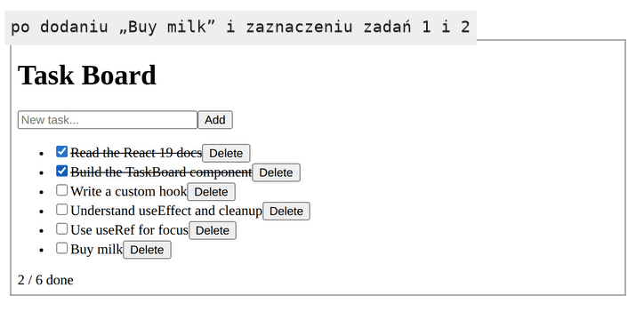
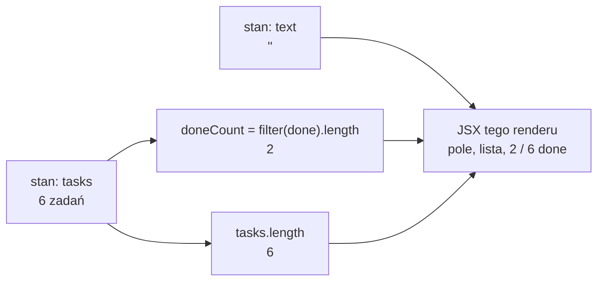

# Usuwanie zadań i migawka stanu

## Pełna lista operacji na zadaniach

Lista obiektów, w której każde zadanie ma własny identyfikator, przydaje się od razu przy następnej operacji. Zadanie do usunięcia wskazuje się po `id`, a lista po usunięciu jest nową tablicą bez tego jednego elementu. Szósta wersja `TaskBoard.jsx` domyka obsługę listy. Każde zadanie dostaje przycisk „Delete”, a pod listą pojawia się licznik wykonanych zadań. Obie zmiany opierają się na jednej metodzie tablic.

## `filter`: nowa tablica z wybranych elementów

Metoda `filter` sprawdza każdy element warunkiem i zwraca nową tablicę z tymi, które go spełniły. Wynik może być krótszy od oryginału albo pusty:

```js
[1, 2, 3, 4].filter((n) => n % 2 === 0);          // [2, 4]: tylko liczby parzyste
const tasks = [{ id: 1 }, { id: 2 }, { id: 3 }];
tasks.filter((t) => t.id !== 2);                   // [{ id: 1 }, { id: 3 }]: bez zadania 2
tasks.filter((t) => t.id !== 2).length;            // 2: długość wyniku to liczba trafień
console.log(tasks.length);                         // 3: oryginał bez zmian
```

Funkcję, która decyduje o pozostaniu elementu, Banks i Porcello nazywają **predykatem** (*predicate*). Do usuwania elementu z tablicy zalecają właśnie `filter`:

> **„Gdy trzeba usunąć element z tablicy, należy użyć `Array.filter` zamiast `Array.pop` lub `Array.splice`, ponieważ `Array.filter` jest niemutowalne.”**
>
> *„When it’s time to remove an item from an array, we should use `Array.filter` over `Array.pop` or `Array.splice` because `Array.filter` is immutable.”*
>
> — Alex Banks, Eve Porcello, *Learning React*

## Usuwanie i licznik w `TaskBoard`

Nowe linie w `app/components/TaskBoard.jsx` wyglądają tak:

```jsx
// deleteTask: filter zwraca NOWĄ tablicę bez zadania o podanym id.
function deleteTask(id) {
  setTasks(tasks.filter((t) => t.id !== id));
}

// Wartość pochodna: bez nowego stanu, liczona z tasks w każdym renderze.
const doneCount = tasks.filter((t) => t.done).length;

// w JSX, w wierszu listy, po treści zadania (strzałka pamięta task z tego wiersza):
<button onClick={() => deleteTask(task.id)}>Delete</button>

// w JSX, pod listą, np. „2 / 6 done”:
<p>{doneCount} / {tasks.length} done</p>
```

Licznik powstaje z `tasks` w każdym renderze, więc każda operacja na liście od razu zmienia jego wynik. Przy sześciu zadaniach i dwóch zaznaczonych pokazuje „2 / 6 done”, a po usunięciu jednego z zaznaczonych „1 / 5 done”. Strzałka `() => deleteTask(task.id)` pamięta `task` ze swojego przebiegu `map`, więc każdy wiersz usuwa dokładnie swoje zadanie.

## Rysunek 2.5 — lista z przyciskami „Delete” i licznikiem



Na Rysunku 2.5 zadania 1 i 2 są zaznaczone i przekreślone. Dodane „Buy milk” stoi na końcu jako szósty wiersz. Przycisk „Delete” jest w każdym wierszu, bo powstaje w tym samym przebiegu `map` co pole wyboru.

Predykat `(t) => t.id !== id` przepuszcza każde zadanie o innym identyfikatorze. Stara tablica zostaje bez zmian, a nowa ma o jeden element mniej i wskazuje te same obiekty zadań co stara. Gdyby identyfikator nie pasował do żadnego zadania, `filter` zwróciłby nową tablicę o tej samej zawartości. React uznałby ją za zmianę, bo to inny obiekt, i wyrenderowałby tę samą listę jeszcze raz. Taki render jest zbędny, lecz nic nie psuje. Zadania 3, 4 i 5 zachowują po usunięciu swoje klucze, więc z DOM znika dokładnie jeden węzeł `<li>`.

Predykat porównuje identyfikator, a nie pozycję na liście, bo pozycja po usunięciu się przesuwa:

```js
const list = ["a", "b", "c"];
const after = list.filter((_, i) => i !== 1); // drugi argument predykatu to indeks: ["a", "c"]
after.indexOf("c");                            // 1: "c" przed usunięciem miało indeks 2
```

Procedura, która zapamiętała indeks 2, po pierwszym usunięciu wskazałaby już inny element albo żaden. Identyfikator zostaje z zadaniem przez cały czas jego życia, niezależnie od tego, ile elementów zniknęło przed nim.

## Wartość pochodna zamiast drugiego stanu

Licznik „2 / 6 done” zmienia się przy każdym zaznaczeniu, dodaniu i usunięciu zadania. Mimo to nie jest stanem, bo odpowiedź na pytanie „ile zadań jest wykonanych” da się w każdej chwili obliczyć z `tasks`. Dokumentacja Reacta zamienia tę obserwację w zasadę:

> **„Jeśli jakąś informację można obliczyć w trakcie renderowania z propsów komponentu albo z jego istniejących zmiennych stanu, nie należy umieszczać tej informacji w stanie komponentu.”**
>
> *„If you can calculate some information from the component's props or its existing state variables during rendering, you should not put that information into that component's state.”*
>
> — dokumentacja React, *Choosing the State Structure*

Taką informację nazywa się **wartością pochodną** (*derived value*). Schwarzmüller w *React Key Concepts* pokazuje ją na liczniku znaków: stała `numChars` powstaje z `userInput.length` w ciele komponentu. Po każdej zmianie stanu React wywołuje funkcję komponentu od nowa, więc przy każdym wywołaniu powstaje świeża stała z nową wartością. Schwarzmüller podkreśla, że to częsty ruch w pracy z Reactem: jako stan trzyma się kluczową wartość, która się zmienia, a resztę wyprowadza się z niej.

Ta sama strona dokumentacji wymienia zasady dobrego stanu. Dwie z nich dotyczą tego miejsca bezpośrednio:

- **Unikać nadmiarowego stanu.** Wartości pochodnych nie trzyma się w stanie, tylko liczy w renderze.
- **Unikać sprzeczności w stanie.** Układ, w którym dwie zmienne stanu mogą sobie przeczyć, zostawia miejsce na pomyłki.

Druga zasada wyjaśnia, co by się stało ze stanem `doneCount`. Każda z trzech funkcji, `addTask`, `toggleTask` i `deleteTask`, musiałaby pamiętać o aktualizacji licznika:

```jsx
// Przykład spoza demo, w komponencie z tasks i setTasks.
// ŹLE: licznik jako drugi stan, aktualizowany ręcznie.
const [doneCount, setDoneCount] = useState(0);
function toggleTask(id) {
  const t = tasks.find((x) => x.id === id);
  setTasks(tasks.map((x) => (x.id === id ? { ...x, done: !x.done } : x)));
  setDoneCount(doneCount + (t.done ? -1 : 1)); // toggleTask pamięta o liczniku
}
function deleteTask(id) {
  setTasks(tasks.filter((x) => x.id !== id));  // deleteTask o nim zapomina
}
```

Przy trzech zadaniach wystarczy zaznaczyć dwa i usunąć jedno z zaznaczonych. Licznik pokazuje wtedy „2 / 2 done”, choć zaznaczone jest tylko jedno pole. Wartość liczona w renderze nie może się rozjechać z listą, bo za każdym razem powstaje z aktualnej listy. <u>Jeśli coś da się obliczyć ze stanu, nie tworzy się dla tego nowego stanu</u>.


*Przerywnik: xkcd 2200 „Unreachable State”. Autor: Randall Munroe, licencja CC BY-NC 2.5, <https://xkcd.com/2200/>.* Licznik w osobnym stanie dochodzi do stanu „nieosiągalnego”: „2 / 2 done” przy jednym zaznaczonym polu.

## Rysunek 2.6 — co jest stanem, a co z niego wynika



Na Rysunku 2.6 po lewej stoją tylko dwie zmienne stanu, czyli wszystko, co React pamięta za `TaskBoard`. Środkowe prostokąty to wartości pochodne. Powstają w każdym renderze od nowa i znikają po jego zakończeniu. Wszystkie strzałki prowadzą w prawo, do JSX jednego konkretnego renderu. Żadna strzałka nie wraca od wartości pochodnej do stanu.

## Migawka: co widzi procedura obsługi kliknięcia

Funkcja `addTask` wywołuje dwa settery jeden po drugim: `setTasks(...)` i `setText("")`. Odczyt stanu zaraz po pierwszym z nich pokazuje starą wartość:

```jsx
// Przykład w TaskBoard: odczyt stanu tuż po wywołaniu settera.
// newTask to obiekt nowego zadania, na przykład { id: 6, text: "Buy milk", done: false }.
function handleAdd() {
  setTasks([...tasks, newTask]);
  console.log(tasks.length); // 5, nie 6: ta procedura widzi tasks ze swojego renderu
}
```

Na ekranie po kliknięciu jest sześć zadań, a konsola wypisuje 5. Dokumentacja Reacta opisuje to zjawisko słowami:

> **„Ustawienie stanu zmienia go dopiero dla następnego renderu.”**
>
> *„Setting state only changes it for the next render.”*
>
> — dokumentacja React, *State as a Snapshot*

Według tej strony JSX zwrócony z renderu jest **migawką** (*snapshot*) interfejsu w danej chwili. Propsy, procedury obsługi zdarzeń i zmienne lokalne tego renderu obliczono ze stanu, jaki obowiązywał przy tym wywołaniu. Procedura `addTask` powstała w konkretnym renderze i widzi `tasks` z tego renderu. Wywołanie settera tej zmiennej nie zmienia. Prosi Reacta o następny render, w którym `useState` zwróci nową wartość.

W `TaskBoard` skutek migawki dotyczyłby dwukrotnego wywołania `setTasks([...tasks, nowe])` w jednej procedurze. Oba wywołania zbudowałyby tablicę ze starej listy i drugie nadpisałoby pierwsze, więc przybyłoby tylko jedno zadanie. <u>W obrębie jednego renderu wartość stanu się nie zmienia</u>.

Migawka nie zmienia się nawet wtedy, gdy część kodu procedury wykona się później, na przykład po odczekaniu kilku sekund. Dokumentacja pisze, że w obrębie renderu wartość zmiennej stanu się nie zmienia, nawet w kodzie asynchronicznym (*„A state variable's value never changes within a render, even if its event handler's code is asynchronous”*).

## Kilka setterów, jeden render

Dwa różne settery w `addTask` nie przeszkadzają sobie, bo każdy zmienia inną zmienną stanu. Nie dają też dwóch renderów, bo React łączy aktualizacje z jednej procedury (*batching*). Kliknięcie „Add” daje więc jeden render, w którym lista jest już dłuższa, a pole puste. Pośredniego stanu z nowym zadaniem i starym tekstem w polu React nigdy nie pokazuje. Migawka i łączenie aktualizacji działają razem: wszystkie settery z procedury czytają ten sam render, a ich wynik widać w jednym następnym.

## Aktualizator: seria zmian w jednej procedurze

Migawka nie przeszkadza, dopóki procedura wywołuje dany setter raz. Każda procedura w `TaskBoard` tak właśnie robi, dlatego demo zostaje przy zapisie `setTasks(tasks.filter(...))`. Seria zmian tej samej zmiennej w jednej procedurze wymaga innej postaci settera. Zamiast gotowej wartości przekazuje się mu funkcję, na przykład `setTasks((prev) => prev.filter(...))`. Taka funkcja nazywa się **aktualizatorem** (*updater function*). Dokumentacja `useState` opisuje, co React z nią robi:

> **„React umieści aktualizator w kolejce i ponownie wyrenderuje komponent. Podczas następnego renderu React obliczy nowy stan, stosując wszystkie aktualizatory z kolejki do poprzedniego stanu.”**
>
> *„React will put your updater function in a queue and re-render your component. During the next render, React will calculate the next state by applying all of the queued updaters to the previous state.”*
>
> — dokumentacja React, *useState*

Różnicę pokazuje przykład z tej strony dokumentacji, spoza `TaskBoard`. Licznik wieku ma wartość 42, a procedura kliknięcia wywołuje setter trzy razy:

```jsx
// Przykład z dokumentacji useState, spoza TaskBoard: const [age, setAge] = useState(42).
function handleClick() {
  setAge(age + 1); // setAge(42 + 1): każde wywołanie liczy z tej samej migawki
  setAge(age + 1); // setAge(42 + 1)
  setAge(age + 1); // setAge(42 + 1), wynik: 43
}

function handleClickWithUpdater() {
  setAge((a) => a + 1); // 42 => 43: React podaje aktualną wartość z kolejki
  setAge((a) => a + 1); // 43 => 44
  setAge((a) => a + 1); // 44 => 45, wynik: 45
}
```

Aktualizator nie czyta stanu z migawki renderu. Dostaje od Reacta parametr z aktualną wartością, z uwzględnieniem wcześniejszych aktualizacji w tej samej kolejce. Schwarzmüller nazywa przekazywanie funkcji dobrą praktyką zawsze wtedy, gdy nowy stan zależy od poprzedniego. Dokumentacja jest tu ostrożniejsza. Pisze, że taki zapis „nie szkodzi, ale nie zawsze jest potrzebny” (*„There is no harm in it, but it is also not always necessary”*). W `TaskBoard` każda procedura wywołuje `setTasks` raz, więc obie postacie dają ten sam wynik.

## Czystość i tryb ścisły

Aktualizator podlega innej regule niż procedura, która go wywołuje. Dokumentacja `useState` stawia mu wymaganie wprost. Aktualizator musi być czysty (*„It must be pure”*), tak jak funkcja komponentu: przyjmuje oczekujący stan jako jedyny argument, zwraca następny stan i nie zmienia niczego, co istniało przed jego wywołaniem. To samo wymaganie dotyczy inicjalizatora, czyli funkcji, którą można przekazać do `useState` zamiast gotowej wartości początkowej. Procedury obsługi zdarzeń czyste być nie muszą.

Tryb ścisły, który w trybie deweloperskim podwójnie wywołuje funkcję komponentu, obejmuje te same funkcje, które mają być czyste. Podwaja więc także aktualizatory i inicjalizatory. `TaskBoard` aktualizatora nie używa, więc jego procedury tego nie odczują. Podwojenie widać na aktualizatorze, który zmienia stary stan. React bierze wynik jednego wywołania, a drugi odrzuca, więc czysta funkcja daje ten sam efekt. Nieczysta się zdradza:

```jsx
// Przykład spoza TaskBoard: const [tasks, setTasks] = useState([{ id: 1, text: "Milk", done: false }]).
// ŹLE: aktualizator zmienia obiekt ze starego stanu.
function handleBangWrong() {
  setTasks((prev) => {
    prev[0].text += "!";  // mutacja: drugie wywołanie dopisze drugi wykrzyknik
    return [...prev];
  });
}
// DOBRZE: nowy obiekt dla zmienianego zadania, stary stan nietknięty.
function handleBang() {
  setTasks((prev) => prev.map((t) => (t.id === 1 ? { ...t, text: t.text + "!" } : t)));
}
```

Pierwsza wersja po jednym kliknięciu zmienia „Milk” w „Milk!!” w trybie deweloperskim i w „Milk!” w wersji produkcyjnej, bo tam tryb ścisły nie działa. Dwa wykrzykniki to sygnał, że funkcja zmienia dane spoza siebie. Druga wersja daje „Milk!” w obu trybach. Dokumentacja streszcza zasadę. Czyste muszą być tylko funkcje komponentu, inicjalizatory i aktualizatory, a procedur obsługi zdarzeń React nigdy nie wywołuje dwukrotnie (*„React will never call your event handlers twice”*). Dlatego mutacja w procedurze, taka jak `task.done = !task.done`, przechodzi przez tryb ścisły niezauważona.

> 💡 **Zapamiętaj:** stan to minimum danych, które się zmieniają, a wszystko, co z niego wynika, liczy się w renderze. Procedura widzi stan z migawki swojego renderu. Seria zmian tej samej zmiennej wymaga aktualizatora `setX((prev) => ...)`, a aktualizator musi być czysty.

