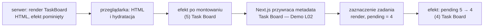

# Efekt: kod, który działa po renderze

## Tytuł karty nie jest częścią JSX

Zakładka przeglądarki ma pokazywać liczbę niewykonanych zadań, na przykład `(4) Task Board`. Tytuł karty należy jednak do dokumentu HTML, którym `TaskBoard` nie zarządza, i zmienia się go poleceniem `document.title = ...`. To polecenie nie pasuje ani do renderu, który ma tylko obliczyć JSX, ani do procedury obsługi zdarzenia. Tytuł ma się zgadzać z listą zawsze, niezależnie od tego, która operacja tę listę zmieniła: dodanie, zaznaczenie czy usunięcie. Dla takiego kodu potrzebne jest trzecie miejsce.

## Efekt uboczny

Schwarzmüller w *React Key Concepts* definiuje **efekt uboczny** (*side effect*) jako czynność wykonywaną obok głównego procesu:

> **„Efekty uboczne to czynności lub procesy, które zachodzą dodatkowo, obok innego, głównego procesu.”**
>
> *„Side effects are actions or processes that occur in addition to another main process.”*
>
> — Maximilian Schwarzmüller, *React Key Concepts*

W komponencie Reacta głównym procesem jest render, czyli zwrócenie JSX opisującego interfejs. Schwarzmüller podaje listę typowych efektów ubocznych. Są to wysłanie żądania HTTP, zapis do pamięci przeglądarki albo odczyt z niej, na przykład przez `localStorage`, ustawienie timera przez `setTimeout` lub `setInterval` i wypisanie danych do konsoli. Zmiana `document.title` należy do tej samej grupy. Nie wpływa na zwracany JSX, a zmienia coś poza Reactem.

Banks i Porcello ujmują to od strony funkcji. Komponent `Checkbox` w ich przykładzie to funkcja, która renderuje interfejs. Wszystko, co komponent ma robić poza zwróceniem interfejsu, nazywają **efektami** (*effects*). Wieruch dodaje, że wynik komponentu wyznaczają propsy i stan, a efekty uboczne służą do kontaktu z API spoza Reacta, takimi jak `localStorage` przeglądarki, zdalne API, pomiary elementów HTML albo timery.

Efektu ubocznego nie wpisuje się bezpośrednio w ciało komponentu z dwóch powodów. Pierwszy: React może wywołać render wielokrotnie, więc nie wiadomo, ile razy wykona się kod w ciele komponentu. Drugi powód dotyczy Next.js: pierwszy render komponentu klienckiego wykonuje się na serwerze, gdzie nie ma obiektu `document`.

## Efekt to synchronizacja

Dokumentacja Reacta definiuje efekty przez to, co je wywołuje:

> **„Efekt pozwala opisać efekt uboczny wywołany samym renderowaniem, a nie konkretnym zdarzeniem.”**
>
> *„Effects let you specify side effects that are caused by rendering itself, rather than by a particular event.”*
>
> — dokumentacja React, *Synchronizing with Effects*

Przykład z tej strony rozróżnia oba przypadki. Wysłanie wiadomości w czacie jest zdarzeniem, bo wynika z kliknięcia konkretnego przycisku. Połączenie z serwerem czatu jest efektem, bo ma istnieć bez względu na to, która czynność sprawiła, że komponent pojawił się na ekranie. Tytuł karty w Task Board należy do drugiej grupy.

Ta sama strona podaje cel efektów: pozwalają uruchomić kod po renderze, żeby **zsynchronizować** komponent z systemem spoza Reacta (*„synchronize your component with some system outside of React”*). Systemem zewnętrznym jest tu dokument przeglądarki. Reguła brzmi „tytuł ma zawsze odpowiadać liczbie niewykonanych zadań”. <u>Efekt opisuje stan, z którym świat poza Reactem ma być zgodny</u>.

Efekt nie pyta więc, kiedy komponent pojawia się na stronie, tylko od czego zależy. Pierwsze umieszczenie komponentu na stronie nazywa się **montowaniem** (*mount*), a efekt wykonuje się po nim zawsze. Później wykonuje się ponownie tylko wtedy, gdy zmieniła się któraś z wartości, od których zależy.

## Najmniejszy efekt

Hook `useEffect` przyjmuje dwa argumenty. Pierwszy to funkcja efektu, w dokumentacji nazywana *setup*. Drugi to **tablica zależności**, czyli lista wartości, od których efekt zależy. Najmniejszy przykład, poza Task Board, to komponent, który tylko ustawia tytuł karty, i rodzic, który pozwala go wyrenderować ponownie.

```jsx
"use client";
import { useState, useEffect } from "react";

function PageTitle({ title }) {
  console.log("render", title); // tylko do pomiaru kolejności: ciało komponentu to render

  useEffect(() => {
    console.log("efekt", title); // setup: wykonuje się dopiero po zatwierdzeniu zmian w DOM
    document.title = title; // zmiana poza Reactem, czyli efekt uboczny
  }, [title]); // po pierwszym renderze zawsze, potem tylko gdy title ma inną wartość

  return <h1>{title}</h1>; // render oblicza JSX i nie dotyka dokumentu
}

export default function App() {
  const [title, setTitle] = useState("A");
  const [clicks, setClicks] = useState(0); // zmiana clicks wymusza render z tym samym title
  return (
    <>
      <PageTitle title={title} />
      <button onClick={() => setClicks(clicks + 1)}>Render</button>
      <button onClick={() => setTitle("B")}>B</button>
    </>
  );
}
```

Pierwszy render `App`, kliknięcie „Render”, a potem „B” dają `PageTitle` trzy rendery z tytułami `A`, `A` i `B`. W React 19.3.0 bez trybu ścisłego konsola pokazuje pięć wpisów: `render A`, `efekt A`, `render A`, `render B`, `efekt B`. Drugi render z tym samym tytułem efektu nie uruchamia, bo zależność się nie zmieniła. Każdy wpis `efekt` pojawia się po swoim `render`, nigdy przed nim.

W cyklu pracy Reacta efekty stoją na końcu, po zatwierdzeniu zmian w DOM (*commit*). Efekt widzi więc gotowy DOM i wartości z renderu, po którym się wykonuje.

## Po zatwierdzeniu, zwykle po malowaniu

Efekt wykonuje się po zatwierdzeniu zmian. Zwykle przeglądarka zdąży wtedy namalować nowy ekran, ale efekt wywołany kliknięciem React może uruchomić jeszcze przed malowaniem. Banks i Porcello pokazują zwykłą kolejność na przykładzie, w którym `alert` stoi bezpośrednio w ciele komponentu. Okno zatrzymuje stronę do chwili zamknięcia, więc nowy stan pola wyboru pojawia się na ekranie dopiero po kliknięciu „OK”. Ten sam `alert` przeniesiony do `useEffect` wyświetla się dopiero po renderze.

Autorzy radzą traktować `useEffect` jak funkcję, która dzieje się po renderze. Ma ona dostęp do najnowszych wartości z tego renderu, czyli propsów i stanu. Dla tytułu karty w Task Board nie ma znaczenia, czy efekt wykona się tuż przed malowaniem, czy tuż po nim, bo zmiana `document.title` niczego na stronie nie blokuje.

## `useEffect` w `TaskBoard`

Siódma wersja pliku `app/components/TaskBoard.jsx` dopisuje do importu `useEffect`, a przed `return` liczbę niewykonanych zadań i efekt. Nowe linie wyglądają tak:

```jsx
import { useState, useEffect } from "react"; // do importu dochodzi useEffect

// pending to wartość pochodna: liczy się ją w renderze, tak jak doneCount
const pending = tasks.filter((t) => !t.done).length;
useEffect(() => {
  // setup przenosi gotowy wynik renderu do dokumentu przeglądarki;
  // operator warunkowy wybiera "(N) Task Board" albo sam "Task Board", gdy wszystko zrobione
  document.title = pending > 0 ? `(${pending}) Task Board` : "Task Board";
}, [pending]); // efekt wykona się ponownie tylko po renderze, w którym pending się zmieniło
```

Zaraz po wczytaniu strony zakładka pokazuje jeszcze tytuł z `metadata`, bez licznika. Licznik pojawia się przy pierwszej zmianie `pending`: po zaznaczeniu jednego zadania zakładka pokazuje `(4) Task Board`, a po dodaniu zadania `(5) Task Board`. Efekty w jednym komponencie można mnożyć: każdy `useEffect` to osobna synchronizacja z własną tablicą zależności.

## Efekty działają tylko w przeglądarce

Dokumentacja `useEffect` wymienia wśród zastrzeżeń jedno, które dotyczy Next.js:

> **„Efekty działają wyłącznie po stronie klienta. Nie uruchamiają się podczas renderowania na serwerze.”**
>
> *„Effects only run on the client. They don't run during server rendering.”*
>
> — dokumentacja React, *useEffect*

Dzięki temu efekt może bezpiecznie sięgać po `document`. Render na serwerze odtwarza funkcja `renderToString`. Zamienia ona komponent w HTML tak jak serwer.

```jsx
import { renderToString } from "react-dom/server";

renderToString(<PageTitle title="SSR" />); // "<h1>SSR</h1>"; konsola: tylko "render SSR", bez "efekt SSR"
```

Linijka `document.title = ...` wpisana bezpośrednio przed `return` wykonałaby się także podczas renderu na serwerze, gdzie obiektu `document` nie ma. Efekt po raz pierwszy wykonuje się w przeglądarce, po hydratacji, czyli podpięciu Reacta do HTML z serwera, więc nie może wpłynąć na ten HTML.

## Rysunek 2.5 — tytuł karty od wczytania do pierwszej zmiany



Na Rysunku 2.5 pierwsze dwa prostokąty to droga strony z serwera do przeglądarki. Efekt nie bierze w niej udziału. Po montowaniu efekt ustawia `(5) Task Board`, ale znacznik `<title>` w nagłówku strony należy do drzewa, które Next.js buduje z obiektu `metadata` w `layout.jsx`. W wersji produkcyjnej Next.js 16.4.0 tekst tego znacznika wraca do wartości z `metadata` około 2 ms po pierwszym efekcie, a w trybie deweloperskim także w czasie krótszym niż 10 ms.

Dlatego zaraz po wczytaniu karta pokazuje „Task Board — Demo L02”. Licznik w zakładce widać dopiero po pierwszej zmianie `pending`, gdy efekt wykona się ponownie. Tytuł potrzebny od pierwszego bajtu strony ustawia się więc na serwerze przez `metadata`, a efekt zostawia się do zmian w trakcie pracy.

## Nie każdy kod potrzebuje efektu

Efekt jest narzędziem do kontaktu z systemem zewnętrznym. Dokumentacja poświęca osobną stronę (*You Might Not Need an Effect*) przypadkom, w których efekt jest zbędny. Gdy w grę wchodzi wyłącznie dostosowanie stanu do innego stanu, bez żadnego systemu zewnętrznego, efekt nie jest potrzebny (*„you might not need an Effect”*). `doneCount` i `pending` są wartościami pochodnymi, więc liczy się je w renderze. Efekt w rodzaju `useEffect(() => setDoneCount(...), [tasks])` dodawałby tylko drugi render z chwilowo nieaktualnym licznikiem.

Pomocne jest jedno pytanie z tej samej strony dokumentacji. Czy kod ma się wykonać dlatego, że komponent został wyświetlony, czy dlatego, że użytkownik coś zrobił? Pierwszy przypadek to efekt. Drugi to procedura obsługi zdarzenia. Tytuł karty odpowiada na pierwsze pytanie, a dodanie zadania na drugie.

## Rozszerzenie: komunikat po ostatnim zadaniu

Pytanie o przyczynę jest trudniejsze wtedy, gdy zdarzenie zostawia ślad w stanie. Przypuśćmy, że po zaznaczeniu ostatniego zadania aplikacja ma pokazać gratulacje. Efekt zależny od `pending` wygląda na naturalne miejsce:

```jsx
// Przykład poza demo, w TaskBoard obok efektu tytułu: logika jednego zdarzenia umieszczona w efekcie (błąd)
useEffect(() => {
  if (pending === 0) alert("All tasks done!"); // efekt zna liczbę, ale nie powód jej zmiany
}, [pending]);
```

Efekt widzi tylko liczbę. Usunięcie ostatniego niewykonanego zadania także daje `pending === 0` i wywoła gratulacje, choć nikt niczego nie skończył. Gdyby lista była zapisywana w przeglądarce i wczytywana po odświeżeniu strony, komunikat pokazywałby się przy każdym wczytaniu listy bez niewykonanych zadań, bo efekt wykonuje się po pierwszym renderze z zerem. Dokumentacja streszcza to regułą:

> **„Efektów używa się tylko dla kodu, który ma się wykonać dlatego, że komponent został wyświetlony użytkownikowi.”**
>
> *„Use Effects only for code that should run because the component was displayed to the user.”*
>
> — dokumentacja React, *You Might Not Need an Effect*

Gratulacje należą więc do `toggleTask`. Procedura zna nową listę, którą sama oblicza, i wie, że przyczyną jest zaznaczenie.

## Rozszerzenie: efekt przed malowaniem ekranu

Dokumentacja `useEffect` w React 19 rozróżnia efekty według tego, co je wywołało.

> **„Jeśli efekt został wywołany interakcją (na przykład kliknięciem), React może uruchomić go, zanim przeglądarka namaluje zaktualizowany ekran. Dzięki temu wynik efektu może zostać zauważony przez system zdarzeń.”**
>
> *„If your Effect is caused by an interaction (like a click), React may run your Effect before the browser paints the updated screen. This ensures that the result of the Effect can be observed by the event system.”*
>
> — dokumentacja React, *useEffect*

Pierwsze wykonanie efektu tytułu, zaraz po montowaniu, nie wynika z żadnej interakcji. Każde następne wynika już z kliknięcia, bo `pending` zmienia się wyłącznie przy zaznaczeniu, dodaniu albo usunięciu zadania. Te wykonania należą więc do opisanej grupy. Dla zmiany `document.title` kolejność nie ma znaczenia. Ma ją dla `alert`, który blokuje stronę. Okno wywołane w efekcie po kliknięciu może się pojawić, zanim przekreślenie trafi na ekran. Dokumentacja radzi w takim przypadku odłożyć pracę przez `setTimeout`. Odwrotną potrzebę, czyli efekt wykonany zawsze przed malowaniem, obsługuje `useLayoutEffect`. Dokumentacja pisze, że ogromna większość efektów go nie potrzebuje (*„this shouldn't be needed for the vast majority of Effects”*). Przykładem wyjątku jest zmierzenie i ustawienie dymku podpowiedzi, zanim zobaczy go użytkownik.

> 💡 **Zapamiętaj:** efekt synchronizuje komponent ze światem poza Reactem. Wykonuje się po renderze i tylko w przeglądarce, a wartość, którą da się obliczyć ze stanu, nie potrzebuje efektu.

