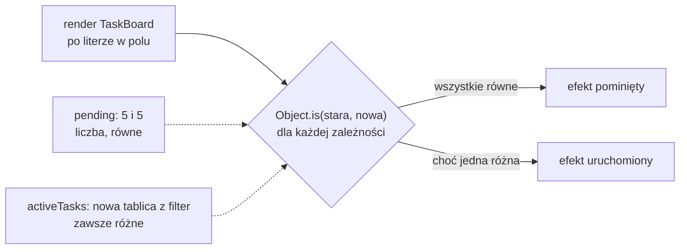

# Od czego zależy efekt

## Drugi argument `useEffect`

Efekt ustawiający tytuł karty kończy się tablicą `[pending]`. Ta tablica decyduje, po których renderach React uruchomi funkcję efektu ponownie. Dokumentacja `useEffect` opisuje jej działanie:

> **„React porówna każdą zależność z jej poprzednią wartością za pomocą porównania `Object.is`. Jeśli pominiesz ten argument, efekt będzie uruchamiany ponownie po każdym zatwierdzeniu komponentu.”**
>
> *„React will compare each dependency with its previous value using the `Object.is` comparison. If you omit this argument, your Effect will re-run after every commit of the component.”*
>
> — dokumentacja React, *useEffect*

Po każdym renderze React bierze kolejne elementy tablicy i porównuje każdy z wartością z poprzedniego renderu. Gdy wszystkie są równe, efekt zostaje pominięty. Gdy choć jeden się różni, efekt wykonuje się ponownie. Pierwszy render nie ma poprzednika, więc efekt wykonuje się po nim zawsze. Ta sama strona stawia tablicy dwa wymagania formalne. Lista musi mieć stałą liczbę elementów i musi być zapisana bezpośrednio w wywołaniu, w postaci `[dep1, dep2, dep3]`. Tablicy zależności nie buduje się więc w pętli ani nie przekazuje w zmiennej.

Banks i Porcello pokazują, po co ten mechanizm istnieje, na komponencie z polem tekstowym i dwoma efektami, z których każdy wypisuje w konsoli inną wartość. Bez tablic oba efekty reagują na każdą literę. Z tablicami `[val]` i `[phrase]` każdy reaguje tylko na swoją wartość.

## Porównanie `Object.is`

O tym, czy zależność „się zmieniła”, rozstrzyga `Object.is`, to samo porównanie, którego setter używa do decyzji o renderze. Dla zależności liczy się jego zachowanie przy obiektach. Funkcja też jest obiektem.

```js
// Przykład spoza demo: porównanie dwóch funkcji przez Object.is
Object.is(() => 1, () => 1); // false: dwie funkcje o tym samym kodzie to dwa różne obiekty
const f = () => 1;
Object.is(f, f);             // true: ta sama funkcja, czyli ten sam adres
```

Tablice, obiekty i funkcje są dla tablicy zależności równe tylko wtedy, gdy to jeden i ten sam obiekt.

Z tym porównaniem łączy się fakt o samym komponencie. Funkcja `TaskBoard` wykonuje się od nowa przy każdym renderze. Każdy literał `[...]` i `{...}`, każdy wynik `filter` czy `map` i każda funkcja zapisana w jej ciele powstaje przy tym wywołaniu jako nowy obiekt. Banks i Porcello pokazują to na tablicy `words`: zadeklarowana w komponencie, przy każdym renderze jest nową instancją, więc efekt z `[words]` uruchamia się po każdym naciśnięciu klawisza. <u>Zależność od wartości prostej zmienia się razem z danymi, a zależność od obiektu utworzonego w renderze zmienia się w każdym renderze</u>.

## Trzy postacie tablicy

Ten sam efekt w `TaskBoard` można zapisać na trzy sposoby. Każdy z trzech bloków poniżej zajmuje w `app/components/TaskBoard.jsx` miejsce efektu z tytułem karty. Pierwszy pomija tablicę:

```jsx
useEffect(() => {
  document.title = pending > 0 ? `(${pending}) Task Board` : "Task Board";
}); // brak tablicy: efekt po KAŻDYM renderze, także po każdej literze w polu
```

Efekt bez tablicy wykonuje się po każdym zatwierdzeniu renderu. Zakładka zachowuje się tak samo jak z `[pending]`, ale przypisanie tytułu powtarza się po każdej literze wpisanej w pole, choć liczba zadań się nie zmienia. Wynik na ekranie jest poprawny, a praca zbędna. Wieruch odnotowuje, że efekt bez tablicy uruchamia się po każdym renderze, co grozi problemami z wydajnością.

Drugi sposób to pusta tablica:

```jsx
useEffect(() => {
  document.title = `(${pending}) Task Board`; // pending zamrożone na wartości z pierwszego renderu (5)
}, []); // pusta tablica: efekt raz, po montowaniu; późniejsze zmiany pending nie docierają do tytułu
```

Pusta tablica nie zawiera niczego, co mogłoby się zmienić. Banks i Porcello wyjaśniają skutek krótko: brak zależności oznacza brak zmian, więc efekt wykona się raz, po pierwszym renderze, i nigdy więcej. W Task Board efekt zapisuje `(5) Task Board` raz, zaraz po montowaniu, Next.js przywraca tytuł z `metadata` i zakładka przez cały czas pokazuje „Task Board — Demo L02”. Zaznaczanie i dodawanie zadań nic w niej nie zmienia, a konsola nie zgłasza żadnego błędu.

Trzeci sposób to tablica z wartością, która rzeczywiście jest używana w efekcie. Ta wersja wraca do pliku na stałe:

```jsx
useEffect(() => {
  document.title = pending > 0 ? `(${pending}) Task Board` : "Task Board";
}, [pending]); // efekt po pierwszym renderze i po każdym, w którym pending ma inną wartość
```

Wpisywanie liter w pole efektu nie uruchamia, bo `pending` zostaje bez zmian. Zaznaczenie zadania zmniejsza `pending` i efekt wykonuje się ponownie. Usunięcie wykonanego zadania nie zmienia `pending`, więc tytuł zostaje bez zmian.

## Zamrożona wartość

Wersja z pustą tablicą wygląda poprawnie, a jest błędna. Funkcja efektu powstaje w pierwszym renderze i jako domknięcie trzyma `pending` z tego renderu, czyli liczbę 5. React nie wywoła tej funkcji ponownie, bo tablica jest pusta. Kolejne rendery tworzą nowe funkcje efektu z aktualnym `pending`, ale React je odrzuca. Efekt na zawsze pracuje na wartości z pierwszego renderu. Taką wartość nazywa się **przestarzałą** (*stale*).

Dokumentacja (*Lifecycle of Reactive Effects*) daje pojęcie, które rozstrzyga, co musi trafić do tablicy:

> **„Propsy, stan i inne wartości zadeklarowane wewnątrz komponentu są reaktywne, bo są obliczane w trakcie renderowania i biorą udział w przepływie danych Reacta.”**
>
> *„Props, state, and other values declared inside the component are reactive because they're calculated during rendering and participate in the React data flow.”*
>
> — dokumentacja React, *Lifecycle of Reactive Effects*

`pending` jest zadeklarowane w ciele `TaskBoard`, więc jest **wartością reaktywną** (*reactive value*). Każda wartość reaktywna użyta w efekcie musi stać w tablicy. Dokumentacja (*Synchronizing with Effects*) pisze, że zależności „nie da się wybrać” (*„You can't "choose" your dependencies”*). Wyznacza je kod wewnątrz efektu. <u>Tablica zależności zawiera każdą wartość reaktywną użytą w efekcie</u>.

Schwarzmüller wymienia trzy rodzaje wartości, których w tablicy być nie musi. Pierwszy to wartości zadeklarowane wewnątrz samego efektu. Drugi to wartości spoza komponentu, na przykład funkcje przeglądarki takie jak `setTimeout` albo funkcje zaimportowane z modułu. Trzeci to settery z `useState`. React gwarantuje, że w każdym renderze setter jest tą samą funkcją, a nie nową kopią. Dokumentacja `useState` nazywa to „stałą tożsamością” (*„stable identity”*), więc obecność settera w tablicy niczego nie zmienia.

## Tablica utworzona w renderze jako zależność

Reguła „każda wartość reaktywna” prowadzi do pułapki, gdy wartością reaktywną jest tablica. Widać to na efekcie, który zależy od tablicy wyliczonej w renderze:

```jsx
// Przykład w TaskBoard, przed return, obok efektu z tytułem.
// filter tworzy w każdym renderze NOWĄ tablicę, czyli nowy adres
const activeTasks = tasks.filter((t) => !t.done);

useEffect(() => {
  console.log("effect ran"); // wpis po KAŻDYM renderze, nie tylko po zmianie danych
}, [activeTasks]); // Object.is porównuje adresy, a adres jest za każdym razem inny
```

Efekt wykonuje się po każdej literze w polu i po każdym zaznaczeniu zadania. Po wczytaniu strony w trybie deweloperskim wypisuje dwa wpisy, bo tryb ścisły dokłada jeden cykl efektu. To nie jest nieskończona pętla, bo efekt nie zmienia stanu. Tablica zależności nie spełnia jednak swojej roli: efekt i tak wykonuje się po każdym renderze. Poprawka zastępuje zależność liczbą:

```jsx
useEffect(() => {
  console.log("effect ran");
}, [tasks.length]); // liczba: porównanie po wartości, stała między renderami
```

Z tą zależnością litery i zaznaczanie nie dodają wpisów, a dodanie zadania dopisuje jeden. Oba efekty z `console.log` służą tylko do pokazania mechanizmu i w kodzie aplikacji nie zostają.

Są trzy sposoby naprawy. Pierwszy to zależność od wartości prostej wyprowadzonej z danych, jak `tasks.length` albo `pending`. Drugi to zapamiętanie tablicy między renderami, tak żeby przy niezmienionych danych zachowała ten sam adres. To narzędzie optymalizacji wydajności, potrzebne dopiero przy kosztownych obliczeniach. Trzeci, opisany przez Banksa i Porcello, dotyczy wartości, która nie zależy od niczego w komponencie: deklaruje się ją poza funkcją komponentu. Taka tablica powstaje raz, przy wczytaniu modułu, i ma ten sam adres przez cały czas działania aplikacji.

## Rysunek 2.10 — decyzja po renderze



Na Rysunku 2.10 ciągłe strzałki pokazują decyzję, którą React podejmuje po każdym renderze. Przerywane strzałki to dwie przykładowe zależności po wpisaniu litery w pole. Liczba `pending` ma tę samą wartość co przed chwilą, więc porównanie daje równość i efekt zostaje pominięty. Tablica `activeTasks` zawsze trafia na gałąź „różna”.

## Tablica opisuje kod

Task Board powstał bez lintera, czyli programu sprawdzającego kod bez uruchamiania go. W projekcie z ESLintem i wtyczką `eslint-plugin-react-hooks` wersję z `[]` zgłasza reguła `react-hooks/exhaustive-deps`, bo efekt czyta `pending`, a tablica go nie wymienia. Dokumentacja (*Lifecycle of Reactive Effects*) ostrzega przed wyciszaniem tej reguły komentarzem. Strona *Separating Events from Effects* pisze, że kto nigdy nie wycisza lintera, ten nigdy nie zobaczy problemów z przestarzałymi wartościami (*„If you never suppress the linter, you will never see problems with stale values”*). Strona *Removing Effect Dependencies* nazywa wyciszenie okłamywaniem Reacta co do wartości, od których efekt zależy, i radzi traktować ten błąd jak błąd kompilacji.

Strona *Removing Effect Dependencies* odwraca też kolejność pracy z tablicą. Najpierw zmienia się kod efektu albo miejsce, w którym zadeklarowano wartość. Tablica tylko ten kod opisuje. Żeby usunąć zależność, trzeba wykazać, że wartość nie jest reaktywna, na przykład przenosząc stałą poza komponent. Gdy efekt uruchamia się za często, naprawia się więc kod efektu.

> 💡 **Zapamiętaj:** w tablicy zależności stoi każda wartość reaktywna użyta w efekcie. Obiekt, tablica albo funkcja utworzone w renderze różnią się w każdym renderze, więc do tablicy trafiają wartości proste odczytane z nich.


Materiał rozszerzony do tego slajdu: [`rozszerzenia/r06_tablica-zaleznosci.md`](rozszerzenia/r06_tablica-zaleznosci.md)
