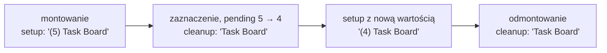

# Sprzątanie po efekcie i zapis listy w przeglądarce

## Efekt, który zostawia ślad

Efekt z tytułem karty zmienia dokument przeglądarki i nigdy tej zmiany nie cofa. Gdyby `TaskBoard` zniknął ze strony, na przykład po przejściu pod inny adres aplikacji, zakładka zostałaby z napisem `(4) Task Board` na stronie, która o zadaniach nic nie wie. Przy tytule skutek jest kosmetyczny. Przy efektach, które coś uruchamiają, jest poważniejszy: timer albo subskrypcja włączone przez komponent działają dalej po jego zniknięciu i przy każdym ponownym pojawieniu się dochodzi kolejna kopia. Efekt potrzebuje więc drugiej połowy, która cofa to, co zrobił.

## Timery przeglądarki

Najprostszy przykład czegoś, co trzeba wyłączyć, to timer. Przeglądarka udostępnia dwie pary funkcji. `setTimeout` wywołuje funkcję raz, po podanym czasie, a `setInterval` wywołuje ją co podany czas, aż do odwołania. Obie zwracają identyfikator timera. Timer odwołuje się przez `clearTimeout` albo `clearInterval`.

```js
const id = setTimeout(() => console.log("po sekundzie"), 1000); // id: uchwyt tego timera
clearTimeout(id); // timer odwołany przed upływem sekundy: napis się nie pojawi

let n = 0;
const tick = setInterval(() => {
  n += 1;
  console.log("tick", n); // wywołanie co 200 ms
  if (n === 3) clearInterval(tick); // bez tej linii interwał działałby bez końca
}, 200);
```

Kod wypisuje `tick 1`, `tick 2` i `tick 3`, a napisu „po sekundzie” nie ma, bo jego timer został odwołany, zanim minęła sekunda. Identyfikator to jedyna droga do timera. Po jego utracie interwału nie da się już odwołać.

## Funkcja sprzątająca

Funkcja efektu może zwrócić drugą funkcję. Dokumentacja pisze, że setup „może opcjonalnie zwrócić” funkcję sprzątającą (*„may also optionally return a cleanup function”*). React jej nie wywołuje od razu. Zapamiętuje ją i wywołuje później, w ściśle określonych chwilach. Efekt, który nic nie zwraca, po prostu nie ma czego cofać.

Dokumentacja `useEffect` podaje dokładną kolejność wywołań:

> **„Po każdym zatwierdzeniu ze zmienionymi zależnościami React najpierw uruchomi funkcję sprzątającą (jeśli ją podano) ze starymi wartościami, a potem funkcję setup z nowymi wartościami. Po usunięciu komponentu z DOM React uruchomi funkcję sprzątającą.”**
>
> *„After every commit with changed dependencies, React will first run the cleanup function (if you provided it) with the old values, and then run your setup function with the new values. After your component is removed from the DOM, React will run your cleanup function.”*
>
> — dokumentacja React, *useEffect*

Z tego opisu wynikają trzy sytuacje:

- **Pierwszy render.** Wykonuje się tylko setup. Schwarzmüller podkreśla, że przy pierwszym wywołaniu efektu funkcja sprzątająca nie jest uruchamiana, bo nie ma jeszcze po czym sprzątać.
- **Zmiana zależności.** Najpierw sprzątanie po poprzednim setupie, potem nowy setup. Sprzątanie widzi stare wartości, bo zostało zwrócone przez funkcję z poprzedniego renderu i ma w domknięciu tamte zmienne. Efekt, który rezygnuje z subskrypcji konkretnego kanału, wie dzięki temu, który kanał był podłączony.
- **Odmontowanie** (*unmount*), czyli usunięcie komponentu ze strony. Wykonuje się tylko sprzątanie, a nowego setupu już nie ma.

Bugl w *Learn React Hooks* porównuje funkcję sprzątającą do metody `componentWillUnmount` z komponentów klasowych, czyli dawnego zapisu komponentu jako klasy JavaScriptu. Zaznacza jednak różnicę: funkcja sprzątająca działa także przed każdym ponownym uruchomieniem efektu. Banks i Porcello opisują ten wzorzec jako parę **ustawienie i rozebranie** (*setup and teardown*): efekt subskrybuje kanał wiadomości, a funkcja sprzątająca rezygnuje z subskrypcji, gdy komponent znika z drzewa. <u>Funkcja sprzątająca cofa to, co zrobił setup, i działa przed następnym setupem oraz przy odmontowaniu</u>.

## Najmniejszy efekt ze sprzątaniem

Przykład poza Task Board to licznik sekund `Ticker`, który co sekundę zwiększa wartość:

```jsx
"use client";
import { useState, useEffect } from "react";

export default function Ticker() {
  const [seconds, setSeconds] = useState(0);

  useEffect(() => {
    // setup: interwał startuje po montowaniu; aktualizator s => s + 1 nie czyta seconds
    // z renderu, więc seconds nie trafia do tablicy zależności
    const id = setInterval(() => setSeconds((s) => s + 1), 1000);
    return () => clearInterval(id); // sprzątanie: ten sam id, ten sam interwał
  }, []); // pusta tablica: setup raz po montowaniu, sprzątanie przy odmontowaniu

  return <p>{seconds} s</p>;
}
```

Identyfikator `id` jest zmienną lokalną setupu. Funkcja sprzątająca powstaje w tym samym wywołaniu, więc ma go w domknięciu i odwołuje dokładnie ten interwał, który setup uruchomił. Bez tej linii każde ponowne pojawienie się komponentu uruchamia kolejny interwał, a poprzednie działają dalej, bo nikt ich nie odwołał.

## Rysunek 2.7 — setup i sprzątanie w życiu `TaskBoard`



Na Rysunku 2.7 czas biegnie od lewej do prawej. Setup nigdy nie wykonuje się dwa razy z rzędu. Przed każdym kolejnym setupem React sprząta po poprzednim. Drugi prostokąt pokazuje zmianę zależności: sprzątanie ustawia `Task Board`, a zaraz potem setup wpisuje `(4) Task Board`. Ostatnie sprzątanie przychodzi przy odmontowaniu i jest jedynym, po którym nie startuje nowy setup.

## Sprzątanie w `TaskBoard`

Kolejna wersja efektu z tytułem dopisuje funkcję, która przy sprzątaniu ustawia tytuł bez licznika. W `app/components/TaskBoard.jsx` zastępuje ona efekt z `[pending]`:

```jsx
useEffect(() => {
  document.title = pending > 0 ? `(${pending}) Task Board` : "Task Board"; // setup
  return () => {
    // sprzątanie: przed kolejnym setupem (zmiana pending) i przy odmontowaniu
    document.title = "Task Board"; // prosty tytuł z kodu efektu; tytułu z metadata nie przywraca
  };
}, [pending]);
```

Przy zmianie `pending` z 5 na 4 sprzątanie należy do renderu z `pending` równym 5, a setup do renderu z `pending` równym 4. Oba wykonują się bezpośrednio po sobie, więc pośredniego tytułu „Task Board” w zakładce nie widać. Sens sprzątania ujawnia się dopiero przy odmontowaniu. Zakładka nie zostaje wtedy z licznikiem zadań, których już nie ma na stronie.

## Dodatkowy cykl w trybie deweloperskim

Na serwerze deweloperskim (`next dev`) efekty po pierwszym montowaniu zachowują się inaczej niż w wersji produkcyjnej (`next build`). App Router, czyli mechanizm stron Next.js, na którym stoi projekt, domyślnie włącza tryb ścisły, zestaw sprawdzeń działających tylko w trybie deweloperskim. Dokumentacja `useEffect` opisuje jego skutek dla efektów:

> **„Gdy tryb ścisły jest włączony, React uruchomi jeden dodatkowy cykl setup i sprzątania, tylko w trybie deweloperskim, przed pierwszym właściwym setupem.”**
>
> *„When Strict Mode is on, React will run one extra development-only setup+cleanup cycle before the first real setup.”*
>
> — dokumentacja React, *useEffect*

Dokumentacja nazywa ten cykl testem obciążeniowym, który sprawdza, czy sprzątanie jest „lustrzanym odbiciem” setupu. `Ticker` go przechodzi: po sekwencji setup, sprzątanie, setup działa jeden interwał, więc po 3,1 s w trybie ścisłym licznik pokazuje 3. Wersja bez sprzątania wygląda tak:

```jsx
useEffect(() => {
  setInterval(() => setSeconds((s) => s + 1), 1000); // brak return: interwału nikt nie odwoła
}, []);
```

Po 3,1 s pokazuje ona wartość 6, bo interwał z dodatkowego cyklu nie został odwołany i oba zwiększają licznik. Błąd widoczny tylko w trybie deweloperskim oznacza więc błąd w sprzątaniu.

W Task Board efekt z `console.log("effect ran")` w setupie wypisuje na serwerze deweloperskim dwa wpisy zaraz po wczytaniu strony. Efekt z tytułem przechodzi test bez śladu, bo po cyklu setup, sprzątanie, setup tytuł jest taki sam jak po jednym setupie. Wersja produkcyjna dodatkowego cyklu nie wykonuje.

Dokumentacja (*Synchronizing with Effects*) odpowiada też na pokusę, żeby dodatkowy cykl obejść. Według niej właściwe pytanie nie brzmi „jak uruchomić efekt raz”, tylko „jak naprawić efekt, żeby działał po ponownym montowaniu” (*„how to fix my Effect so that it works after remounting”*). Ponowne montowanie sprawdza sytuację, która zdarza się naprawdę: wyjście ze strony i powrót do niej. Flaga blokująca drugi setup ukrywa objaw, a efekt bez sprzątania dalej psuje się przy takim powrocie. Nie każdy efekt potrzebuje jednak sprzątania. Efekt, którego dwukrotne wykonanie daje ten sam wynik, jak przypisanie tytułu karty, przechodzi test także bez niego.

## `localStorage`: magazyn napisów

Po odświeżeniu strony lista wraca do pięciu zadań startowych. Stan Reacta żyje w pamięci karty i znika razem z nią. Trwałość daje **`localStorage`**, czyli magazyn przeglądarki przypisany do strony. MDN opisuje go dwiema cechami. Dane w `localStorage` nie mają daty wygaśnięcia i są zachowywane między sesjami przeglądarki (*„localStorage data has no expiration time”*, *„the stored data is saved across browser sessions”*). Według MDN klucze i wartości w `localStorage` są zawsze napisami. Ta cecha decyduje o tym, jak zapisuje się tablicę:

```js
localStorage.setItem("theme", "dark");   // zapis pod kluczem "theme"
localStorage.getItem("theme");           // "dark"
localStorage.getItem("missing");         // null: klucza nie ma
localStorage.setItem("count", 5);
localStorage.getItem("count");           // "5": liczba zamieniona na napis
localStorage.setItem("tasks", [{ id: 1, done: false }]);
localStorage.getItem("tasks");           // "[object Object]": treść obiektu przepadła
localStorage.removeItem("theme");        // usunięcie klucza

const tasks = [{ id: 1, text: "Buy milk", done: false }];
const text = JSON.stringify(tasks);      // '[{"id":1,"text":"Buy milk","done":false}]'
const back = JSON.parse(text);           // znowu tablica obiektów
back[0].text;                            // "Buy milk"
back === tasks;                          // false: JSON.parse buduje nową tablicę
JSON.parse("{broken");                   // wyjątek SyntaxError: napis to nie JSON
```

`JSON.stringify` zamienia tablicę obiektów na napis w formacie JSON, a `JSON.parse` odtwarza z niego nową tablicę. Przy zapisie bez konwersji `setItem` zamienia wartość na napis po swojemu i obiekt traci treść. Magazyn jest przypisany do konkretnej strony. Lista zapisana pod `http://localhost:3000` nie będzie widoczna pod innym portem ani pod adresem wdrożonej aplikacji. Każda przeglądarka i każdy profil użytkownika mają też własny magazyn. Na serwerze obiektu `localStorage` nie ma wcale.

## Drugi efekt: zapis listy

`TaskBoard` dostaje drugi efekt, wstawiony w `TaskBoard.jsx` pod efektem z tytułem:

```jsx
useEffect(() => {
  // tablica zamieniona na napis JSON, bo magazyn przechowuje tylko napisy
  localStorage.setItem("tasks", JSON.stringify(tasks));
}, [tasks]); // każda operacja na liście tworzy nową tablicę, więc zapis po każdej zmianie listy
```

Zaraz po wczytaniu pod kluczem `tasks` leży napis `[{"id":1,"text":"Przeczytaj dokumentację React 19","done":false},…]` z pięcioma zadaniami. Dodanie zadania dopisuje szósty obiekt, a zaznaczenie pierwszego zadania zmienia w nim `"done":false` na `"done":true`. Wpisywanie liter w pole zmienia tylko `text`, więc zapisu nie uruchamia. Efekt działa tylko w przeglądarce, więc brak `localStorage` na serwerze mu nie przeszkadza. Po odświeżeniu lista i tak wraca do pięciu zadań i „0 / 5 done”, bo komponent niczego z magazynu jeszcze nie czyta.

Ten efekt nie ma funkcji sprzątającej. Zapis do magazynu nie zostawia niczego, co trzeba by zatrzymać. Dodatkowy cykl trybu deweloperskiego zapisuje ten sam napis pod tym samym kluczem drugi raz, co niczego nie zmienia. Po odmontowaniu komponentu zapisana lista powinna zostać.

`TaskBoard` ma teraz dwa efekty i każdy pilnuje jednej rzeczy. Schwarzmüller przypomina, że `useEffect` można wywołać w komponencie tyle razy, ile trzeba. Banks i Porcello zalecają dzielenie efektów według celu, co poprawia czytelność. Podział ma też skutek techniczny, bo każdy efekt ma własną tablicę zależności. Usunięcie wykonanego zadania zmienia listę, więc zapis do magazynu się wykona, a tytuł karty zostanie bez zmian, bo `pending` ma tę samą wartość.

## Zapis w jednym miejscu

Zapis dałoby się wstawić bezpośrednio do `addTask`, `toggleTask` i `deleteTask`, zaraz po wywołaniu `setTasks`. Wieruch w *The Road to React* zaczyna od takiej wersji. W jego aplikacji procedura obsługi pola wyszukiwania zmienia frazę setterem `setSearchTerm` i od razu zapisuje ją w magazynie. Potem wskazuje wadę tego układu.

> **„Procedura obsługi powinna zajmować się głównie aktualizacją stanu, a teraz ma efekt uboczny. Wada: jeśli funkcja `setSearchTerm` zostanie użyta gdzieś indziej w aplikacji, funkcja przestanie działać, bo pamięć lokalna nie zostanie zaktualizowana.”**
>
> *„The handler function should mostly be concerned with updating the state, but it has a side-effect now. The flaw: If we use the setSearchTerm state updater function somewhere else in our application, we break the feature because the local storage doesn’t get updated […].”*
>
> — Robin Wieruch, *The Road to React*

W Task Board ryzyko jest jeszcze większe, bo listę zmieniają trzy procedury, a każda następna operacja byłaby czwartym miejscem do zapamiętania. Wieruch przenosi zapis do `useEffect` z zależnością od stanu. Od tej chwili magazyn przeglądarki jest zawsze zsynchronizowany ze stanem, niezależnie od tego, gdzie i kiedy stan został zmieniony. Efekt z `[tasks]` w `TaskBoard` daje tę samą gwarancję w jednej linii.

## Rozszerzenie: kod asynchroniczny w efekcie

Z umowy o funkcji sprzątającej wynika, że funkcja efektu nie może być asynchroniczna. Banks i Porcello wyjaśniają, że funkcja `async` zawsze zwraca obiekt Promise, czyli wynik dostępny dopiero później, więc zapis `useEffect(async () => {})` jest niepoprawny. React uznaje zwróconą wartość za funkcję sprzątającą. Ostrzega wtedy w konsoli, że efekt „must not return anything besides a function, which is used for clean-up”, a przy usunięciu komponentu zgłasza `TypeError: destroy is not a function`. Kod asynchroniczny umieszcza się w funkcji wewnętrznej, wywoływanej w setupie:

```jsx
"use client";
import { useState, useEffect } from "react";

// zaślepka źródła danych: Promise, który po 500 ms daje tablicę
function fetchData() {
  return new Promise((resolve) => setTimeout(() => resolve(["a", "b"]), 500));
}

export default function Loader() {
  const [data, setData] = useState([]);
  useEffect(() => {
    async function load() {           // funkcja asynchroniczna zdefiniowana wewnątrz setupu
      const result = await fetchData(); // await czeka na wynik Promise
      setData(result);
    }
    load(); // setup niczego nie zwraca, więc React nie ma czego wziąć za sprzątanie
  }, []);
  return <p>{data.length} items</p>;
}
```

> 💡 **Zapamiętaj:** efekt, który coś włącza, zwraca funkcję, która to wyłącza. Stan zapisywany poza Reactem synchronizuje się efektem zależnym od tego stanu, a nie kodem rozsianym po procedurach.

