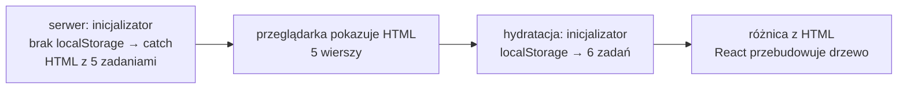
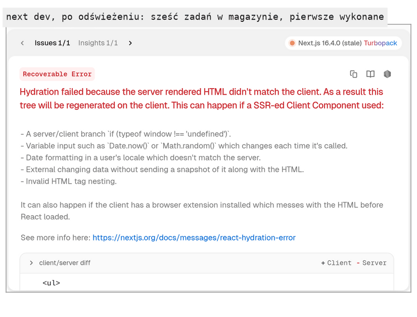

# Odczyt zapisanej listy i dwa miejsca renderowania

## Lista, której nikt nie odczytuje

Efekt zapisu odkłada listę do magazynu po każdej zmianie, ale nikt jej stamtąd nie odczytuje. Komponent musi przy starcie sprawdzić magazyn i użyć zapisanej listy, jeśli taka istnieje. Naturalnym miejscem jest wartość początkowa stanu, bo to ona decyduje, z jaką listą komponent zaczyna. React liczy się z wartością początkową tylko przy tworzeniu stanu, w pierwszym renderze. Odczyt magazynu wystarczy więc wykonać raz, a nie przy każdym renderze.

## Funkcja zamiast wyniku funkcji

`useState` przyjmuje jako wartość początkową albo samą wartość, albo funkcję, która ją oblicza. Dokumentacja `useState` opisuje drugi przypadek:

> **„Jeśli jako `initialState` przekażesz funkcję, zostanie potraktowana jak funkcja inicjalizująca. Powinna być czysta, nie powinna przyjmować argumentów i powinna zwracać wartość dowolnego typu. React wywoła ją przy inicjalizacji komponentu i zapisze zwrócony wynik jako stan początkowy.”**
>
> *„If you pass a function as `initialState`, it will be treated as an initializer function. It should be pure, should take no arguments, and should return a value of any type. React will call your initializer function when initializing the component, and store its return value as the initial state.”*
>
> — dokumentacja React, *useState*

Taka funkcja nazywa się **funkcją inicjalizującą** (*initializer function*), a potocznie **leniwym inicjalizatorem** (*lazy initializer*), bo praca odkłada się do chwili, w której React jej potrzebuje. Dokumentacja pokazuje różnicę na funkcji `createInitialTodos`, która buduje listę startową. Tutaj dostaje ona wpis w konsoli, żeby było widać każde wywołanie. Dwa zapisy różnią się parą nawiasów:

```jsx
// Przykład spoza demo: wartość początkowa z funkcji createInitialTodos
function createInitialTodos() {
  console.log("createInitialTodos"); // jeden wpis = jedno wywołanie
  return [{ id: 1, text: "Todo 1" }];
}

// A: nawiasy wywołują funkcję od razu, w KAŻDYM renderze;
// React zapamiętuje wynik tylko z pierwszego, kolejne wyniki wyrzuca
const [todos, setTodos] = useState(createInitialTodos());

// B: przekazana jest sama funkcja; React wywoła ją raz, przy tworzeniu stanu
const [todos, setTodos] = useState(createInitialTodos);
```

Argument w wersji A jest zwykłym wyrażeniem w ciele komponentu, więc oblicza się przy każdym wywołaniu komponentu, zanim `useState` w ogóle go zobaczy. Przy czterech renderach (montowanie i trzy litery wpisane w pole tekstowe tego samego komponentu) wersja A wypisuje cztery wpisy `createInitialTodos`, a wersja B jeden. Dokumentacja dodaje, że różnicy w zachowaniu nie widać, ale kod jest mniej wydajny.

Wymóg czystości ma konkretny powód. Tryb ścisły wywołuje inicjalizator przy montowaniu dwa razy. Odczyt niczego nie zmienia, więc podwójne wywołanie daje ten sam wynik. Zapis albo wysłanie żądania w inicjalizatorze wykonałby się podwójnie.

## Leniwy inicjalizator w `TaskBoard`

Odczyt magazynu może się nie udać, więc inicjalizator obejmuje go blokiem `try/catch`. Kod w `try` wykonuje się normalnie. Gdy rzuci wyjątek, reszta `try` jest pomijana, a sterowanie przechodzi do `catch`. Gdy obiekt błędu nie jest potrzebny, `catch` zapisuje się bez nawiasów.

```js
// Przykład spoza demo: try/catch
try {
  JSON.parse("{broken");      // rzuca SyntaxError
  console.log("nie dojdzie"); // pominięte
} catch {
  console.log("error caught"); // tu trafia sterowanie
}
console.log("program continues"); // wynik: "error caught", "program continues"
```

W `app/components/TaskBoard.jsx` wywołanie `useState(initialTasks)` zastępuje się wersją z funkcją:

```jsx
// funkcja przekazana do useState: React wywoła ją raz, w pierwszym renderze
const [tasks, setTasks] = useState(() => {
  try {
    const stored = localStorage.getItem("tasks"); // napis z efektu zapisu albo null
    return stored ? JSON.parse(stored) : initialTasks; // null: pierwsza wizyta, lista startowa
  } catch {
    // dwa przypadki: na serwerze nie ma localStorage (ReferenceError; skąd serwer, niżej)
    // albo napis w magazynie nie jest poprawnym JSON (SyntaxError)
    return initialTasks; // wyjątek złapany, ale wynik na serwerze i w przeglądarce może się różnić (niżej)
  }
});
```

Wieruch w *The Road to React* zapisuje podobny odczyt bez strzałki: `useState(localStorage.getItem('search') || 'React')`. Działa poprawnie, bo napis z magazynu jest tani do odczytania, ale odczyt powtarza się przy każdym renderze. W `TaskBoard` stawką jest odczyt magazynu i parsowanie JSON przy każdej literze w polu „New task...”, więc strzałka ma tu uzasadnienie.

Odczyt i zapis są rozdzielone między dwa mechanizmy. Odczyt dzieje się raz, w inicjalizatorze, w trakcie pierwszego renderu. Zapis dzieje się w efekcie, który wykonuje się po każdym renderze ze zmienioną listą, a pierwszy raz zaraz po montowaniu. Gdy efekt zapisu wykonuje się pierwszy raz, `tasks` zawiera już listę odczytaną z magazynu, więc zapis odkłada tę samą listę i niczego nie gubi.

Blok `try/catch` chroni też przed uszkodzonym wpisem. Magazyn może zawierać napis, który nie jest poprawnym JSON, na przykład po ręcznej edycji wartości w narzędziach przeglądarki albo po zmianie formatu zapisu w nowej wersji aplikacji. `JSON.parse` rzuca wtedy `SyntaxError` i bez `catch` przerwałby render komponentu. Z `catch` aplikacja startuje z listą początkową, a efekt zapisu nadpisuje uszkodzony wpis zaraz po montowaniu, bez żadnej zmiany listy. Przed montowaniem pod kluczem `tasks` leży `{broken`, a zaraz po nim lista startowa w formacie JSON.

## Dlaczego odczyt nie siedzi w efekcie

Odczyt dałoby się też zapisać jako efekt, który wczytuje listę z magazynu do stanu:

```jsx
// Przykład spoza demo: odczyt listy w efekcie, BŁĄD: nieskończona pętla renderów
useEffect(() => {
  const stored = localStorage.getItem("tasks");
  if (stored) setTasks(JSON.parse(stored)); // JSON.parse daje za każdym razem NOWĄ tablicę
}, [tasks]); // nowa tablica w tasks => Object.is widzi zmianę => efekt rusza znowu
```

Pętla zamyka się w czterech krokach. Odczyt daje nową tablicę, bo `JSON.parse` za każdym razem buduje nowy obiekt, setter wywołuje render, porównanie zależności widzi w `tasks` inny adres i efekt wykonuje się ponownie. Na serwerze deweloperskim (`next dev`) React wypisuje komunikat „Maximum update depth exceeded” ponad 200 razy w 4 sekundy. Strona dalej odpowiada, ale procesor pracuje bez przerwy.

Komunikat podaje przyczynę: komponent wywołuje `setState` w efekcie, który nie ma tablicy zależności albo ma zależność zmieniającą się przy każdym renderze. Dokumentacja (*You Might Not Need an Effect*) ostrzega przed efektami, które tylko dostosowują stan do innego stanu. <u>Odczyt robi się raz, przy tworzeniu stanu, a zapis osobnym efektem, który stanu nie zmienia</u>.

## Hydratacja

`TaskBoard` jest komponentem klienckim, a mimo to przy pierwszym wczytaniu strony renderuje się dwa razy, w dwóch różnych środowiskach. Najpierw Next.js renderuje go na serwerze i wysyła gotowy HTML, który przeglądarka pokazuje, zanim wczyta się JavaScript. Potem React w przeglądarce wykonuje ten sam komponent jeszcze raz i podpina procedury obsługi zdarzeń do istniejących elementów, zamiast budować je od nowa. Ten drugi etap nazywa się **hydratacją** (*hydration*). Dokumentacja `useEffect` wyprowadza z niego wymóg:

> **„Na serwerze komponent wyrenderuje się, żeby wytworzyć początkowy HTML. Na kliencie React ponownie uruchomi kod renderujący, żeby dołączyć procedury obsługi zdarzeń do tego HTML-a. Dlatego, żeby hydratacja działała, wynik pierwszego renderu musi być identyczny na kliencie i na serwerze.”**
>
> *„On the server, it will render to produce the initial HTML. On the client, React will run the rendering code again so that it can attach your event handlers to that HTML. This is why, for hydration to work, your initial render output must be identical on the client and the server.”*
>
> — dokumentacja React, *useEffect*

React zakłada, że jego pierwszy render w przeglądarce da dokładnie ten sam wynik co HTML z serwera. Dokumentacja `hydrateRoot`, funkcji Reacta, która podpina aplikację do HTML z serwera, każe traktować każdą niezgodność jako błąd do naprawienia. Wyjaśnia też, dlaczego React nie sprawdza całego HTML dokładnie: niezgodności zdarzają się w większości aplikacji rzadko, a walidacja całego znacznikowania byłaby zbyt kosztowna. W trybie deweloperskim React ostrzega o niezgodnościach, ale nie gwarantuje, że różnice w atrybutach zostaną poprawione.

## Rysunek 2.12 — dwa pierwsze rendery `TaskBoard`



Na Rysunku 2.12 ten sam inicjalizator wykonuje się w dwóch środowiskach. Na serwerze odwołanie do `localStorage` rzuca wyjątek, więc `catch` zwraca pięć zadań startowych i z nich powstaje HTML. W przeglądarce, podczas hydratacji, inicjalizator wykonuje się ponownie i znajduje w magazynie zapisaną listę, na przykład sześć zadań. Każde środowisko liczy poprawnie według danych, które ma. Rozjazd powstaje dopiero wtedy, gdy React zestawia oba wyniki i oczekuje, że będą identyczne.

## Niezgodność w konsoli

Przy pierwszej wizycie magazyn jest pusty i oba rendery dają pięć zadań, więc niezgodności nie ma. Po dodaniu „Buy milk”, zaznaczeniu pierwszego zadania i odświeżeniu strony lista ma sześć wierszy, pierwszy przekreślony, a pod nią „1 / 6 done”. Konsola na serwerze deweloperskim pokazuje wtedy „Hydration failed because the server rendered HTML didn't match the client.”. Okno błędów porównuje oba drzewa i jako pierwszą różnicę wskazuje pierwszy wiersz listy: przeglądarka ma tam element `<s>` (zadanie przekreślone), a HTML z serwera zwykły tekst „Read the React 19 docs”. React buduje drzewo od nowa po stronie klienta i na ekranie lista wygląda poprawnie. W wersji produkcyjnej (`next build`) ten sam przypadek zgłasza się jako „Minified React error #418”.

## Rysunek 2.13 — niezgodność w oknie błędów Next.js



Na Rysunku 2.13 serwer deweloperski zebrał komunikat w oknie błędów, które otwiera się z plakietki „1 Issue” w rogu strony. Etykieta „Recoverable Error” oznacza, że React poradził sobie sam: odbudował drzewo w przeglądarce, a strona pod oknem działa dalej.

Niezgodność ma też objaw poza konsolą: tytuł karty po wczytaniu zależy od zawartości magazynu. Magazyn z listą identyczną z `initialTasks` zostawia w karcie „Task Board — Demo L02”. Sześć zapisanych zadań, z pierwszym wykonanym, daje „(5) Task Board”.

Dokumentacja Next.js (*Text content does not match server-rendered HTML*) wymienia tę przyczynę na liście typowych. Wśród źródeł niezgodności podaje używanie w logice renderowania API dostępnych tylko w przeglądarce, takich jak `window` albo `localStorage`. `try/catch` w inicjalizatorze chroni przed wyjątkiem na serwerze, ale nie wyrównuje wyników obu renderów.

## Renderowanie dwuprzebiegowe

Leniwy inicjalizator był więc w `TaskBoard` etapem pośrednim. Dokumentacja React i Next.js podaje rozwiązanie zasadnicze: pierwszy render w przeglądarce ma pokazać to samo co serwer, a dane dostępne tylko w przeglądarce dochodzą w efekcie po hydratacji. Strona `hydrateRoot` nazywa to **renderowaniem dwuprzebiegowym** (*two-pass rendering*). W `app/components/TaskBoard.jsx` taki kod zastępuje leniwy inicjalizator i dotychczasowy efekt zapisu:

```jsx
// renderowanie dwuprzebiegowe: odczyt w efekcie, już po hydratacji
const [tasks, setTasks] = useState(initialTasks); // serwer i hydratacja: ta sama lista
const [loaded, setLoaded] = useState(false); // true, gdy odczyt magazynu się skończył

useEffect(() => {
  try {
    const stored = localStorage.getItem("tasks");
    if (stored) setTasks(JSON.parse(stored)); // drugi przebieg: zapisana lista
  } catch {
    // uszkodzony wpis: zostaje lista startowa
  }
  setLoaded(true);
}, []); // raz, po montowaniu, już po hydratacji

useEffect(() => {
  if (loaded) localStorage.setItem("tasks", JSON.stringify(tasks)); // zapis dopiero po odczycie
}, [tasks, loaded]);
```

Flaga `loaded` pilnuje kolejności. Efekt zapisu też wykonuje się po pierwszym renderze i bez flagi nadpisałby zapisaną listę listą startową, zanim efekt odczytu zdążyłby ją wczytać. Każdy render widzi własną wartość `loaded`, więc `setLoaded(true)` zmienia ją dopiero w następnym renderze i dopiero wtedy zapis rusza.

Pierwszy przebieg daje na serwerze i w przeglądarce tę samą listę startową, więc HTML i hydratacja się zgadzają. Drugi przebieg zaczyna się od efektu odczytu: setter wstawia sześć zapisanych zadań i React renderuje komponent jeszcze raz, już bez porównywania z HTML serwera. Konsola nie zgłasza wtedy błędu hydratacji, a w magazynie zostaje sześć zadań. Uszkodzony wpis kończy się w `catch` i lista startowa zostaje, a efekt zapisu po odczycie zastępuje `{broken` poprawnym JSON. Strona `hydrateRoot` zaznacza koszt: dodatkowy przebieg renderu zaraz po hydratacji. Po odświeżeniu przez ułamek sekundy widać listę startową z HTML serwera.

Leniwy inicjalizator nadal jest właściwym narzędziem dla kosztownej wartości początkowej, jak lista budowana przez `createInitialTodos`. Nie nadaje się tylko do danych, których serwer nie ma. Przy pustym magazynie niezgodności nie widać wcale, więc sprawdzanie aplikacji wyłącznie na świeżej karcie jej nie ujawni.

> 💡 **Zapamiętaj:** funkcja przekazana do `useState` wykonuje się raz, przy tworzeniu stanu. Komponent kliencki w Next.js renderuje się najpierw na serwerze, więc dane dostępne tylko w przeglądarce dochodzą w efekcie, w drugim przebiegu.


Materiał rozszerzony do tego slajdu: [`rozszerzenia/r08_leniwy-inicjalizator.md`](rozszerzenia/r08_leniwy-inicjalizator.md)
