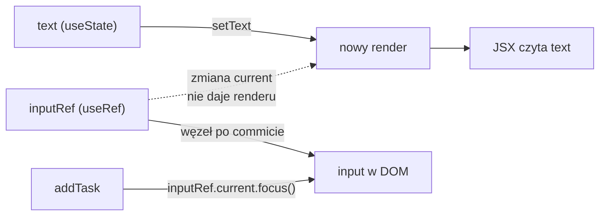

# Ref: pamięć, której React nie śledzi

## Kursor, który wraca do pola

Po kliknięciu „Add” zadanie trafia na listę, a pole się czyści. Kursor zostaje jednak na przycisku i przed wpisaniem kolejnego zadania trzeba kliknąć w pole. Przeniesienie kursora do pola, czyli ustawienie **fokusu** (*focus*), to polecenie dla przeglądarki: wywołanie metody `focus()` na węźle `<input>`. JSX nie ma atrybutu, który znaczyłby „ustaw fokus teraz”, bo JSX opisuje wygląd, a nie czynności wykonywane w określonej chwili. Komponent potrzebuje więc dostępu do samego węzła DOM, który React utworzył na podstawie JSX.

Stan do tego się nie nadaje. Węzeł DOM nie jest częścią opisu interfejsu, tylko jego wynikiem, a zapisanie go w stanie wywołałoby render, który niczego na ekranie nie zmienia. React ma na takie wartości osobny hook: `useRef`.

## Czym jest ref

Schwarzmüller w *React Key Concepts* rozwija nazwę:

> **„Ref to skrót od *reference*, czyli odwołania. Ta funkcja pozwala przechowywać odwołania do wartości, na przykład do elementów DOM, z wnętrza komponentu Reacta.”**
>
> *„Ref stands for reference, and it’s a feature that allows you to store references to values—for example, to DOM elements from inside a React component.”*
>
> — Maximilian Schwarzmüller, *React Key Concepts*

Wywołanie `useRef(wartośćPoczątkowa)` zwraca zwykły obiekt JavaScriptu z jednym polem `current`. Dokumentacja Reacta (*Referencing Values with Refs*) podkreśla, że to pole jest celowo zmienne: czyta się je i zapisuje bez żadnego settera. Porównuje ref do „ukrytej kieszeni komponentu, której React nie śledzi” (*„a secret pocket of your component that React doesn't track”*). Wieruch dodaje, że sam obiekt refa zostaje nienaruszony przez cały czas życia komponentu. Zmienia się tylko jego pole `current`.

Ref ma jedną cechę wspólną ze stanem i jedną odmienną. Tak jak stan, przetrwa kolejne rendery, bo React przechowuje go razem z komponentem. W odróżnieniu od stanu jego zmiana nie wywołuje renderu. Dokumentacja `useRef` podaje powód: ref jest zwykłym obiektem JavaScriptu. React nie wie więc, kiedy pole `current` się zmienia (*„React is not aware of when you change it because a ref is a plain JavaScript object”*). Setter stanu zawiadamia Reacta o zmianie, a przypisanie do `current` nikogo nie zawiadamia.

## Minimalny przykład: fokus po kliknięciu

Najkrótszy komponent z refem do węzła DOM ma pole i przycisk, który przenosi do niego kursor.

```jsx
// Przykład spoza demo: fokus po kliknięciu
import { useRef } from "react";

function SearchBox() {
  const inputRef = useRef(null); // obiekt { current: null }, ten sam w każdym renderze

  return ( // <> … </> to fragment: grupuje dwa elementy bez dodatkowego węzła w DOM
    <>
      {/* React wpisze tu węzeł <input> do inputRef.current */}
      <input ref={inputRef} />
      {/* kliknięcie: sięgamy po węzeł i wywołujemy metodę przeglądarki */}
      <button onClick={() => inputRef.current.focus()}>Search</button>
    </>
  );
}
```

Prop `ref` jest dla Reacta prośbą: gdy ten element pojawi się na stronie, wpisz jego węzeł do podanego obiektu. Komponent nie szuka węzła sam, na przykład przez `document.querySelector`, i nie musi wiedzieć, kiedy węzeł powstał. Przy usunięciu elementu React wpisuje z powrotem `null`. Przed kliknięciem aktywnym elementem dokumentu jest `<body>`, a po kliknięciu pole `<input>`.

## Kiedy React wypełnia ref

Węzeł `<input>` nie istnieje w chwili, gdy funkcja komponentu wykonuje się po raz pierwszy. Render tylko oblicza JSX, a React tworzy węzły dopiero w commicie, czyli przy nanoszeniu zmian na DOM. Dokumentacja (*Manipulating the DOM with Refs*) opisuje dokładny moment:

> **„React ustawia `ref.current` w trakcie commitu. Przed aktualizacją DOM React ustawia odpowiednie wartości `ref.current` na `null`. Po aktualizacji DOM od razu ustawia je na odpowiadające im węzły DOM.”**
>
> *„React sets `ref.current` during the commit. Before updating the DOM, React sets the affected `ref.current` values to `null`. After updating the DOM, React immediately sets them to the corresponding DOM nodes.”*
>
> — dokumentacja React, *Manipulating the DOM with Refs*

Z tego wynika, gdzie ref do węzła wolno czytać. W trakcie pierwszego renderu `inputRef.current` to jeszcze `null`. Procedura obsługi kliknięcia i efekt wykonują się po commicie, więc w nich węzeł jest już na miejscu. <u>Ref do węzła DOM czyta się w procedurach obsługi zdarzeń i w efektach, a nie w renderze</u>.

## Fokus w `TaskBoard`

W `app/components/TaskBoard.jsx` dochodzą cztery zmiany. Import dostaje `useRef`.

```jsx
import { useState, useEffect, useRef } from "react"; // nowy import: useRef
```

Pod deklaracjami stanu powstaje ref.

```jsx
// ref do węzła pola tekstowego; zmiana inputRef.current nie wywołuje renderu
const inputRef = useRef(null);
```

Pole „New task...” dostaje prop `ref`.

```jsx
<input
  ref={inputRef}          // po commicie React wpisze tu węzeł <input>
  value={text}
  onChange={(e) => setText(e.target.value)}
  placeholder="New task..."
/>
```

Wywołanie fokusu w `addTask` korzysta z operatora `?.` (*optional chaining*). Odczyt pola albo wywołanie metody przez `?.` sprawdza najpierw, czy wartość po lewej nie jest `null` ani `undefined`. Jeśli jest, całe wyrażenie daje `undefined` zamiast błędu.

```js
// Przykład spoza demo: operator ?.
const box = { current: null };
box.current?.focus(); // undefined: current to null, focus() się nie wykonuje
box.current.focus();  // TypeError: Cannot read properties of null (reading 'focus')
```

Funkcja `addTask` po dodaniu zadania przenosi fokus.

```jsx
function addTask() {
  if (!text.trim()) return;
  setTasks([...tasks, { id: Date.now(), text: text.trim(), done: false }]);
  setText("");
  // ?.: gdy current to null (pole jeszcze nie istnieje), focus() się nie wykona;
  // samo focus() nie wywołuje renderu, render wynika z setTasks i setText
  inputRef.current?.focus();
}
```

Po tej zmianie kolejne zadanie można pisać od razu po kliknięciu „Add”. Kolejność w `addTask` nie ma znaczenia dla fokusu, bo pole istnieje na stronie przez cały czas, a settery tylko planują następny render.

## Wyjście poza model deklaratywny

React jest deklaratywny: komponent opisuje, jak ma wyglądać interfejs dla danego stanu, a React sam dopasowuje do tego opisu DOM. Fokus się w tym modelu nie mieści, bo jest czynnością wykonywaną w określonej chwili, czyli kodem imperatywnym, który mówi przeglądarce, co ma zrobić, a nie jak ma wyglądać wynik. Wieruch wymienia typowe przypadki takiego dostępu: odczyt rozmiaru elementu, ustawienie fokusu pola, sterowanie animacjami i integrację z bibliotekami imperatywnymi, takimi jak D3.

Dokumentacja nazywa refy **wyjściem awaryjnym** (*escape hatch*) i zaleca używać ich tylko wtedy, gdy trzeba wyjść poza Reacta. Jako typowe przykłady podaje zarządzanie fokusem, pozycją przewinięcia i wywoływanie API przeglądarki, których React nie udostępnia. Schwarzmüller radzi ogólnie nie zmieniać DOM ręcznie, bo to zadanie Reacta. Wyjątek robi właśnie dla `focus()`: taka metoda nie zmienia DOM w sposób, który mógłby zepsuć aplikację. `inputRef` w `TaskBoard` mieści się w tym wyjątku. Odczyt wartości pola nadal idzie przez stan `text`, a ref służy do jednej czynności.

Banks i Porcello pokazują, jak wyglądałby formularz oparty w całości na refach. Procedura wysłania czyta `txtTitle.current.value`, a potem czyści pole przypisaniem `txtTitle.current.value = ""`. Autorzy nazywają to zmianą paradygmatu: kod bezpośrednio zmienia atrybuty węzłów DOM, a komponent staje się niekontrolowany, czyli treść pola trzyma DOM, a nie stan. Za lepsze podejście uznają komponent kontrolowany, w którym treść pola należy do stanu.

## Ref czy stan

Dokumentacja daje regułę, która rozstrzyga większość wyborów:

> **„Gdy informacja jest używana do renderowania, trzyma się ją w stanie. Gdy potrzebują jej tylko procedury obsługi zdarzeń, a jej zmiana nie wymaga renderu, użycie refa może być wydajniejsze.”**
>
> *„When a piece of information is used for rendering, keep it in state. When a piece of information is only needed by event handlers and changing it doesn't require a re-render, using a ref may be more efficient.”*
>
> — dokumentacja React, *Referencing Values with Refs*

| | `useRef` | `useState` |
|--|----------|-----------|
| Powoduje ponowny render? | Nie | Tak |
| Wartość między renderami | Tak (`current`) | Tak |
| Użycie | węzeł DOM, identyfikator timera | interfejs — cokolwiek musi być widoczne |

Według tej reguły `inputRef` jest wzorcowym refem. Węzeł pola potrzebny jest tylko procedurze `addTask`, a na ekranie nic od niego nie zależy.

## Ref bez DOM: identyfikator interwału

Ref może przechowywać dowolną wartość. Dokumentacja `useRef` podaje typowy przykład spoza DOM: identyfikator zwrócony przez `setInterval`, potrzebny później do `clearInterval`. Stoper w najprostszej postaci wygląda tak.

```jsx
// Przykład spoza demo: stoper z identyfikatorem interwału w refie
import { useState, useRef } from "react";

function Stopwatch() {
  const [ticks, setTicks] = useState(0); // stan: liczba widoczna na ekranie
  const intervalRef = useRef(null);      // ref: identyfikator, którego nie widać

  function handleStart() {
    clearInterval(intervalRef.current);  // drugi Start nie uruchomi drugiego interwału
    intervalRef.current = setInterval(() => setTicks((t) => t + 1), 10);
  }

  function handleStop() {
    clearInterval(intervalRef.current);  // ten sam identyfikator, zapisany przy starcie
  }

  return (
    <>
      <p>{ticks}</p>
      <button onClick={handleStart}>Start</button>
      <button onClick={handleStop}>Stop</button>
    </>
  );
}
```

Dwie procedury dzielą tu jedną wartość, która ma przetrwać rendery wywołane przez `setTicks`. Zmienna lokalna `let id` by nie wystarczyła, bo każdy render tworzy ją od nowa i `handleStop` z nowego renderu nie widziałby identyfikatora zapisanego przez `handleStart` z poprzedniego. Stan by zadziałał, ale zapis identyfikatora wywołałby zbędny render. Interwał co 10 ms podnosi licznik o 1, więc po uruchomieniu i 100 ms licznik pokazuje 10. Po kliknięciu „Stop” liczba stoi: 60 ms później nadal jest to 10. Sama obsługa `setInterval` i sprzątanie timera przy odmontowaniu należą do efektów, ref tylko przechowuje identyfikator.

## Rysunek 2.14 — stan i ref w `TaskBoard`



Na Rysunku 2.14 górna ścieżka to stan. Zmiana `text` przez setter prowadzi do renderu, a JSX odczytuje nową wartość. Dolna ścieżka to ref. React wypełnia `inputRef` po commicie, a procedura `addTask` korzysta z niego już poza renderem. Przerywana strzałka oznacza połączenie, którego nie ma: zmiana `current` nie uruchamia renderu, więc JSX nie może na niej polegać.

## Granica: ref w trakcie renderu

Dokumentacja `useRef` formułuje zakaz, który dopełnia regułę wyboru:

> **„Nie zapisuj ani nie odczytuj `ref.current` w trakcie renderowania, z wyjątkiem inicjalizacji. To sprawia, że zachowanie komponentu staje się nieprzewidywalne.”**
>
> *„Do not write or read `ref.current` during rendering, except for initialization. This makes your component's behavior unpredictable.”*
>
> — dokumentacja React, *useRef*

Uzasadnienie wynika z czystości komponentu. React oczekuje, że render jest czystą funkcją: dla tych samych propsów i stanu zwraca ten sam JSX. Wartość `current` zmienia się bez wiedzy Reacta, więc JSX zależny od niej może pokazywać coś, czego React nie odświeży. Zakaz obejmuje też przechowywanie poprzedniej wartości propsa przez zapis do refa w renderze. Dokumentacja `useState` zaleca w takim przypadku drugą zmienną stanu.

Złamanie tego zakazu najlepiej widać na liczniku renderów. W `TaskBoard` trafia on do kodu tylko na czas pomiaru, tak jak wcześniej `console.log` w efekcie, i znika zaraz po nim. Ile renderów wywołuje jedna litera wpisana w pole, dało się do tej pory tylko wyliczyć z kodu. Ref policzy wywołania funkcji komponentu, a sam ich nie doda.

```jsx
// licznik wywołań funkcji komponentu: tylko narzędzie pomiaru, nie wzorzec
const renderCount = useRef(0);
renderCount.current += 1; // zapis w trakcie renderu: łamie regułę

return (
  <div>
    <p>Renders: {renderCount.current}</p> {/* odczyt w trakcie renderu: też łamie */}
    {/* … pole, przyciski i lista bez zmian */}
  </div>
);
```

Gdyby licznik był stanem, jego zwiększenie wywoływałoby kolejny render, a ten kolejne zwiększenie. Ref unika tej pętli, ale łamie obie połowy zakazu: zapisuje `current` w renderze i pokazuje go w JSX. Pod `next dev`, czyli na serwerze deweloperskim, licznik zaraz po wczytaniu pokazuje 4 i rośnie o 2 przy każdej literze. W wersji produkcyjnej, po `next build && next start`, pokazuje po wczytaniu 2 i rośnie o 1. Przyrost na literę wynika z trybu ścisłego, który w dev podwaja wywołanie funkcji komponentu, a z nim zapis w renderze. Start nie jest równy przyrostowi, bo po montowaniu efekt czytający magazyn wywołuje `setLoaded(true)`, co daje jeszcze jeden render. Wychodzą dwa przebiegi po dwa wywołania w dev i dwa przebiegi po jednym w wersji produkcyjnej.

Ten sam zapis psuje hydratację. Serwer renderuje komponent raz i wysyła „Renders: 1”. Pod `next dev` przeglądarka w trybie ścisłym już w pierwszym renderze hydratacji dochodzi do 2. Przy każdym wczytaniu strona zgłasza więc „Hydration failed because the server rendered text didn't match the client”, a różnica w `<p>` to `+ 2` (klient) i `- 1` (serwer). W wersji produkcyjnej pierwszy render w przeglądarce daje 1, czyli tyle co HTML z serwera, więc ostrzeżenia nie ma, a „2” pojawia się dopiero po `setLoaded(true)`. To drugi powód, dla którego licznik nie zostaje w aplikacji. Po pomiarze jego trzy linie znikają z `TaskBoard.jsx`, a z nimi ostrzeżenie. W projekcie z ESLintem wtyczka `eslint-plugin-react-hooks` w wersji 7.1.1 zgłasza taki kod komunikatem „Cannot access refs during render”. Rendery w prawdziwej aplikacji liczy Profiler z React DevTools, który mierzy je z zewnątrz komponentu.

> 💡 **Zapamiętaj:** ref przetrwa każdy render, a jego zmiana nie wywołuje renderu. Czyta się go i zapisuje w procedurach obsługi zdarzeń i w efektach, a nie w renderze.


Materiał rozszerzony do tego slajdu: [`rozszerzenia/r09_useref.md`](rozszerzenia/r09_useref.md)
