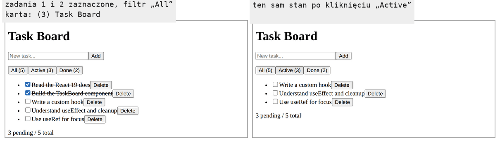
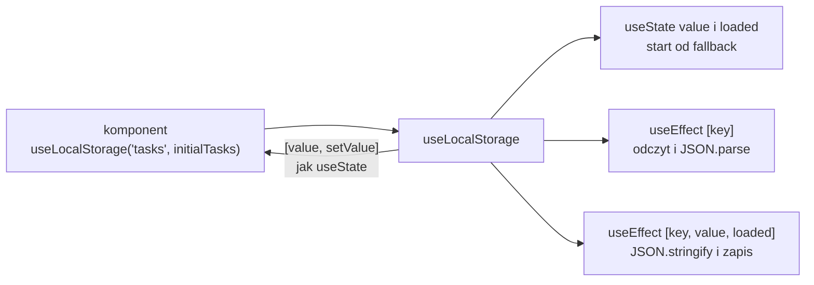
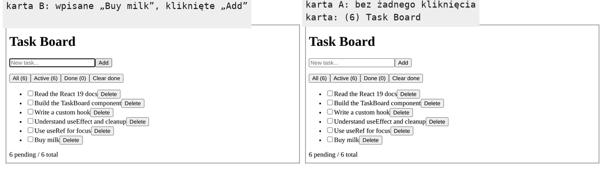

# Filtr, liczniki i własny hook `useLocalStorage`

## Filtr i liczniki liczone w renderze

Lista rośnie i przydaje się możliwość pokazania tylko zadań aktywnych albo tylko wykonanych. Filtr nie wnosi nowego mechanizmu Reacta, tylko trzeci stan i dwie wartości pochodne. Dobrze za to pokazuje, ile logiki zebrało się już w jednym pliku.

Filtr jest stanem, bo to wybór użytkownika, który ma przetrwać kolejne rendery i zmieniać ekran. W `app/components/TaskBoard.jsx` pod stanem `text` pojawia się trzecia zmienna stanu.

```jsx
const [filter, setFilter] = useState("all"); // "all" | "active" | "done"
```

Wybór listy do wyświetlenia korzysta z łańcucha operatorów warunkowych. Wyrażenie `a ? b : c` daje `b`, gdy warunek `a` jest spełniony, a w przeciwnym razie `c`. Gdy na miejscu `c` stoi kolejny operator, warunki sprawdza się po kolei, a wynik daje pierwszy spełniony.

```js
const n = 5;
n > 10 ? "big" : n > 3 ? "medium" : "small"; // "medium": pierwszy warunek fałszywy, drugi spełniony
```

Stałe `pending` i `doneCount` zastępuje obiekt z trzema licznikami i lista zadań do wyświetlenia.

```jsx
// wartości pochodne: liczone od nowa w każdym renderze, bez osobnego stanu
const counts = {
  total:   tasks.length,
  done:    tasks.filter((t) =>  t.done).length,
  pending: tasks.filter((t) => !t.done).length,
};
// łańcuch operatorów warunkowych: "active" i "done" mają własną listę, każda inna wartość daje tasks
const visibleTasks =
  filter === "active" ? tasks.filter((t) => !t.done) :
  filter === "done"   ? tasks.filter((t) =>  t.done) :
  tasks; // "all": ta sama tablica, bez kopii, bo nikt jej nie zmienia
```

Efekt z tytułem karty czyta licznik z obiektu, a nad listą stoją trzy przyciski filtra.

```jsx
useEffect(() => {
  document.title = counts.pending > 0 ? `(${counts.pending}) Task Board` : "Task Board";
  return () => { document.title = "Task Board"; };
}, [counts.pending]); // zależność to liczba, a nie cały obiekt counts
```

```jsx
<p>
  {/* każdy przycisk ustawia filtr; liczby w nawiasach to wartości pochodne */}
  <button onClick={() => setFilter("all")}>All ({counts.total})</button>
  <button onClick={() => setFilter("active")}>Active ({counts.pending})</button>
  <button onClick={() => setFilter("done")}>Done ({counts.done})</button>
</p>
```

Lista w JSX iteruje teraz po `visibleTasks.map` zamiast `tasks.map`, a akapit pod listą pokazuje `{counts.pending} pending / {counts.total} total`. Przy pustym magazynie i pięciu zadaniach startowych przyciski pokazują „All (5)”, „Active (5)” i „Done (0)”.

## Rysunek 2.15 — filtr po zaznaczeniu dwóch zadań



Na Rysunku 2.15 oba zrzuty pokazują tę samą listę w stanie i różnią się tylko wartością `filter`. Po kliknięciu „Active” znikają dwa przekreślone wiersze, ale liczby w nawiasach i „3 pending / 5 total” zostają, bo `counts` liczy się z `tasks`, a nie z `visibleTasks`.

Obiekt `counts` powstaje w każdym renderze od nowa, więc tablica `[counts]` uruchamiałaby efekt po każdym renderze. Liczba `counts.pending` porównana przez `Object.is` zmienia się tylko wtedy, gdy zmienia się liczba niewykonanych zadań. Render wykonuje przy tym najwyżej trzy przejścia `filter` po tablicy, co przy kilku zadaniach nic nie kosztuje.

## Kolejność deklaracji: strefa martwa

Miejsce obiektu `counts` w pliku ma znaczenie. Obiekt zadeklarowany niżej, pod efektem z tytułem, daje pod `next dev`, czyli na serwerze deweloperskim, odpowiedź 500, kod HTTP błędu serwera, z komunikatem „ReferenceError: Cannot access 'counts' before initialization”. Polecenie `next build`, które przygotowuje wersję produkcyjną, kompiluje taki plik, ale przerywa pracę przy prerenderowaniu strony `/`, czyli przy budowaniu jej HTML z wyprzedzeniem. Ten sam render wykonuje się bowiem na serwerze.

Przyczyną jest reguła JavaScriptu dotycząca `const` i `let`. MDN opisuje ją tak:

> **„Zmienna zadeklarowana przez `let`, `const` albo `class` znajduje się w „strefie martwej” (TDZ) od początku bloku do chwili, gdy wykonanie kodu dotrze do miejsca jej deklaracji i inicjalizacji.”**
>
> *„A variable declared with `let`, `const`, or `class` is said to be in a "temporal dead zone" (TDZ) from the start of the block until code execution reaches the place where the variable is declared and initialized.”*
>
> — MDN, *let*

MDN dodaje, że każda próba odczytu zmiennej w strefie martwej kończy się błędem `ReferenceError`. Liczy się chwila odczytu, a nie miejsce w tekście pliku. Dwie funkcje pokazują różnicę.

```js
function renderLater() {
  const read = () => counts.pending; // funkcja tylko odwołuje się do counts
  const counts = { pending: 3 };
  return read();                      // odczyt po deklaracji: 3
}

function renderNow() {
  const deps = [counts.pending];      // odczyt teraz, przed deklaracją
  const counts = { pending: 3 };
  return deps;
}

renderLater(); // 3
renderNow();   // ReferenceError: Cannot access 'counts' before initialization
```

`useEffect` ma oba przypadki naraz. Funkcja efektu wykonuje się po renderze, więc odwołanie do `counts` w jej ciele działałoby jak w `renderLater`. Tablica zależności jest jednak zwykłym wyrażeniem obliczanym w chwili wywołania `useEffect`, czyli w trakcie renderu, jak w `renderNow`. <u>Wartość pochodna, której używa tablica zależności, musi stać nad efektem</u>.

## Komponent, który robi za dużo

Po dodaniu filtra `TaskBoard.jsx` trzyma w sobie wszystko: stan listy, flagę odczytu, odczyt i zapis `localStorage`, filtr, liczniki, trzy funkcje zmieniające listę, pole tekstowe, fokus i tytuł karty. Gdyby drugi komponent, na przykład okno edycji zadania, potrzebował tej samej logiki zadań, trzeba by skopiować prawie cały plik. Kopia oznaczałaby dwa miejsca do poprawiania przy każdej zmianie.

Zwykła funkcja pomocnicza tego nie rozwiąże, bo logika zadań korzysta z `useState` i `useEffect`, a hooków nie wywołuje się w zwykłych funkcjach. Potrzebna jest funkcja, która sama jest hookiem. Taką funkcję nazywa się **własnym hookiem** (*custom Hook*).

## Czym jest własny hook

Schwarzmüller w *React Key Concepts* podaje trzy warunki, które musi spełnić funkcja, żeby była własnym hookiem. Jej nazwa zaczyna się od `use`. Wywołuje inny hook, wbudowany albo własny. Nie zwraca wyłącznie kodu JSX, bo wtedy byłaby komponentem:

> **„Własne hooki to po prostu zwykłe funkcje o specjalnych nazwach (zaczynających się od `use`), które wywołują inne hooki (własne lub wbudowane) i nie zwracają (wyłącznie) kodu JSX.”**
>
> *„So, custom Hooks are really just normal functions with special names (starting with `use`) that call other (custom or built-in) Hooks and that do not (just) return JSX code.”*
>
> — Maximilian Schwarzmüller, *React Key Concepts*

Schwarzmüller zestawia własne hooki z komponentami. Komponenty to wielokrotnego użytku elementy interfejsu, a własne hooki to wielokrotnego użytku fragmenty logiki. Dokumentacja Reacta (*Reusing Logic with Custom Hooks*) wskazuje drugą korzyść, niezależną od ponownego użycia. Własny hook ukrywa szczegóły kontaktu z systemem zewnętrznym albo API przeglądarki, a kod komponentu wyraża zamiar (*„The code of your components expresses your intent, not the implementation”*).

## Eksport nazwany i `import`

Hook zamieszka w osobnym pliku, więc komponent musi go zaimportować. Każdy plik JavaScriptu z `import` albo `export` jest **modułem**: jego zmienne i funkcje są prywatne, dopóki moduł ich nie wyeksportuje. Komponenty w projekcie mają eksport domyślny (`export default`), jeden na plik, który przy imporcie dostaje dowolną nazwę. Hooki mają **eksport nazwany** (*named export*). Jest ich w pliku dowolnie wiele, a importuje się je pod nazwą z modułu, w nawiasach klamrowych.

```js
// useCounter.js: dwa eksporty nazwane w jednym module
export function useCounter() { /* … */ }
export const START = 0;

// Counter.jsx: import nazwany, nazwa musi zgadzać się z eksportem
import { useCounter, START } from "./useCounter";
import { useCounter as useTicks } from "./useCounter"; // zmiana nazwy tylko przez as
```

Nazwa w klamrach jest częścią umowy z modułem. Literówka w imporcie nazwanym nie przechodzi niezauważona: dla `import { useCountr }` narzędzie budujące zgłasza, że moduł nie eksportuje takiej nazwy. Przy eksporcie domyślnym ta sama funkcja mogłaby trafić do różnych plików pod różnymi nazwami. W projekcie `taskboard` eksport domyślny mają `page.jsx` i `layout.jsx`, bo Next.js szuka go w tych plikach, a także komponent `TaskBoard`. Hooki mają eksporty nazwane.

## Hook `useLocalStorage`

Pierwszy hook wydziela z `TaskBoard` jedną rzecz: stan zsynchronizowany z `localStorage`. Powstaje katalog `app/hooks/` i w nim plik `useLocalStorage.js`.

```js
// własny hook: stan zsynchronizowany z localStorage
// zwraca [value, setValue], czyli ten sam kształt co useState
import { useState, useEffect } from "react";

export function useLocalStorage(key, fallback) { // eksport nazwany
  // serwer i hydratacja zaczynają od fallback, więc ich HTML się zgadza
  const [value, setValue] = useState(fallback);
  const [loaded, setLoaded] = useState(false); // true, gdy odczyt magazynu się skończył

  // drugi przebieg: odczyt w przeglądarce, już po hydratacji
  useEffect(() => {
    try {
      const stored = localStorage.getItem(key);
      if (stored) setValue(JSON.parse(stored));
    } catch {
      // uszkodzony wpis: zostaje fallback
    }
    setLoaded(true);
  }, [key]);

  // zapis dopiero po odczycie, inaczej fallback nadpisałby zapisaną wartość
  useEffect(() => {
    if (loaded) localStorage.setItem(key, JSON.stringify(value));
  }, [key, value, loaded]);

  return [value, setValue];
}
```

Ciało hooka to dwa stany i dwa efekty renderowania dwuprzebiegowego, przeniesione z `TaskBoard` bez zmiany działania. Parametr `key` zastępuje wpisany na sztywno klucz `"tasks"`, a parametr `fallback`, czyli wartość zapasowa na wypadek pustego magazynu, listę `initialTasks`. Klucz przychodzi teraz z zewnątrz, więc trafia do tablic zależności obu efektów. Flaga `loaded` nie wychodzi z hooka, bo komponent nie musi wiedzieć, w którym przebiegu jest. Wywołanie hooka wygląda jak wywołanie `useState`:

```js
// zamiast dwóch stanów i dwóch efektów: jedna linia
const [tasks, setTasks] = useLocalStorage("tasks", initialTasks);
```

W projekcie ta linia trafia do hooka `useTasks`, który zbiera resztę logiki listy, a `TaskBoard` przestaje wywoływać `useState` dla zadań. Hook nie wie, że przechowuje zadania. Ten sam kod obsłuży wybrany filtr, motyw kolorów albo dowolną inną wartość, którą da się zapisać jako JSON. Plik ma rozszerzenie `.js`, bo nie zawiera JSX, i nie ma dyrektywy `"use client"`, bo importuje go komponent kliencki. Schwarzmüller zaznacza, że nazwa pliku i katalogu nie podlega żadnym regułom. O tym, czy funkcja jest hookiem, decyduje nazwa samej funkcji.

## Ten sam hook u Wierucha

Robin Wieruch w *The Road to React* buduje prawie identyczny hook o nazwie `useStorageState`. Zaczyna od wycięcia `useState` i `useEffect` z komponentu i wklejenia ich do nowej funkcji. Potem zwraca parę w tablicy, co pozwala nadać jej przy wywołaniu nazwy z dziedziny aplikacji, na przykład `[searchTerm, setSearchTerm]`. Ostatni krok to parametr `key`. Autor tłumaczy go problemem, który pojawiłby się bez niego:

> **„Użycie tego własnego hooka więcej niż raz w aplikacji prowadzi do nadpisania elementu „value” w pamięci lokalnej, bo hook używa tego samego klucza w pamięci lokalnej.”**
>
> *„Using the custom hook more than once in a React application leads to an overwrite of the “value”-allocated item in the local storage, because it uses the same key in the local storage.”*
>
> — Robin Wieruch, *The Road to React*

Wieruch dodaje, że klucz przychodzi z zewnątrz, więc hook musi zakładać, że może się zmienić. Dlatego klucz trafia do tablicy zależności. Bez niego efekt mógłby zapisać wartość pod przestarzałym kluczem. U Wierucha odczyt stoi w leniwym inicjalizatorze, bo jego aplikacja nie renderuje się na serwerze. W Next.js ten sam hook potrzebuje drugiego przebiegu.

## Rysunek 2.16 — co hook ukrywa przed komponentem



Na Rysunku 2.16 komponent widzi tylko wywołanie z kluczem i wartością zapasową oraz parę, która wraca. Odczyt, parsowanie, flaga drugiego przebiegu, zapis i serializacja zostają w hooku. Komponent, który zamieni `useState` na `useLocalStorage`, zyskuje trwałość danych bez jednej linii kodu o `localStorage`. To **rozdzielenie odpowiedzialności** (*separation of concerns*): komponent odpowiada za wygląd i interakcję, a hook za przechowywanie. Gdyby lista miała kiedyś trafiać na serwer, zmiana objęłaby wnętrze hooka.

## Nazwa zaczyna się od `use`

Dokumentacja Reacta stawia warunek dotyczący nazwy:

> **„Nazwy hooków muszą zaczynać się od `use`, po którym stoi wielka litera, jak `useState` (wbudowany) albo `useOnlineStatus` (własny).”**
>
> *„Hook names must start with `use` followed by a capital letter, like `useState` (built-in) or `useOnlineStatus` (custom […]).”*
>
> — dokumentacja React, *Reusing Logic with Custom Hooks*

Bugl w *Learn React Hooks* wyjaśnia, po co ten wymóg. Bez konwencji nie dałoby się odróżnić hooków od zwykłych funkcji, a tej wiedzy potrzebują narzędzia pilnujące reguł hooków. Schwarzmüller dodaje, że React sam tej konwencji nie wymusza, ale jest ona bardzo silnym zaleceniem. Działa to też w drugą stronę. Dokumentacja odradza przedrostek `use` dla funkcji, które nie wywołują hooków (*„If you don't plan to use Hooks inside it (now or later), don't make it a Hook”*).

## Wspólna logika, osobny stan

Dokumentacja opisuje, co własny hook dzieli między komponentami.

> **„Własne hooki pozwalają dzielić logikę ze stanem, ale nie sam stan. Każde wywołanie hooka jest całkowicie niezależne od każdego innego wywołania tego samego hooka.”**
>
> *„Custom Hooks let you share stateful logic but not state itself. Each call to a Hook is completely independent from every other call to the same Hook.”*
>
> — dokumentacja React, *Reusing Logic with Custom Hooks*

Schwarzmüller pokazuje to na dwóch komponentach z hookiem licznika. Każdy ma własny licznik i zmiana jednego nie dotyka drugiego. Dla `useLocalStorage` ma to konkretny skutek. Dwa komponenty wywołujące `useLocalStorage("tasks", ...)` miałyby dwa niezależne stany, a zapisywałyby pod ten sam klucz. W magazynie zostałaby wersja tego, który zapisał ostatni.

Kod wewnątrz własnego hooka wykonuje się przy każdym renderze komponentu, który go wywołuje, więc tak jak kod komponentu musi być czysty. Dlatego zapis do magazynu stoi w `useEffect`, a nie bezpośrednio w ciele funkcji `useLocalStorage`.

## Rozszerzenie: granice hooka

Drugi przebieg ma swoją cenę. Po odświeżeniu przez ułamek sekundy widać wartość zapasową z HTML serwera, a dopiero potem zapisaną. Komponent, który ma tej chwili nie pokazywać, czeka z listą, aż odczyt się skończy. Hook oddaje mu wtedy także flagę `loaded`.

```jsx
// Przykład spoza demo: useLocalStorage oddaje też flagę loaded.
// w useLocalStorage zamiast return [value, setValue]:
return [value, setValue, loaded]; // trzeci element: true, gdy odczyt magazynu się skończył

// w komponencie: trzecia nazwa w destrukturyzacji
const [tasks, setTasks, loaded] = useLocalStorage("tasks", initialTasks);

// w JSX, w miejscu listy: napis zastępczy do końca odczytu
{loaded ? <ul>{/* zadania jak dotąd */}</ul> : <p>Loading tasks…</p>}
```

```text
HTML z serwera                          → <p>Loading tasks…</p>, bez zadań
w magazynie „Buy milk” i drugie zadanie → Loading tasks…, potem dwa zapisane zadania
pusty magazyn                           → Loading tasks…, potem pięć zadań startowych
```

Przy zapisanej liście pięć zadań startowych nie pojawia się ani na chwilę. Wywołanie z dwiema nazwami, `[tasks, setTasks]`, działa bez zmian, bo destrukturyzacja tablicy pomija nadmiarowe elementy.

Hook nie słyszy też zmian z innych kart tej samej strony. Druga karta zapisuje swoją listę pod tym samym kluczem, a pierwsza przy najbliższej zmianie nadpisze magazyn. Przeglądarka zgłasza taki zapis pozostałym kartom zdarzeniem `storage`, więc hook może go nasłuchiwać w trzecim efekcie.

```js
// Przykład spoza demo: useLocalStorage słyszy zapis z innej karty.
// w useLocalStorage, pod efektem zapisu:
useEffect(() => {
  function handleStorage(e) {
    // e.key: klucz zmieniony w innej karcie, e.newValue: nowy napis JSON
    if (e.key === key && e.newValue) setValue(JSON.parse(e.newValue));
  }
  window.addEventListener("storage", handleStorage);
  return () => window.removeEventListener("storage", handleStorage); // sprzątanie: koniec nasłuchu
}, [key]);
```

```text
karta B: „Buy milk” + Add        → karta A: 6 pending / 6 total, tytuł (6) Task Board
karta B: zaznaczenie zadania 1   → karta A: 5 pending / 6 total
zdarzenia storage                → karta A: 2, karta B: 0
```

## Rysunek 2.17 — dwie karty po dodaniu zadania w karcie B



Na Rysunku 2.17 lewy zrzut to karta, w której wpisano „Buy milk”, a prawy to karta, której nikt nie dotknął. Obie mają sześć wierszy. Prawa dostała listę tylko przez zdarzenie `storage` i własny setter, więc przeliczyła też liczniki i tytuł karty.

Karta, która zapisuje, nie dostaje własnego zdarzenia, a ponowny zapis tego samego napisu w karcie A nie wywołuje go w karcie B, więc karty się nie zapętlają. React czyta takie magazyny także hookiem `useSyncExternalStore`, który ma osobną funkcję dla renderu na serwerze.

> 💡 **Zapamiętaj:** własny hook to funkcja `useCoś`, która wywołuje inne hooki. Wykonuje się przy każdym renderze komponentu, który go wywołuje, więc musi być czysty jak sam komponent.

