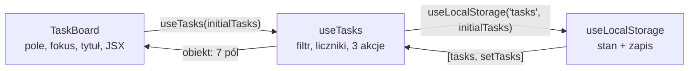

# Hook złożony z hooków: `useTasks`

## Cała logika zadań w jednym miejscu

`useLocalStorage` przejmuje przechowywanie listy. Poza nim w `TaskBoard` siedzą jeszcze filtr, liczniki i trzy funkcje zmieniające listę. Drugi hook, w nowym pliku `app/hooks/useTasks.js`, zbiera je wszystkie.

```js
// własny hook: cała logika listy zadań
// składa useLocalStorage i useState; reszta to wartości pochodne i zwykłe funkcje
import { useState } from "react";
import { useLocalStorage } from "./useLocalStorage"; // import nazwany z sąsiedniego pliku

export function useTasks(initialTasks) {
  // przechowywanie oddane hookowi; TaskBoard nie wie, gdzie trafia lista
  const [tasks, setTasks] = useLocalStorage("tasks", initialTasks);
  const [filter, setFilter] = useState("all"); // "all" | "active" | "done"

  // wartości pochodne: liczone przy każdym wywołaniu hooka
  const counts = {
    total:   tasks.length,
    done:    tasks.filter((t) =>  t.done).length,
    pending: tasks.filter((t) => !t.done).length,
  };
  const visibleTasks =
    filter === "active" ? tasks.filter((t) => !t.done) :
    filter === "done"   ? tasks.filter((t) =>  t.done) :
    tasks;

  // treść przychodzi w argumencie: stan pola zostaje w komponencie
  function addTask(text) {
    if (!text.trim()) return;
    setTasks([...tasks, { id: Date.now(), text: text.trim(), done: false }]);
  }

  function toggleTask(id) {
    setTasks(tasks.map((t) => (t.id === id ? { ...t, done: !t.done } : t)));
  }

  function deleteTask(id) {
    setTasks(tasks.filter((t) => t.id !== id));
  }

  // skrócony zapis pól: { visibleTasks } znaczy { visibleTasks: visibleTasks }
  return { visibleTasks, filter, setFilter, counts, addTask, toggleTask, deleteTask };
}
```

Wartości pochodne `counts` i `visibleTasks` oraz funkcje `toggleTask` i `deleteTask` przeszły z komponentu dosłownie. Wywołanie `useLocalStorage("tasks", initialTasks)` zastępuje dwa stany i dwa efekty odczytu i zapisu. Z `addTask` zniknęły `setText("")` i `inputRef.current?.focus()`, bo pole tekstowe i jego fokus zostają w komponencie. `useTasks` to zwykłe złożenie: dwa wywołania hooków na początku, pod nimi wartości liczone w każdym wywołaniu i funkcje. Nie ma w nim żadnego mechanizmu, którego nie było w komponencie.

## Obiekt na wyjściu: skrócony zapis i destrukturyzacja

Ostatnia linia hooka i pierwsza linia komponentu, który go wywoła, korzystają z dwóch zapisów JavaScriptu dla obiektów. Oba są lustrzanym odbiciem siebie nawzajem.

**Skrócony zapis pól** (*shorthand property names*) buduje obiekt ze zmiennych o tych samych nazwach. Wieruch w *The Road to React* opisuje go przy obiekcie przekazywanym do settera:

> **„Gdy nazwa pola w obiekcie jest taka sama jak nazwa zmiennej, można pominąć parę klucz/wartość i napisać tylko nazwę.”**
>
> *„When the property name in your object is the same as your variable name, you can omit the key/value pair and just write the name”*
>
> — Robin Wieruch, *The Road to React*

**Destrukturyzacja obiektu** (*object destructuring*) działa w drugą stronę: wyjmuje pola obiektu do stałych o tych samych nazwach. Schwarzmüller w *React Key Concepts* pokazuje ją na hooku `useCounter`, który zwraca obiekt z trzema polami. Dwa komponenty odbierają je przez destrukturyzację i podpinają funkcje pod przyciski. Oba zapisy pokazuje krótki kod.

```js
const total = 5, pending = 3;
const counts = { total, pending };  // skrócony zapis: { total: total, pending: pending }
console.log(counts);                // { total: 5, pending: 3 }

const result = { counts, addTask: () => "added", filter: "all" };
const { counts: c, addTask } = result; // destrukturyzacja; counts: c zmienia nazwę na c
console.log(c.total, addTask());       // 5 added

const { clearDone } = result;       // pole, którego obiekt nie ma
console.log(clearDone);             // undefined, bez błędu
```

W destrukturyzacji obiektu kolejność nazw nie ma znaczenia, bo pola dobiera się po nazwie, a nie po pozycji. Ostatni przykład pokazuje granicę tego zapisu. Literówka albo pole, którego hook nie zwraca, daje `undefined` bez żadnego komunikatu. Przycisk z `onClick={undefined}` renderuje się poprawnie, ale kliknięcie niczego nie robi i konsola milczy. Taki błąd wychodzi dopiero wtedy, gdy ktoś zauważy, że przycisk nie działa.

## Składanie hooków

`useTasks` wywołuje `useLocalStorage`, który wywołuje dwa razy `useState` i dwa razy `useEffect`. Taki łańcuch nazywa się **składaniem hooków** (*composition*). Wieruch wymienia tę możliwość wśród głównych zalet własnych hooków: hook może być złożeniem innych hooków. Banks i Porcello pokazują hook, który łączy stan listy wiadomości z dwoma efektami, a komponent korzystający z niego wywołuje jedną funkcję i o efektach nic nie wie.

Stan należy do egzemplarza komponentu, który wywołał `useTasks`. Hooki z niższych poziomów trafiają na tę samą listę co hooki samego `TaskBoard`, w kolejności wywołań, więc dla Reacta nie ma różnicy, czy `useState` stoi bezpośrednio w komponencie, czy dwa poziomy niżej w hooku. Drugi komponent z `useTasks` dostałby własną listę z własnymi pozycjami, a więc własne zadania i własny filtr.

Dokumentacja (*Reusing Logic with Custom Hooks*) dodaje cechę, która sprawia, że łańcuch działa. Wartości reaktywne przekazywane z jednego hooka do drugiego pozostają aktualne (*„You can pass reactive values from one Hook to another, and they stay up-to-date”*). `useTasks` przy każdym renderze dostaje od `useLocalStorage` bieżące `tasks` i liczy z nich listę oraz liczniki od nowa. Nie trzeba niczego ręcznie synchronizować, bo każdy render przechodzi przez cały łańcuch.

## Rysunek 2.18 — `TaskBoard` → `useTasks` → `useLocalStorage`



Na Rysunku 2.18 strzałki w prawo to wywołania, a strzałki w lewo to wartości oddawane wyżej. `useLocalStorage` zwraca parę jak `useState`, bo z zewnątrz ma wyglądać jak stan, a flagę `loaded` zostawia u siebie. `useTasks` zwraca obiekt z siedmioma polami. `TaskBoard` nie wie, że lista trafia do `localStorage`.

## Odchudzony `TaskBoard`

W `app/components/TaskBoard.jsx` import dostaje hook, a wywołanie hooka zastępuje oba stany i oba efekty odczytu i zapisu, stan filtra, wartości pochodne i trzy funkcje.

```jsx
import { useTasks } from "../hooks/useTasks"; // import nazwany; ../ to katalog app/

// destrukturyzacja: siedem pól obiektu zwróconego przez useTasks
const { visibleTasks, filter, setFilter, counts, addTask, toggleTask, deleteTask } =
  useTasks(initialTasks);

const [text, setText] = useState(""); // stan pola zostaje w komponencie
```

Ścieżka w imporcie zaczyna się od `../`, więc wskazuje plik względem bieżącego: z `app/components/` w górę do `app/`, a stamtąd do `hooks/useTasks`. Rozszerzenia nie ma, bo narzędzie budujące Next.js samo dobiera plik `useTasks.js`. Nazwa bez kropki na początku, taka jak `"react"`, oznacza pakiet zainstalowany w `node_modules`.

Nowa procedura łączy hook z polem tekstowym.

```jsx
function handleAdd() {
  addTask(text);              // hook sprawdza pustą treść i dodaje zadanie
  setText("");                // czyści pole; nie zmienia text w tej procedurze
  inputRef.current?.focus();  // fokus wraca do pola
}
```

Przycisk „Add” dostaje `onClick={handleAdd}`. Ref do pola, efekt z tytułem karty i cały JSX listy zostają bez zmian. Na ekranie nic się nie zmieniło. Przy pustym magazynie są to dalej „All (5)”, „Active (5)”, „Done (0)” i „5 pending / 5 total”, a zadania dodane przed odświeżeniem zostają na liście. Taka zmiana kodu bez zmiany zachowania to **refaktoryzacja** (*refactoring*). Po refaktoryzacji sprawdza się każdą funkcję, która działała przed nią, bo jej sensem jest to, że nic się nie zepsuło.

## Co zostaje w komponencie

Podział między `TaskBoard` a `useTasks` wynika z prostego kryterium. Do hooka trafia to, czego potrzebowałby każdy widok listy zadań: lista, filtr, liczniki i operacje. W komponencie zostaje to, co istnieje tylko dlatego, że na ekranie stoi konkretne pole tekstowe. Dlatego `text`, `inputRef` i ustawianie fokusu zostały w `TaskBoard`. Efekt z tytułem karty też został w komponencie, bo tytuł dotyczy tej konkretnej strony.

Kolejność trzech linii w `handleAdd` jest bezpieczna. Wywołanie `setText("")` nie zmienia zmiennej `text` w trwającej procedurze, bo każdy render widzi własną migawkę stanu. `addTask` dostaje więc treść wpisaną przed kliknięciem. Puste pole odrzuca sam hook warunkiem `if (!text.trim()) return`, dlatego komponent nie musi go sprawdzać.

`useTasks` zwraca dane i funkcje, a nie gotowy fragment JSX. Hook zwracający gotową listę `<ul>` decydowałby o wyglądzie za każdy komponent, który go użyje. Okno edycji zadania nie mogłoby pokazać zadań w tabeli ani dodać przycisku między wierszami. Przy obecnym podziale `useTasks` mówi, jakie są zadania i co można z nimi zrobić, a `TaskBoard` decyduje, jak to wygląda.

## Obiekt zamiast tablicy

Schwarzmüller zostawia autorowi hooka wybór: wartości można zgrupować w tablicy albo w obiekcie. Para z `useLocalStorage` ma oczywistą kolejność, więc tablica jest wygodna i pozwala nadać elementom własne nazwy przy destrukturyzacji tablicy. Przy siedmiu polach tablica wymagałaby pamiętania, że `deleteTask` stoi na siódmym miejscu. Obiekt pozwala wziąć tylko potrzebne pola w dowolnej kolejności. <u>Para o stałym znaczeniu wraca w tablicy, a większy zestaw wartości w obiekcie</u>.

## Co hook oddaje, a czego nie

Obiekt zwracany przez `useTasks` wyznacza granicę hooka. Nie ma w nim ani pełnej tablicy `tasks`, ani settera `setTasks`. Komponent dostaje listę do wyświetlenia i trzy operacje, ale nie może podać hookowi dowolnej tablicy. Każda zmiana listy przechodzi przez `addTask`, `toggleTask` albo `deleteTask`, a te pilnują jej postaci. Pusta treść nie trafia na listę, spacje z brzegów znikają, a nowe zadanie dostaje `id` i `done: false`. <u>Hook oddaje operacje na danych, a nie setter, który przyjmie cokolwiek</u>.

Filtr jest od tej zasady wyjątkiem. `setFilter` wychodzi z hooka bez opakowania, więc nic nie sprawdza jego argumentu. Wywołanie `setFilter("archived")` nie zgłosi błędu, a `visibleTasks` pokaże wtedy wszystkie zadania, bo wyrażenie warunkowe trafi do ostatniej gałęzi. W `TaskBoard` trzy przyciski podają tylko poprawne napisy, ale drugi komponent korzystający z hooka mógłby już podać dowolny.

Kod `useTasks` wykonuje się przy każdym renderze `TaskBoard`, także przy każdej literze wpisanej w pole. Za każdym razem powstają od nowa obiekt `counts`, trzy funkcje i sam zwracany obiekt. Tak samo działo się, gdy ten kod stał w komponencie, więc wydzielenie nie dodaje pracy.

## Rozszerzenie: część hooka, która nie musi być hookiem

Nie wszystko w `useTasks` korzysta z Reacta. Hooki wywołują tylko dwie pierwsze linie. Wyliczenie `visibleTasks` z listy i filtra to zwykłe przekształcenie tablicy. Dokumentacja (*Reusing Logic with Custom Hooks*) rozstrzyga taki przypadek krótko: funkcje, które nie wywołują hooków, nie muszą być hookami (*„Functions that don't call Hooks don't need to be Hooks”*). Jej przykład to `getSorted(items)` w miejsce `useSorted(items)`.

```js
// Przykład spoza demo: logika filtra z useTasks jako zwykła funkcja, dane w argumentach, wynik w return
export function getVisibleTasks(tasks, filter) {
  if (filter === "active") return tasks.filter((t) => !t.done);
  if (filter === "done") return tasks.filter((t) => t.done);
  return tasks;
}
```

Taką funkcję sprawdza się jednym wywołaniem, bez Reacta i bez przeglądarki, i można ją wywołać w dowolnym miejscu, także w warunku. Hook zostaje cieńszy: trzyma stan i woła `getVisibleTasks(tasks, filter)`. Kryterium jest mechaniczne. Kod wywołujący hook należy do hooka albo komponentu. Kod zwracający JSX jest komponentem. Pozostałe obliczenia mogą być zwykłymi funkcjami.

## Rozszerzenie: kiedy wydzielać hook, a kiedy nie

Bugl w *Learn React Hooks* radzi, żeby najpierw napisać komponent, a hook wydzielić dopiero wtedy, gdy podobny kod pojawia się w kilku komponentach. Pozwala to uniknąć przedwczesnego definiowania hooków i niepotrzebnej złożoności projektu. Task Board przeszedł dokładnie tę drogę. Dokumentacja dodaje wskazówkę co do nazwy: hook ma odpowiadać konkretnemu zastosowaniu, a jego nazwa mówi, co robi, co przyjmuje i co zwraca. Według dokumentacji kłopot z wyborem jasnej nazwy może oznaczać, że efekt jest zbyt spleciony z resztą logiki komponentu i nie nadaje się jeszcze do wydzielenia.

Dokumentacja przestrzega też przed wydzielaniem hooka z każdego powtórzonego fragmentu. Trochę powtórzeń jest w porządku, a hook opakowujący jedno wywołanie `useState` jest prawdopodobnie zbędny.


*Przerywnik: xkcd 974 „The General Problem”. Autor: Randall Munroe, licencja CC BY-NC 2.5, <https://xkcd.com/974/>.* Hook wydzielony na zapas, zanim ten sam kod pojawi się w drugim komponencie, jest takim systemem do podawania dowolnych przypraw.

Ta sama strona podaje sygnał w drugą stronę. Każdy efekt oznacza wyjście poza Reacta, więc przy każdym napisanym efekcie można zapytać, czy nie byłby czytelniejszy w hooku, który nazywa zamiar. `useLocalStorage` jest przykładem tej sytuacji: nazwa mówi, gdzie trafia wartość. Tak samo da się wydzielić efekt z tytułem karty.

```js
// Przykład spoza demo: efekt z tytułem karty jako hook nazwany od zamiaru.
import { useEffect } from "react";

export function usePendingTitle(pending) {
  useEffect(() => {
    document.title = pending > 0 ? `(${pending}) Task Board` : "Task Board";
    return () => { document.title = "Task Board"; }; // sprzątanie przy odmontowaniu
  }, [pending]);
}

// w TaskBoard zamiast całego efektu z tytułem:
usePendingTitle(counts.pending);
```

```text
dwa z pięciu zadań zaznaczone → tytuł karty: (3) Task Board
wszystkie zaznaczone          → tytuł karty: Task Board
```

Wywołanie zostaje w `TaskBoard`, bo tytuł dotyczy tej strony, a tablica zależności i sprzątanie chowają się w hooku. Dokumentacja ostrzega za to przed hookami opakowującymi sam `useEffect` pod ogólną nazwą, bo nazwa hooka ma mówić, co robi, a nie kiedy się wykonuje.

> 💡 **Zapamiętaj:** własne hooki można składać, a stan każdego z nich należy do komponentu, który wywołał łańcuch. Do hooka trafia logika potrzebna każdemu widokowi danych, w komponencie zostaje to, co dotyczy konkretnego ekranu.

