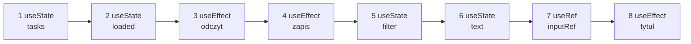
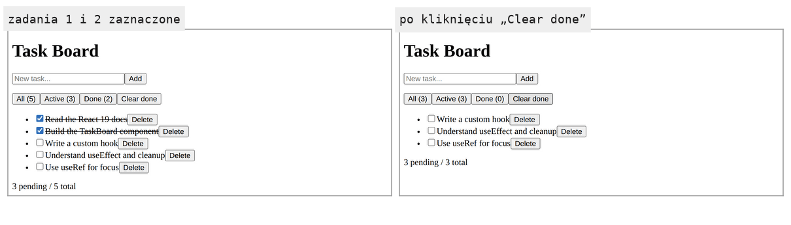

# Reguły hooków i ich powód

## Dwie reguły

Refaktoryzacja przeniosła hooki z `TaskBoard` do dwóch nowych plików, a aplikacja działa bez zmian. Działa, bo przeniesienie nie zmieniło ani liczby wywołań hooków, ani ich kolejności. Właśnie tego pilnują dwie reguły wywoływania hooków.

W `TaskBoard`, `useTasks` i `useLocalStorage` hooki stoją na najwyższym poziomie funkcji, przed każdym warunkowym `return`, i w każdym renderze padają w tej samej kolejności. Między nimi może stać zwykły kod, na przykład obliczenie `counts` w `useTasks`, bo nie zmienia ani liczby hooków, ani ich porządku. Dokumentacja Reacta (*Rules of Hooks*) formułuje dwie reguły. Pierwsza dotyczy miejsca wywołania w funkcji:

> **„Nie wywołuj hooków w pętlach, warunkach, funkcjach zagnieżdżonych ani w blokach `try`/`catch`/`finally`. Zamiast tego zawsze używaj hooków na najwyższym poziomie funkcji Reacta, przed jakimkolwiek wczesnym `return`.”**
>
> *„Don’t call Hooks inside loops, conditions, nested functions, or `try`/`catch`/`finally` blocks. Instead, always use Hooks at the top level of your React function, before any early returns.”*
>
> — dokumentacja React, *Rules of Hooks*

Ta sama strona wylicza przypadki, które łamią pierwszą regułę, choć na pierwszy rzut oka jej nie dotyczą. Hooka nie wywołuje się po warunkowym `return`, w procedurze obsługi zdarzenia, w komponencie klasowym ani w funkcji przekazanej do innego hooka, na przykład do `useEffect`.

Druga reguła dotyczy tego, skąd hooki wolno wywoływać. Dopuszczalne są dwa miejsca: komponent funkcyjny i własny hook. Zwykła funkcja JavaScriptu się nie kwalifikuje. Dokumentacja uzasadnia tę regułę czytelnością: dzięki niej cała logika stanowa komponentu jest widoczna w jego kodzie źródłowym. Własne hooki mogą wywoływać inne hooki, bo same również wywołuje się tylko w trakcie renderu komponentu.

Według dokumentacji hooki są funkcjami, ale lepiej traktować je jak bezwarunkowe deklaracje tego, czego komponent potrzebuje, podobne do importów na początku pliku. Deklaracja nie stoi w warunku, więc wykonuje się przy każdym renderze.

## Skąd `useState` wie, który stan zwrócić

Wywołanie `useState("")` nie dostaje żadnego identyfikatora. Nic w nim nie mówi, że chodzi o pole tekstowe, a nie o filtr. Dokumentacja (*State: A Component's Memory*) odpowiada na to pytanie wprost:

> **„Zamiast tego, żeby zapis mógł być zwięzły, hooki polegają na stałej kolejności wywołań w każdym renderze tego samego komponentu.”**
>
> *„Instead, to enable their concise syntax, Hooks rely on a stable call order on every render of the same component.”*
>
> — dokumentacja React, *State: A Component's Memory*

Dalej dokumentacja opisuje mechanizm. React trzyma dla każdego komponentu tablicę par stanu i bieżący indeks, ustawiany na `0` przed renderem. Każde wywołanie `useState` dostaje kolejną parę i przesuwa indeks o jeden.

Daniel Bugl w *Learn React Hooks* dochodzi do tego samego modelu przez trzy próby własnej implementacji `useState`. Wartość w zmiennej lokalnej funkcji ginie, bo każdy render tworzy ją od nowa. Wartość w jednej zmiennej globalnej działa tylko przy jednym hooku, bo dwa hooki piszą do tej samej zmiennej. Dopiero tablica wartości z licznikiem, zerowanym przed renderem, działa przy wielu hookach. Bugl zaznacza, że prawdziwe hooki nie korzystają ze zmiennych globalnych, ale ograniczenia mają podobne. React trzyma hooki każdego komponentu na liście przypiętej do jego miejsca w drzewie komponentów, a tablica jest uproszczonym modelem tej listy.

## Model w kodzie: tablica komórek i indeks

Model z dokumentacji mieści się w kilkunastu liniach. Pierwsza część to sam `useState` i funkcja `render`. Wszystkie trzy bloki stanowią jeden plik JavaScriptu.

```js
let cells = []; // komórki hooków jednego komponentu, w kolejności wywołań
let index = 0;  // numer komórki dla następnego wywołania hooka

function useState(initial) {
  if (index === cells.length) cells.push({ value: initial }); // pierwszy render: nowa komórka
  const cell = cells[index++]; // komórka spod indeksu; index++ przesuwa indeks o 1
  return [cell.value, (next) => { cell.value = next; }];
}

function render(component) {
  index = 0;          // przed każdym renderem indeks wraca na 0
  return component();
}

function Form() {
  const [text, setText] = useState("");        // zawsze komórka 0
  const [filter, setFilter] = useState("all"); // zawsze komórka 1
  return { text, filter, setText };
}

render(Form).setText("milk"); // setter zmienia komórkę 0; tablica cells żyje między renderami
console.log(render(Form).text, render(Form).filter); // milk all
```

Żaden z dwóch `useState` nie podaje nazwy. `text` dostaje komórkę 0, bo jest wywoływany pierwszy, a `filter` komórkę 1, bo drugi. Dopóki kolejność się nie zmienia, każdy render czyta właściwe wartości.

Druga część dodaje do tego samego pliku dwa hooki: `useRef` trzyma w komórce obiekt z polem `current`, a `useEffect` poprzednią tablicę zależności.

```js
function useRef(initial) {
  if (index === cells.length) cells.push({ current: initial });
  return cells[index++]; // ref to sama komórka
}

function useEffect(setup, deps) {
  if (index === cells.length) cells.push({ deps: null });
  const cell = cells[index++];
  // porównanie z poprzednim renderem; w React 19.3 robi to funkcja areHookInputsEqual
  const changed = cell.deps === null ||                  // pierwszy render
    deps.length !== cell.deps.length ||                  // komórka bez deps (np. ref): cell.deps to undefined
    deps.some((d, i) => !Object.is(d, cell.deps[i]));
  cell.deps = deps;
  if (changed) setup();
}
```

Komponent w tym modelu ma hook w warunku.

```js
cells = []; // Board to inny komponent: zaczyna z własną, pustą tablicą komórek
let total = 5;
function Board() {
  if (total > 0) {
    const [x] = useState(0);      // komórka 0, ale tylko gdy są zadania
  }
  const [text] = useState("");    // komórka 1 albo 0
  const inputRef = useRef(null);  // komórka 2 albo 1
  useEffect(() => console.log("effect, total =", total), [total]); // komórka 3 albo 2
  return JSON.stringify({ text, inputRef });
}

console.log(render(Board)); // effect, total = 5, potem {"text":"","inputRef":{"current":null}}
total = 0;
console.log(render(Board)); // TypeError: Cannot read properties of undefined (reading 'length')
```

Pierwszy render zakłada cztery komórki. W drugim warunek jest fałszywy i wszystkie wywołania przesuwają się o jedną pozycję w górę. `text` czyta komórkę 0, czyli `0` z pominiętego hooka. `inputRef` dostaje komórkę stanu `text`. `useEffect` dostaje komórkę refa, która nie ma pola `deps`, więc `cell.deps.length` czyta `length` z `undefined`. <u>Hook nie wie, którą komórkę dostał; zna tylko jej numer</u>.

## Rysunek 2.19 — hooki `TaskBoard` w kolejności wywołań

Końcowy `TaskBoard` razem z `useTasks` i `useLocalStorage` wywołuje osiem hooków. Licznik renderów zniknął z kodu po pomiarze, więc na liście go nie ma.



Na Rysunku 2.19 każdy prostokąt to pozycja na liście, którą React prowadzi dla egzemplarza `TaskBoard`. Pozycje 1–4 pochodzą z `useLocalStorage`, pozycja 5 z `useTasks`, a pozycje 6–8 z samego komponentu. Sam `TaskBoard` zawiera cztery wywołania (`useTasks`, `useState`, `useRef`, `useEffect`), ale `useTasks` nie zajmuje własnej pozycji, tylko wnosi pięć hooków ze środka. Przy pierwszym renderze React zakłada osiem pozycji. Przy każdym następnym oczekuje tych samych ośmiu w tej samej kolejności i odczytuje je po kolei.

## Czwarta akcja: „Clear done”

Lista z wieloma wykonanymi zadaniami potrzebuje operacji, która usunie je wszystkie naraz. Akcja przyda się też do sprawdzenia reguł, bo opróżnia listę jednym kliknięciem. W `app/hooks/useTasks.js` nowa funkcja staje pod `deleteTask`, a obiekt w `return` dostaje jej nazwę.

```js
// zostawia zadania niewykonane; setter dostaje nową tablicę, jak w deleteTask
function clearDone() {
  setTasks(tasks.filter((t) => !t.done));
}

return { visibleTasks, filter, setFilter, counts, addTask, toggleTask, deleteTask, clearDone };
```

W `app/components/TaskBoard.jsx` nazwa `clearDone` trafia do destrukturyzacji wyniku `useTasks`, a za przyciskiem „Done” pojawia się czwarty przycisk.

```jsx
<button onClick={clearDone}>Clear done</button> {/* zwykła funkcja, nie hook: nie zajmuje pozycji */}
```

Kliknięcie „Clear done” usuwa z listy wszystkie zaznaczone zadania naraz, a liczniki przy filtrach przeliczają się w tym samym renderze. Po tej zmianie `TaskBoard.jsx` ma postać końcową:

```jsx
"use client";
// końcowy TaskBoard: logika zadań w useTasks; pole, fokus i tytuł karty zostają tutaj
import { useState, useEffect, useRef } from "react";
import { useTasks } from "../hooks/useTasks";

export default function TaskBoard({ initialTasks }) {
  const {
    visibleTasks,
    filter,
    setFilter,
    counts,
    addTask,
    toggleTask,
    deleteTask,
    clearDone,
  } = useTasks(initialTasks); // pozycje 1–5 na liście hooków

  const [text, setText] = useState(""); // pozycja 6: treść pola
  const inputRef = useRef(null);        // pozycja 7: węzeł pola, bez renderu przy zmianie

  // pozycja 8: tytuł karty z liczbą niewykonanych zadań
  useEffect(() => {
    document.title =
      counts.pending > 0 ? `(${counts.pending}) Task Board` : "Task Board";
    return () => {
      document.title = "Task Board"; // sprzątanie przy odmontowaniu
    };
  }, [counts.pending]);

  function handleAdd() {
    addTask(text);
    setText("");
    inputRef.current?.focus(); // czynność imperatywna, bez renderu
  }

  return (
    <div>
      <input
        ref={inputRef}
        value={text}
        onChange={(e) => setText(e.target.value)}
        placeholder="New task..."
      />
      <button onClick={handleAdd}>Add</button>

      <p>
        <button onClick={() => setFilter("all")}>All ({counts.total})</button>
        <button onClick={() => setFilter("active")}>Active ({counts.pending})</button>
        <button onClick={() => setFilter("done")}>Done ({counts.done})</button>
        <button onClick={clearDone}>Clear done</button>
      </p>

      <ul>
        {visibleTasks.map((task) => (
          <li key={task.id}>
            <input
              type="checkbox"
              checked={task.done}
              onChange={() => toggleTask(task.id)}
            />
            {task.done ? <s>{task.text}</s> : task.text}
            <button onClick={() => deleteTask(task.id)}>Delete</button>
          </li>
        ))}
      </ul>

      <p>{counts.pending} pending / {counts.total} total</p>
    </div>
  );
}
```

## Rysunek 2.20 — wersja końcowa przed „Clear done” i po nim



Na Rysunku 2.20 obie strony pochodzą z wersji końcowej, której kod stoi wyżej. Po kliknięciu znikają oba zaznaczone zadania, „All” spada z 5 do 3, a „Done” do 0. Liczba niewykonanych zadań się nie zmienia, więc efekt z tytułem karty nie wykonuje się ponownie.

## Hook w warunku

Błędny wariant `TaskBoard.jsx` ma zaraz pod wywołaniem `useTasks` warunek:

```jsx
// BŁĄD: hook w warunku
// gdy lista jest pusta, ten hook znika i każdy następny przesuwa się o pozycję
if (counts.total > 0) {
  const [x, setX] = useState(0);
}
```

Warunek czyta `counts.total`, bo po wydzieleniu hooka komponent nie ma już zmiennej `tasks`. Dopóki lista ma zadania, komponent wywołuje dziewięć hooków, a dodatkowy `useState` zajmuje pozycję 6. Aplikacja działa. Po zaznaczeniu wszystkich zadań i kliknięciu „Clear done” następny render wywołuje osiem hooków, w układzie z Rysunku 2.19. Od pozycji 6 wszystko przesuwa się o jedną w górę:

| Pozycja | Render z zadaniami | Render po „Clear done” |
|---|---|---|
| 1–4 | hooki `useLocalStorage` | hooki `useLocalStorage` |
| 5 | `useState`: filtr | `useState`: filtr |
| 6 | `useState`: `x` z warunku | `useState`: `text` |
| 7 | `useState`: `text` | `useRef`: `inputRef` |
| 8 | `useRef`: `inputRef` | `useEffect`: tytuł |
| 9 | `useEffect`: tytuł | brak |

Konsola pokazuje wtedy „React has detected a change in the order of Hooks called by TaskBoard. This will lead to bugs and errors if not fixed.” z tabelą. Pozycje 1–6 zgadzają się w obu kolumnach, bo na pozycji 6 stał `useState` i stoi `useState`. Pozycja 7 zmienia się z `useState` (*Previous render*) na `useRef` (*Next render*). Tabela kończy się na pierwszej niezgodności.

Zaraz potem pada „TypeError: Cannot read properties of undefined (reading 'length')”, a strona pokazuje „This page couldn’t load”. Przyczyna jest ta sama co w modelu. Ostrzeżenie o kolejności niczego nie zatrzymuje, więc React dalej przydziela pozycje po kolei. Efekt z tytułem karty dostaje pozycję 8, na której w poprzednim renderze leżał ref `inputRef`. Efekt porównuje nową tablicę `[counts.pending]` z poprzednią, zapisaną na swojej pozycji. Ref ma tylko pole `current` i żadnej tablicy zależności, więc porównanie czyta `length` z `undefined`, dokładnie jak w modelu. Wyjątek w renderze przerywa render całego drzewa i Next.js pokazuje stronę błędu.

Bugl opisuje to samo zachowanie: w trybie deweloperskim React wykrywa zmianę kolejności hooków i wypisuje ostrzeżenie. Błąd zależy od danych. Kod przechodzi każde sprawdzenie, w którym lista ma zadania, a błąd pojawia się dopiero przy konkretnym stanie aplikacji. Komunikat `TypeError` nie wskazuje przy tym ani warunku, ani nowego hooka, tylko wnętrze Reacta.

Bugl i Banks z Porcello podają to samo rozwiązanie. Hook wywołuje się zawsze, a warunek przenosi się do środka albo do kodu, który korzysta z wyniku. Banks i Porcello pokazują efekt, który zaczyna się od `if (count < 5) return;` wewnątrz funkcji efektu. Hook stoi na najwyższym poziomie, a warunek decyduje tylko o tym, czy efekt coś zrobi. Bugl dodaje drugą drogę: rozbicie komponentu na dwa i warunkowe renderowanie jednego z nich. Każdy komponent ma wtedy własną, stałą listę hooków.

## Hook poza komponentem

Druga reguła łamie się, gdy wywołanie stoi poza funkcją komponentu, na poziomie modułu:

```jsx
"use client";
import { useState } from "react";

// BŁĄD: hook na poziomie modułu, poza funkcją komponentu
const [x, setX] = useState(0);

export default function TaskBoard({ initialTasks }) {
  // dalej bez zmian
}
```

Strona odpowiada kodem 500, a terminal pokazuje „Invalid hook call.” ze wskazaniem linii z `useState(0)`. Budowanie wersji produkcyjnej przez `npx next build` też się nie kończy: „Export encountered an error on /page: /”. Kod na poziomie modułu wykonuje się przy imporcie pliku, gdy żaden komponent się nie renderuje. W modelu z tablicą komórek oznaczałoby to wywołanie bez `render`, czyli bez komponentu, do którego należy tablica. Moduł wykonuje się już na serwerze, dlatego błąd przychodzi jako odpowiedź 500. Bugl zauważa, że hooki to w większości zwykłe funkcje JavaScriptu. Różni je to, że zależą od wywołania w komponencie funkcyjnym.

## Linter pilnuje reguł wcześniej

Oba błędy widać w Task Board dopiero w przeglądarce, bo projekt powstał bez ESLinta. Flaga `--no-eslint` przy tworzeniu projektu była decyzją świadomą: dzięki niej oba błędy dało się pokazać w działającej aplikacji, z prawdziwymi komunikatami Reacta. Bugl wyjaśnia, że konwencja nazw z przedrostkiem `use` pozwala egzekwować reguły hooków automatycznie. Wtyczka `eslint-plugin-react-hooks` rozpoznaje hooki po nazwie i zgłasza wywołanie w warunku, w pętli albo w zwykłej funkcji jeszcze w edytorze. Dokumentacja reguł hooków odsyła do tej samej wtyczki.

Wtyczka sprawdza dwie klasyczne reguły. Reguła `rules-of-hooks` pilnuje miejsca i kolejności wywołań hooków, a `exhaustive-deps` kompletności tablicy zależności. Schwarzmüller pisze, że wywołanie hooka w niewłaściwym miejscu „może” skończyć się ostrzeżeniem, zależnie od konfiguracji projektu. To „może” zależy od tego, czy projekt ma wtyczkę. Z wtyczką błąd widać w chwili pisania kodu. Bez niej zostaje komunikat w konsoli albo strona z błędem 500.

## Rozszerzenie: wczesny return przed hookami

Ten sam mechanizm stoi za zakazem hooka po wczesnym `return`. Zabezpieczenie `if (!initialTasks) return null;` wstawione na początku `TaskBoard`, nad wywołaniem `useTasks`, wygląda niewinnie. Gdy strona przekaże pustą wartość, render kończy się przed wszystkimi hookami. Gdyby przy następnym renderze dane już były, React dostałby osiem wywołań tam, gdzie poprzednio nie było żadnego.

Ten przypadek zachowuje się inaczej niż hook w warunku. Gdy komponent nadrzędny podaje `TaskBoard` raz listę, a raz `undefined`, serwer deweloperski nie pokazuje tabeli z kolejnością hooków ani żadnego wpisu w konsoli. Przy przejściu od ośmiu hooków do zera lista po prostu znika, a przy przejściu od zera do ośmiu React zakłada pozycje od nowa, jak przy pierwszym renderze. Render zakończony przed pierwszym hookiem nie zostawia żadnej pozycji do porównania, więc nie ma czego zgłosić. Taki błąd najpewniej łapie linter. Wskazuje go przy każdym wywołaniu hooka pod wczesnym `return`, komunikatem „React Hook "useTasks" is called conditionally” i dalej „Did you accidentally call a React Hook after an early return?”. Takie zabezpieczenie stawia się pod ostatnim hookiem.

```jsx
// Przykład spoza demo: zabezpieczenie przed brakiem danych pod ostatnim hookiem TaskBoard.
const {
  visibleTasks, filter, setFilter, counts, addTask, toggleTask, deleteTask, clearDone,
} = useTasks(initialTasks ?? []); // hook zawsze; ?? podstawia [] za undefined

const [text, setText] = useState("");
const inputRef = useRef(null);
useEffect(() => { /* tytuł karty jak dotąd */ }, [counts.pending]);

if (!initialTasks) return null; // wczesny return dopiero pod ósmym hookiem
```

```text
zadanie 1 zaznaczone, potem dane: lista → undefined → lista
undefined   → TaskBoard nie renderuje niczego, konsola bez ostrzeżeń Reacta
lista       → pięć zadań, zadanie 1 dalej zaznaczone, 4 pending / 5 total
linter      → 0 zgłoszeń reguły rules-of-hooks
```

W każdym renderze wywołuje się wszystkie osiem hooków, więc pozycje i stan listy przetrwają przerwę w danych. Druga droga to warunek w komponencie nadrzędnym, który nie renderuje `TaskBoard` bez danych.

> 💡 **Zapamiętaj:** React rozpoznaje hooki wyłącznie po kolejności wywołań. Hooki wywołuje się zawsze, w tej samej kolejności, na najwyższym poziomie komponentu albo własnego hooka, a warunek stawia się wewnątrz hooka.

