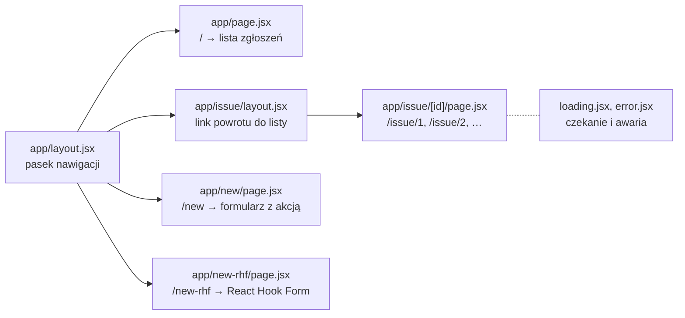
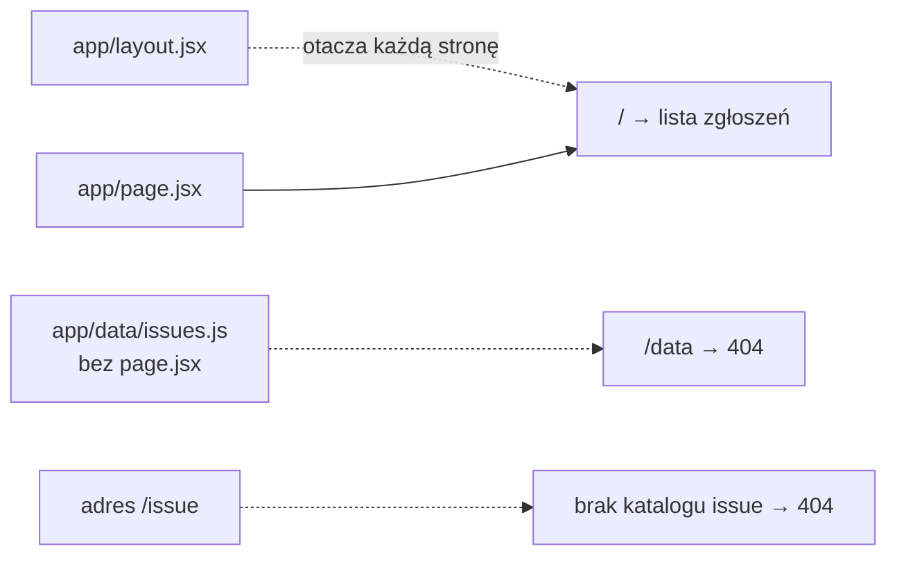

# Szkielet aplikacji i to, co w `app/` staje się adresem

## Dwie drogi między użytkownikiem a aplikacją

Aplikacja webowa wymienia informacje z użytkownikiem w dwóch kierunkach. **Adres** w pasku przeglądarki mówi, co użytkownik chce odczytać, na przykład listę albo jeden rekord. **Formularz** niesie to, co chce zapisać: dane, które trafią na serwer i zmienią stan aplikacji.

Adres jest stanem, który żyje poza kodem aplikacji. Użytkownik zapisuje go w zakładce albo wysyła komuś w wiadomości i oczekuje, że po otwarciu zobaczy ten sam widok. Maximilian Schwarzmüller zauważa, że gdy ścieżka się nie zmienia, odwiedzający mogą udostępnić link tylko do strony startowej (*„can’t share links to anything but the starting page of your website”*). Stąd pierwsza klasa problemów: <u>dopasować adres do widoku</u> i ustalić, które części ekranu są wspólne dla wielu widoków. Druga dotyczy samego odczytu. Dane mogą przychodzić długo albo wcale, a adres może wskazywać rzecz, której nie ma.

Trzecia klasa należy do zapisu. Między wysłaniem formularza a odpowiedzią serwera interfejs jest w stanie pośrednim, który trzeba pokazać, a po odpowiedzi trzeba pokazać jej wynik. Czwarta to zaufanie. Dane od użytkownika mogą łamać reguły aplikacji, więc przed zapisem przechodzą **walidację** (*validation*), czyli sprawdzenie tych reguł. Schwarzmüller zalicza ją do zwykłych zadań współczesnego interfejsu. Strona ma według niego między innymi „wysłać wpisane dane na serwer do sprawdzenia” (*„send that entered data to a server to validate it”*) i pokazać komunikat walidacji.

Te same cztery klasy problemów ma aplikacja wielostronicowa, której każdy ekran składa serwer, i aplikacja jednostronicowa z biblioteką React Router. Frameworki różnią się tym, jakim mechanizmem na nie odpowiadają.

## Mapa klas problemów trackera zgłoszeń

W aplikacji „Issue Tracker”, która zbiera zgłoszenia błędów, każda z klas problemów staje się konkretną usterką. Aplikacja zaczyna od statycznej listy trzech zgłoszeń. Każda następna usterka dostaje własne narzędzie Next.js albo Reacta i własny temat wykładu.

| Klasa problemu | Co psuje się w trackerze | Narzędzie | Temat |
|---|---|---|---|
| Adres → widok | adres `/new` nie prowadzi do żadnego ekranu | katalog `app` i plik `page.jsx` | routing plikowy |
| Wspólne części stron | pasek nawigacji trzeba powtarzać na każdej stronie | layouty | layout główny i zagnieżdżony |
| Przejście bez przeładowania | zwykły link pobiera cały dokument i gubi stan | `Link`, pobieranie z wyprzedzeniem | linki i pamięć klienta |
| Adres z parametrem | `/issue/2` to tekst od użytkownika, który może też brzmieć `/issue/abc` | trasa dynamiczna `[id]` | strona zgłoszenia |
| Czekanie i awaria | wolny odczyt albo wyjątek zostawia pusty ekran | `loading.jsx`, `error.jsx` | czekanie i awaria |
| Dane wspólne dla stron | lista i formularz potrzebują tych samych zgłoszeń | magazyn w module | dane w module |
| Wysłanie formularza | przeglądarka przeładowuje stronę przy wysyłce | `<form action>` | formularz z akcją |
| Wynik i stan wysyłki | użytkownik nie wie, czy wysyłka trwa i jak się skończyła | `useActionState`, `useFormStatus` | stan formularza |
| Poprawność danych | pusty albo za krótki tytuł trafia na listę | schemat Zod | walidacja |
| Walidacja przy pisaniu | błąd widać dopiero po wysłaniu | React Hook Form, Formik, TanStack Form | biblioteki formularzy |

Ekran ładowania i formularze potrzebują własnych adresów, więc wszystko zaczyna się od pytania, jak router zamienia adres na plik.

## Rysunek 3.1 — drzewo tras gotowej aplikacji



Na Rysunku 3.1 strzałka ciągła prowadzi od layoutu do tego, co on otacza, a pod nazwą pliku strony stoi jej adres. Layout główny otacza cztery gałęzie, layout z `app/issue/` tylko strony zgłoszeń. Pliki `loading.jsx` i `error.jsx` leżą obok strony `[id]` i działają tylko dla niej. Katalogów `data` i `lib` na rysunku nie ma, bo nie mają pliku `page.jsx`.

## Projekt z kreatora

Projekt powstaje z kreatora `create-next-app` w przypiętej wersji 16.4.0, a `package.json` zapisuje dokładne wersje `next` 16.4.0 oraz `react` i `react-dom` 19.3.0, których dotyczą wszystkie opisane zachowania. Paczki do walidacji i formularzy (`zod`, `react-hook-form`, `@hookform/resolvers`) instalują się od razu, żeby wykład nie czekał na sieć.

```bash
# w katalogu, w którym ma powstać projekt
npx create-next-app@16.4.0 issuetracker \
  --js --app --no-tailwind --no-eslint --no-src-dir --no-react-compiler \
  --no-cache-components --no-agents-md --import-alias "@/*"  # kreator nie zadaje pytań
cd issuetracker
mv app/page.js app/page.jsx && mv app/layout.js app/layout.jsx   # demo używa rozszerzenia .jsx
rm app/globals.css app/page.module.css app/favicon.ico           # pliki strony startowej
npm install zod@3.25.76 react-hook-form@7.89.0 @hookform/resolvers@3.10.0 --save-exact
```

## Segment, ścieżka i drzewo tras

Katalogi w `app/` wyznaczają segmenty adresu, więc `/issue/2` ma dwa segmenty, `issue` i `2`. Z katalogów powstaje drzewo. Korzeniem jest `app/`, a każdy podkatalog to węzeł potomny. Router dopasowuje adres do tego drzewa od lewej strony, segment po segmencie. Dla `/issue/2` szuka w `app/` katalogu `issue`, a w nim katalogu pasującego do `2`. Jeśli na którymś poziomie nie znajdzie dopasowania, adres kończy się stroną 404. Jeśli dojdzie do końca adresu, sprawdza jeszcze, czy w ostatnim katalogu leży `page.jsx`. Bez tego pliku też zwraca 404.

Projekt na tym etapie ma w `app/` dwa pliki, `layout.jsx` i `page.jsx`, oraz katalog `data/` z danymi. Jedyną stroną, która z tego powstaje, jest `/`. Pozostałe przypadki pokazuje Rysunek 3.2.

## Tabela tras powstaje przy budowaniu

Maximilian Schwarzmüller opisuje router Next.js jako mechanizm, który analizuje system plików (*„analyzes your file system and derives supported routes, their URL paths, and which React components to load and render”*). Wyprowadza z niego trasy, adresy i komponenty, a robi to podczas `next build`. Gotowy `issuetracker` z Rysunku 3.1 dostaje plik `.next/routes-manifest.json` z dwiema listami. Trasy statyczne to `/`, `/new`, `/new-rhf` oraz wewnętrzne `/_not-found` i `/_global-error`, czyli zapasowe strony Next.js dla 404 i dla błędu całej aplikacji. Jedyna trasa dynamiczna to `/issue/[id]` z wyrażeniem regularnym `^/issue/([^/]+?)(?:/)?$`.

Fragment `[^/]+?` pasuje do jednego segmentu bez ukośnika, dlatego `next start` odpowiada na `/issue/1` kodem 200, a na `/issue/1/2` kodem 404. Katalogów bez strony, jak `app/data/` czy sam `app/issue/`, w tabeli nie ma.

Tejas Kumar buduje prostszy wariant: jego serwer szuka pliku dopiero przy żądaniu i importuje go z katalogu `pages/` pod nazwą wziętą z adresu. W miniaturze, bez serwera:

```js
// Router plikowy w miniaturze: adres → plik w pages/ → eksport domyślny
async function handle(url) {
  const page = await import(`./pages${url}.mjs`).catch(() => null); // plik szukany przy żądaniu
  return page ? page.default() : "404";
}
console.log(await handle("/list"));    // → Issue list
console.log(await handle("/detail"));  // → 404
```

Router nie zna z góry nazw komponentów, więc każdy plik strony potrzebuje eksportu domyślnego. Kumar nazywa ten wymóg kompromisem pracy z frameworkiem (*„This is one of the trade-offs of working with frameworks”*), a Next.js stawia go plikom `page.jsx` i `layout.jsx`. Tabela zbudowana z góry ma nad wyszukiwaniem przy żądaniu jedną przewagę: <u>błąd w drzewie tras zatrzymuje build</u>, zanim aplikacja trafi do użytkowników. Tak kończą się na przykład dwa segmenty dynamiczne na jednym poziomie.

## Ten sam router na serwerze i w przeglądarce

Router działający tylko w przeglądarce ma słaby punkt, który Kumar pokazuje na adresie `/detail?thingId=24`. Serwer nie ma takiego pliku i odpowiada stroną 404. Obejściem jest wysyłanie przy każdym 404 strony ze skryptem, który przejmuje routing, ale według Kumara zawodzi ono w wyszukiwarkach i tam, gdzie JavaScript jest ograniczony.

> **„Frameworki dostarczają routery izomorficzne, czyli takie, które działają zarówno na kliencie, jak i na serwerze.”**
>
> *„Frameworks ship isomorphic routers, which are routers that work on both the client and the server.”*
>
> — Tejas Kumar, *Fluent React*

W Next.js oba routery opierają się na tym samym drzewie katalogów. Adres `/issue/2` wklejony do nowej karty obsługuje serwer, kliknięcie `<Link>` router w przeglądarce, a wynik jest ten sam.

## Dane startowe

Dane startowe leżą w pliku `app/data/issues.js`, gotowym przed wykładem:

```js
// app/data/issues.js
// Dane startowe zgłoszeń; w prawdziwej aplikacji leżą w bazie na serwerze.
export const initialIssues = [
  { id: 1, title: "Login button does not work", priority: "high" },
  { id: 2, title: "Page loads slowly", priority: "medium" },
  { id: 3, title: "No e-mail after sign-up", priority: "low" },
];
```

Pole `id` jest liczbą, a `priority` ma wartość `"low"`, `"medium"` albo `"high"`. Dane to zwykły moduł JavaScriptu z eksportem nazwanym, bez żadnego `fetch`.

## Layout główny i pierwsza strona

Szablonowy layout importuje `globals.css` i fonty z `next/font/google`, które przy pierwszym uruchomieniu łączą się z serwerami Google. Plik `app/layout.jsx` dostaje więc taką treść:

```jsx
// app/layout.jsx
export default function RootLayout({ children }) {
  return (
    <html lang="en">
      <body>{children}</body>
    </html>
  );
}
```

Atrybut `lang` ma wartość `en`, bo cały interfejs jest po angielsku. Parametr `children` to strona bieżącego adresu, którą Next.js wstawia w `<body>`.

Plik `app/page.jsx` wyświetla listę:

```jsx
// app/page.jsx
import { initialIssues } from "./data/issues";

export default function HomePage() {
  return (
    <main>
      <h1>Issues</h1>
      <ul>
        {initialIssues.map((issue) => (
          <li key={issue.id}>
            [{issue.priority}] {issue.title}
          </li>
        ))}
      </ul>
    </main>
  );
}
```

Na ekranie stoi nagłówek „Issues” i trzy wiersze, od „[high] Login button does not work” do „[low] No e-mail after sign-up”. Strona jest komponentem serwerowym, bo domyślnie każdy komponent w App Routerze nim jest. Atrybut `key` bierze się z danych, więc jest stały między renderami. Zapis `[{issue.priority}]` to zwykły tekst w nawiasach kwadratowych, w środku którego klamry wstawiają wartość.

## Kod dzielony według tras

Next.js nie wysyła przeglądarce całej aplikacji naraz. Buduje **graf modułów** (*module graph*), w którym każdy plik jest węzłem, a każdy `import` krawędzią. Z tego grafu wylicza, który kod potrzebny jest na danej trasie. Dokumentacja nazywa to **dzieleniem kodu** (*code splitting*):

> **„Podział aplikacji na mniejsze porcje JavaScriptu według tras. Zamiast wczytywać cały kod na początku, wczytuje się tylko kod potrzebny bieżącej trasie, co skraca pierwsze ładowanie.”**
>
> *„The process of dividing your application into smaller JavaScript chunks based on routes. Instead of loading all code upfront, only the code needed for the current route is loaded, reducing initial load time.”*
>
> — dokumentacja Next.js, *Glossary*

Każdy plik `page.jsx` wyznacza więc nie tylko adres, ale też granicę paczki. Ciężki formularz na osobnej trasie nie obciąża strony z listą, bo jego kod trafia do innej porcji. Routing plikowy daje frameworkowi gotową mapę podziału, bo granice tras są zapisane w drzewie katalogów.

Kumar pokazuje dzielenie kodu w samym JavaScripcie: wywołanie `import()`, to samo co w routerze w miniaturze, wczytuje moduł dopiero wtedy, gdy kod jest potrzebny. Do paczki przeglądarki trafiają przy tym wyłącznie komponenty klienckie i ich importy. Na tym etapie tablica z `issues.js` jest importowana tylko przez komponent serwerowy `HomePage`, więc zostaje na serwerze, a przeglądarka dostaje gotowy HTML listy.

## Katalog bez strony

Katalog może mieć własny layout i mimo to nie dawać adresu. Daniel Bugl pokazuje to na panelu z ustawieniami: katalog `dashboard` ma layout bez strony, a podkatalog `settings` ma oba pliki.

> **„Katalog dashboard nie ma pliku page.js, więc wejście pod dashboard/ skończy się błędem 404 Not Found.”**
>
> *„The dashboard folder does not have a page.js file, so going to dashboard/ will result in a 404 Not Found error.”*
>
> — Daniel Bugl, *Modern Full-Stack React Projects*

Layout otacza strony podkatalogów, więc `/dashboard/settings` dostaje jego ramkę, a `/dashboard` nie istnieje.

## Rysunek 3.2 — katalog `app/` po pierwszym kroku i adresy, które z niego wynikają



Na Rysunku 3.2 strzałka ciągła prowadzi od pliku strony do adresu, a przerywane pokazują dwa sposoby, w jakie adres nie powstaje. Katalog `data` nie ma strony, więc dopasowanie dochodzi do końca i trafia na 404. Adres `/issue` odpada na pierwszym kroku, bo takiego katalogu nie ma. Layout stoi z boku, bo adresu nie tworzy.

## Gdzie trzymać pliki pomocnicze

Projekt `issuetracker` trzyma pliki pomocnicze w podkatalogach bezpośrednio w `app/`, bo plik o zwykłej nazwie nie tworzy adresu. Bez adresu zostają jednak wyłącznie takie pliki. Plik `page.jsx` w katalogu `app/data/` utworzyłby adres `/data`, bo `page`, `layout` i pozostałe nazwy plików specjalnych są zastrzeżone w każdym katalogu wewnątrz `app/`.

## Zalety i koszty routingu plikowego

Drzewo katalogów jest jedynym spisem adresów, więc o adresie decyduje położenie pliku, a nie osobna konfiguracja. Za tę jawność płaci się konwencjami: nazwy plików mają znaczenie, a przenoszenie katalogów zmienia adresy.

| Zyskujemy | Płacimy | Kiedy nie warto / co zamiast |
|---|---|---|
| Adres wynika z katalogu, więc spis tras i struktura projektu nie rozjeżdżają się (Rysunek 3.1) | Konwencje nazw plików: `page.jsx`, `layout.jsx` i inne nazwy specjalne są zastrzeżone w każdym katalogu `app/` | Jeden ekran z przełączanym widokiem, bez własnych adresów: stan komponentu zamiast tras |
| Kod dzielony według tras: ciężki formularz nie obciąża listy | Katalog bez `page.jsx` nie jest adresem, więc `/data` kończy się stroną 404 (Rysunek 3.2) | Pliki pomocnicze obok stron: zwykłe nazwy, bo tylko pliki specjalne tworzą adres |
| Tabela tras powstaje przy `next build`, a błąd w drzewie zatrzymuje build | Zmiana adresu to przeniesienie katalogu, a wraz z nim wszystkich linków do niego | Adresy, które często się zmieniają: grupy tras `(nazwa)` porządkują katalogi bez zmiany adresu |

> 💡 **Zapamiętaj:** <u>router dopasowuje adres do drzewa katalogów segment po segmencie, a adres istnieje dopiero wtedy, gdy ostatni katalog ma `page.jsx`</u>. Tabelę tras Next.js buduje z tego drzewa przy `next build`, a każda trasa dostaje własną porcję kodu.


Materiał rozszerzony do tego slajdu: [`rozszerzenia/r01_szkielet-i-katalog-app.md`](rozszerzenia/r01_szkielet-i-katalog-app.md)
