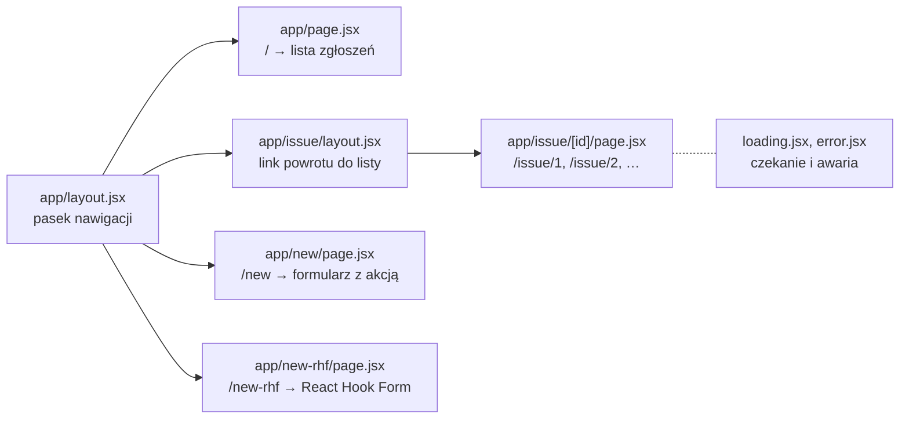
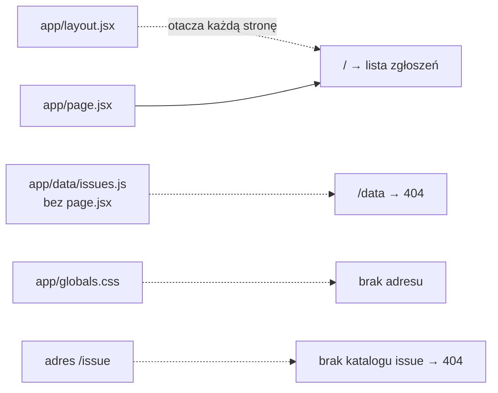

# Szkielet aplikacji i to, co w `app/` staje się adresem

## Dwie drogi między użytkownikiem a aplikacją

Aplikacja webowa wymienia informacje z użytkownikiem w dwóch kierunkach. **Adres** w pasku przeglądarki mówi, co użytkownik chce odczytać, na przykład listę albo jeden rekord. **Formularz** niesie to, co chce zapisać: dane, które trafią na serwer i zmienią stan aplikacji.

Adres jest stanem, który żyje poza kodem aplikacji. Użytkownik zapisuje go w zakładce albo wysyła komuś w wiadomości i oczekuje, że po otwarciu zobaczy ten sam widok. Maximilian Schwarzmüller zauważa, że gdy ścieżka się nie zmienia, odwiedzający mogą udostępnić link tylko do strony startowej (*„can’t share links to anything but the starting page of your website”*). Stąd pierwsza klasa problemów: <u>dopasować adres do widoku</u> i ustalić, które części ekranu są wspólne dla wielu widoków. Druga dotyczy samego odczytu. Dane mogą przychodzić długo albo wcale, a adres może wskazywać rzecz, której nie ma.

Trzecia klasa należy do zapisu. Między wysłaniem formularza a odpowiedzią serwera interfejs jest w stanie pośrednim, który trzeba pokazać, a po odpowiedzi trzeba pokazać jej wynik. Czwarta to zaufanie. Dane od użytkownika mogą łamać reguły aplikacji, więc przed zapisem przechodzą **walidację** (*validation*), czyli sprawdzenie tych reguł. Schwarzmüller zalicza ją do zwykłych zadań współczesnego interfejsu. Strona ma według niego między innymi „wysłać wpisane dane na serwer do sprawdzenia” (*„send that entered data to a server to validate it”*) i pokazać komunikat walidacji.

Te same cztery klasy problemów ma aplikacja wielostronicowa, której każdy ekran składa serwer, i aplikacja jednostronicowa z biblioteką React Router. Frameworki różnią się tym, jakim mechanizmem na nie odpowiadają.

## Cztery pytania jednej aplikacji

W aplikacji „Issue Tracker”, która zbiera zgłoszenia błędów, każda z czterech klas staje się konkretnym pytaniem. Aplikacja zaczyna od statycznej listy czterech zgłoszeń, a gotowa odpowiada na każde pytanie innym mechanizmem Next.js albo Reacta:

1. **Jak adres wskazuje jedno zgłoszenie.** Adres `/issue/2` to tekst od użytkownika, który może też brzmieć `/issue/abc`. Odpowiedzią jest routing plikowy z trasą dynamiczną `[id]`.
2. **Co widać w czasie czekania na dane i po awarii.** Wolny odczyt ani wyjątek nie mogą zostawić pustego ekranu. Tym zajmują się pliki `loading.jsx` i `error.jsx`.
3. **Jak wysłać formularz bez przeładowania strony.** Przycisk ma pokazać, że wysyłka trwa. Służy do tego `<form action>` z hookami `useActionState` i `useFormStatus`.
4. **Jak odrzucić złe dane.** Pusty albo za krótki tytuł nie trafia na listę. Reguły zapisuje schemat Zod, a druga wersja formularza używa biblioteki React Hook Form.

Ekran ładowania i formularze potrzebują własnych adresów, więc wszystko zaczyna się od pytania, jak router zamienia adres na plik.

## Rysunek 3.1 — drzewo tras gotowej aplikacji



Na Rysunku 3.1 strzałka ciągła prowadzi od layoutu do tego, co on otacza, a pod nazwą pliku strony stoi jej adres. Layout główny otacza cztery trasy, layout z `app/issue/` tylko strony zgłoszeń. Pliki `loading.jsx` i `error.jsx` leżą obok strony `[id]` i działają tylko dla niej. Katalogów `components`, `data` i `lib` na rysunku nie ma, bo nie mają pliku `page.jsx`.

## Projekt z kreatora

Projekt powstaje z kreatora `create-next-app` w przypiętej wersji 16.4.0, a `package.json` zapisuje dokładne wersje `next` 16.4.0 oraz `react` i `react-dom` 19.3.0, których dotyczą wszystkie opisane zachowania.

```bash
# w katalogu, w którym ma powstać projekt
npx create-next-app@16.4.0 issuetracker \
  --js --app --no-tailwind --no-eslint --no-src-dir --no-react-compiler \
  --no-cache-components --no-agents-md --import-alias "@/*"  # kreator nie zadaje pytań
cd issuetracker
mv app/page.js app/page.jsx && mv app/layout.js app/layout.jsx   # demo używa rozszerzenia .jsx
rm app/page.module.css                                           # arkusz strony startowej
```

## Segment, ścieżka i drzewo tras

Katalogi w `app/` wyznaczają segmenty adresu, więc `/issue/2` ma dwa segmenty, `issue` i `2`. Z katalogów powstaje drzewo. Korzeniem jest `app/`, a każdy podkatalog to węzeł potomny. Router dopasowuje adres do tego drzewa od lewej strony, segment po segmencie. Dla `/issue/2` szuka w `app/` katalogu `issue`, a w nim katalogu pasującego do `2`. Jeśli na którymś poziomie nie znajdzie dopasowania, adres kończy się stroną 404. Jeśli dojdzie do końca adresu, sprawdza jeszcze, czy w ostatnim katalogu leży `page.jsx`. Bez tego pliku też zwraca 404.

Projekt na tym etapie ma w `app/` cztery pliki, `layout.jsx`, `page.jsx`, `globals.css` i `favicon.ico` z kreatora, oraz katalog `data/` z danymi. Jedyną stroną, która z tego powstaje, jest `/`. Plik `favicon.ico` to plik metadanych: `next start` podaje go pod `/favicon.ico` jako obrazek z kodem 200. Pozostałe przypadki pokazuje Rysunek 3.2.

## Tabela tras powstaje przy budowaniu

Maximilian Schwarzmüller opisuje router Next.js jako mechanizm, który analizuje system plików (*„analyzes your file system and derives supported routes, their URL paths, and which React components to load and render”*). Wyprowadza z niego trasy, adresy i komponenty, a robi to podczas `next build`. Gotowy `issuetracker` z Rysunku 3.1 dostaje plik `.next/routes-manifest.json` z dwiema listami. Trasy statyczne to `/`, `/new`, `/new-rhf` oraz wewnętrzne `/_not-found` i `/_global-error`, czyli zapasowe strony Next.js dla 404 i dla błędu całej aplikacji. Jedyna trasa dynamiczna to `/issue/[id]` z wyrażeniem regularnym `^/issue/([^/]+?)(?:/)?$`.

Fragment `[^/]+?` pasuje do jednego segmentu bez ukośnika, dlatego `next start` odpowiada na `/issue/1` kodem 200, a na `/issue/1/2` kodem 404. Katalogów bez strony, jak `app/data/` czy sam `app/issue/`, w tabeli nie ma.

Tejas Kumar buduje prostszy wariant: jego serwer szuka pliku dopiero przy żądaniu i importuje go z katalogu `pages/` pod nazwą wziętą z adresu. W miniaturze, bez serwera:

```js
// Router plikowy w miniaturze: adres → plik w pages/ → eksport domyślny
async function handle(url) {
  const page = await import(`./pages${url}.mjs`).catch(() => null); // plik szukany przy żądaniu
  return page ? page.default() : "404";
}
console.log(await handle("/list"));    // → Issue list
console.log(await handle("/detail"));  // → 404
```

Router nie zna z góry nazw komponentów, więc każdy plik strony potrzebuje eksportu domyślnego. Kumar nazywa ten wymóg kompromisem pracy z frameworkiem (*„This is one of the trade-offs of working with frameworks”*), a Next.js stawia go plikom `page.jsx` i `layout.jsx`. Tabela zbudowana z góry ma nad wyszukiwaniem przy żądaniu jedną przewagę: <u>błąd w drzewie tras zatrzymuje build</u>, zanim aplikacja trafi do użytkowników. Tak kończą się na przykład dwa segmenty dynamiczne na jednym poziomie.

## Ten sam router na serwerze i w przeglądarce

Router działający tylko w przeglądarce ma słaby punkt, który Kumar pokazuje na adresie `/detail?thingId=24`. Serwer nie ma takiego pliku i odpowiada stroną 404. Obejściem jest wysyłanie przy każdym 404 strony ze skryptem, który przejmuje routing, ale według Kumara zawodzi ono w wyszukiwarkach i tam, gdzie JavaScript jest ograniczony.

> **„Frameworki dostarczają routery izomorficzne, czyli takie, które działają zarówno na kliencie, jak i na serwerze.”**
>
> *„Frameworks ship isomorphic routers, which are routers that work on both the client and the server.”*
>
> — Tejas Kumar, *Fluent React*

W Next.js oba routery opierają się na tym samym drzewie katalogów. Adres `/issue/2` wklejony do nowej karty obsługuje serwer, kliknięcie `<Link>` router w przeglądarce, a wynik jest ten sam.

## Pusty arkusz i dane startowe

Plik `app/globals.css` zostaje, choć traci wszystkie reguły:

```css
/* app/globals.css: zastąpić całą zawartość */
/* globals.css: celowo pusty, demo nie ma stylów. */
```

Pusty plik zostaje, bo importuje go layout główny, a usunięcie pliku dałoby błąd importu.

Dane startowe leżą w nowym pliku `app/data/issues.js`:

```js
// app/data/issues.js: utworzyć plik
// Dane startowe zgłoszeń: stała tablica na potrzeby demo.
// W prawdziwej aplikacji dane czyta się z bazy na serwerze.
export const initialIssues = [
  { id: 1, title: "Login button does not work on Safari",       priority: "high",   status: "open"   },
  { id: 2, title: "Page loads slowly on mobile",                priority: "medium", status: "open"   },
  { id: 3, title: "Registration form does not validate e-mail", priority: "high",   status: "open"   },
  { id: 4, title: "No e-mail notification after registration",  priority: "low",    status: "closed" },
];
```

Pole `id` jest liczbą, `priority` ma wartość `"low"`, `"medium"` albo `"high"`, a `status` wartość `"open"` albo `"closed"`. Dane to zwykły moduł JavaScriptu z eksportem nazwanym, bez żadnego `fetch`.

## Layout główny i pierwsza strona

Plik `app/layout.jsx` dostaje w pierwszej wersji taką treść:

```jsx
// app/layout.jsx: zastąpić całą zawartość
// Layout główny: powłoka HTML wspólna dla wszystkich tras.
import "./globals.css";                      // arkusz ładowany raz, dla całej aplikacji

export const metadata = {                    // obiekt, z którego Next.js składa <head>
  title: "Issue Tracker — Demo L03",
};

export default function RootLayout({ children }) {  // children: strona bieżącego adresu
  return (
    <html lang="en">
      <body>{children}</body>
    </html>
  );
}
```

Atrybut `lang` ma wartość `en`, bo cały interfejs jest po angielsku. Z obiektu `metadata` Next.js generuje znaczniki w `<head>`, więc karta przeglądarki dostaje tytuł z pola `title`.

Plik `app/page.jsx` wyświetla listę.

```jsx
// app/page.jsx: zastąpić całą zawartość
// Lista zgłoszeń: komponent serwerowy (domyślny w App Routerze).
import { initialIssues } from "./data/issues";

export default function HomePage() {
  return (
    <div>
      <h1>Issue Tracker</h1>
      <ul>
        {initialIssues.map((issue) => (           // jeden <li> na zgłoszenie
          <li key={issue.id}>                     {/* klucz z danych, stały między renderami */}
            [{issue.priority}] {issue.title} — {issue.status}
          </li>
        ))}
      </ul>
    </div>
  );
}
```

Na ekranie stoi nagłówek „Issue Tracker” i cztery wiersze, od `[high] Login button does not work on Safari — open` do `[low] No e-mail notification after registration — closed`. Zapis `[{issue.priority}]` to zwykły tekst w nawiasach kwadratowych, w środku którego klamry wstawiają wartość.

## Kod dzielony według tras

Next.js nie wysyła przeglądarce całej aplikacji naraz. Buduje **graf modułów** (*module graph*), w którym każdy plik jest węzłem, a każdy `import` krawędzią. Z tego grafu wylicza, który kod potrzebny jest na danej trasie. Dokumentacja nazywa to **dzieleniem kodu** (*code splitting*):

> **„Podział aplikacji na mniejsze porcje JavaScriptu według tras. Zamiast wczytywać cały kod na początku, wczytuje się tylko kod potrzebny bieżącej trasie, co skraca pierwsze ładowanie.”**
>
> *„The process of dividing your application into smaller JavaScript chunks based on routes. Instead of loading all code upfront, only the code needed for the current route is loaded, reducing initial load time.”*
>
> — dokumentacja Next.js, *Glossary*

Każdy plik `page.jsx` wyznacza więc nie tylko adres, ale też granicę paczki. Ciężki formularz na osobnej trasie nie obciąża strony z listą, bo jego kod trafia do innej porcji. Routing plikowy daje frameworkowi gotową mapę podziału, bo granice tras są zapisane w drzewie katalogów.

Kumar pokazuje dzielenie kodu w samym JavaScripcie: wywołanie `import()`, to samo co w routerze w miniaturze, wczytuje moduł dopiero wtedy, gdy kod jest potrzebny. Do paczki przeglądarki trafiają przy tym wyłącznie komponenty klienckie i ich importy. Tablica z `issues.js` jest importowana tylko przez komponent serwerowy `HomePage`, więc zostaje na serwerze, a przeglądarka dostaje gotowy HTML listy.

## Katalog bez strony

Katalog może mieć własny layout i mimo to nie dawać adresu. Daniel Bugl pokazuje to na panelu z ustawieniami: katalog `dashboard` ma layout bez strony, a podkatalog `settings` ma oba pliki.

> **„Katalog dashboard nie ma pliku page.js, więc wejście pod dashboard/ skończy się błędem 404 Not Found.”**
>
> *„The dashboard folder does not have a page.js file, so going to dashboard/ will result in a 404 Not Found error.”*
>
> — Daniel Bugl, *Modern Full-Stack React Projects*

Layout otacza strony podkatalogów, więc `/dashboard/settings` dostaje jego ramkę, a `/dashboard` nie istnieje.

## Rysunek 3.2 — katalog `app/` po pierwszym kroku i adresy, które z niego wynikają



Na Rysunku 3.2 strzałka ciągła prowadzi od pliku strony do adresu, a przerywane pokazują trzy sposoby, w jakie adres nie powstaje. Katalog `data` nie ma strony, więc dopasowanie dochodzi do końca i trafia na 404. Arkusz `globals.css` jest plikiem, więc nie jest segmentem. Adres `/issue` odpada na pierwszym kroku, bo takiego katalogu nie ma. Layout stoi z boku, bo adresu nie tworzy.

## Gdzie trzymać pliki pomocnicze

Projekt `issuetracker` trzyma pliki pomocnicze w podkatalogach bezpośrednio w `app/`, bo plik o zwykłej nazwie nie tworzy adresu. Bez adresu zostają jednak wyłącznie takie pliki. Plik `page.jsx` w katalogu `app/data/` utworzyłby adres `/data`, bo `page`, `layout` i pozostałe nazwy plików specjalnych są zastrzeżone w każdym katalogu wewnątrz `app/`.

## Rozszerzenie: foldery prywatne `_nazwa`

Podkreślnik na początku nazwy katalogu wyłącza go z routingu razem z podkatalogami, na przykład `_components`.

> **„To sygnał, że katalog jest prywatnym szczegółem implementacji i system tras ma go pomijać. Wyłącza to z routingu ten katalog i wszystkie jego podkatalogi.”**
>
> *„This indicates the folder is a private implementation detail and should not be considered by the routing system, thereby opting the folder and all its subfolders out of routing.”*
>
> — dokumentacja Next.js, *Project Structure*

Zwykłe pliki i tak nie tworzą adresów, więc dokumentacja podaje inne powody. Nazwy z podkreślnikiem sortują się w edytorze razem i chronią przed konfliktem z plikami specjalnymi przyszłych wersji Next.js.

```text
// Przykład spoza demo: katalog prywatny obok zwykłego, po next build
app/_components/page.jsx   → /_components → 404
app/components/page.jsx    → /components  → 200
app/%5Fnotes/page.jsx      → /_notes      → 200
```

Katalog `app/components/` z `issuetracker` trzyma tylko `SubmitButton.jsx`, ale pierwszy `page.jsx` dałby w nim adres. Ostatni wiersz to sposób na adres z podkreślnikiem: `%5F` jest zakodowanym znakiem `_`.

## Rozszerzenie: grupy tras `(nazwa)`

Katalog w nawiasie okrągłym nadal bierze udział w routingu, ale jego nazwa nie trafia do adresu. Router przy dopasowaniu po prostu go przeskakuje.

> **„Grupy tras to konwencja nazywania katalogów, która pozwala porządkować trasy według kategorii albo zespołu.”**
>
> *„Route Groups are a folder convention that let you organize routes by category or team.”*
>
> — dokumentacja Next.js, *Route Groups*

Minimalny przykład spoza projektu pokazuje oba skutki naraz:

```text
app/(shop)/layout.jsx       ← ramka sklepu, bez segmentu w adresie
app/(shop)/cart/page.jsx    → /cart, w ramce sklepu
app/(info)/about/page.jsx   → /about, bez ramki sklepu
```

Adresy `/cart` i `/about` nie zdradzają, że strony leżą w dwóch grupach. Grupa daje jednak jednej z nich własny layout, a drugiej nie. Dwie grupy nie mogą prowadzić do tego samego adresu. Dokumentacja podaje przykład: pliki `(marketing)/about/page.js` i `(shop)/about/page.js` dają oba `/about` i kończą się błędem (*„would both resolve to `/about` and cause an error”*).

## Rozszerzenie: katalog `src/` i ścieżki importów

Next.js dopuszcza katalog `src/`, który oddziela kod aplikacji od konfiguracji. Stary `app/` w korzeniu sprawia jednak, że `src/app/` zostanie pominięty (*„`src/app` or `src/pages` will be ignored if `app` or `pages` are present in the root directory”*).

```text
// Przykład spoza demo: src/app obok app w korzeniu projektu, po next build
app/page.jsx               → /      → 200
src/app/about/page.jsx     → /about → 404, bo cały src/app jest pominięty
```

Plik `jsconfig.json` definiuje alias `"@/*": ["./*"]`, czyli `@/` oznacza korzeń projektu niezależnie od miejsca pliku.

```jsx
// Przykład spoza demo: import danych aliasem w app/issue/[id]/page.jsx
import { initialIssues } from "@/app/data/issues";  // to samo co "../../data/issues"
```

Kod demo zostaje przy ścieżkach względnych, bo żaden plik nie leży głębiej niż dwa poziomy pod `app/`.

> 💡 **Zapamiętaj:** <u>router dopasowuje adres do drzewa katalogów segment po segmencie, a adres istnieje dopiero wtedy, gdy ostatni katalog ma `page.jsx`</u>. Tabelę tras Next.js buduje z tego drzewa przy `next build`, a każda trasa dostaje własną porcję kodu.

