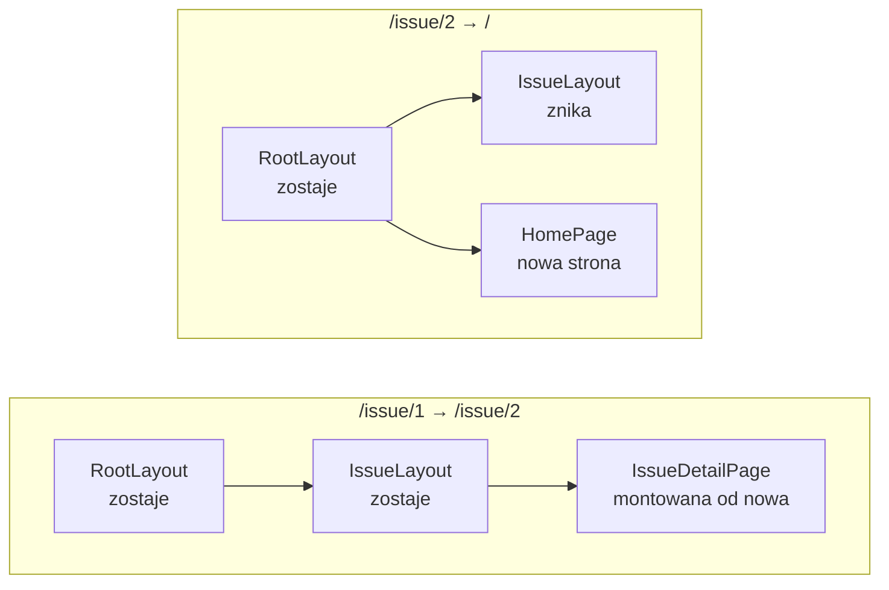

# Ramka, która zostaje na miejscu przy nawigacji

## Nawigacja w layoucie głównym

Lista zgłoszeń ma na razie jeden adres. Zanim pojawią się kolejne, aplikacja dostaje nawigację widoczną na każdej stronie. Jej miejscem jest layout główny, czyli komponent, który otacza wszystkie strony. Plik `app/layout.jsx` dostaje import `Link`, opis strony w metadanych i pasek nawigacji nad treścią:

```jsx
// app/layout.jsx: zastąpić całą zawartość
// Layout główny: powłoka HTML wspólna dla wszystkich tras.
// Nawigacja używa Link: przejście po stronie klienta, bez przeładowania strony.
import "./globals.css";                      // arkusz ładowany raz, dla całej aplikacji
import Link from "next/link";                // komponent linku z Next.js

export const metadata = {                    // obiekt, z którego Next.js składa <head>
  title: "Issue Tracker — Demo L03",
  description: "Live-coding demo: routing and forms (React 19 + Next.js 16)", // opis strony w <head>
};

export default function RootLayout({ children }) {  // children: strona bieżącego adresu
  return (
    <html lang="en">
      <body>
        <nav>                                {/* poza <main>: wspólne dla każdej trasy */}
          <Link href="/">Issues</Link>
          {" | "}                            {/* napis w klamrach, żeby JSX nie przyciął spacji */}
          <Link href="/new">+ New Issue</Link>
        </nav>
        <main>{children}</main>              {/* tu Next.js wstawia stronę bieżącego adresu */}
      </body>
    </html>
  );
}
```

Nad nagłówkiem „Issue Tracker” stoi pasek „Issues | + New Issue”. Drugi link prowadzi na razie do strony 404, bo `/new` nie ma jeszcze strony.

Klamry wokół `" | "` są potrzebne, bo JSX przycina białe znaki na brzegach tekstu między znacznikami. Zapis bez klamer dałby linki sklejone z kreską bez spacji.

## Layout w layoucie

Każdy katalog w `app/` może mieć własny `layout.jsx`. Layout z podkatalogu trafia do `children` layoutu głównego i otacza strony swojego segmentu. Dla każdego adresu Next.js zbiera layouty z katalogów na ścieżce od `app/` w dół, składa je w łańcuch, a na samym końcu wstawia stronę.

Strony szczegółów zgłoszeń dostaną własną ramkę. Nowy plik `app/issue/layout.jsx` wygląda tak:

```jsx
// app/issue/layout.jsx: utworzyć plik
// Layout zagnieżdżony: renderuje się WEWNĄTRZ RootLayout i otacza każdą trasę /issue/*.
// Pokazuje składanie layoutów: RootLayout > IssueLayout > strona.
import Link from "next/link";

export default function IssueLayout({ children }) {
  return (
    <section>
      <p>
        <Link href="/">← Back to issues</Link>
      </p>
      {children}
    </section>
  );
}
```

`IssueLayout` dokłada link „← Back to issues” nad każdą stroną w segmencie `issue`. Nie zwraca `<html>` ani `<body>`, bo te znaczniki ma już layout główny. Strona `/` tego linku nie dostanie, bo nie leży w katalogu `app/issue/`. Katalog nie ma jeszcze żadnej strony, więc adresy `/issue` i `/issue/1` kończą się stroną 404 pod paskiem nawigacji, bez linku powrotu. Layout otacza strony, więc w pustym katalogu nie ma czego otaczać.

## Częściowe renderowanie

Przy przejściu między stronami router porównuje dwa łańcuchy layoutów, stary i nowy. Część wspólna zostaje na miejscu, a wymienia się tylko to, co poniżej niej się różni. Next.js nazywa to **częściowym renderowaniem** (*partial rendering*). Dotyczy ono dwóch miejsc naraz. Na serwerze komponenty wspólnych layoutów nie wykonują się ponownie, więc serwer wysyła opis tylko zmienionej części. W przeglądarce React nie montuje wspólnych layoutów od nowa. Dokumentacja opcji `staleTimes` podkreśla skutek dla danych. Przy nawigacji ponownie pobiera się tylko zmieniony segment strony (*„shared layouts won't automatically be refetched on every navigation, only the page segment that changes”*).

## Stan należy do miejsca w drzewie

To, że layout zachowuje stan, wynika z miejsca, w którym React ten stan trzyma. Jest nim **Fiber**, długowieczna struktura przypisana do komponentu na ekranie. Kumar zaznacza, że Fiber oprócz propsów i stanu zapisuje też pozycję komponentu w drzewie (*„The Fiber node also contains information about its position in the component tree”*). Uzgadnianie, czyli porównanie starego drzewa elementów z nowym, zostawia Fiber na miejscu, dopóki na tej pozycji stoi komponent tego samego typu.

Na razie `app/issue/` nie ma strony, więc skutek widać dopiero w gotowej aplikacji, w której pod `app/issue/[id]/` stoi strona zgłoszenia `IssueDetailPage`. Przy przejściu z `/issue/1` na `/issue/2` `RootLayout` i `IssueLayout` stoją tam na tych samych pozycjach, więc ich Fibery zostają razem ze stanem. Strona zachowuje się inaczej, choć jej typ też się nie zmienia. Pole z `useState` w `IssueLayout` i drugie takie pole w `IssueDetailPage` dają po przejściu różny wynik. Pierwsze zachowuje wpisany tekst, drugie jest puste. Wynik zgadza się z założeniem, że router nadaje poddrzewu segmentu klucz z jego wartością, a inny klucz każe Reactowi zamontować stronę od nowa.


Na Rysunku 3.3 pole w `IssueLayout` zachowuje wpisane „abc” po przejściu na `/issue/2`. Pole tekstowe i link „Next issue →” dodano tylko na potrzeby zrzutu, gotowa aplikacja ich nie ma.

Przy przejściu z `/issue/2` przez `/` z powrotem na `/issue/2` puste jest także pole w layoucie. Strona główna nie leży w katalogu `app/issue/`, więc po drodze `IssueLayout` zniknął z drzewa razem ze swoim Fiberem. <u>Stan layoutu przetrwa tylko te przejścia, w których layout ani na chwilę nie znika z drzewa</u>.

## Rysunek 3.4 — co dzieje się z warstwami przy dwóch przejściach



Rysunek 3.4 pokazuje dwa przejścia w gotowej aplikacji, ze stroną zgłoszenia pod `app/issue/[id]/`. Każda ramka to jedno przejście, a węzły biegną od layoutu głównego do strony. W lewej ramce zmienia się tylko ostatni węzeł. W prawej rozgałęzienie zaczyna się już pod `RootLayout`, bo strona główna leży bezpośrednio w `app/`.

## Layout nie jest miejscem na kontrolę dostępu

Przewodnik o uwierzytelnianiu wyciąga z częściowego renderowania wniosek dla sprawdzania sesji:

> **„Z powodu częściowego renderowania trzeba uważać na sprawdzenia w layoutach, bo nie renderują się one ponownie przy nawigacji. Sesja użytkownika nie będzie więc sprawdzana przy każdej zmianie trasy.”**
>
> *„Due to Partial Rendering, be cautious when doing checks in Layouts as these don't re-render on navigation, meaning the user session won't be checked on every route change.”*
>
> — dokumentacja Next.js, *Authentication*

Layout panelu administracyjnego, który sprawdza sesję i ukrywa treść niezalogowanym, zrobi to przy pierwszym wejściu. Po wylogowaniu w innej karcie przejście między podstronami panelu nie uruchomi tego sprawdzenia ponownie. Ten sam przewodnik dodaje drugi argument. Next.js renderuje layout i stronę jako osobne segmenty, więc layout, który nie wstawi `children`, nie powstrzyma kodu strony przed wykonaniem na serwerze. Sprawdzenie stawia się więc blisko danych, w kodzie, który je odczytuje.

## Czego layout nie dostaje

Z trwałości wynika też ograniczenie danych wejściowych. Strona dostaje prop `searchParams` z częścią adresu po znaku `?`, a layout go nie dostaje. Dokumentacja podaje powód.

> **„W odróżnieniu od stron layouty (Server Components) nie dostają propa `searchParams`. Wspólny layout nie renderuje się przy nawigacji, więc wartości z adresu mogłyby się w nim zestarzeć.”**
>
> *„Unlike Pages, Layouts (Server Components) do not receive the `searchParams` prop. This is because a shared layout is not re-rendered during navigation which could lead to stale `searchParams` between navigations.”*
>
> — dokumentacja Next.js, *useSearchParams*

Ten sam powód odbiera layoutowi bieżącą ścieżkę. Dokumentacja `layout.js` zaleca czytać ją w komponencie klienckim, bo komponenty klienckie renderują się przy nawigacji ponownie. Layout nie widzi też surowego obiektu żądania. Nagłówki i ciasteczka bieżącego żądania odczytuje się osobno, funkcjami `headers()` i `cookies()` z modułu `next/headers`. Layout w segmencie dynamicznym dostaje za to prop `params` z wartościami segmentów leżących nad nim i w nim samym.

Dokumentacja `layout.js` dodaje zdanie o segmentach poniżej.

> **„Layout nie ma dostępu do segmentów trasy leżących poniżej niego.”**
>
> *„Layouts do not have access to the route segments below itself.”*
>
> — dokumentacja Next.js, *layout.js*

`IssueLayout` w katalogu `app/issue/` nie zna więc numeru zgłoszenia, a tytuł zgłoszenia należy do strony. Layout nie wie też, która strona leży pod nim. Do tego służy hook `useSelectedLayoutSegment`, wywoływany w komponencie klienckim, który layout importuje:

```jsx
"use client";                                  // hook działa tylko w komponencie klienckim
import { useSelectedLayoutSegment } from "next/navigation";

export default function Seg() {
  const segment = useSelectedLayoutSegment(); // aktywny segment o jeden poziom niżej
  return <span>segment={String(segment)}</span>;
}
```

Wstawiony do `app/layout.jsx` komponent pokazuje `segment=null` na stronie `/`, `segment=issue` na `/issue/2` i `segment=new` na `/new`. Hook zwraca jeden segment, ten bezpośrednio pod layoutem, w którym go użyto. Dokumentacja podaje jako zastosowanie zakładki w layoucie nadrzędnym, które zmieniają wygląd zależnie od aktywnej podstrony.

## Wolne dane w layoucie

Layout, który sam pobiera dane, ma pułapkę związaną z ekranem ładowania. Plik `loading.jsx`, czyli ekran pokazywany w czasie oczekiwania na stronę, daje treść zastępczą tylko temu, co leży pod layoutem. Dokumentacja `layout.js` opisuje skutek dla aplikacji z wyłączonym modelem Cache Components. To opcjonalny tryb Next.js 16, włączany w konfiguracji opcją `cacheComponents`, w którym strona łączy treść przygotowaną z góry z treścią liczoną przy żądaniu. Projekt `issuetracker` powstał z flagą `--no-cache-components`, więc ostrzeżenie dotyczy także jego.

> **„Nawigacja jest zablokowana, dopóki layout nie skończy się renderować, a treść zastępcza z `loading.js` się nie pokazuje.”**
>
> *„The navigation will block until the layout finishes rendering, and the `loading.js` fallback will not be shown.”*
>
> — dokumentacja Next.js, *layout.js*

Gdyby layout odczytywał ustawienia użytkownika z wolnego serwisu, kliknięcie nie dawałoby żadnej reakcji do końca tego odczytu. Dokumentacja podaje dwa wyjścia:

1. **Własna granica `<Suspense>`** wokół tego fragmentu layoutu, który czeka na dane. Komponent `Suspense` pokazuje treść zastępczą z propa `fallback`, dopóki fragment w jego wnętrzu nie jest gotowy.
2. **Przeniesienie pobierania** z `layout.jsx` do `page.jsx`, gdzie obejmie je `loading.jsx`.

Drugie wyjście jest prostsze, gdy dane i tak dotyczą jednej strony. Pierwsze zostaje dla danych, które rzeczywiście należą do ramki, na przykład nazwy zalogowanego użytkownika w pasku nawigacji.

## `template`, czyli ramka tworzona od nowa

Czasem trwałość layoutu przeszkadza. Next.js ma na to plik o tej samej budowie co `layout.jsx`, ale z odwrotnym zachowaniem przy nawigacji.

> **„W odróżnieniu od layoutów, które trwają między trasami i zachowują stan, szablony dostają unikalny klucz, więc komponenty klienckie w ich wnętrzu tracą stan przy nawigacji.”**
>
> *„Unlike layouts that persist across routes and maintain state, templates are given a unique key, meaning children Client Components reset their state on navigation.”*
>
> — dokumentacja Next.js, *template.js*

Mechanizm to zwykły klucz Reacta: zmiana `key` każe wyrzucić stare poddrzewo razem ze stanem i zbudować nowe. Plik `template.jsx` przydaje się w trzech sytuacjach:

1. **Ponowne uruchomienie efektu** przy każdej nawigacji, na przykład licznika odwiedzin.
2. **Wyczyszczenie stanu komponentu klienckiego**, na przykład pola wyszukiwania.
3. **Zmiana zachowania granic Suspense.** W layoucie treść zastępcza pokazuje się tylko przy pierwszym wejściu, a w szablonie przy każdym przejściu.

Która nawigacja przebudowuje szablon, zależy od jego miejsca w drzewie. Szablon w katalogu `blog` powstaje od nowa przy przejściu z `/blog/first-post` na `/blog/second-post`, bo zmienił się segment pod nim. Szablon w korzeniu `app/` przy tym samym przejściu zostaje. Parametry po znaku `?` nie przebudowują żadnego szablonu. W `issuetracker` plik `app/issue/template.jsx` z polem wyszukiwania wyczyściłby to pole przy przejściu z `/issue/1` na `/issue/2`.

<u>Layout wybiera się dla tego, co ma przetrwać nawigację, a szablon dla tego, co ma przy niej zacząć od zera</u>. Zamiana `layout.jsx` na `template.jsx` kosztuje cały stan ramki przy każdym przejściu, także ten, który miał zostać.

> 💡 **Zapamiętaj:** <u>wspólny layout przy nawigacji nie wykonuje się ponownie</u>, dlatego zachowuje stan. Nie dostaje też `searchParams` i nie nadaje się do sprawdzania sesji. Layout zna tylko segmenty nad sobą, a aktywny segment poniżej odczytuje hook `useSelectedLayoutSegment`. Plik `template.jsx` ma budowę layoutu, ale przy każdej nawigacji powstaje od nowa.


Materiał rozszerzony do tego slajdu: [`rozszerzenia/r02_layouty.md`](rozszerzenia/r02_layouty.md)
