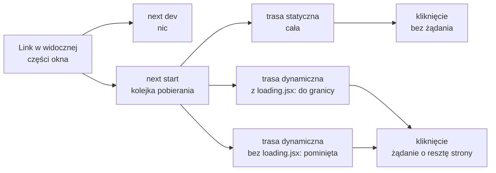

# Linki do zgłoszeń i trasy pobierane z wyprzedzeniem

## Każde zgłoszenie dostaje link

Lista na stronie głównej pokazuje zgłoszenia, ale nie prowadzi do żadnego z nich. Plik `app/page.jsx` dostaje import `Link` i link w każdym wierszu:

```jsx
// app/page.jsx: zastąpić całą zawartość
// Lista zgłoszeń: komponent serwerowy (domyślny w App Routerze).
import Link from "next/link";
import { initialIssues } from "./data/issues";

export default function HomePage() {
  return (
    <div>
      <h1>Issue Tracker</h1>
      <ul>
        {initialIssues.map((issue) => (           // jeden <li> na zgłoszenie
          <li key={issue.id}>                     {/* klucz z danych, stały między renderami */}
            <Link href={`/issue/${issue.id}`}>    {/* adres budowany z danych */}
              [{issue.priority}] {issue.title}
            </Link>
            {" — "}                               {/* status poza linkiem, jako zwykły tekst */}
            {issue.status}
          </li>
        ))}
      </ul>
    </div>
  );
}
```

Wartość `href` powstaje z **szablonu tekstowego** (*template literal*). To napis w odwrotnych apostrofach, w którym `${…}` wstawia wynik wyrażenia:

```js
const issue = { id: 3 };
`/issue/${issue.id}`;   // → "/issue/3"
"/issue/" + issue.id;   // ten sam napis, zapisany przez sklejanie
```

Klamry wokół szablonu są potrzebne, bo wartością propa jest wyrażenie JavaScriptu. Priorytet i tytuł każdego zgłoszenia stają się linkiem, a status stoi za nim. Kliknięcie prowadzi pod `/issue/1` i kończy się stroną 404, bo katalog `app/issue/` nie ma jeszcze strony. Link nie sprawdza, czy adres docelowy istnieje. Zgłasza to dopiero serwer.

Kliknięcie linku pobiera **RSC Payload**, czyli opis drzewa komponentów serwerowych, którym router podmienia zmienioną część strony bez przeładowania.

## Pamięć klienta

Router nie pyta serwera przy każdym kliknięciu. Opisy tras, które już widział albo pobrał w tle, trzyma w pamięci przeglądarki. Dokumentacja definiuje ją tak:

> **„Pamięć podręczna w przeglądarce, przechowywana w pamięci operacyjnej, która trzyma RSC Payload odwiedzonych i pobranych z wyprzedzeniem tras. Podczas nawigacji po stronie klienta Next.js podaje z niej layouty i stany ładowania od razu, bez żądania do serwera.”**
>
> *„An in-memory cache in the browser that stores RSC Payload for visited and prefetched routes. During client-side navigation, Next.js serves cached layouts and loading states instantly without a server request.”*
>
> — dokumentacja Next.js, *Glossary*

Pamięć jest podzielona według segmentów trasy. Przy przejściu z `/issue/1` na `/issue/2` router bierze wspólny layout z pamięci i pobiera tylko nową stronę. Pamięć znika przy przeładowaniu karty.

Daniel Bugl wymienia ją jako jedyną z czterech pamięci podręcznych Next.js, która działa w przeglądarce. Pozostałe trzy działają na serwerze. Pamięć klienta ogranicza żądania przy nawigacji na czas jednej sesji albo przez ustalony czas (*„A client-side cache of routes to reduce server requests on navigation, for a single user session or time-based”*). Ten sam autor zaznacza, że w trybie deweloperskim Next.js wyłącza większość pamięci podręcznych, żeby kod i dane były zawsze świeże.

Jak długo wpis jest ważny, zależy od rodzaju trasy. **Trasa statyczna**, której HTML powstaje podczas budowania, zostaje w pamięci domyślnie przez 5 minut. **Trasa dynamiczna**, renderowana przy każdym żądaniu, domyślnie nie jest w niej przechowywana wcale, a każde kliknięcie wymaga odpowiedzi serwera. Czas ten zmienia opcja `staleTimes` w `next.config.mjs`. Rodzaj trasy widać w wyniku `next build`: trasa statyczna ma przy nazwie symbol `○`, a dynamiczna symbol `ƒ`. W `issuetracker` lista `/` jest statyczna, bo jej treść nie zależy od żądania.

## Pobieranie z wyprzedzeniem

Pamięć klienta wypełnia się na dwa sposoby: przez odwiedziny i przez **pobieranie z wyprzedzeniem** (*prefetching*). Dokumentacja opisuje drugi sposób jednym zdaniem:

> **„Next.js pobiera z wyprzedzeniem automatycznie w środowisku produkcyjnym. Gdy kolejny `<Link>` pojawia się w widocznej części okna, Next.js pobiera stojącą za nim trasę i układa tę pracę w kolejkę, żeby strona pełna linków nie zalała sieci żądaniami.”**
>
> *„Next.js prefetches automatically in production. As each `<Link>` enters the viewport, Next.js prefetches the route behind it and schedules the work so a page full of links doesn't flood the network.”*
>
> — dokumentacja Next.js, *Prefetching*

W zdaniu są dwa warunki. Pierwszy to <u>tryb produkcyjny: w trybie deweloperskim (`next dev`) pobierania z wyprzedzeniem nie ma wcale</u>, ani przy wczytaniu strony, ani po najechaniu na link. W trybie produkcyjnym, czyli po `next build` i `next start`, lista zaraz po wczytaniu wysyła dla każdego widocznego linku żądanie oznaczone nagłówkiem `Next-Router-Prefetch: 1`. Drugi warunek to widoczność. Link na dole długiej strony zostanie pobrany dopiero po przewinięciu.

Kolejka ma ustalony porządek. Najpierw idą linki w widocznej części okna, potem te, nad którymi stoi kursor albo palec. Nowsze linki wypierają starsze, a linki, które zniknęły z ekranu, wypadają z kolejki. Ile każda trasa wnosi do pamięci, zależy od jej rodzaju. Trasa statyczna jest pobierana w całości. Trasa dynamiczna jest pomijana, chyba że ma plik `loading.jsx`. Wtedy router pobiera ją do pierwszej granicy ładowania: layouty i ekran ładowania, bez samej strony.

## Rysunek 3.5 — co robi link, który pojawił się na ekranie



Na Rysunku 3.5 lewa strona to warunki, a prawa koszt kliknięcia. Gałąź statyczna kończy się przejściem bez żadnego żądania, bo całość leży już w pamięci klienta. Obie gałęzie dynamiczne kończą się żądaniem do serwera, ale tylko w górnej użytkownik od razu widzi ekran ładowania.

## Kod trasy wykonuje się wcześniej, niż użytkownik ją odwiedzi

Pobieranie z wyprzedzeniem oznacza, że serwer renderuje trasę dla linku, którego nikt jeszcze nie kliknął. Komponent strony albo layoutu wykonuje się więc w chwili, gdy link wszedł na ekran. Dokumentacja wyciąga z tego wniosek dla kodu z efektami ubocznymi:

> **„Jeśli layouty albo strony nie są czyste i mają efekty uboczne (np. zliczanie odsłon), Next.js może je wykonać przy pobieraniu trasy z wyprzedzeniem, a nie w chwili, gdy użytkownik odwiedza stronę.”**
>
> *„If your layouts or pages are not pure and have side-effects (e.g. tracking analytics), Next.js might run them when the route is prefetched, not when the user visits the page.”*
>
> — dokumentacja Next.js, *Prefetching*

Licznik odsłon wywołany w ciele komponentu serwerowego policzyłby każde wyświetlenie listy z linkiem, a nie każde wejście na stronę. To ten sam wymóg czystości, który dotyczy renderowania w Reakcie: render ma tylko obliczyć wynik. Dokumentacja radzi przenieść taki kod do efektu w komponencie klienckim albo do funkcji wykonywanej na serwerze na wywołanie z komponentu klienckiego, którą Next.js nazywa Server Action.

## Ruch sieciowy w zamian za krótsze czekanie

Pobieranie z wyprzedzeniem wymienia przesłane bajty na krótszy czas reakcji po kliknięciu. Liczby dotyczą gotowej aplikacji ze wszystkimi trasami. Lista zgłoszeń pod `next start` wysyła tam zaraz po wczytaniu 12–14 żądań z nagłówkiem `Next-Router-Prefetch` do siedmiu adresów: `/`, `/new`, `/new-rhf` i czterech zgłoszeń. Odpowiedzi mają razem od 13 766 do 15 589 bajtów, czyli 1,9–2,2 raza więcej niż sam dokument `/` (7160 bajtów). Użytkownik kliknie przy tym najwyżej jeden link. Każdy nowy widoczny link to kolejna trasa do pobrania, więc koszt rośnie z długością listy. W projekcie na obecnym etapie ta sama lista pobiera tylko trasę `/` (2 żądania, 4360 bajtów). Pozostałe linki prowadzą jeszcze do 404 i nic nie pobierają.


Na Rysunku 3.6 szare słupki to dokument `/`, a pomarańczowe suma odpowiedzi pobranych z wyprzedzeniem w kolejnych próbach. W gotowej aplikacji pobieranie kosztuje więcej niż sama strona, na obecnym etapie mniej, bo obejmuje wyłącznie trasę `/`.

Ten sam pomysł Alex Banks i Eve Porcello opisują wśród funkcji generatora stron Gatsby.

> **„Cała treść potrzebna do wczytania następnej strony ładuje się w tle, zanim nastąpi kliknięcie w kolejny link.”**
>
> *„All of the content needed to load the next page will load in the background before you click on the next link.”*
>
> — Alex Banks, Eve Porcello, *Learning React*

Tejas Kumar opisuje inny podział tej samej pracy we frameworku Qwik. Kod pobiera się tam przy pierwszym wczytaniu, ale analizuje i wykonuje dopiero wtedy, gdy jest potrzebny (*„everything is prefetched on initial load but only parsed and executed on demand”*).

## Kiedy pobieranie z wyprzedzeniem nie pomaga

Mechanizm ma granice opisane w tej samej dokumentacji. Na wolnym albo niestabilnym łączu pobieranie może nie skończyć się przed kliknięciem. Wtedy także ekran ładowania nie pojawia się od razu, bo nie zdążył dotrzeć do przeglądarki.

Druga granica dotyczy pierwszej wizyty. `<Link>` jest komponentem klienckim i zaczyna pobierać trasy dopiero po hydratacji, czyli po dołączeniu obsługi zdarzeń do HTML z serwera. Duży pakiet JavaScriptu opóźnia hydratację, a razem z nią start pobierania. Zalecenie brzmi więc: przenosić logikę z klienta na serwer tam, gdzie to możliwe, i pilnować rozmiaru zależności.

Prop **`prefetch`** pozwala wyłączyć mechanizm dla jednego linku. Wartość domyślna `"auto"` działa jak opisano wyżej, a `prefetch={false}` wyłącza pobieranie. Dokumentacja zaleca to przy długich listach linków, na przykład w tabeli z nieskończonym przewijaniem. Ceną jest wolniejsza nawigacja, bo trasa zostanie pobrana dopiero po kliknięciu.

## Nawigacja z kodu: `useRouter`

Link wymaga kliknięcia. Czasem przejście ma nastąpić po zdarzeniu w kodzie, na przykład po zapisaniu formularza. Służy do tego hook `useRouter` z `next/navigation`, działający tylko w komponentach klienckich:

```jsx
"use client";
import { useRouter } from "next/navigation";  // nie "next/router": to moduł starego Pages Routera

export default function GoHome() {
  const router = useRouter();                    // obiekt z metodami nawigacji
  return <button onClick={() => router.push("/")}>Home</button>;  // przejście po kliknięciu
}
```

Dokumentacja ustala kolejność wyboru:

> **„Do nawigacji używa się komponentu `<Link>`, chyba że istnieje konkretny powód, by sięgnąć po `useRouter`.”**
>
> *„Use the `<Link>` component for navigation unless you have a specific requirement for using `useRouter`.”*
>
> — dokumentacja Next.js, *useRouter*

Link ma nad przyciskiem dwie przewagi. Daje pobieranie z wyprzedzeniem i prawdziwy element `<a>`, który można otworzyć w nowej karcie. Kumar podaje `useRouter` jako przykład tego, co dokłada framework: abstrakcję, która daje komponentom wygodny dostęp do routera.

Obiekt z `useRouter()` ma sześć metod. **`push`** przechodzi pod adres i dopisuje wpis do historii przeglądarki. **`replace`** robi to samo bez nowego wpisu. **`back`** i **`forward`** odpowiadają przyciskom przeglądarki. **`prefetch`** pobiera trasę ręcznie, na przykład zanim link pojawi się na ekranie. **`refresh`** pobiera od serwera nowy wynik komponentów serwerowych bieżącej trasy i kasuje przy tym jej wpisy w pamięci klienta, a stanu komponentów klienckich nie rusza.

Dokumentacja dodaje ostrzeżenie o bezpieczeństwie. Do `push` i `replace` nie wolno przekazywać niesprawdzonych adresów. Adres zaczynający się od `javascript:` wykona się w kontekście strony (*„`javascript:` URLs sent to `router.push` or `router.replace` will be executed in the context of your page”*). Adres zbudowany z danych od użytkownika sprawdza się więc przed nawigacją.

## Rozszerzenie: który link jest aktywny, czyli `usePathname`

Hook `usePathname` zwraca bieżącą ścieżkę, na przykład `/issue/2`. Maximilian Schwarzmüller zauważa, że Next.js nie ma odpowiednika komponentu `NavLink` z React Routera, który sam oznacza aktywny link. Ścieżkę porównuje się z `href` samodzielnie:

```jsx
// Przykład spoza demo: nawigacja z podświetleniem aktywnego linku.
"use client";                                   // hook działa tylko w przeglądarce
import Link from "next/link";
import { usePathname } from "next/navigation";

export default function NavLinks() {
  const pathname = usePathname();               // np. "/new"
  return (
    <nav>
      <Link href="/" className={pathname === "/" ? "active" : ""}>Issues</Link>
      {" | "}
      <Link href="/new" className={pathname === "/new" ? "active" : ""}>+ New Issue</Link>
    </nav>
  );
}
```

Pod `/new` klasę `active` dostaje drugi link, a pod `/` pierwszy. Nawigacja `issuetracker` siedzi w `RootLayout`, a ten jest komponentem serwerowym, w którym hooków wywołać nie wolno. Schwarzmüller pokazuje drogę, która nie przenosi całego layoutu do przeglądarki. Nawigację wydziela się do osobnego pliku z dyrektywą `"use client"`, a layout tylko go importuje i sam dyrektywy nie potrzebuje. W demo tego komponentu nie ma.

## Rozszerzenie: część adresu po znaku zapytania, czyli `useSearchParams`

Hook `useSearchParams` zwraca obiekt `URLSearchParams` tylko do odczytu. Ten sam obiekt da się zbudować w czystym JavaScripcie:

```js
const sp = new URLSearchParams("?priority=high");
sp.get("priority");  // → "high"
sp.get("status");    // → null: parametru nie ma w adresie
```

Pod adresem `/?priority=high` wywołanie `searchParams.get("priority")` w komponencie da `"high"`, a pod `/` wartość `null`. Przy buildzie obowiązuje jednak warunek, którego serwer deweloperski nie sprawdza.

> **„Podczas budowania produkcyjnego statyczna strona, która wywołuje `useSearchParams` w komponencie klienckim, musi być owinięta w granicę `Suspense`. Inaczej build kończy się błędem.”**
>
> *„During production builds, a static page that calls `useSearchParams` from a Client Component must be wrapped in a `Suspense` boundary, otherwise the build fails with the Missing Suspense boundary with useSearchParams error.”*
>
> — dokumentacja Next.js, *useSearchParams*

Strona statyczna powstaje podczas `next build`, gdy nikt jeszcze nie wysłał żądania, więc parametrów zapytania nie ma. Komponent, który ich potrzebuje, czeka za granicą `Suspense`, a reszta strony trafia do HTML od razu.

Brak granicy wychodzi dopiero przy budowaniu. Strona `/filter` z `useSearchParams` bez tej granicy zatrzymuje build komunikatem `useSearchParams() should be wrapped in a suspense boundary at page "/filter"`. Z granicą build przechodzi, a strona dostaje symbol `○`:

```jsx
import { Suspense } from "react";
import PriorityFilter from "./PriorityFilter";  // komponent kliencki z useSearchParams

export default function FilterPage() {
  return (
    <Suspense fallback={<p>...</p>}>             {/* treść zastępcza w statycznym HTML */}
      <PriorityFilter />
    </Suspense>
  );
}
```

## Rozszerzenie: wskaźnik przejścia `useLinkStatus`

Przy wolnej sieci dokumentacja proponuje hook `useLinkStatus` z `next/link`, który zwraca `pending` na czas trwającego przejścia. Hook działa tylko w komponencie potomnym `<Link>`, więc wskaźnik stoi wewnątrz linku. Gdy trasa leży już w pamięci klienta, faza oczekiwania jest pomijana, dlatego hook jest najprzydatniejszy przy `prefetch={false}`. Dokumentacja traktuje go jako rozwiązanie tymczasowe:

> **„`useLinkStatus` stosuje się jako szybką łatkę po wykryciu wolnego przejścia, a potem usuwa się przyczynę przez pobieranie z wyprzedzeniem albo treść zastępczą z `loading.js`.”**
>
> *„Use `useLinkStatus` as a quick patch when you identify a slow transition, then iterate to fix the root cause with prefetching or a `loading.js` fallback.”*
>
> — dokumentacja Next.js, *useLinkStatus*

> 💡 **Zapamiętaj:** <u>pobieranie z wyprzedzeniem działa tylko po buildzie i wypełnia pamięć klienta trasami widocznych linków</u>. Płaci się za to ruchem sieciowym, a kod trasy wykonuje się już przy tym pobraniu. `useRouter`, `usePathname` i `useSearchParams` działają w komponentach klienckich, a `useSearchParams` na stronie statycznej wymaga granicy `Suspense`.

