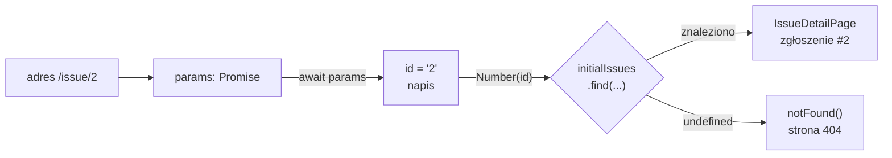

# Jedna strona dla każdego zgłoszenia

## Najpierw sprawdzenie, czy trasa działa

Linki z listy prowadzą pod `/issue/1`, `/issue/2` i dalej. Zamiast katalogu dla każdego zgłoszenia powstaje jeden segment dynamiczny, katalog `[id]`. Pierwsza wersja pliku `app/issue/[id]/page.jsx` tylko pokazuje przechwyconą wartość:

```jsx
// app/issue/[id]/page.jsx: utworzyć plik
// Trasa dynamiczna: tymczasowa strona, która potwierdza działanie routingu.
export default async function IssueDetailPage({ params }) {
  const { id } = await params; // Next.js 16: params to obiekt Promise, zawsze z await
  return <p>Issue ID: {id}</p>;
}
```

Adres `/issue/1` daje napis „Issue ID: 1” pod linkiem „← Back to issues” z `IssueLayout`. Adres `/issue/abc` daje „Issue ID: abc” z kodem 200, bo strona jeszcze niczego nie sprawdza. Taki minimalny plik oddziela dwa pytania: czy trasa w ogóle pasuje do adresu i czy strona poprawnie odczytuje dane. Na pierwsze odpowiada już teraz.

Nazwa w nawiasach staje się kluczem w obiekcie `params`. Katalog `[id]` daje `{ id: "1" }`, a katalog `[slug]` dałby `{ slug: "1" }`.

## Dlaczego `params` jest obiektem Promise

Na `params` czeka się przez `await`, bo Next.js 16 przekazuje je jako obiekt Promise. Powodem jest to, że wartości segmentu mogą być nieznane w chwili, gdy renderowanie się zaczyna. Dokumentacja opisuje to przy modelu Cache Components. Bez listy podanej z góry wartości parametrów są nieznane podczas prerenderingu, więc stają się danymi z czasu żądania (*„param values are unknown during prerendering, making params runtime data”*).

Prerendering to wyrenderowanie strony z góry, podczas budowania, zanim przyjdzie pierwsze żądanie. Część strony, która `params` nie odczytuje, może powstać wcześniej. Dlatego ta sama dokumentacja radzi w layoutach nie czekać na `params` na samej górze, tylko przekazać obiekt Promise w dół, do komponentu, który wartości naprawdę potrzebuje.

W `issuetracker` model Cache Components jest wyłączony, a strona czyta `params` w pierwszej linii. Każda strona zgłoszenia renderuje się więc przy żądaniu, a wynik buildu oznacza wzorzec trasy symbolem `ƒ`. Przygotowanie stron z góry funkcją `generateStaticParams` zmieniłoby ten symbol, ale przy czterech zgłoszeniach w pliku nic by nie dało.

Odczyt bez `await` daje `undefined`, a terminal serwera podpowiada w komunikacie drugą drogę: `React.use()`. To funkcja Reacta, która odczytuje wartość obiektu Promise w komponencie klienckim, bo komponent kliencki nie może być `async`.

## Strona, która szuka zgłoszenia

Druga wersja `app/issue/[id]/page.jsx` odczytuje dane:

```jsx
// app/issue/[id]/page.jsx: zastąpić całą zawartość
// Trasa dynamiczna /issue/[id]: komponent serwerowy.
import { notFound } from "next/navigation";
import { initialIssues } from "../../data/issues";

export default async function IssueDetailPage({ params }) {
  const { id } = await params; // Next.js 16: params to obiekt Promise, zawsze z await

  const issue = initialIssues.find((i) => i.id === Number(id)); // napis z adresu zamieniony na liczbę
  if (!issue) notFound(); // przerywa render i włącza granicę „nie znaleziono” z Next.js

  return (
    <article>
      <h1>#{issue.id} — {issue.title}</h1>
      <p>Priority: {issue.priority}</p>
      <p>Status: {issue.status}</p>
    </article>
  );
}
```

Adres `/issue/1` pokazuje nagłówek „#1 — Login button does not work on Safari” oraz wiersze „Priority: high” i „Status: open”. Adres `/issue/99` daje domyślną stronę Next.js „404 This page could not be found.”, bo projekt nie ma własnego pliku `not-found.jsx`. Metoda `find` zwraca pierwszy pasujący element albo `undefined`, a `notFound()` przerywa render wyjątkiem.


Na Rysunku 3.7 pasek nawigacji stoi na obu stronach. Prawa strona nie ma linku „← Back to issues” z `IssueLayout`, więc komunikat 404 zastąpił cały układ zgłoszeń.

## Napis z adresu i liczba w danych

Nowy element to `Number(id)`. Segment adresu jest zawsze napisem, nawet gdy składa się z samych cyfr. Pole `id` w danych jest liczbą. Operator `===` porównuje bez zamiany typów, więc napis nigdy nie jest równy liczbie:

```js
"3" === 3;            // → false: różne typy
Number("3") === 3;    // → true: po konwersji oba są liczbami
Number("abc");        // → NaN (not a number), wynik nieudanej konwersji
NaN === NaN;          // → false: NaN nie jest równe niczemu, także sobie
```

Bez konwersji żadne zgłoszenie by się nie znalazło. Luźne porównanie `==` zamienia typy samo, więc `"3" == 3` daje `true`. Robi to jednak według reguł, które łatwo przeoczyć: `"" == 0` i `"0x2" == 2` też dają `true`. Jawne `Number(id)` z `===` pokazuje w kodzie, w którym miejscu napis staje się liczbą, i pozwala tę konwersję poprzedzić sprawdzeniem formatu.

Ostatnia linia przykładu tłumaczy, co dzieje się z adresem `/issue/abc`. Konwersja daje `NaN`, porównanie `i.id === NaN` jest zawsze fałszywe, a `find` kończy się `undefined` bez żadnego wyjątku. MDN zaznacza tę własność wprost: porównanie z `NaN` daje fałsz dla każdej wartości, także dla innego `NaN`. Do sprawdzenia, czy wynik jest `NaN`, służy `Number.isNaN`.

## Rysunek 3.8 — od adresu do strony albo do 404



Na Rysunku 3.8 strzałki biegną w kolejności wykonania kodu w `IssueDetailPage`. Do dolnej gałęzi prowadzi więcej adresów, niż widać. Trafia tam numer spoza danych, jak `99`, i każdy napis, z którego konwersja daje `NaN`, jak `abc`. Trafia tam też brakujący `await`, bo `Number(undefined)` daje `NaN`. Na rysunku te trzy przyczyny są nie do odróżnienia, bo każda kończy się tym samym `undefined` z `find`. Brakujący `await` zostawia jednak komunikat w terminalu serwera, dlatego <u>przy niespodziewanym 404 w trasie dynamicznej sprawdza się najpierw terminal</u>.

## Segment ścieżki czy parametr zapytania

Numer zgłoszenia mógłby też trafić do części adresu po znaku `?`, na przykład `/issue?id=2`. Oba zapisy dają każdemu zgłoszeniu własny adres, a tego potrzebują wyszukiwarki. Daniel Bugl tłumaczy, że gdy wpisy widać tylko na stronie z listą, wyszukiwarka zawsze linkuje do tej strony. Na niej może już jednak stać co innego (*„a search engine will always link to the index page, which might already contain different articles than what the user was searching for”*).

Różnica między zapisami wychodzi dopiero w buildzie. Bugl wymienia odczyt `searchParams` wśród powodów, dla których Next.js rezygnuje z renderowania statycznego i uznaje stronę za dynamiczną. Segment ścieżki tego ograniczenia nie ma, bo znane z góry wartości `[id]` można przygotować podczas budowania funkcją `generateStaticParams`. Parametr zapytania pasuje więc do filtra, jak `/?priority=high`, który zmienia widok tej samej listy i osobnego zasobu nie wskazuje.

## Segment adresu to wejście od użytkownika

Wartości `params` to napis, tablica napisów albo `undefined`, bo nie są znane przed uruchomieniem aplikacji. Dokumentacja tłumaczy, po co ten szeroki typ.

> **„Użytkownik może wpisać w pasek adresu dowolny URL, a te szerokie typy pomagają upewnić się, że kod aplikacji obsłuży wszystkie możliwe przypadki.”**
>
> *„Users can enter any URL into the address bar, and these broad types help ensure that your application code handles all these possible cases.”*
>
> — dokumentacja Next.js, *Dynamic Route Segments*

Segment adresu należy więc traktować jak pole formularza. Funkcja `Number` przyjmuje przy tym więcej zapisów niż same cyfry. Pomija białe znaki na brzegach, przyjmuje znak `+` na początku, a pusty napis zamienia na `0`. Zapisy szesnastkowy i wykładniczy też są dla niej liczbami:

```js
Number("02");   // → 2
Number("2.0");  // → 2
Number("+2");   // → 2
Number("0x2");  // → 2: zapis szesnastkowy
Number("2e0");  // → 2: zapis wykładniczy
```

Adresy `/issue/02`, `/issue/2.0` i `/issue/0x2` pokażą więc to samo zgłoszenie co `/issue/2`. Dla wyszukiwarki to cztery różne strony z identyczną treścią. Demo zostaje przy `Number(id)`, bo jest krótsze. Przy identyfikatorach tekstowych, takich jak `safari-login`, problem znika, bo napis porównuje się z napisem.

## Najpierw format, potem konwersja

Zanim napis zamieni się na liczbę, sprawdza się jego **format**. Dla numeru zgłoszenia wystarczy wyrażenie regularne `/^\d+$/`. Znak `^` oznacza początek napisu, `\d+` jedną cyfrę albo więcej, a `$` koniec napisu:

```js
const re = /^\d+$/;
re.test("2");     // → true
re.test("02");    // → true: same cyfry, choć z zerem wiodącym
re.test("2.0");   // → false: kropka nie jest cyfrą
re.test("0x2");   // → false
re.test("");      // → false: pusty napis nie ma ani jednej cyfry
```

Wyrażenie odrzuca `abc`, `2.0`, `+2`, `0x2` i `2e0`, zanim kod dotknie danych. Zostaje jeden niejednoznaczny przypadek: zera wiodące, jak w `/issue/02`. Taki adres wskazuje zgłoszenie, które istnieje, tylko zapisane nietypowo. Strona 404 byłaby tu fałszywą informacją, a pokazanie treści tworzy drugi adres tej samej strony.

## Jeden adres dla jednego zgłoszenia

Trzecia możliwość to przekierowanie na **adres kanoniczny**, czyli jedyny uznany zapis danego zasobu. Służy do tego funkcja `permanentRedirect` z `next/navigation`. Przykład spoza projektu łączy wszystkie kroki:

```jsx
// Przykład spoza demo: ścisłe sprawdzenie numeru i jeden adres kanoniczny.
import { notFound, permanentRedirect } from "next/navigation";
import { initialIssues } from "../../data/issues";

export default async function IssueDetailPage({ params }) {
  const { id } = await params;
  if (!/^\d+$/.test(id)) notFound();                       // "abc", "2.0", "+2", "0x2"
  const n = Number(id);
  if (String(n) !== id) permanentRedirect(`/issue/${n}`);  // "02" → /issue/2
  const issue = initialIssues.find((i) => i.id === n);
  if (!issue) notFound();                                  // numer spoza danych
  // ...render zgłoszenia
}
```

Warunek `String(n) !== id` łapie zera wiodące: `Number("02")` daje 2, a `String(2)` daje `"2"`, czyli inny napis niż w adresie. Taka strona odpowiada na `/issue/02` kodem 308 z nagłówkiem `Location` wskazującym `/issue/2`. Zapisy `2.0`, `0x2` i `abc` kończą się stroną 404, a `/issue/2` kodem 200.

Dokumentacja `permanentRedirect` wskazuje granicę zastosowania:

> **„Jeśli zasób nie istnieje, można zamiast niej użyć funkcji `notFound`.”**
>
> *„If a resource doesn't exist, you can use the `notFound` function instead.”*
>
> — dokumentacja Next.js, *permanentRedirect*

Z tego zdania wynika **kryterium wyboru**. <u>Zasób istnieje pod innym zapisem adresu: przekierowanie. Zasobu nie ma: `notFound()`</u>. Kod 308 oznacza, że zasób został na stałe przeniesiony pod adres z nagłówka `Location`. Słowo „na stałe” odróżnia go od kodu 307, który wysyła zwykłe `redirect`. Segment z plikiem `loading.jsx` wysyła odpowiedź strumieniowo, czyli w kawałkach, a kod HTTP wychodzi już z pierwszym z nich. Wtedy `permanentRedirect` wstawia do strony znacznik meta, a przekierowanie wykonuje dopiero przeglądarka, więc kodu 308 w odpowiedzi nie ma.

Bugl opisuje lżejszą drogę dla adresów z opisem słownym, tak zwanym *slugiem*, jak `/posts/<id>/<tytuł>`. Strona pokazuje treść pod każdym zapisem. Element `<link rel="canonical">` wskazuje wtedy wyszukiwarkom adres właściwy, żeby nie indeksowały duplikatów (*„This would tell crawlers not to index duplicate pages when incorrect slugs are used”*). Przekierowanie kosztuje dodatkowe żądanie, ale potem pasek adresu pokazuje zapis kanoniczny. Znacznik kanoniczny nie wymaga żądania, ale użytkownik zostaje przy nietypowym adresie.

## Rozszerzenie: nazwa stała obok dynamicznej

Na jednym poziomie segment dynamiczny może stać obok zwykłego katalogu. Gdyby formularz trafił pod `app/issue/new/page.jsx`, adres `/issue/new` pasowałby do dwóch katalogów: `new` i `[id]`. Router wybiera wtedy katalog o nazwie zapisanej wprost. Strona z `app/issue/new/` odpowiada pod `/issue/new` własną treścią, a `/issue/2` nadal pokazuje zgłoszenie. Nazwa stała ma pierwszeństwo, bo opisuje adres dokładniej niż wzorzec.

Dwa segmenty dynamiczne na tym samym poziomie to błąd. Katalog `app/issue/[slug]/` dodany obok `[id]` zatrzymuje build komunikatem:

```text
Error: Ambiguous app routes detected:

Ambiguous route pattern "/issue/[*]" matches multiple routes:
  - /issue/[id]
  - /issue/[slug]
```

Dla adresu `/issue/2` nie da się rozstrzygnąć, czy `2` jest numerem, czy nazwą, bo oba wzorce pasują do każdej wartości. Wyjściem są odrębne segmenty stałe przed nimi, na przykład `app/issue/[id]` i `app/issue/by-slug/[slug]`.

## Rozszerzenie: polskie znaki w segmencie

Przeglądarka koduje polskie znaki i spację procentowo. Słowo `żółw` trafia do serwera jako `%C5%BC%C3%B3%C5%82w`, a spacja jako `%20`. W tej zakodowanej postaci wartość trafia też do `params`, więc porównanie z napisem `"żółw"` w danych nie znajdzie niczego. Wartość z adresu dekoduje funkcja wbudowana w JavaScript:

```js
encodeURIComponent("żółw");               // → "%C5%BC%C3%B3%C5%82w"
decodeURIComponent("%C5%BC%C3%B3%C5%82w"); // → "żółw"
decodeURIComponent("%C5");                 // → wyjątek URIError: URI malformed (niepełny kod znaku)
```

Dekodowanie stawia się w jednym miejscu, zaraz po `await params`, żeby reszta kodu pracowała już na zwykłym napisie. Adres z niepełnym kodem, jak końcówka `%C5`, nie dociera zresztą do strony, bo serwer Next.js w trybie produkcyjnym odpowiada na niego kodem 500. Numer zgłoszenia składa się z samych cyfr, więc `issuetracker` tego kroku nie potrzebuje.

## Rozszerzenie: segmenty „łap wszystko”

Nawias z trzema kropkami, `[...slug]`, przechwytuje wszystkie kolejne segmenty naraz, a wartość przychodzi jako tablica napisów. Wersja w podwójnym nawiasie, `[[...slug]]`, pasuje dodatkowo do adresu bez żadnego segmentu. Strona w katalogu `app/shop/[[...slug]]/` dostaje takie wartości:

| Adres | `params` |
|---|---|
| `/shop` | `{}`, czyli `slug` ma wartość `undefined` |
| `/shop/a` | `{ slug: ['a'] }` |
| `/shop/a/b` | `{ slug: ['a', 'b'] }` |

Wersja z pojedynczym nawiasem nie pasuje do samego `/shop` i daje tam 404. Wariant opcjonalny wymaga ostrożności: kod zakładający tablicę dostanie pod `/shop` wartość `undefined`, a wywołanie `slug.join("/")` zgłosi wyjątek. W `issuetracker` takiego segmentu nie ma, bo każdy adres zgłoszenia ma dokładnie jeden numer.

> 💡 **Zapamiętaj:** <u>segment dynamiczny to napis od użytkownika</u>. Przed porównaniem z liczbą w danych sprawdza się jego format i dopiero potem konwertuje. Nietypowy zapis istniejącego zasobu przekierowuje się na adres kanoniczny, a brak zasobu kończy się `notFound()`.

