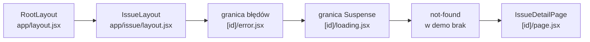

# Ekran ładowania i ekran błędu dla jednej trasy

## Cztery możliwe zakończenia strony

Strona `/issue/[id]` może skończyć się na cztery sposoby. Dane przychodzą i strona się renderuje. Dane jeszcze nie przyszły, bo serwer czeka. Kod rzucił wyjątek. Zgłoszenia o podanym numerze nie ma. Pierwszy przypadek obsługuje `page.jsx`, a czwarty funkcja `notFound()`. Dwa środkowe dostają w App Routerze własne pliki: `loading.jsx` i `error.jsx`.

Oba pliki działają przez **granice** Reacta, czyli komponenty, które przejmują czekanie albo awarię całego swojego poddrzewa. Granica Suspense pokazuje treść zastępczą na czas czekania. **Granica błędów** (*error boundary*) pokazuje komunikat w miejsce poddrzewa, które rzuciło wyjątek. Banks i Porcello opisują tę parę jako złożenie, które obsługuje trzy stany żądania: oczekiwanie, sukces i porażkę (*„pending, success, and fail”*). W Next.js nie pisze się żadnej z granic ręcznie. Plik o zastrzeżonej nazwie wystarczy, a Next.js sam wstawia granicę w odpowiednie miejsce drzewa.

## Opóźnienie zapisane jako `sleep`

Dane w `issuetracker` leżą w pliku, więc strona odpowiada natychmiast i ekranu ładowania nie da się zobaczyć. Wolne źródło danych symuluje funkcja `sleep`. Zwraca ona Promise spełniany po podanej liczbie milisekund:

```js
// sleep(ms) zwraca Promise; setTimeout wywoła resolve po ms milisekundach.
function sleep(ms) {
  return new Promise((resolve) => setTimeout(resolve, ms));
}
const t0 = Date.now();
console.log("start");                      // → start
await sleep(800);                          // kod dalej czeka, ale wątek nie stoi
console.log("po", Date.now() - t0, "ms");  // → po 806 ms
```

Funkcja komponentu stoi przy `await` przez 0,8 s, a pętla zdarzeń obsługuje w tym czasie inne żądania.

## Ekran na czas oczekiwania

Nowy plik `app/issue/[id]/loading.jsx` zwraca jeden akapit.

```jsx
// app/issue/[id]/loading.jsx: utworzyć plik
// Next.js pokazuje ten komponent sam, dopóki IssueDetailPage czeka (await).
export default function IssueLoading() {
  return <p>Loading issue...</p>;
}
```

W `app/issue/[id]/page.jsx` dochodzą funkcja `sleep` i jedno wywołanie w komponencie:

```jsx
// app/issue/[id]/page.jsx: pod importami, nad IssueDetailPage, dopisać:
// TYLKO DEMO: symulacja wolnego pobierania danych. Usunąć w produkcji!
function sleep(ms) {
  return new Promise((resolve) => setTimeout(resolve, ms));
}

// … w IssueDetailPage, pod wierszem z `await params`, dopisać:
  await sleep(800); // dzięki temu loading.jsx jest widoczny przez ok. 0,8 s
```

Po kliknięciu pierwszego zgłoszenia pod linkiem „← Back to issues” najpierw stoi napis „Loading issue...”. Po 0,8 s zastępuje go nagłówek z numerem i tytułem zgłoszenia. `IssueLoading` nie ma dyrektywy `"use client"`, więc jest komponentem serwerowym. Plik w katalogu `[id]` obejmuje tylko strony zgłoszeń. Ten sam plik w korzeniu `app/` objąłby całą aplikację, ale wtedy jeden napis pokazywałby się przy każdej trasie.


Rysunek 3.9 to zrzut zrobiony w trakcie `sleep(800)`. Pasek nawigacji i link do listy są już na ekranie, bo należą do layoutów, które na dane nie czekają. Zamieni się tylko napis.


*Przerywnik: xkcd 612 „Estimation”. Autor: Randall Munroe, licencja CC BY-NC 2.5, <https://xkcd.com/612/>.* Czasu oczekiwania nie da się obiecać, dlatego `loading.jsx` pokazuje treść zastępczą zamiast szacunku czasu.

## Co Next.js składa z pliku `loading.jsx`

Plik `loading.js` sam owija stronę w granicę Suspense. Dla katalogu `[id]` wynik odpowiada mniej więcej takiemu drzewu:

```jsx
// Model poglądowy: tak Next.js składa segment [id]. Tego kodu nie pisze się ręcznie.
<IssueLayout>
  <Suspense fallback={<IssueLoading />}>
    <IssueDetailPage params={params} />
  </Suspense>
</IssueLayout>
```

Granica leży wewnątrz layoutu. `IssueLayout` renderuje się więc od razu, a czeka tylko strona. Według dokumentacji *Linking and Navigating* nawigacja zaczyna się wtedy natychmiast, a wspólne layouty pozostają interaktywne: przy napisie „Loading issue...” link „← Back to issues” działa.

## Co robi React, gdy strona czeka

`IssueDetailPage` jest funkcją `async`, więc jej render kończy się dopiero po ostatnim `await`. Do tego czasu komponent jest **zawieszony** (*suspended*): React nie ma jeszcze jego wyniku, ale nie przerywa pracy nad resztą drzewa. Przebieg ma trzy kroki:

1. **Zawieszenie.** React dochodzi do `IssueDetailPage` i dostaje Promise zamiast gotowego JSX.
2. **Treść zastępcza najbliższej granicy.** React idzie w górę drzewa do najbliższej granicy Suspense, czyli tej z `loading.jsx`, i w miejsce całego jej poddrzewa wstawia `IssueLoading`. Layouty leżą nad granicą i renderują się normalnie.
3. **Wznowienie.** Po spełnieniu Promise React kończy render tylko tego poddrzewa i podmienia nim treść zastępczą. Layoutów nie liczy od nowa.

Funkcja strony wykonuje się przy tym raz na żądanie, co pokazuje licznik wywołań wpisany do strony testowej. Schwarzmüller opisuje ten układ od strony Next.js:

> **„Ponieważ Next.js obsługuje strumieniowanie odpowiedzi HTTP, może od razu wyrenderować resztę strony, a treść zależną od pobieranych danych dosłać do klienta, gdy będzie dostępna. Dopóki dane nie zostaną załadowane, Suspense renderuje zdefiniowaną treść zastępczą.”**
>
> *„Since Next.js supports HTTP response streaming, it’s able to render the rest of the page immediately while streaming the content that depends on the fetched data to the client side once it’s available. Until the data is loaded and available, `Suspense` will render its defined fallback.”*
>
> — Maximilian Schwarzmüller, *React Key Concepts*

## Strumieniowanie: odpowiedź HTTP w kawałkach

Przy wejściu wprost na adres `/issue/1` serwer nie czeka 0,8 s z całą odpowiedzią. Wysyła stronę w kawałkach, zaraz po przygotowaniu każdego z nich. Taki sposób nazywa się **strumieniowaniem** (*streaming*).

Odpowiedź zbudowanej aplikacji dla `/issue/1` przychodzi w dwóch turach:

```text
pierwsza tura, od razu:       <nav>…</nav> … <a href="/">← Back to issues</a>
                              <!--$?--><template id="B:0"></template><p>Loading issue...</p><!--/$-->
druga tura, po ok. 0,8 s:     <script>…dane strony dla przeglądarki…</script>
                              <div hidden id="S:1"><article><h1>#1 — Login button does not work on Safari</h1>…</div>
                              <script>…przeniesienie S:1 na miejsce granicy…</script>
```

Pierwsza tura zawiera layout, link powrotu i treść zastępczą, a komentarze `<!--$?-->` i `<!--/$-->` oznaczają miejsce granicy Suspense. Po 0,8 s serwer dosyła gotowy HTML strony w ukrytym elemencie, a krótki skrypt Reacta przenosi go na miejsce granicy i usuwa treść zastępczą. Połączenie HTTP przez cały ten czas pozostaje otwarte, a przeglądarka rysuje każdą turę od razu po odebraniu. Pierwsza tura niesie też kod 200, którego później nie da się już zmienić.

Kumar zwraca uwagę, że podmianę wykonuje skrypt dołączony do samej odpowiedzi, bez pakietu Reacta w przeglądarce, więc treść pojawia się przed hydratacją. Starsza funkcja `renderToString` strumieniowania nie obsługuje: cały napis HTML musi powstać, zanim można go wysłać (*„the entire HTML string must be generated before it can be sent to the client”*).

## Pierwsza treść po 0,01 s zamiast po 0,8 s

Na dane czeka się przy strumieniowaniu tyle samo, ale pierwsza treść pojawia się wcześniej. Pomiar po zbudowaniu aplikacji:

- **z `loading.jsx`:** pierwszy bajt odpowiedzi `/issue/1` przychodzi po 0,01–0,08 s, cała odpowiedź po 0,81 s;
- **bez `loading.jsx`:** pierwszy bajt przychodzi po 0,81–0,87 s, razem z całą stroną.

Bez granicy Suspense serwer nie ma czego wysłać przed końcem `IssueDetailPage`, więc przez 0,8 s karta stoi pusta, także bez paska nawigacji. <u>Granica Suspense decyduje o tym, co da się wysłać przed danymi</u>.


Na Rysunku 3.10 niebieskie słupki to pierwszy bajt odpowiedzi, a pomarańczowe cała odpowiedź; długość słupka to zakres z trzech prób. Plik `loading.jsx` przesuwa tylko niebieski słupek. Pomarańczowy zostaje przy 0,8 s, bo ekran ładowania nie przyspiesza danych.

## Ekran po wyjątku

Nowy plik `app/issue/[id]/error.jsx` wygląda tak:

```jsx
// app/issue/[id]/error.jsx: utworzyć plik
// Widok, gdy IssueDetailPage rzuci nieobsłużony wyjątek.
// MUSI mieć "use client": granice błędów Reacta działają w przeglądarce.
// retry() (Next.js 16.3+) pobiera segment od nowa i renderuje go ponownie.
"use client";

// error: obiekt wyjątku; retry: funkcja od Next.js do ponownej próby.
export default function IssueError({ error, retry }) {
  return (
    <div>
      <h2>Something went wrong!</h2>
      <p>{error.message}</p>
      <button onClick={retry}>Try again</button>
    </div>
  );
}
```

Dane demo są zawsze poprawne, więc `IssueDetailPage` żadnego wyjątku nie rzuca. Przypuśćmy, że po `await sleep(800)` stoi w niej `throw new Error("Database connection failed!")` dla zgłoszenia nr 2. Pod `/issue/2` stałby wtedy pod paskiem nawigacji i linkiem „← Back to issues” nagłówek „Something went wrong!”, komunikat „Database connection failed!” i przycisk „Try again”. Strona `/issue/1` działałaby dalej. Reszta aplikacji przetrwa awarię jednej strony, bo granica obejmuje tylko segment `[id]`.

## Dlaczego granica błędów działa w przeglądarce

Dokumentacja definiuje plik krótko: `error.js` owija segment trasy i jego dzieci w granicę błędów Reacta. Krause podaje porównanie:

> **„Można o tym myśleć jak o bloku try...catch na poziomie komponentu.”**
>
> *„Think about it as a try...catch block on a component level.”*
>
> — Martin Krause, *The Complete Developer*

Granica błędów ma stan: pamięta wyjątek z poddrzewa i pokazuje komunikat zamiast dzieci, a „Try again” musi ten stan wyczyścić. Komponent serwerowy stanu nie ma, więc tej roli pełnić nie może. Wyjątek z serwera dociera do przeglądarki w danych strony i tam przejmuje go granica, która jest komponentem klienckim. Next.js pilnuje tego wymogu przy kompilacji. Bez dyrektywy wejście na dowolne zgłoszenie, nawet `/issue/1`, które nic nie rzuca, kończy się odpowiedzią HTTP 500 z komunikatem:

```text
Error: app/issue/[id]/error.jsx must be a Client Component. Add the "use client" directive
the top of the file to resolve this issue.
```

## Które wyjątki trafiają do `error.jsx`

Granica przechwytuje wyjątki rzucone w trakcie renderu swojego poddrzewa. W `issuetracker` takim wyjątkiem jest `throw` w `IssueDetailPage`, wykonany na serwerze. Poza granicą zostaje wyjątek w zwykłej procedurze obsługi zdarzenia:

```jsx
"use client";
// Wyjątek w onClick: ekran błędu się NIE pojawia, błąd trafia do konsoli przeglądarki.
export default function BrokenButton() {
  return <button onClick={() => { throw new Error("click"); }}>Break</button>;
}
```

Procedura `onClick` wykonuje się po zakończeniu renderu, więc granica o jej wyjątku się nie dowiaduje.

## `retry` i `reset`

Przycisk „Try again” może wywołać jedną z dwóch funkcji. Wersja 16.2 dodała `unstable_retry`, a od 16.3 dokumentacja zaleca stabilne `retry`:

> **„Wywołana funkcja próbuje ponownie pobrać i wyrenderować zawartość granicy błędów. Jeśli się uda, komponent błędu zostaje zastąpiony wynikiem ponownego renderowania.”**
>
> *„When executed, the function will try to re-fetch and re-render the error boundary's children. If successful, the fallback error component is replaced with the result of the re-render.”*
>
> — dokumentacja Next.js, *error.js*

Starsza funkcja `reset` tylko czyści stan błędu i renderuje ponownie ten sam, już pobrany wynik. Różnicę widać przy awarii chwilowej, czyli wyjątku, który strona rzuca tylko przy pierwszym wykonaniu na serwerze, na przykład `Timeout` dla zgłoszenia nr 2. `retry` wysyła żądanie `/issue/2?_rsc=…`, serwer ponownie wykonuje `IssueDetailPage` i na ekranie pojawia się zgłoszenie #2. <u>`reset` zostawia ekran błędu i nie wysyła żadnego żądania</u>. Przy wyjątku rzucanym za każdym razem także `retry` wraca do ekranu błędu, bo serwer za każdym razem rzuca ten sam wyjątek.

W trybie deweloperskim `error.message` pokazuje treść wyjątku. Po zbudowaniu aplikacji przeglądarka dostaje tylko ogólny komunikat („Minified React error #441…” w React 19.3.0) i identyfikator `error.digest`, po którym według dokumentacji znajduje się wpis w logach serwera.

## Nazwy plików, które Next.js rezerwuje

Strona, ekran ładowania i ekran błędu to trzy z dziewięciu plików routingu z dokumentacji *Project Structure*:

| Plik | Rola |
|---|---|
| `layout.jsx` | wspólna ramka, trwa przy nawigacji |
| `template.jsx` | ramka tworzona od nowa przy każdej nawigacji |
| `page.jsx` | strona pod adresem segmentu |
| `loading.jsx` | ekran na czas ładowania strony |
| `error.jsx` | widok po wyjątku w segmencie |
| `not-found.jsx` | widok „nie znaleziono” |
| `route.js` | punkt końcowy API bez strony |
| `global-error.jsx` | widok błędu dla layoutu głównego, tylko w korzeniu `app/` |
| `default.jsx` | strona zastępcza dla tras równoległych |

Plik `route.js` odpowiada na żądania HTTP i nie renderuje komponentów, więc w zagnieżdżeniu go nie ma. `global-error.jsx` zastępuje cały dokument, łącznie z `<html>` i `<body>`, bo awaria layoutu głównego zabiera też ramkę strony.

## Rysunek 3.11 — w co Next.js owija stronę `/issue/[id]`



Na Rysunku 3.11 każdy prostokąt obejmuje wszystkie leżące na prawo od niego, w kolejności plików z dokumentacji. Węzeł z dopiskiem „w demo brak” pokazuje miejsce, które zająłby plik `not-found.jsx`. Dla granicy błędów wynikają z tego trzy reguły. `IssueLayout` leży poza granicą błędów, więc awaria strony nie zabiera linku powrotu. Granica błędów obejmuje granicę Suspense, więc wyjątek rzucony w trakcie ładowania też zostanie złapany. Dokumentacja dodaje regułę odwrotną: `error.js` nie obejmuje layoutu ani szablonu z tego samego katalogu. Wyjątek w `IssueLayout` trafiłby do granicy poziom wyżej.

## Dwa rodzaje strony „nie znaleziono”

Next.js rozróżnia dwie sytuacje. Adres może pasować do trasy, ale danych brak: `/issue/99` trafia do `IssueDetailPage`, która wywołuje `notFound()`. Adres może też nie pasować do żadnej trasy, jak `/issues/1` z literówką. Wyjątek z `notFound()` nie kończy się ekranem `IssueError`, bo na Rysunku 3.11 granica „nie znaleziono” leży bliżej strony niż granica błędów.

W demo `notFound()` stoi po `await sleep(800)`, a pierwsza tura z kodem 200 jest już wtedy w drodze. Po zbudowaniu `/issue/99` daje więc kod 200 ze stroną „This page could not be found” i znacznikiem `<meta name="robots" content="noindex">`, który trzyma adres z dala od wyszukiwarek. Literówka `/issues/1` daje prawdziwe 404, bo żadna trasa nie zaczęła strumienia. Plik `app/issue/[id]/not-found.jsx` dałby komunikat w języku aplikacji wewnątrz `IssueLayout`, a literówkę w adresie obsłużyłby dopiero plik w korzeniu `app/`.

## Rozszerzenie: ekran ładowania na kształt strony

Napis „Loading issue...” zajmuje jedną linię. Gotowa strona ma nagłówek i dwa akapity, więc w chwili podmiany treść pod linkiem powrotu nagle rośnie. Dokumentacja `loading.js` proponuje w miejsce napisu szkielet albo „mały, ale znaczący fragment przyszłego ekranu” (*„a small but meaningful part of future screens”*). **Szkielet** (*skeleton*) to ekran ładowania o kształcie docelowej strony, ale bez danych. Kształt ma znaczenie z powodu miary, którą Bugl omawia przy czasie ładowania. **Skumulowane przesunięcie układu** (*Cumulative Layout Shift*, CLS) mierzy stabilność wizualną aplikacji. Zgłasza przy tym nieoczekiwany ruch na stronie podczas ładowania (*„reporting unexpected movement on the page during loading”*).

```jsx
// Przykład spoza demo: szkielet o tej samej strukturze co IssueDetailPage.
export default function IssueLoading() {
  return (
    <article>
      <h1>#… Loading issue...</h1>
      <p>Priority: …</p>
      <p>Status: …</p>
    </article>
  );
}
```

Szkielet ma granicę wynikającą z API. Według dokumentacji komponenty z `loading.js` nie przyjmują żadnych parametrów. `IssueLoading` nie zna więc numeru z adresu i nie pokaże „#2” przed nadejściem danych. Odtworzyć da się tylko to, co wspólne dla wszystkich zgłoszeń.

## Rozszerzenie: granica dla fragmentu strony

Plik `error.jsx` zawsze obejmuje cały segment trasy. Awaria jednego fragmentu, na przykład panelu komentarzy pod zgłoszeniem, nie musi jednak zabierać reszty strony. Next.js ma do tego funkcję `catchError` z modułu `next/error`, dodaną w wersji 16.2 jako `unstable_catchError` i stabilną od 16.3. Tworzy ona komponent, który owija swoje dzieci w granicę błędów. Dokumentacja nazywa ją programową alternatywą dla konwencji pliku `error.js` (*„a programmatic alternative to the `error.js` file convention”*). Komponent zastępczy dostaje to samo `retry`. Wyjątki, którymi `redirect()` i `notFound()` sterują przebiegiem strony, przechodzą dalej, więc granica nie przechwyci ich przez pomyłkę. Stan błędu znika sam po nawigacji do innej trasy. `issuetracker` tej funkcji nie używa.

> 💡 **Zapamiętaj:** <u>`loading.jsx` to treść zastępcza granicy Suspense, a `error.jsx` to granica błędów</u>, obie wewnątrz layoutu segmentu. Serwer strumieniuje stronę: najpierw ramkę z treścią zastępczą, potem resztę. Przycisk ponowienia wywołuje `retry`, które pobiera segment od nowa.

