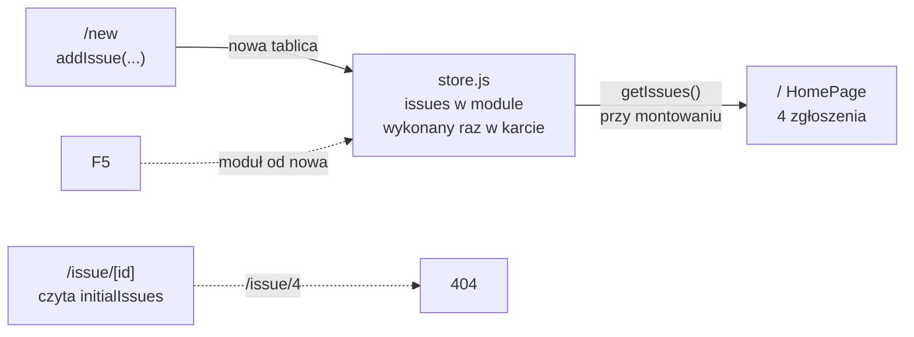
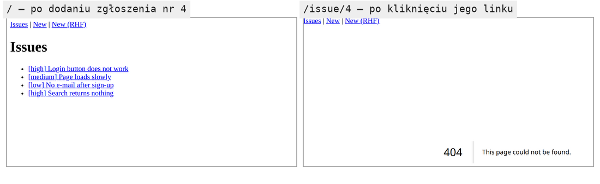

# Dane, które przetrwają przejście między stronami

## Zgłoszenie, które nie ma gdzie zostać

Trasy aplikacji są gotowe: lista, strona zgłoszenia, ekran ładowania i ekran błędu. Lista czyta jednak stałą tablicę `initialIssues` i pokazuje zawsze te same trzy zgłoszenia. Formularz nowego zgłoszenia nie ma dokąd zapisać czwartego, i lista nie ma skąd go odczytać. Zapis do `initialIssues` odpada, bo to dane startowe, które mają zostać bez zmian. Prawdziwa aplikacja zapisałaby zgłoszenie w bazie danych przez serwer. Demo używa prostszego rozwiązania: **magazynu** (*store*) w zwykłym module JavaScriptu.

Taki magazyn opiera się na dwóch regułach modułów ES: kiedy wykonuje się kod modułu i co dostaje plik, który coś z niego importuje.

## Moduł wykonuje się raz

Dokumentacja MDN formułuje pierwszą regułę tak:

> **„Moduły wykonują się tylko raz, nawet jeśli odwołuje się do nich wiele znaczników `<script>`.”**
>
> *„Modules are only executed once, even if they have been referenced in multiple `<script>` tags.”*
>
> — MDN Web Docs, *JavaScript modules*

Reguła dotyczy każdego importu, także poza znacznikami `<script>`. Trzy małe pliki pokazują ją w Node.js:

```js
// Przykład spoza demo: trzy pliki Node.js.
// counter.mjs: kod na najwyższym poziomie modułu
console.log("counter.mjs: module code executed");
export let count = 0;
export function increment() { count++; }

// a.mjs i b.mjs: dwa niezależne pliki z tym samym importem
import { count, increment } from "./counter.mjs";
increment();
console.log("a sees", count);   // w b.mjs: console.log("b sees", count)

// main.mjs: importuje oba po kolei
await import("./a.mjs");  // → counter.mjs: module code executed
                          // → a sees 1
await import("./b.mjs");  // → b sees 2   (bez drugiego „module code executed”)
```

Napis „module code executed” pojawia się raz. Drugi import dostaje ten sam, już wykonany moduł, z tymi samymi zmiennymi, więc `b.mjs` widzi licznik podbity wcześniej przez `a.mjs`.

## Moduł rozpoznaje się po adresie

Środowisko trzyma każdy wczytany moduł w pamięci pod jego adresem i przy kolejnym imporcie zwraca gotowy obiekt. Kluczem jest pełny adres po rozwiązaniu ścieżki, a nie nazwa pliku. Pokazuje to wariant `main.mjs`, który dopisuje do adresu parametr zapytania:

```js
// Przykład spoza demo: ten sam plik counter.mjs pod dwoma adresami.
const a = await import("./counter.mjs");       // → counter.mjs: module code executed
const b = await import("./counter.mjs");       // ten sam adres: bez ponownego wykonania
const c = await import("./counter.mjs?copy");  // → counter.mjs: module code executed
a.increment();
console.log(a === b, a === c, b.count, c.count); // → true false 1 0
```

`a` i `b` to jeden obiekt modułu, więc `b.count` widzi zwiększenie wykonane przez `a`. Adres z `?copy` wskazuje ten sam plik na dysku, ale dla środowiska jest innym modułem. Kod wykonuje się drugi raz, a `c.count` ma własną zmienną z wartością `0`. <u>Jeden adres w jednym środowisku daje jeden egzemplarz modułu</u>, a każda karta przeglądarki i proces serwera mają własną pamięć modułów.

## Import to widok tylko do odczytu

Plik `a.mjs` wypisał `1`, choć przy imporcie `count` miało wartość `0`. Import nie kopiuje wartości. Daje **żywe powiązanie** (*live binding*) ze zmienną w module, więc każdy odczyt pokazuje jej bieżącą wartość. Ta sama strona MDN dodaje drugą regułę: zaimportowana zmienna jest widokiem tylko do odczytu, a zmienić ją może wyłącznie moduł, który ją eksportuje.

```js
// c.mjs: próba przypisania zmiennej zaimportowanej
import { count } from "./counter.mjs";
try { count = 10; } catch (e) { console.log(e.constructor.name + ": " + e.message); }
// → TypeError: Assignment to constant variable.
```

Z obu reguł wynika budowa magazynu. Zmienne leżą w module i nie są eksportowane. Na zewnątrz wychodzą tylko funkcje, które je czytają i zmieniają. Każdy plik, który zaimportuje te funkcje, pracuje na tych samych danych.

## Numer nadawany przez `++`

Magazyn dopisuje elementy rozwinięciem tablicy, które daje nową tablicę. Numery nadaje operatorem `++` w wersji przyrostkowej:

```js
// Przykład spoza demo: wersja przyrostkowa operatora ++
let nextId = 4;
const id = nextId++;          // id = 4: najpierw odczyt, potem zwiększenie; nextId = 5
```

Zapis przyrostkowy `nextId++` zwraca wartość sprzed zwiększenia, więc pierwsze nowe zgłoszenie dostanie numer 4, a licznik przejdzie na 5. Zapis przedrostkowy `++nextId` zwróciłby od razu 5 i numer 4 nigdy by nie powstał.

## Magazyn `store.js`

Nowy plik `app/lib/store.js` wygląda tak:

```js
// app/lib/store.js
// Magazyn w module: jedna tablica na kartę przeglądarki, znika po przeładowaniu
import { initialIssues } from "../data/issues";

let issues = [...initialIssues]; // kopia: dane startowe zostają bez zmian
let nextId = issues.length + 1; // 4, bo zgłoszenia startowe są trzy

export function getIssues() {
  return issues;
}

export function addIssue({ title, priority }) {
  const issue = { id: nextId++, title, priority }; // numer i od razu zwiększenie licznika
  issues = [...issues, issue]; // nowa tablica zamiast push
  return issue;
}
```

Linijka `issues = [...issues, issue]` buduje nową tablicę i podmienia nią starą. Wywołanie `addIssue({ title: "New", priority: "high" })` zwraca `{ id: 4, title: "New", priority: "high" }`. Tablica pobrana wcześniej przez `getIssues()` ma dalej trzy elementy, a nowe wywołanie zwraca cztery. Kto trzyma starą tablicę, zostaje ze stanem sprzed zmiany, jak przy stanie Reacta. Zmienne `issues` i `nextId` nie są eksportowane, więc zmienić je mogą tylko dwie funkcje z tego pliku.

Ten sam wzorzec pokazuje Schwarzmüller w przykładzie z listą zadań: zmienna `storedTodos` na poziomie modułu i przypisanie `storedTodos = [...storedTodos, newTodo]` w funkcji zapisu. Komentarz w jego kodzie nazywa tę funkcję atrapą, która symuluje wolny backend zarządzający zadaniami. Rola `store.js` jest taka sama. Moduł udaje serwer, żeby formularz miał gdzie zapisać dane, zanim aplikacja dostanie prawdziwy zapis. Kod formularza zmieni się wtedy tylko w jednym miejscu, przy wywołaniu `addIssue`.

## Trzy miejsca, w których mogą mieszkać dane

Zgłoszenie dodane w formularzu musi przeżyć co najmniej przejście na listę. Aplikacja React ma trzy miejsca na dane i każde żyje inaczej długo.

1. **Stan komponentu** z `useState` żyje tak długo jak komponent, więc tablica zgłoszeń w stanie strony `/new` zniknęłaby po przejściu na `/`.
2. **Zmienna w module** trwa do przeładowania karty, jak `issues` w `store.js`.
3. **Serwer z bazą danych** przechowuje dane niezależnie od przeglądarki. Przetrwają przeładowanie, zamknięcie karty i wejście z innego komputera.

Demo wybiera drugie miejsce, bo jest najprostsze i wystarcza do pokazania formularza. Wspólny stan dwóch stron dałoby się też podnieść do layoutu, który przy nawigacji zostaje na miejscu. Layout nie przekazuje jednak stronom danych przez propsy, więc wymagałoby to kontekstu, czyli mechanizmu Reacta przekazującego wartość w głąb drzewa bez propsów. Moduł daje ten sam efekt bez żadnego kodu Reacta.

## Lista czyta z magazynu

Strona główna przestaje czytać `initialIssues`. W `app/page.jsx` dochodzi dyrektywa, a import z magazynu zastępuje import danych startowych. Reszta JSX zostaje bez zmian:

```jsx
// app/page.jsx
"use client"; // lista czyta magazyn, który żyje w przeglądarce
import Link from "next/link";
import { getIssues } from "./lib/store";

export default function HomePage() {
  const issues = getIssues();

  return (
    <main>
      <h1>Issues</h1>
      <ul>
        {issues.map((issue) => (
          <li key={issue.id}>
            <Link href={`/issue/${issue.id}`}>[{issue.priority}] {issue.title}</Link>
          </li>
        ))}
      </ul>
    </main>
  );
}
```

Dyrektywa `"use client"` robi z `HomePage` komponent kliencki. Jest tu potrzebna, bo zapisy trafiają do kopii magazynu w przeglądarce. Komponent serwerowy wykonałby się na serwerze, gdzie `addIssue` nigdy nie zostanie wywołane, i zawsze pokazywałby trzy zgłoszenia startowe. Wywołanie `getIssues()` wykonuje się przy każdym renderze.

## Dlaczego lista widzi nowe zgłoszenie

`HomePage` nie ma stanu, ale po dodaniu zgłoszenia i powrocie na `/` pokazuje cztery pozycje. Mechanizm wynika z nawigacji. Przejście z `/` na `/new` odmontowuje `HomePage`, bo strona główna znika z drzewa. Powrót przez `<Link>` montuje ją od nowa. Nowe montowanie oznacza nowy render, a w nim nowe wywołanie `getIssues()`, które zwraca już tablicę z czwartym zgłoszeniem.

React nie wie natomiast nic o zmianie zmiennej `issues`. Render uruchamia setter z `useState`, a przypisanie do zmiennej modułu nie uruchamia niczego. Gdyby lista i formularz stały na tej samej stronie, lista nie odświeżyłaby się po dodaniu zgłoszenia. Demo omija ten problem, bo formularz leży pod innym adresem. <u>Lista pokazuje nowe zgłoszenie tylko dlatego, że montuje się od nowa</u>. Wystarczy przenieść formularz do okna dialogowego nad listą, a nowe zgłoszenia przestaną się na niej pojawiać.

## Rysunek 3.12 — jedna tablica w module, dwie strony, które z niej korzystają



Na Rysunku 3.12 środek zajmuje moduł `store.js`. Formularz z `/new` zapisuje do niego nową tablicę, a strona główna odczytuje ją przy każdym montowaniu. Dolne strzałki przerywane pokazują dwie granice rozwiązania. Przeładowanie strony wykonuje moduł od nowa i na liście znowu są trzy zgłoszenia. Strona szczegółów w ogóle nie korzysta z magazynu.

## Jak długo żyje moduł

Moduł żyje tak długo jak karta. Nawigacja przez `<Link>` nie przeładowuje dokumentu, więc moduł zostaje w pamięci. Klawisz F5 albo wpisanie adresu ręcznie ładuje dokument od nowa. Wszystkie moduły wykonują się wtedy ponownie, a dodane zgłoszenia znikają.

Nowa karta też wczytuje dokument od nowa, więc ma własną kopię `store.js`. Zgłoszenie dodane w pierwszej karcie nie pojawi się na liście otwartej w drugiej, choć żadna z nich nie była przeładowana. Przeglądarka ma dwa magazyny, które żyją dłużej niż moduł. `sessionStorage` przetrwa przeładowanie karty, ale każda karta ma własne dane. `localStorage` przetrwa zamknięcie przeglądarki i jest wspólny dla wszystkich kart tego samego **pochodzenia** (*origin*), czyli schematu, hosta i portu adresu, na przykład `http://localhost:3000`. MDN ujmuje różnicę tak:

> **„Różnica polega na tym, że `localStorage` jest rozdzielony tylko według pochodzenia, a `sessionStorage` według pochodzenia i kart przeglądarki (kontekstów przeglądania najwyższego poziomu).”**
>
> *„the difference is that while `localStorage` is partitioned by origin only, `sessionStorage` is partitioned by both origin and browser tabs (top-level browsing contexts).”*
>
> — MDN Web Docs, *Window: sessionStorage property*

Z tych granic wynika **kryterium wyboru miejsca na dane**:

- **przetrwanie przeładowania** wymaga `sessionStorage` albo `localStorage`;
- **wspólne dane wszystkich kart** wymagają `localStorage`;
- **wspólne dane wielu urządzeń i użytkowników** wymagają serwera.

<u>Magazyn w module wystarcza tylko wtedy, gdy żaden z tych warunków nie obowiązuje</u>. Prawdziwy tracker zgłoszeń spełnia trzeci warunek, bo zgłoszenie ma zobaczyć cały zespół. Demo mimo to świadomie zostaje przy magazynie w module, bo pokazuje formularz bez serwera i bazy danych. Cenę tej decyzji widać od razu na stronie szczegółów.

## Dwie kopie modułu i dwa źródła danych

Pierwsze wejście na `/` renderuje `HomePage` także na serwerze, bo komponent kliencki też dostaje pierwszy render po stronie serwera. Serwer ma własną kopię modułu `store.js` i ta kopia nigdy nie dostaje wywołania `addIssue`, bo formularz działa tylko w przeglądarce. Przy pierwszym wejściu obie kopie mają trzy zgłoszenia, więc HTML z serwera zgadza się z tym, co wyrenderuje przeglądarka, i hydratacja, czyli podpięcie Reacta pod gotowy HTML, przechodzi bez niezgodności. Kolejne wejścia na `/` przez `<Link>` renderują się już tylko w przeglądarce. Restart serwera czyści kopię serwerową, a kopię w przeglądarce czyści dopiero przeładowanie karty.

Strona szczegółów `/issue/[id]` pozostała komponentem serwerowym i czyta `initialIssues`. Zgłoszenie nr 4 ma więc na liście link, a jego strona kończy się 404. Router działa przy tym poprawnie. Dwie części aplikacji czytają dane z dwóch różnych miejsc, a naprawą jest jedno źródło danych po stronie serwera.



Rysunek 3.13 pokazuje to w jednej karcie. Po dodaniu zgłoszenia lista ma cztery wiersze, a kliknięcie czwartego kończy się komunikatem 404. Przejście odbyło się przez `<Link>`, bez przeładowania, więc magazyn w przeglądarce zachował nowe zgłoszenie.

## Zalety i koszty magazynu w module

Magazyn w module jest najprostszym wspólnym miejscem na dane. Płaci się za to trwałością, widocznością dla serwera i odświeżaniem listy.

| Zyskujemy | Płacimy | Kiedy nie warto / co zamiast |
|---|---|---|
| Formularz i lista pracują na jednej tablicy bez propsów i kontekstu | Dane znikają po F5: po dodaniu zgłoszenia nr 4 odświeżenie strony przywraca trzy | Dane mają przetrwać odświeżenie albo być widoczne dla wielu osób: `sessionStorage`, `localStorage` albo serwer z bazą |
| Kilkanaście linii zamiast bazy i żądań HTTP | Strona zgłoszenia działa na serwerze i nie widzi nowego zgłoszenia: `/issue/4` kończy się 404 | Dane potrzebne serwerowi: magazyn po stronie serwera |
| Magazyn zostaje w pamięci między stronami, więc przejście przez `<Link>` niczego nie gubi | React nie widzi zmian zmiennej w module, więc lista odświeża się tylko przez ponowne zamontowanie | Stan jednej strony: `useState`; stan widoczny od razu we wszystkich komponentach: `useSyncExternalStore` |

> 💡 **Zapamiętaj:** moduł wykonuje się raz na kartę, a import daje żywy widok jego zmiennych, więc formularz i lista pracują na jednej tablicy. Po F5 na liście znowu są trzy zgłoszenia, a nowego nie zna strona zgłoszenia na serwerze. React nie widzi zmian zmiennej w module: poprawny odczyt takiego magazynu daje `useSyncExternalStore`.


Materiał rozszerzony do tego slajdu: [`rozszerzenia/r06_dane-w-module.md`](rozszerzenia/r06_dane-w-module.md)
