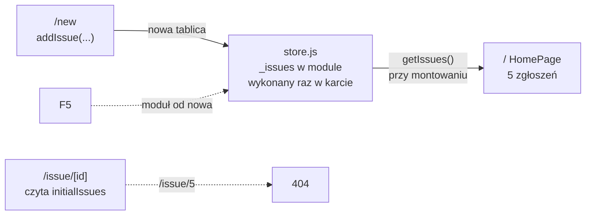
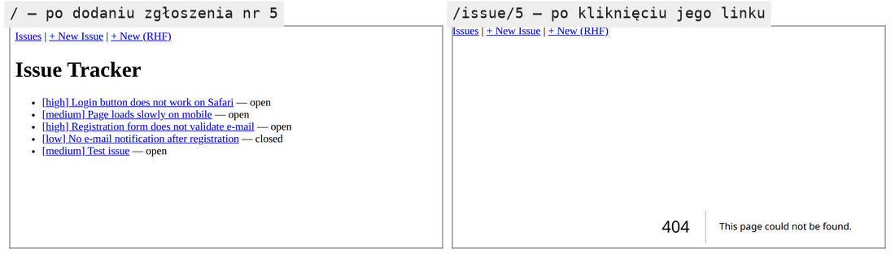

# Dane, które przetrwają przejście między stronami

## Po co osobny magazyn

Trasy aplikacji są gotowe: lista, strona zgłoszenia, ekran ładowania i ekran błędu. Formularz nowego zgłoszenia będzie musiał gdzieś zapisać dane, a lista będzie musiała je potem odczytać. Tablica `initialIssues` się do tego nie nadaje, bo to stałe dane startowe. Prawdziwa aplikacja zapisałaby zgłoszenie w bazie danych przez serwer. Demo używa prostszego rozwiązania: **magazynu** (*store*) w zwykłym module JavaScriptu.

Taki magazyn opiera się na dwóch regułach modułów ES: kiedy wykonuje się kod modułu i co dostaje plik, który coś z niego importuje.

## Moduł wykonuje się raz

Dokumentacja MDN formułuje pierwszą regułę tak:

> **„Moduły wykonują się tylko raz, nawet jeśli odwołuje się do nich wiele znaczników `<script>`.”**
>
> *„Modules are only executed once, even if they have been referenced in multiple `<script>` tags.”*
>
> — MDN Web Docs, *JavaScript modules*

Reguła dotyczy każdego importu, nie tylko znaczników `<script>`. Trzy małe pliki pokazują ją w Node.js:

```js
// Przykład spoza demo: trzy pliki Node.js.
// counter.mjs: kod na najwyższym poziomie modułu
console.log("counter.mjs: module code executed");
export let count = 0;
export function increment() { count++; }

// a.mjs i b.mjs: dwa niezależne pliki z tym samym importem
import { count, increment } from "./counter.mjs";
increment();
console.log("a sees", count);   // w b.mjs: console.log("b sees", count)

// main.mjs: importuje oba po kolei
await import("./a.mjs");  // → counter.mjs: module code executed
                          // → a sees 1
await import("./b.mjs");  // → b sees 2   (bez drugiego „module code executed”)
```

Napis „module code executed” pojawia się raz. Drugi import dostaje ten sam, już wykonany moduł, z tymi samymi zmiennymi, więc `b.mjs` widzi licznik podbity wcześniej przez `a.mjs`.

## Moduł rozpoznaje się po adresie

Środowisko trzyma każdy wczytany moduł w pamięci pod jego adresem i przy kolejnym imporcie zwraca gotowy obiekt. Kluczem jest pełny adres po rozwiązaniu ścieżki, a nie nazwa pliku. Pokazuje to wariant `main.mjs`, który dopisuje do adresu parametr zapytania:

```js
// Przykład spoza demo: ten sam plik counter.mjs pod dwoma adresami.
const a = await import("./counter.mjs");       // → counter.mjs: module code executed
const b = await import("./counter.mjs");       // ten sam adres: bez ponownego wykonania
const c = await import("./counter.mjs?copy");  // → counter.mjs: module code executed
a.increment();
console.log(a === b, a === c, b.count, c.count); // → true false 1 0
```

`a` i `b` to jeden obiekt modułu, więc `b.count` widzi zwiększenie wykonane przez `a`. Adres z `?copy` wskazuje ten sam plik na dysku, ale dla środowiska jest innym modułem. Kod wykonuje się drugi raz, a `c.count` ma własną zmienną z wartością `0`. <u>Jeden adres w jednym środowisku daje jeden egzemplarz modułu</u>, a każda karta przeglądarki i proces serwera mają własną pamięć modułów.

## Import to widok tylko do odczytu

Plik `a.mjs` wypisał `1`, choć przy imporcie `count` miało wartość `0`. Import nie kopiuje wartości. Daje **żywe powiązanie** (*live binding*) ze zmienną w module, więc każdy odczyt pokazuje jej bieżącą wartość. Ta sama strona MDN dodaje drugą regułę: zaimportowana zmienna jest widokiem tylko do odczytu, a zmienić ją może wyłącznie moduł, który ją eksportuje.

```js
// c.mjs: próba przypisania zmiennej zaimportowanej
import { count } from "./counter.mjs";
try { count = 10; } catch (e) { console.log(e.constructor.name + ": " + e.message); }
// → TypeError: Assignment to constant variable.
```

Z obu reguł wynika budowa magazynu. Zmienne leżą w module i nie są eksportowane. Na zewnątrz wychodzą tylko funkcje, które je czytają i zmieniają. Każdy plik, który zaimportuje te funkcje, pracuje na tych samych danych.

## Numer nadawany przez `++`

Magazyn dopisuje elementy rozwinięciem tablicy, które daje nową tablicę. Numery nadaje operatorem `++` w wersji przyrostkowej:

```js
let nextId = 5;
const id = nextId++;          // id = 5: najpierw odczyt, potem zwiększenie; nextId = 6
```

Zapis przyrostkowy `nextId++` zwraca wartość sprzed zwiększenia, więc pierwsze nowe zgłoszenie dostanie numer 5, a licznik przejdzie na 6. Zapis przedrostkowy `++nextId` zwróciłby od razu 6 i numer 5 nigdy by nie powstał.

## Magazyn `store.js`

Nowy plik `app/lib/store.js` wygląda tak:

```js
// app/lib/store.js: utworzyć plik
// Magazyn tylko na potrzeby demo: zmienna tablica na poziomie modułu.
// Przetrwa nawigację po stronie klienta (moduł zostaje w pamięci karty).
// Znika po przeładowaniu strony albo restarcie serwera.
// Prawdziwa trwałość: serwer + baza danych.
import { initialIssues } from "../data/issues.js";

let _issues = [...initialIssues];          // kopia: initialIssues zostaje nietknięte
let _nextId = initialIssues.length + 1;    // 5, bo zgłoszeń startowych jest cztery

// Podkreślnik = umowa „prywatne dla modułu”; zmienne nie są eksportowane.
export function getIssues() {
  return _issues;                          // bieżąca tablica
}

export function addIssue({ title, priority }) {
  const issue = { id: _nextId++, title, priority, status: "open" }; // ++ po użyciu
  _issues = [..._issues, issue];           // NOWA tablica zamiast push do starej
  return issue;                            // formularz pokaże numer zgłoszenia
}
```

Linijka `_issues = [..._issues, issue]` buduje nową tablicę i podmienia nią starą. Wywołanie `addIssue({ title: "New", priority: "high" })` zwraca `{ id: 5, title: "New", priority: "high", status: "open" }`. Tablica pobrana wcześniej przez `getIssues()` ma dalej cztery elementy, a nowe wywołanie zwraca pięć. Kto trzyma starą tablicę, zostaje ze stanem sprzed zmiany, jak przy stanie Reacta.

Ten sam wzorzec pokazuje Schwarzmüller w przykładzie z listą zadań: zmienna `storedTodos` na poziomie modułu i przypisanie `storedTodos = [...storedTodos, newTodo]` w funkcji zapisu. Komentarz w jego kodzie nazywa tę funkcję atrapą, która symuluje wolny backend zarządzający zadaniami. Rola `store.js` jest taka sama. Moduł udaje serwer, żeby formularz miał gdzie zapisać dane, zanim aplikacja dostanie prawdziwy zapis. Kod formularza zmieni się wtedy tylko w jednym miejscu, przy wywołaniu `addIssue`.

## Trzy miejsca, w których mogą mieszkać dane

Zgłoszenie dodane w formularzu musi przeżyć co najmniej przejście na listę. Aplikacja React ma trzy miejsca na dane i każde żyje inaczej długo.

1. **Stan komponentu** z `useState` żyje tak długo jak komponent, więc tablica zgłoszeń w stanie strony `/new` zniknęłaby po przejściu na `/`.
2. **Zmienna w module** trwa do przeładowania karty, jak `_issues` w `store.js`.
3. **Serwer z bazą danych** przechowuje dane niezależnie od przeglądarki. Przetrwają przeładowanie, zamknięcie karty i wejście z innego komputera.

Demo wybiera drugie miejsce, bo jest najprostsze i wystarcza do pokazania formularza. Wspólny stan dwóch stron dałoby się też podnieść do layoutu, który przy nawigacji zostaje na miejscu. Layout nie przekazuje jednak stronom danych przez propsy, więc wymagałoby to kontekstu, czyli mechanizmu Reacta przekazującego wartość w głąb drzewa bez propsów. Moduł daje ten sam efekt bez żadnego kodu Reacta.

## Lista czyta z magazynu

Strona główna przestaje czytać `initialIssues`. W `app/page.jsx` dochodzi dyrektywa, import z magazynu zastępuje import danych startowych, a lista mapuje tablicę z magazynu. Reszta JSX zostaje bez zmian:

```jsx
// app/page.jsx: zastąpić całą zawartość
// Lista zgłoszeń jako komponent kliencki, bo czyta zmienny magazyn z przeglądarki.
// getIssues() wywołuje się przy każdym montowaniu; po nawigacji po stronie klienta
// komponent montuje się od nowa i widzi nowo dodane zgłoszenia.
"use client";
import Link from "next/link";
import { getIssues } from "./lib/store";

export default function HomePage() {
  const issues = getIssues(); // odczyt tablicy z modułu przy każdym renderze

  return (
    <div>
      <h1>Issue Tracker</h1>
      <ul>
        {issues.map((issue) => (                 // jeden <li> na zgłoszenie
          <li key={issue.id}>                    {/* klucz z danych, stały między renderami */}
            <Link href={`/issue/${issue.id}`}>   {/* adres budowany z danych */}
              [{issue.priority}] {issue.title}
            </Link>
            {" — "}                              {/* status poza linkiem, jako zwykły tekst */}
            {issue.status}
          </li>
        ))}
      </ul>
    </div>
  );
}
```

Dyrektywa `"use client"` robi z `HomePage` komponent kliencki. Jest tu potrzebna, bo zapisy trafiają do kopii magazynu w przeglądarce. Komponent serwerowy wykonałby się na serwerze, gdzie `addIssue` nigdy nie zostanie wywołane, i zawsze pokazywałby cztery zgłoszenia startowe.

## Dlaczego lista widzi nowe zgłoszenie

`HomePage` nie ma żadnego stanu, a mimo to po dodaniu zgłoszenia i powrocie na `/` pokazuje pięć pozycji. Mechanizm wynika z nawigacji. Przejście z `/` na `/new` odmontowuje `HomePage`, bo strona główna znika z drzewa. Powrót przez `<Link>` montuje ją od nowa. Nowe montowanie oznacza nowy render, a w nim nowe wywołanie `getIssues()`, które zwraca już tablicę z piątym zgłoszeniem.

React nie wie natomiast nic o zmianie zmiennej `_issues`. Render uruchamia setter z `useState`, a przypisanie do zmiennej modułu nie uruchamia niczego. Gdyby lista i formularz stały na tej samej stronie, lista nie odświeżyłaby się po dodaniu zgłoszenia. Demo omija ten problem, bo formularz leży pod innym adresem. <u>Lista pokazuje nowe zgłoszenie tylko dlatego, że montuje się od nowa</u>. Wystarczy przenieść formularz do okna dialogowego nad listą, a nowe zgłoszenia przestaną się na niej pojawiać.

## Rysunek 3.12 — jedna tablica w module, dwie strony, które z niej korzystają



Na Rysunku 3.12 środek zajmuje moduł `store.js`. Formularz z `/new` zapisuje do niego nową tablicę, a strona główna odczytuje ją przy każdym montowaniu. Dolne strzałki przerywane pokazują dwie granice rozwiązania. Przeładowanie strony wykonuje moduł od nowa i zgłoszenie znika. Strona szczegółów w ogóle nie korzysta z magazynu.

## Jak długo żyje moduł

Moduł żyje tak długo jak karta. Nawigacja przez `<Link>` nie przeładowuje dokumentu, więc moduł zostaje w pamięci. Klawisz F5 albo wpisanie adresu ręcznie ładuje dokument od nowa. Wszystkie moduły wykonują się wtedy ponownie, a dodane zgłoszenia znikają.

Nowa karta też wczytuje dokument od nowa, więc ma własną kopię `store.js`. Zgłoszenie dodane w pierwszej karcie nie pojawi się na liście otwartej w drugiej, choć żadna z nich nie była przeładowana. Przeglądarka ma dwa magazyny, które żyją dłużej niż moduł. `sessionStorage` przetrwa przeładowanie karty, ale każda karta ma własne dane. `localStorage` przetrwa zamknięcie przeglądarki i jest wspólny dla wszystkich kart tego samego **pochodzenia** (*origin*), czyli schematu, hosta i portu adresu, na przykład `http://localhost:3000`. MDN ujmuje różnicę tak:

> **„Różnica polega na tym, że `localStorage` jest rozdzielony tylko według pochodzenia, a `sessionStorage` według pochodzenia i kart przeglądarki (kontekstów przeglądania najwyższego poziomu).”**
>
> *„the difference is that while `localStorage` is partitioned by origin only, `sessionStorage` is partitioned by both origin and browser tabs (top-level browsing contexts).”*
>
> — MDN Web Docs, *Window: sessionStorage property*

Z tych granic wynika **kryterium wyboru miejsca na dane**:

- **przetrwanie przeładowania** wymaga `sessionStorage` albo `localStorage`;
- **wspólne dane wszystkich kart** wymagają `localStorage`;
- **wspólne dane wielu urządzeń i użytkowników** wymagają serwera.

<u>Magazyn w module wystarcza tylko wtedy, gdy żaden z tych warunków nie obowiązuje</u>. Prawdziwy tracker zgłoszeń spełnia trzeci warunek, bo zgłoszenie ma zobaczyć cały zespół. Demo mimo to świadomie zostaje przy magazynie w module, bo pokazuje formularz bez serwera i bazy danych. Cenę tej decyzji widać od razu na stronie szczegółów.

## Dwie kopie modułu i dwa źródła danych

Pierwsze wejście na `/` renderuje `HomePage` także na serwerze, bo komponent kliencki też dostaje pierwszy render po stronie serwera. Serwer ma własną kopię modułu `store.js` i ta kopia nigdy nie dostaje wywołania `addIssue`, bo formularz działa tylko w przeglądarce. Przy pierwszym wejściu obie kopie mają cztery zgłoszenia, więc HTML z serwera zgadza się z tym, co wyrenderuje przeglądarka, i hydratacja, czyli podpięcie Reacta pod gotowy HTML, przechodzi bez niezgodności. Kolejne wejścia na `/` przez `<Link>` renderują się już tylko w przeglądarce. Restart serwera czyści kopię serwerową, a kopię w przeglądarce czyści dopiero przeładowanie karty.

Strona szczegółów `/issue/[id]` pozostała komponentem serwerowym i czyta `initialIssues`. Zgłoszenie nr 5 ma więc na liście link, a jego strona kończy się 404. Router działa przy tym poprawnie. Dwie części aplikacji czytają dane z dwóch różnych miejsc, a naprawą jest jedno źródło danych po stronie serwera.



Rysunek 3.13 pokazuje to w jednej karcie: po dodaniu zgłoszenia lista ma pięć wierszy, a kliknięcie piątego kończy się komunikatem 404. Przejście odbyło się przez `<Link>`, bez przeładowania, więc magazyn w przeglądarce zachował nowe zgłoszenie.

## Rozszerzenie: jak React czyta zewnętrzny magazyn

Dane trzymane poza Reactem dokumentacja nazywa **zewnętrznym magazynem** (*external store*), a do ich odczytu służy hook `useSyncExternalStore`. Hook przyjmuje funkcję `subscribe`, przez którą komponent zapisuje się na powiadomienia o zmianie, i funkcję `getSnapshot`, która odczytuje bieżącą wartość. Gdy zwrócona wartość jest inna w porównaniu `Object.is`, React renderuje komponent ponownie. Migawka musi być niezmienna, co `store.js` spełnia, bo `addIssue` podmienia całą tablicę. Funkcję `subscribe` deklaruje się poza komponentem. Dokumentacja ostrzega, że nowa funkcja przy kolejnym renderze każe Reactowi zapisać się do magazynu od nowa. Szkic takiego magazynu:

```js
// Rozszerzenie spoza demo: magazyn, który powiadamia o zmianach.
const listeners = new Set();               // zbiór funkcji do powiadomienia

export function subscribe(callback) {
  listeners.add(callback);
  return () => listeners.delete(callback); // funkcja wypisania
}

// w addIssue, po podmianie tablicy:
  listeners.forEach((notify) => notify()); // React dowiaduje się o zmianie

// w komponencie klienckim; trzeci argument to migawka dla renderu na serwerze:
// const issues = useSyncExternalStore(subscribe, getIssues, getIssues);
```

Lista zbudowana w ten sposób odświeżyłaby się także wtedy, gdy formularz stałby na tej samej stronie.

## Rozszerzenie: wspólne dane kart przez `localStorage`

Magazyn na `localStorage` daje wspólne dane kart, a zdarzenie `storage` powiadamia pozostałe karty o zmianie. W magazynie z subskrypcją wystarczy dopisać w `subscribe` wywołanie `window.addEventListener("storage", callback)`. Odczyt ma pułapkę po stronie `getSnapshot`. React porównuje kolejne migawki przez `Object.is`, a `JSON.parse` przy każdym wywołaniu buduje nową tablicę, nawet z tego samego napisu. Dla Reacta każda migawka wygląda więc na zmianę, a każda zmiana wymusza kolejny render. React 19.3.0 w trybie deweloperskim ostrzega, że wynik `getSnapshot` trzeba zapamiętać, bo inaczej powstanie pętla (*„The result of getSnapshot should be cached to avoid an infinite loop”*). Sam render przerywa błędem *Maximum update depth exceeded*. Wyjściem jest pamięć podręczna w module: ostatni napis i ostatnia tablica.

```js
// getSnapshot z pamięcią: parsuje tylko wtedy, gdy napis w localStorage się zmienił.
let lastText = null, lastIssues = [];
export function getSnapshot() {
  const text = localStorage.getItem("issues");
  if (text !== lastText) { lastText = text; lastIssues = JSON.parse(text ?? "[]"); }
  return lastIssues;   // ten sam obiekt, dopóki dane się nie zmienią
}
```

> 💡 **Zapamiętaj:** moduł wykonuje się raz na kartę, a import daje żywy widok jego zmiennych, więc formularz i lista pracują na jednej tablicy. React nie widzi zmian zmiennej w module: poprawny odczyt takiego magazynu daje `useSyncExternalStore`.

