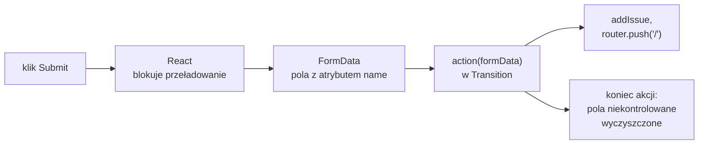

# Formularz, który przekazuje dane funkcji

## Formularz, który działa bez Reacta

Formularz HTML umie wysłać dane bez jednej linii JavaScriptu. Przeglądarka przy wysłaniu zbiera wartości wszystkich pól, które mają atrybut `name`, w pary „nazwa → wartość”. Atrybut **`action`** elementu `<form>` to adres URL, który te dane przetworzy. Atrybut **`method`** wybiera metodę HTTP. Domyślne `get` dopisuje pary do adresu po znaku `?`, a `post` wysyła je w treści żądania. Format tej treści wybiera atrybut `enctype`, a pliki wymagają wartości `multipart/form-data`. Po odpowiedzi serwera przeglądarka wczytuje nowy dokument.

Wyszukiwarka zgłoszeń w czystym HTML-u (przykład spoza projektu):

```jsx
{/* Pole q i metoda GET: dane trafią do adresu /search?q=... */}
<form action="/search" method="get">
  <input name="q" />
  <button type="submit">Search</button>
</form>
```

Wpisanie „safari login” i Enter przenosi przeglądarkę pod adres `/search?q=safari+login`. Spacja zmienia się w adresie w znak `+`. Metoda GET pasuje do wyszukiwania, bo wynik ma własny adres, który można zapisać w zakładkach. Gdy do atrybutu `action` w JSX trafia adres, React nie przechwytuje formularza (*„When a URL is passed to `action` the form will behave like the HTML form component”*).

## `FormData`: pary nazwa → wartość

Te same pary przeglądarka udostępnia skryptom jako obiekt **`FormData`**. Schwarzmüller podkreśla, że to interfejs przeglądarki, którego nie importuje się z Reacta ani z żadnej biblioteki. Obiekt da się zbudować i odczytać także ręcznie:

```js
const fd = new FormData();
fd.append("title", "Login bug");
fd.append("tag", "ui");
fd.append("tag", "safari");     // druga para o tej samej nazwie
fd.get("title");                // → "Login bug"
fd.get("tag");                  // → "ui": get zwraca pierwszą wartość
fd.getAll("tag");               // → ["ui", "safari"]
fd.get("priority");             // → null: takiej pary nie ma
```

Metoda `get()` wymaga nazwy pola. MDN zaznacza, że przy kilku parach o tej samej nazwie zwraca pierwszą wartość (*„returns the first value associated with a given key”*), a wszystkie wartości zwraca `getAll()`. Brak pary daje `null`, a nie wyjątek. Bugl formułuje regułę, która z tego wynika dla formularzy:

> **„Ważne jest jednak poprawne zdefiniowanie właściwości name pól formularza, bo to po niej pole zostanie rozpoznane przy wysłaniu formularza.”**
>
> *„However, it is important to properly define the name property of input fields, as that is what will be used to identify the field when the form is submitted.”*
>
> — Daniel Bugl, *Modern Full-Stack React Projects*

Przeglądarka buduje taki obiekt sama, gdy konstruktor dostaje element formularza. Tak samo postępuje React przy wysłaniu. Formularz z pięcioma polami:

```html
<form>
  <input name="title" value="Bug" />
  <input name="urgent" type="checkbox" checked />   <!-- zaznaczone, bez value -->
  <input name="public" type="checkbox" />           <!-- niezaznaczone -->
  <select name="priority">
    <option value="low">Low</option>
    <option value="high" selected>High</option>
  </select>
  <input name="x" value="1" disabled />             <!-- wyłączone -->
</form>
```

daje taki obiekt:

```js
const fd = new FormData(document.querySelector("form"));
[...fd.entries()];  // → [["title","Bug"], ["urgent","on"], ["priority","high"]]
```

Pary idą w kolejności pól w dokumencie. Zaznaczone pole wyboru bez atrybutu `value` wysyła napis `"on"`, a lista `<select>` wartość wybranej opcji. Pole `public` i wyłączone pole `x` w ogóle nie dały par.

O kluczu w `FormData` decyduje `name`, a `id` służy wyłącznie połączeniu z etykietą. <u>Pole bez atrybutu `name` jest dla formularza niewidoczne</u>. Sam atrybut `name` nie wystarcza w dwóch przypadkach z przykładu. Pole z atrybutem `disabled` nie trafia do `FormData`, choć ma nazwę i wartość, a pole `readOnly` trafia. Niezaznaczone pole wyboru też nie daje pary, więc `get` zwraca dla niego `null`.

## Funkcja w atrybucie `action`

React 19 pozwala przekazać do `action` funkcję zamiast adresu. Przy wysłaniu React blokuje przeładowanie strony, sam buduje `FormData` z pól formularza i wywołuje funkcję z tym obiektem:

```jsx
// Minimalna akcja: React wywoła ją z FormData wysłanego formularza.
<form action={(formData) => console.log(formData.get("q"))}>
  <input name="q" />
  <button type="submit">Search</button>
</form>
```

Funkcję podpiętą w ten sposób nazywa się **akcją** (*Action*). Blog wydania React 19 podaje tę nazwę jako umowę: „umownie funkcje korzystające z asynchronicznych przejść nazywa się akcjami” (*„By convention, functions that use async transitions are called “Actions””*).

Akcja z funkcją działająca w przeglądarce nie wysyła żadnego żądania HTTP: wysłanie formularza na `/new` kończy się wywołaniem funkcji w kodzie strony, bez ruchu w sieci. Dokumentacja React pisze, że przy funkcji w `action` albo `formAction` metodą HTTP jest zawsze POST, niezależnie od atrybutu `method`. To zdanie dotyczy formularza, którego funkcja wykonuje się na serwerze i dane muszą do niego dotrzeć żądaniem. Dla wyszukiwarki z adresem w pasku zostaje więc formularz z adresem i metodą GET.

## Pierwszy formularz zgłoszenia

Formularz zgłoszenia ma dwa pola niekontrolowane, czyli bez atrybutu `value`. Tytuł i priorytet są potrzebne dopiero po kliknięciu „Submit”, więc komponent nie śledzi ich litera po literze. Nowy plik `app/new/page.jsx` wygląda tak:

```jsx
// app/new/page.jsx: utworzyć plik
// Formularz nowego zgłoszenia: podstawowa akcja formularza.
// "use client": useRouter działa tylko w komponencie klienckim,
// a addIssue zapisuje do kopii magazynu w przeglądarce.
"use client";
import { useRouter } from "next/navigation";
import { addIssue } from "../lib/store";

export default function NewIssuePage() {
  const router = useRouter();

  // action(formData): React 19 wywołuje ją przy wysłaniu formularza.
  // FormData powstaje automatycznie ze wszystkich pól z atrybutem name.
  function action(formData) {
    const title = formData.get("title");
    const priority = formData.get("priority");
    console.log("FormData:", { title, priority }); // podgląd danych w konsoli
    addIssue({ title, priority });
    router.push("/"); // powrót na listę
  }

  return (
    <div>
      <h1>New Issue</h1>
      <form action={action}>
        <div>
          {/* htmlFor łączy etykietę z polem o id="title" */}
          <label htmlFor="title">Title</label>
          <input id="title" name="title" type="text" />
        </div>
        <div>
          <label htmlFor="priority">Priority</label>
          <select id="priority" name="priority">
            <option value="low">Low</option>
            <option value="medium">Medium</option>
            <option value="high">High</option>
          </select>
        </div>
        <button type="submit">Submit</button>
      </form>
    </div>
  );
}
```

`router.push("/")` przechodzi na listę tak jak kliknięcie linku, tyle że z kodu. Atrybut `htmlFor` to w JSX odpowiednik HTML-owego `for`, bo `for` jest w JavaScripcie słowem zastrzeżonym. Po wpisaniu „New test issue”, wybraniu „High” i wysłaniu konsola wypisuje obiekt z polami `title` i `priority`. Lista na `/` ma wtedy piąty wiersz „[high] New test issue — open”. Gdyby pole tytułu nie miało atrybutu `name`, `formData.get("title")` zwróciłoby `null`, a piąty wiersz miałby postać „[high] — open”, bez tytułu.

## Akcja jako przejście

Akcja wykonuje się w **przejściu** (*Transition*), czyli aktualizacji, którą React może odłożyć i przerwać na rzecz pilniejszych, takich jak wpisywanie znaków. Dokumentacja React opisuje to tak:

> **„Gdy do `action` przekazuje się funkcję, obsługuje ona wysłanie formularza w ramach Transition, zgodnie ze wzorcem propa akcji. Funkcja może być asynchroniczna i dostaje jeden argument z danymi wysłanego formularza.”**
>
> *„When a function is passed to `action` the function will handle the form submission in a Transition following the Action prop pattern. The function passed to `action` may be async and will be called with a single argument containing the form data of the submitted form.”*
>
> — dokumentacja React, *form*

Funkcje asynchroniczne w przejściach doszły dopiero w React 19, więc opisy przejść pisane dla React 18 pokazują tylko funkcje synchroniczne. Blog wydania wiąże tę zmianę ze stanem oczekiwania, błędami i formularzami (*„support for using async functions in transitions to handle pending states, errors, forms, and optimistic updates automatically”*). Schwarzmüller ujmuje nowy model wprost: akcje są przejściami, a dokładniej przejściami asynchronicznymi (*„To be precise, they are asynchronous transitions”*).

## Przejście trwa do końca akcji

Przejście asynchroniczne obejmuje cały czas działania funkcji, także każdy `await`. Przebieg opisuje blog React 19.

> **„Przejście asynchroniczne od razu ustawia stan `isPending` na `true`, wykonuje żądania asynchroniczne i przełącza `isPending` na `false` po zakończeniu wszystkich przejść.”**
>
> *„The async transition will immediately set the `isPending` state to true, make the async request(s), and switch `isPending` to false after any transitions.”*
>
> — blog React, *React v19*

Kumar opisuje ten sam związek przy nawigacji. Gdy w przejściu coś się zawiesza, React wiąże `isPending` z pobraniem danych i ich renderem (*„React will tie the `isPending` state to the data fetch”*). Z tego wynika zachowanie, które Schwarzmüller nazywa nieoczekiwanym. <u>Zmiany stanu wywołane wewnątrz akcji React stosuje dopiero po zakończeniu całej akcji</u>. Pokazuje to mały formularz spoza projektu:

```jsx
// Setter na początku akcji: napis „Saving...” nigdy nie pojawi się na ekranie.
const [msg, setMsg] = useState("-");
async function action() {
  setMsg("Saving...");
  await new Promise((r) => setTimeout(r, 300)); // symulacja zapisu
  setMsg("Saved");
}
// <form action={action}><p>{msg}</p><button type="submit">Go</button></form>
```

Przez cały czas trwania akcji akapit pokazuje „-”, a po jej zakończeniu od razu „Saved”. Pośredniego napisu nie widać ani przez chwilę, bo oba wywołania settera należą do tego samego przejścia i React stosuje je razem. React zna za to cały czas status przejścia, więc wie, kiedy akcja trwa. Na tej wiedzy opierają się hooki, które pokazują wynik akcji i stan oczekiwania.

## Rysunek 3.14 — wysłanie formularza z akcją



Na Rysunku 3.14 strzałki idą w kolejności zdarzeń. Trzy pierwsze kroki dawniej wykonywał programista w procedurze obsługi zdarzenia `submit`. Ostatni węzeł dotyczy pól bez `value`, które React czyści po udanej akcji.

## To samo przez `onSubmit`

Dla porównania stary wzorzec obsługi tego samego formularza wygląda tak:

```jsx
{/* Starszy wzorzec: onSubmit z ręcznym preventDefault. */}
<form onSubmit={(e) => {
  e.preventDefault();                // bez tego: pełne przeładowanie strony
  const title = e.target.title.value; // element formularza → pole o nazwie title
  addIssue({ title, priority: "medium" });
  router.push("/");
}}>
```

Funkcja dostaje obiekt zdarzenia i musi sama wywołać `e.preventDefault()`. Bez tego przeglądarka wykonałaby domyślne działanie formularza: wysłałaby żądanie HTTP pod bieżący adres i wczytała nowy dokument, gubiąc stan aplikacji. `e.target` to element `<form>`, a `e.target.title` to jego pole o nazwie `title`. Schwarzmüller wymienia dwie czynności, które przy akcji React wykonuje w zamian za programistę: blokuje domyślne zachowanie przeglądarki i tworzy obiekt danych formularza. Wysłanie przez `onSubmit` nie jest też przejściem, więc React nie zna jego statusu i hooki stanu formularza nic o nim nie wiedzą.

Wieruch ocenia kierunek zmiany tak:

> **„Od React 19 do wysyłania danych formularza używa się atrybutu action zamiast onSubmit, bo lepiej wykorzystuje on natywne zachowanie formularza.”**
>
> *„Moving forward with React 19, the action attribute will be used over the onSubmit attribute to submit form data, because it takes more advantage of the native form behavior.”*
>
> — Robin Wieruch, *The Road to React*

Schwarzmüller jest ostrożniejszy: `onSubmit` spotyka się w większości projektów React, a wybór zależy od wymagań aplikacji. Akcja skraca kod przy zwykłym zbieraniu danych. Stan albo ref są nadal potrzebne, gdy pola trzeba ustawiać z kodu albo przenosić do nich fokus.

## Formularz, zanim dotrze JavaScript

Trzy sposoby wysłania formularza różnią się tym, co zostaje w HTML-u wysłanym z serwera. Ma to znaczenie przed załadowaniem skryptów strony i wtedy, gdy JavaScript nie działa wcale. Zasada **progresywnego wzbogacania** (*progressive enhancement*) wymaga, żeby podstawowa funkcja strony działała także w takim przypadku, a skrypt jedynie ją wzbogacał. Kumar ujmuje to krótko: rolą JavaScriptu jest wzbogacać stronę, a nie nią być (*„JavaScript’s role is to enhance a web page, not be a web page”*). Według tej miary trzy formularze wypadają różnie:

- **Formularz z adresem w `action`** działa bez skryptów, bo wysyłkę wykonuje sama przeglądarka.
- **Formularz z `onSubmit`** ma procedurę obsługi tylko w JavaScripcie. W HTML-u z serwera nie ma po niej śladu.
- **Formularz z funkcją w `action`** dostaje w HTML-u z serwera atrybut `action="javascript:throw new Error('React form unexpectedly submitted.')"`. Po załadowaniu skryptów wysłanie przejmuje React i ten adres się nie wykonuje.

Strona `/new` po zbudowaniu, otwarta z wyłączonym JavaScriptem, po kliknięciu „Submit” nie wysyła żadnego żądania i zostaje pod adresem `/new` z wpisanym tytułem. Akcja wykonywana w przeglądarce nie spełnia więc zasady progresywnego wzbogacania. Spełnia ją dopiero funkcja wykonywana na serwerze, którą przeglądarka może wywołać zwykłym żądaniem HTTP.


Na Rysunku 3.15 po kliknięciu adres to nadal `/new`, a w polu stoi wpisany tytuł. Strona się nie przeładowała, bo `action` zawiera funkcję, którą wykonuje dopiero JavaScript.

## Co dzieje się z polami po akcji

Dokumentacja elementu `form` opisuje krok, który kończy każdą udaną akcję:

> **„Gdy funkcja `action` zakończy się sukcesem, wszystkie niekontrolowane pola formularza zostają zresetowane.”**
>
> *„After the `action` function succeeds, all uncontrolled field elements in the form are reset.”*
>
> — dokumentacja React, *form*

W tym formularzu reset nie jest widoczny, bo `router.push("/")` i tak opuszcza stronę. Ma jednak trzy cechy, które łatwo pomylić ze zwykłym wyczyszczeniem pól:

- **Powrót do wartości domyślnej.** Skutek jest taki sam jak metody `reset()` elementu formularza, którą MDN opisuje jako przywrócenie wartości domyślnych (*„restores a form element's default values”*). Pole tekstowe bez `defaultValue` staje się puste. Lista `<select>` bez `defaultValue` wraca do pierwszej opcji, czyli „Low”, a z atrybutem `defaultValue="medium"` do „Medium”.
- **Sukces znaczy brak wyjątku.** Akcja, która zwraca obiekt z komunikatem błędu, też kończy się dla Reacta sukcesem. Pola czyszczą się więc także wtedy, gdy użytkownik ma poprawić dane. Zachowanie wpisu po takim błędzie wymaga zwrócenia wartości pól w wyniku akcji i podania ich jako `defaultValue`.
- **Tylko pola niekontrolowane.** Pola z `value` ze stanu React nie rusza, bo jego wartość wyznacza stan komponentu. Taki stan trzeba wyczyścić samemu.

## Rozszerzenie: kilka przycisków w jednym formularzu

Formularz może też mieć więcej niż jedną akcję. Przycisk z atrybutem `formAction` nadpisuje akcję całego formularza, więc „Submit” i „Save draft” mogą wywołać dwie różne funkcje z tymi samymi polami. Demo tego nie używa:

```jsx
<form action={submitIssue}>
  <input name="title" />
  <button type="submit">Submit</button>
  {/* formAction: ten przycisk wywoła saveDraft zamiast submitIssue */}
  <button formAction={saveDraft}>Save draft</button>
</form>
```

Gdy oba przyciski robią to samo i różnią się jednym parametrem, wystarczy atrybut `name` na przycisku. MDN opisuje go tak:

> **„Nazwa przycisku, wysyłana w parze z jego wartością `value` jako część danych formularza, gdy formularz zostanie wysłany tym przyciskiem.”**
>
> *„The name of the button, submitted as a pair with the button's `value` as part of the form data, when that button is used to submit the form.”*
>
> — MDN Web Docs, *&lt;button&gt;: The Button element*

Przykład spoza projektu zastępuje listę priorytetów dwoma przyciskami:

```jsx
<form action={action}>
  <input name="title" />
  {/* para priority=medium albo priority=high, zależnie od klikniętego przycisku */}
  <button type="submit" name="priority" value="medium">Submit</button>
  <button type="submit" name="priority" value="high">Submit as urgent</button>
</form>
```

Kliknięcie „Submit as urgent” daje w akcji `FormData` z parami `title` i `priority` równym `"high"`. Klawisz Enter w polu tekstowym wysyła formularz tak, jakby kliknięto pierwszy przycisk wysyłania, więc akcja dostaje wtedy `"medium"`. Ta sama operacja z innym parametrem to `name` i `value` na przyciskach, a inna operacja, jak zapis szkicu, to `formAction` z osobną funkcją.

> 💡 **Zapamiętaj:** <u>`<form action={fn}>` wywołuje `fn(formData)` w ramach przejścia</u>. React sam zbiera wartości pól, ale tylko tych, które mają atrybut `name`. Po akcji, która nie rzuciła wyjątku, pola niekontrolowane wracają do wartości domyślnych.

