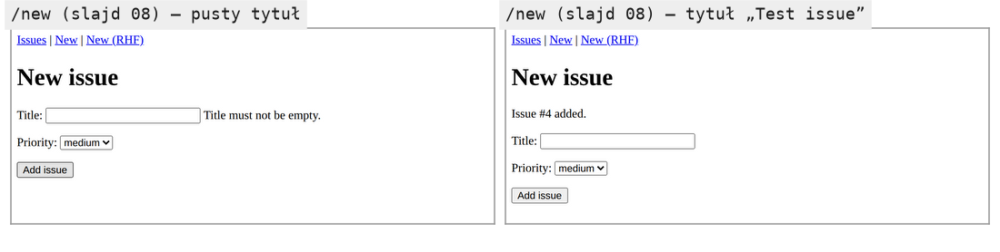
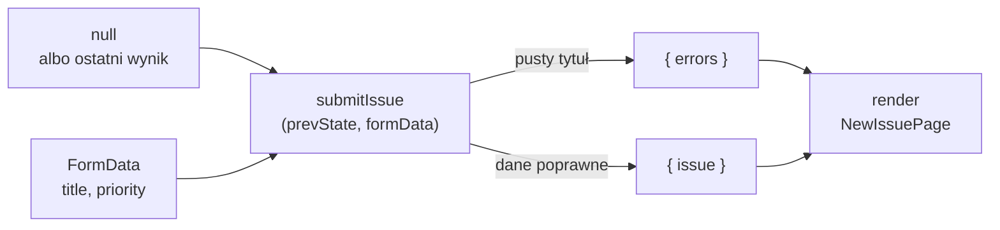

# Akcja, która oddaje wynik: `useActionState`

## Pusty tytuł na liście i przycisk, który nic nie mówi

Formularz z poprzedniego kroku działa, ale nie umie odpowiedzieć użytkownikowi. Pomiar na tej wersji: pusty tytuł jest przyjmowany bez sprzeciwu i trafia na koniec listy jako wiersz „[medium]”. Przycisk „Add issue” nie ma stanu oczekiwania, więc przy wolnym zapisie można go kliknąć wiele razy. Nawigacja na listę następuje natychmiast, bez potwierdzenia, że coś zapisano.

Te braki mają wspólną przyczynę. Funkcja `action` wykonuje pracę i znika, a jej wynik nigdzie nie trafia. Komponent nie wie, czy zgłoszenie dodano, ani czy tytuł był pusty. Brakuje drogi od akcji z powrotem do komponentu. Zwykły `useState` mógłby ją zapewnić, ale wymagałby ręcznego wywoływania settera w kilku miejscach akcji, a setter wywołany w akcji i tak zadziała dopiero po jej końcu.

## Czym jest `useActionState`

Dokumentacja React definiuje hook tak:

> **„`useActionState` to hook Reacta, który pozwala aktualizować stan z efektami ubocznymi za pomocą akcji.”**
>
> *„`useActionState` is a React Hook that lets you update state with side effects using Actions.”*
>
> — dokumentacja React, *useActionState*

Hook przyjmuje stan początkowy i akcję w kształcie reducera, czyli funkcję `(poprzedni stan, dane) → nowy stan`. To, co akcja zwróci, staje się nowym stanem, a komponent renderuje się z tym stanem. Schwarzmüller ujmuje to porównaniem: `useActionState()` to w gruncie rzeczy `useState()` dostrojony do wyprowadzania stanu z akcji (*„essentially like `useState()`, fine-tuned to derive state from actions”*). Przy `useState` stan ustawia ręczne wywołanie settera, a przy `useActionState` wartość zwrócona z akcji.

Hook ma krótką historię nazwy. Bugl w *Modern Full-Stack React Projects*, pisanej dla React 18, używa hooka `useFormState` z pakietu `react-dom` i zaznacza, że w wydaniu React 19 zmieni on nazwę na `useActionState`. Starsze poradniki pokazują więc ten sam mechanizm pod inną nazwą i z innym importem. W React 19 hook importuje się z pakietu `react`.

## Najmniejszy formularz z `useActionState`

Reducer liczący próby wystarczy, żeby zobaczyć wszystkie trzy wartości zwracane przez hook:

```jsx
// Przykład spoza demo: akcja w postaci reducera, dostaje poprzedni stan i FormData.
async function countAttempts(prevState, formData) {
  await new Promise((r) => setTimeout(r, 100)); // symulacja wolnej operacji
  return { attempts: prevState.attempts + 1 };  // nowy stan
}

function Counter() {
  // [bieżący stan, akcja do podpięcia w form, czy akcja trwa]
  const [state, formAction, isPending] = useActionState(countAttempts, { attempts: 0 });
  return (
    <form action={formAction}>
      <p>Attempts: {state.attempts}{isPending && " (pending)"}</p>
      <button type="submit">Go</button>
    </form>
  );
}
```

Pierwszy render daje „Attempts: 0”. Przy dwóch wysłaniach jedno po drugim akapit pokazuje „Attempts: 0 (pending)”, dopóki trwają akcje, a po zakończeniu obu „Attempts: 2”. Druga akcja startuje dopiero po pierwszej i dostaje `prevState` z liczbą 1. Pośredniego „Attempts: 1” nie widać, bo React pokazuje stan oczekiwania, dopóki nie skończą się wszystkie akcje z kolejki, i dopiero wtedy renderuje stan końcowy.

## Dlaczego wywołania czekają w kolejce

Kolejka wynika z sygnatury akcji. Każde wywołanie potrzebuje wyniku poprzedniego jako `prevState`, więc nie może wystartować, zanim tamto się skończy. Dokumentacja ujmuje to tak.

> **„`useActionState` można traktować jak `useReducer` dla efektów ubocznych akcji użytkownika. Ponieważ następną akcję wylicza na podstawie poprzedniej, musi wykonywać wywołania po kolei. Akcje równoległe wymagają bezpośredniego użycia `useState` i `useTransition`.”**
>
> *„You can think of `useActionState` as `useReducer` for side effects from user Actions. Since it computes the next Action to take based on the previous Action, it has to order the calls sequentially. If you want to perform Actions in parallel, use `useState` and `useTransition` directly.”*
>
> — dokumentacja React, *useActionState*

Ta sama strona dokumentacji odróżnia oba hooki jednym warunkiem: reducer w `useReducer` musi być czysty, a akcja w `useActionState` może wykonywać efekty uboczne, na przykład wysłać dane. Kolejka ma cenę, którą dokumentacja liczy na swoim przykładzie z opóźnieniem 1 s: cztery kliknięcia trwają razem mniej więcej cztery sekundy (*„4 clicks will take ~4 seconds to complete”*). Autorzy nazywają to zamierzoną cechą projektu hooka.

Z kolejki wynika też, skąd bierze się stan. Hook nie daje settera, który mógłby zmienić ten stan z boku, w trakcie akcji. Stan zmienia się wyłącznie przez wartość zwróconą z akcji. <u>Stan po serii wysłań zależy tylko od stanu początkowego i kolejnych danych z formularza</u>. Dwa szybkie kliknięcia nie uruchomią więc dwóch akcji równolegle na tym samym stanie i żadna nie nadpisze wyniku drugiej.

## Formularz zgłoszenia z wynikiem i stanem oczekiwania

Strona `app/new/page.jsx` przechodzi na `useActionState`. Akcja leży poza komponentem i ma sygnaturę reducera. W komponencie dochodzą wywołanie hooka, komunikat o sukcesie i błąd przy polu. Przycisk dostaje flagę `isPending`:

```jsx
// app/new/page.jsx
"use client";
import { useActionState } from "react";
import { addIssue } from "../lib/store";

// akcja dostaje poprzedni stan i dane formularza, a zwraca nowy stan
async function submitIssue(prevState, formData) {
  await new Promise((r) => setTimeout(r, 600)); // udajemy zapis na serwerze: 0,6 s
  const title = formData.get("title").trim();
  if (title === "") return { errors: { title: "Title must not be empty." } };

  const issue = addIssue({ title, priority: formData.get("priority") });
  return { issue };
}

export default function NewIssuePage() {
  const [state, formAction, isPending] = useActionState(submitIssue, null);

  return (
    <main>
      <h1>New issue</h1>
      {state?.issue && <p>Issue #{state.issue.id} added.</p>}
      <form action={formAction}>
        <p>Title: <input name="title" /> {state?.errors?.title}</p>
        <p>
          Priority:{" "}
          <select name="priority" defaultValue="medium">
            <option value="low">low</option>
            <option value="medium">medium</option>
            <option value="high">high</option>
          </select>
        </p>
        <button disabled={isPending}>Add issue</button>
      </form>
    </main>
  );
}
```

Pomiar: po kliknięciu „Add issue” przycisk jest wyłączony już po 0,2 s, a akcja trwa 0,6 s. Tytuł złożony z samych spacji kończy się komunikatem „Title must not be empty.” obok pola, bo `trim()` ucina spacje przed porównaniem. Poprawny tytuł, na przykład „ab”, daje „Issue #4 added.”, a na liście pojawia się wiersz „[medium] ab”. Stan początkowy to `null`, dlatego JSX czyta stan przez `state?.`: przed pierwszym wysłaniem nie ma jeszcze ani wyniku, ani błędu. `router.push("/")` zniknęło, więc po sukcesie formularz zostaje na ekranie, a pole tytułu jest puste. Lista priorytetów wraca do „medium”, bo takie jest jej `defaultValue`.



Rysunek 3.16 zestawia dwa wyniki tej samej akcji: komunikat „Title must not be empty.” przy pustym polu i „Issue #4 added.” po sukcesie. W obu stanach formularz zostaje na ekranie.

## Opakowana akcja zamiast akcji programisty

Formularz dostaje `formAction`, a nie `submitIssue`. Schwarzmüller wyjaśnia, po co ta druga wartość w ogóle istnieje:

> **„Zaktualizowana funkcja akcji formularza to w istocie funkcja programisty opakowana przez Reacta. Jest to konieczne, żeby React miał dostęp do wartości zwracanej przez akcję, czyli do nowego stanu.”**
>
> *„An updated form action function, which is essentially your action function, wrapped by React. This is necessary so that React gets access to the value returned by your action function (which is the new state).”*
>
> — Maximilian Schwarzmüller, *React Key Concepts*

Gdyby formularz dostał `submitIssue` bezpośrednio, React wywołałby funkcję i zignorował jej wynik. Opakowanie przejmuje wynik i zapisuje go jako stan. Dokumentacja nazywa tę funkcję `dispatchAction`, a demo przypisuje ją do zmiennej `formAction`. Z atrybutem `formAction` przycisku, który kieruje wysłanie do innej akcji, łączy ją tylko nazwa. W atrybucie `action` formularza działa bez dodatkowej pracy, bo React uruchamia ją wtedy w przejściu. Wywołana z kodu, na przykład z `onClick`, wymaga owinięcia w `startTransition`, czyli funkcję Reacta, która uruchamia aktualizację jako przejście. Wywołanie poza przejściem w trybie deweloperskim zapisuje błąd w konsoli.

## Dlaczego akcja dostaje `prevState`

Opakowana akcja wywołuje funkcję programisty z dwoma argumentami. Dokumentacja opisuje pierwszy z nich: `previousState` to ostatni stan, na początku równy `initialState`, a po pierwszym wywołaniu równy ostatniej zwróconej wartości. Drugi argument to dane przekazane do `dispatchAction`, czyli przy formularzu obiekt `FormData`.

Kolejność argumentów jest sztywna. Akcja ze starą sygnaturą `submitIssue(formData)` dostanie w parametrze `formData` poprzedni stan, czyli przy pierwszym wysłaniu `null`. Wywołanie `formData.get("title")` rzuca wtedy `TypeError` z komunikatem „Cannot read properties of null (reading 'get')”. Dane formularza do funkcji nie trafiają, więc zamiast formularza pojawia się domyślny ekran Next.js „This page couldn’t load”. Demo z `prevState` nie korzysta, ale musi go przyjąć. Licznik nieudanych prób albo lista zgłoszeń dodanych w tej sesji wymagałyby już poprzedniej wartości.

## Rysunek 3.17 — poprzedni stan i dane formularza dają nowy stan



Na Rysunku 3.17 do funkcji `submitIssue` wchodzą dwie strzałki. Pierwsza niesie poprzedni stan, przy pierwszym wysłaniu równy `null`. Druga niesie dane formularza. Wychodzą dwie drogi zależnie od wyniku sprawdzenia tytułu i obie kończą się renderem strony. Przy następnym wysłaniu wynik tego renderu wraca do lewego górnego prostokąta jako `prevState`.

## Kształt stanu

Akcja zwraca albo `{ errors }`, albo `{ issue }`, a przed pierwszym wysłaniem stanem jest `null`. Każdy z trzech przypadków ma inne pola, więc JSX sprawdza je przez `state?.issue` i `state?.errors?.title`. Pilnowanie tego kształtu spada na programistę: literówka w nazwie pola nie rzuca błędu i po cichu nic nie pokazuje. Komunikat błędu jest więc zwykłą wartością zwróconą z akcji. Wyjątek działa inaczej, bo akcja wykonuje się w przejściu, a błąd przejścia React kieruje do najbliższej granicy błędów. Dokumentacja `useActionState` opisuje to wprost:

> **„Jeśli `dispatchAction` zgłosi wyjątek, React anuluje wszystkie oczekujące akcje i pokaże najbliższą granicę błędów.”**
>
> *„If `dispatchAction` throws an error, React cancels all queued actions and shows the nearest Error Boundary.”*
>
> — dokumentacja React, *useActionState*

W Next.js najbliższą granicą jest plik `error.jsx`. Strona `/new` i korzeń `app/` takiego pliku nie mają, więc wyjątek w `submitIssue` kończy się domyślnym ekranem Next.js „This page couldn’t load”, a formularz znika razem z wpisanymi danymi. <u>Błąd, który użytkownik może poprawić w formularzu, zwraca się jako stan</u>, a wyjątek zostawia się na awarie, na które formularz nie ma wpływu.

## Akcja synchroniczna i asynchroniczna

Akcja w tej wersji ma słowo `async`, ale nie musi go mieć. Schwarzmüller zwraca uwagę, że akcje formularzy mogą być synchroniczne albo asynchroniczne. Przykładem akcji synchronicznej jest u niego zapis do `localStorage`, bo to API przeglądarki działa synchronicznie. Akcja asynchroniczna zwraca obiekt Promise, na przykład po wysłaniu żądania `fetch` do serwera. `useActionState` przyjmuje oba rodzaje. Przy akcji asynchronicznej stanem staje się wartość, do której spełni się Promise. Funkcja `addIssue` w demo działa synchronicznie. Słowo `async` i opóźnienie 0,6 s są tu po to, żeby akcja zachowywała się jak prawdziwy zapis na serwerze i żeby stan oczekiwania był widoczny.

## Stan akcji żyje tak długo jak komponent

Stan z `useActionState` należy do komponentu, który wywołał hook, tak samo jak stan z `useState`. Minimalny licznik wysłań pokazuje, co to znaczy dla wyniku akcji:

```jsx
// Przykład spoza demo: licznik wysłań
import { useActionState } from "react";

function Counter() {
  // akcja dostaje poprzedni stan i zwraca następny
  const [count, formAction] = useActionState((prev) => prev + 1, 0);
  return <form action={formAction}><button>Sent {count}</button></form>;
}
// <Counter /> pod warunkiem albo z kluczem: {show && <Counter key={k} />}
```

Po dwóch wysłaniach przycisk pokazuje „Sent 2”. Gdy rodzic ukryje komponent i pokaże go ponownie, przycisk wraca do „Sent 0”, bo nowy egzemplarz zaczyna od stanu początkowego. Ten sam skutek daje zmiana atrybutu `key`, która każe Reactowi potraktować komponent jak nowy. Dwa wywołania hooka w różnych komponentach mają osobne stany: wysłanie jednego formularza nie zmienia licznika drugiego.

W `issuetracker` ma to praktyczny skutek. Komunikat „Issue #4 added.” znika po przejściu na listę i powrocie na `/new`, bo strona formularza montuje się od nowa. Stan akcji przechowuje więc wynik ostatniego wysłania. Dane, które mają przetrwać nawigację, leżą w magazynie `store.js`, poza komponentem.

## Zalety i koszty `useActionState`

Hook oddaje wynik akcji komponentowi, ale narzuca akcji kształt reducera.

| Zyskujemy | Płacimy | Kiedy nie warto / co zamiast |
|---|---|---|
| Wynik akcji jest stanem: błąd przy polu i „Issue #4 added.” bez ręcznego settera | Akcja ma sygnaturę `(prevState, formData)`; pomyłka w kolejności kończy się `TypeError` i ekranem „This page couldn’t load” | Formularz bez komunikatu i bez błędów: sama funkcja w `action` |
| `isPending` blokuje przycisk już po 0,2 s od kliknięcia, bez własnej flagi | Kształt stanu (`null`, `{ errors }`, `{ issue }`) pilnuje programista, a wywołania czekają w kolejce | Akcje, które mają działać równolegle: `useState` i `useTransition` |
| Błąd do poprawienia wraca jako dane, a wyjątek zostaje dla awarii | Stan znika razem z komponentem: komunikat „Issue #4 added.” nie przetrwa przejścia na listę | Wynik, który ma przeżyć nawigację: magazyn poza komponentem |

> 💡 **Zapamiętaj:** `useActionState(akcja, stanPoczątkowy)` zwraca `[state, formAction, isPending]`. Akcja to reducer `(prevState, formData)`: to, co zwróci, staje się nowym stanem, a kolejne wywołania czekają w kolejce. Błędy do poprawienia zwraca się jako stan, a `isPending` wyłącza przycisk na czas zapisu.


Materiał rozszerzony do tego slajdu: [`rozszerzenia/r08_useactionstate.md`](rozszerzenia/r08_useactionstate.md)
