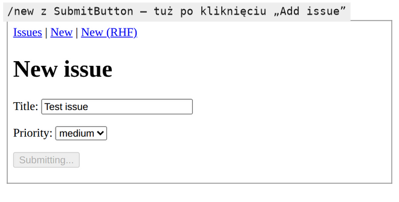
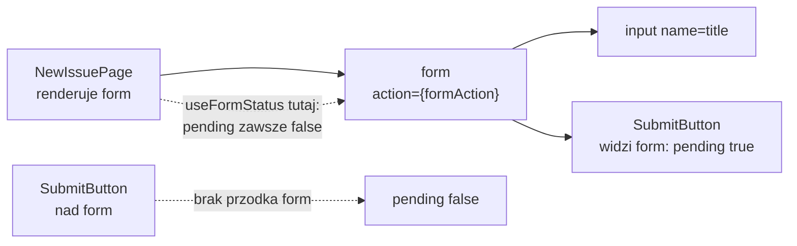

# Przycisk, który sam wie, że formularz się wysyła

## Flaga przekazywana z góry

Przycisk w formularzu `/new` blokuje się dzięki `isPending` z `useActionState`. Flaga powstaje w komponencie strony, a przycisk stoi w JSX tej samej strony, więc nic nie trzeba przekazywać. Problem pojawia się wtedy, gdy przycisk ma stać się osobnym komponentem, używanym w wielu formularzach, na przykład w bibliotece komponentów zespołu. Taki przycisk musiałby dostawać flagę przez propsy:

```jsx
// Przykład spoza demo: przycisk z flagą w propsie.
function SubmitButton({ loading }) {
  return (
    <button type="submit" disabled={loading}>
      {loading ? "Submitting..." : "Add issue"}
    </button>
  );
}

// w formularzu: isPending przekazane w dół ze strony
<SubmitButton loading={isPending} />
```

Każdy formularz musi wtedy pamiętać o przekazaniu `loading`. Gdy przycisk stoi głębiej w drzewie, flaga wędruje przez komponenty pośrednie, które same jej nie używają, czyli powstaje znane *prop drilling*.

React 19 daje drugą drogę: przycisk sam odczytuje stan formularza, w którym stoi. Schwarzmüller ocenia obie drogi dwoma argumentami. Zaletą `isPending` jest brak osobnego komponentu, a przycisk z własnym hookiem opłaca się przy wielu formularzach:

> **„Utworzenie dodatkowego komponentu z `useFormStatus()` może się przydać, gdy na stronie jest wiele formularzy. Można wtedy na przykład użyć tego samego `<SubmitButton>` we wszystkich.”**
>
> *„On the other hand, creating such an extra component and relying on `useFormStatus()` might be useful if you have multiple forms on the page—you could then, for example, reuse the `<SubmitButton>` across all those forms.”*
>
> — Maximilian Schwarzmüller, *React Key Concepts*

Formularz `/new` jest jeden, więc demo zostaje przy `isPending`. Pliku `app/components/SubmitButton.jsx` w projekcie brak, więc wszystkie fragmenty poniżej to przykłady spoza demo. Uruchomiono je w kopii projektu z dopisanym plikiem przycisku i osobną stroną.

## Skąd przycisk wie o formularzu

Przycisk zna stan formularza bez żadnego propsa. Hook czyta wartość dostarczaną przez najbliższy element `<form>` nad komponentem, podobnie jak kontekst Reacta udostępnia wartość całemu poddrzewu bez propsów. W kodzie `react-dom` 19.3.0 hook to jedno wywołanie, które czyta wewnętrzny kontekst stanu przejścia, a wartość ustawia formularz, który właśnie wysyła akcję. Komponent poza takim formularzem dostaje wartość domyślną: `pending` równe `false`, a `data`, `method` i `action` równe `null`.

Z tego modelu wynika, kiedy przycisk renderuje się ponownie. Nie robi tego przy każdej literze wpisanej w pole, bo wpisywanie nie zmienia statusu formularza. W buildzie produkcyjnym renderuje się dwa razy na jedno wysłanie: gdy status przechodzi w oczekiwanie i gdy z niego wychodzi. Pod `next dev` licznik jest dwa razy większy, bo tryb deweloperski wykonuje każdy render podwójnie. W kopii projektu wpisanie trzech liter dało zero renderów przycisku, a jedno wysłanie cztery wpisy w konsoli.

## Komponent `SubmitButton`

Plik z przyciskiem wygląda tak:

```jsx
// Przykład spoza demo: app/components/SubmitButton.jsx
// SubmitButton: czyta stan oczekiwania formularza przez useFormStatus.
// MUSI być OSOBNYM komponentem renderowanym WEWNĄTRZ <form>.
"use client"; // komponent wywołuje hook, więc działa w przeglądarce
import { useFormStatus } from "react-dom"; // uwaga: react-dom, nie react!

export default function SubmitButton() {
  const { pending } = useFormStatus(); // czy formularz nadrzędny właśnie się wysyła
  return (
    <button type="submit" disabled={pending}>
      {pending ? "Submitting..." : "Add issue"}
    </button>
  );
}
```

Dokumentacja React definiuje hook tak:

> **„`useFormStatus` to hook, który podaje informacje o stanie ostatniego wysłania formularza.”**
>
> *„`useFormStatus` is a Hook that gives you status information of the last form submission.”*
>
> — dokumentacja React, *useFormStatus*

Import z pakietu `react-dom` to wyjątek, bo `useState`, `useActionState` i większość hooków pochodzi z pakietu `react`. Pomyłka w ścieżce importu kończy się błędem braku eksportu. Podział wynika z budowy Reacta. Pakiet `react` nie wie nic o przeglądarce: opisuje komponenty, stan i akcje tak samo dla stron WWW i aplikacji mobilnych w React Native. Elementy HTML, takie jak `<form>`, `<input>` czy `<button>`, obsługuje dopiero pakiet `react-dom`, który zamienia drzewo komponentów na węzły DOM. `useFormStatus` pyta o stan konkretnego elementu `<form>`, więc mieszka w pakiecie, który ten element zna. `useActionState` nie pyta o żaden element, dlatego jest w `react` i działa także z akcją wywołaną poza formularzem.

## Formularz z nowym przyciskiem

Strona z `SubmitButton` to formularz z demo, w którym `isPending` ustępuje komponentowi:

```jsx
// Przykład spoza demo: strona z SubmitButton zamiast isPending
"use client";
import { useActionState } from "react";
import { issueSchema } from "../lib/schema";
import { addIssue } from "../lib/store";
import SubmitButton from "../components/SubmitButton";

async function submitIssue(prevState, formData) {
  await new Promise((r) => setTimeout(r, 600)); // udajemy zapis na serwerze: 0,6 s
  const result = issueSchema.safeParse({
    title: formData.get("title"),
    priority: formData.get("priority"),
  });
  if (!result.success) return { errors: result.error.flatten().fieldErrors };

  const issue = addIssue(result.data);
  return { issue };
}

export default function NewIssuePage() {
  // useActionState zwraca [state, formAction, isPending]; tu flaga jest zbędna
  const [state, formAction] = useActionState(submitIssue, null);

  return (
    <main>
      <h1>New issue</h1>
      {state?.issue && <p>Issue #{state.issue.id} added.</p>}
      <form action={formAction}>
        <p>Title: <input name="title" /> {state?.errors?.title}</p>
        <p>
          Priority:{" "}
          <select name="priority" defaultValue="medium">
            <option value="low">low</option>
            <option value="medium">medium</option>
            <option value="high">high</option>
          </select>
        </p>
        <SubmitButton /> {/* sam czyta stan oczekiwania, bez propsów */}
      </form>
    </main>
  );
}
```

Względem `/new` zmieniają się trzy miejsca: dochodzi import, z wyniku `useActionState` znika trzeci element, a `<button disabled={isPending}>` zastępuje `<SubmitButton />`. Dla użytkownika formularz działa tak samo. Po kliknięciu „Add issue” przycisk ma po 0,2 s napis „Submitting...” i jest wyłączony, a po 0,6 s wraca „Add issue” z komunikatem „Issue #4 added.”. Zmiana dotyczy wyłącznie budowy kodu: stan oczekiwania przestał być sprawą komponentu strony i przeszedł do przycisku.



Rysunek 3.19 pochodzi z kopii projektu z `SubmitButton`. W trakcie wysyłania przycisk ma napis „Submitting...” i jest wyłączony, a reszta formularza wygląda tak jak przed wysłaniem. Akcja czeka 600 ms, żeby stan dało się zobaczyć. Przy zapisie bez opóźnienia przycisk byłby wyłączony przez jeden render i tego nie widać.

## Hook widzi tylko formularz nadrzędny

Hook nie dostaje formularza jako argumentu. Szuka go w drzewie, wśród przodków komponentu, który go wywołał. Dokumentacja opisuje pole `pending` tak: `true` oznacza, że formularz nadrzędny (*parent `<form>`*) czeka na wysłanie. Zastrzeżenia na tej samej stronie mówią, czego hook nie widzi:

> **„`useFormStatus` zwraca informacje tylko o formularzu nadrzędnym. Nie zwraca ich dla formularza renderowanego w tym samym komponencie ani w jego dzieciach.”**
>
> *„`useFormStatus` will only return status information for a parent `<form>`. It will not return status information for any `<form>` rendered in that same component or children components.”*
>
> — dokumentacja React, *useFormStatus*

Z tej reguły wynikają dwa miejsca, w których hook zawsze zwraca `pending: false`. Pierwsze to przycisk wyniesiony nad element `<form>`. Drugie jest mniej oczywiste: wywołanie `useFormStatus` bezpośrednio w `NewIssuePage`, czyli w komponencie, który sam renderuje `<form>`. Formularz jest wtedy dzieckiem tego komponentu, a nie jego przodkiem. W kopii projektu przycisk z takim hookiem miał po kliknięciu przez cały czas akcji napis „Add issue” i nie był wyłączony. Powód leży w kolejności renderu. Komponent wywołuje hooki, zanim zwróci swój JSX. W chwili wywołania `useFormStatus` element `<form>` z tego samego komponentu nie istnieje więc jeszcze w drzewie, a hook widzi tylko to, co leży nad komponentem.

Kumar w *Fluent React* pokazuje przykład `AddCheeseForm`, w którym `useFormStatus()` stoi w tym samym komponencie co `<form>`. Według cytowanego zastrzeżenia dokumentacji taki układ zawsze daje `pending: false`, więc osobny `SubmitButton` jest jedynym poprawnym układem.

<u>`useFormStatus` wywołuje się w osobnym komponencie, który stoi wewnątrz `<form>`</u>.

Przebieg da się opisać krokami. Wysłanie formularza z funkcją w `action` rozpoczyna przejście, a React zapamiętuje, który formularz je rozpoczął. Komponenty wywołujące `useFormStatus` wewnątrz tego formularza renderują się ponownie ze statusem `pending: true`. Po zakończeniu akcji renderują się jeszcze raz, już z `pending: false`. Formularz nadrzędny jest przy tym zawsze jeden, bo HTML nie pozwala zagnieżdżać elementu `<form>` w innym `<form>`.

## Rysunek 3.18 — który komponent widzi status formularza



Na Rysunku 3.18 ciągłe strzałki to drzewo komponentów z przykładu, a `SubmitButton` znajduje w nim formularz nadrzędny. Dwie przerywane strzałki to oba przypadki z `pending: false`: komponent, który sam renderuje formularz, i przycisk wyniesiony poza formularz.

## Formularz bez akcji niczego nie zgłasza

Status, który czyta hook, powstaje tylko przy wysłaniu przez akcję, bo `onSubmit` nie jest przejściem. `SubmitButton` w formularzu, którego funkcja `onSubmit` na coś czeka, przez cały ten czas ma napis „Add issue” i nie dostaje atrybutu `disabled`. Tak było w kopii projektu przy formularzu z `onSubmit` czekającym 0,6 s. Formularz obsługiwany przez bibliotekę, jak `/new-rhf`, potrzebuje więc przycisku z flagą w propsie. Współdzielony `SubmitButton` opłaca się tam, gdzie formularze konsekwentnie korzystają z akcji.

## Czego hook nie powie

`useFormStatus` zna wyłącznie przebieg wysłania, a nie jego wynik. Po zakończeniu akcji `pending` wraca do `false`, a `data` do `null`, niezależnie od tego, czy zgłoszenie dodano, czy walidacja je odrzuciła. Komunikat sukcesu i komunikat błędu zawsze pochodzą ze stanu `useActionState`. Schwarzmüller proponuje taki podział pracy: `useActionState` wyświetla błędy walidacji, a osobny, zagnieżdżony komponent z `useFormStatus` steruje blokadą przycisku. Komunikat wyniku dla czytnika ekranu też należy do strony, bo tylko ona zna wynik.

Z tego samego powodu `SubmitButton` nie decyduje, czy formularz jest poprawny. Przycisk zablokowany do czasu wpisania trzech znaków wymagałby wartości pola w trakcie pisania, czyli pola kontrolowanego.

## Zalety i koszty `useFormStatus`

Atrybut `disabled` wyłącza działanie przycisku, nadaje mu wygląd elementu wyłączonego i usuwa go z kolejki fokusu, więc klawisz Tab go pomija. <u>`disabled` blokuje drugie wysłanie bez dodatkowego kodu</u>. Przycisk współdzielony przez wiele formularzy przenosi tę decyzję do wszystkich naraz, więc podejmuje się ją raz, w jednym pliku. Status wysyłania opisuje jedno wysłanie jednego formularza, dlatego należy do formularza, a nie do strony: najbliższy przodek `<form>` wskazuje formularz przycisku bez propsów, a kilka formularzy na jednej stronie nie blokuje się nawzajem. Za tę wygodę płaci się budową komponentów.

| Zyskujemy | Płacimy | Kiedy nie warto / co zamiast |
|---|---|---|
| Przycisk zna stan wysyłania bez propsów i można go użyć w wielu formularzach (pomiar: osobna strona z `SubmitButton` blokuje się po 0,2 s) | Osobny komponent z `"use client"`, który musi stać wewnątrz `<form>`; hook w komponencie z `<form>` zawsze daje `pending: false` (pomiar) | Jeden formularz i przycisk w tym samym komponencie co `useActionState`: `isPending`, jak w demo |
| Pozycja w drzewie wskazuje formularz, więc kilka formularzy na stronie nie blokuje się nawzajem | Widzi tylko formularz nadrzędny, a z wysłania zna przebieg, nie wynik | Wynik i komunikaty zostają w `useActionState`; przycisk nie sprawdza poprawności pól |
| Reguła blokady w jednym pliku zamiast w każdym formularzu | Formularz z `onSubmit` niczego mu nie zgłasza (pomiar: przycisk włączony przez całe 0,6 s) | Formularz z biblioteką, jak `/new-rhf`: przycisk z flagą w propsie |

> 💡 **Zapamiętaj:** `useFormStatus` z pakietu `react-dom` czyta stan wysyłania najbliższego formularza nadrzędnego i bez takiego formularza zawsze zwraca `pending: false`. Demo używa `isPending` z `useActionState`, bo formularz jest jeden. Wynik akcji zostaje w `useActionState`, a formularz obsługiwany przez `onSubmit` hookowi niczego nie zgłasza.


Materiał rozszerzony do tego slajdu: [`rozszerzenia/r09_useformstatus.md`](rozszerzenia/r09_useformstatus.md)
