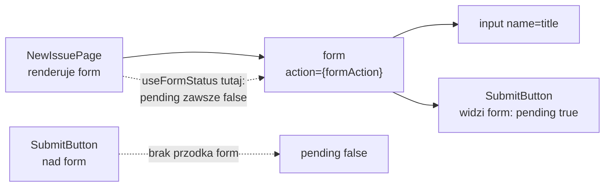
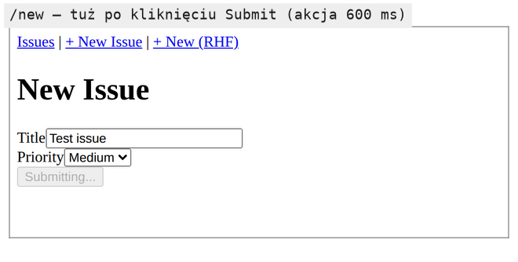

# Przycisk, który sam wie, że formularz się wysyła

## Flaga przekazywana z góry

Przycisk w formularzu `/new` blokuje się dzięki `isPending` z `useActionState`. Flaga powstaje w komponencie strony, a przycisk stoi w JSX tej samej strony, więc na razie nic nie trzeba przekazywać. Problem pojawia się wtedy, gdy przycisk ma stać się osobnym komponentem, używanym w wielu formularzach, na przykład w bibliotece komponentów zespołu. Taki przycisk musiałby dostawać flagę przez propsy:

```jsx
// Wariant z przekazywaniem propsów: tylko do omówienia, nie trafia do projektu.
function SubmitButton({ loading }) {
  return (
    <button type="submit" disabled={loading}>
      {loading ? "Submitting..." : "Submit"}
    </button>
  );
}

// w formularzu: isPending przekazane w dół ze strony
<SubmitButton loading={isPending} />
```

Każdy formularz musi wtedy pamiętać o przekazaniu `loading`. Gdy przycisk stoi głębiej w drzewie, flaga wędruje przez komponenty pośrednie, które same jej nie używają, czyli powstaje znane *prop drilling*.

React 19 daje drugą drogę: przycisk sam odczytuje stan formularza, w którym stoi. Schwarzmüller ocenia obie drogi dwoma argumentami. Zaletą `isPending` jest brak osobnego komponentu, a przycisk z własnym hookiem opłaca się przy wielu formularzach:

> **„Utworzenie dodatkowego komponentu z `useFormStatus()` może się przydać, gdy na stronie jest wiele formularzy. Można wtedy na przykład użyć tego samego `<SubmitButton>` we wszystkich.”**
>
> *„On the other hand, creating such an extra component and relying on `useFormStatus()` might be useful if you have multiple forms on the page—you could then, for example, reuse the `<SubmitButton>` across all those forms.”*
>
> — Maximilian Schwarzmüller, *React Key Concepts*

Formularz `/new` jest jeden, ale demo i tak wydziela przycisk, żeby pokazać mechanizm.

## Skąd przycisk wie o formularzu

Przycisk zna stan formularza bez żadnego propsa. Hook czyta wartość dostarczaną przez najbliższy element `<form>` nad komponentem, podobnie jak kontekst Reacta udostępnia wartość całemu poddrzewu bez propsów. W kodzie `react-dom` 19.3.0 hook to jedno wywołanie, które czyta wewnętrzny kontekst stanu przejścia, a wartość ustawia formularz, który właśnie wysyła akcję. Komponent poza takim formularzem dostaje wartość domyślną: `pending` równe `false`, a `data`, `method` i `action` równe `null`.

Z tego modelu wynika, kiedy przycisk renderuje się ponownie. Nie robi tego przy każdej literze wpisanej w pole, bo wpisywanie nie zmienia statusu formularza. W buildzie produkcyjnym renderuje się dwa razy na jedno wysłanie: gdy status przechodzi w oczekiwanie i gdy z niego wychodzi. Pod `next dev` licznik jest dwa razy większy, bo tryb deweloperski wykonuje każdy render podwójnie.

## Komponent `SubmitButton`

Nowy plik `app/components/SubmitButton.jsx` wygląda tak:

```jsx
// app/components/SubmitButton.jsx: utworzyć plik
// SubmitButton: czyta stan oczekiwania formularza przez useFormStatus.
// MUSI być OSOBNYM komponentem renderowanym WEWNĄTRZ <form>.
// Nie może być tym samym komponentem, który renderuje <form>.
"use client"; // komponent wywołuje hook, więc działa w przeglądarce
import { useFormStatus } from "react-dom"; // uwaga: react-dom, nie react!

export default function SubmitButton() {
  const { pending } = useFormStatus(); // czy formularz nadrzędny właśnie się wysyła
  return (
    <button type="submit" disabled={pending}>
      {pending ? "Submitting..." : "Submit"}
    </button>
  );
}
```

Dokumentacja React definiuje hook tak:

> **„`useFormStatus` to hook, który podaje informacje o stanie ostatniego wysłania formularza.”**
>
> *„`useFormStatus` is a Hook that gives you status information of the last form submission.”*
>
> — dokumentacja React, *useFormStatus*

Import z pakietu `react-dom` to wyjątek, bo `useState`, `useActionState` i większość hooków pochodzi z pakietu `react`. Pomyłka w ścieżce importu kończy się błędem braku eksportu. Podział wynika z budowy Reacta. Pakiet `react` nie wie nic o przeglądarce: opisuje komponenty, stan i akcje tak samo dla stron WWW i aplikacji mobilnych w React Native. Elementy HTML, takie jak `<form>`, `<input>` czy `<button>`, obsługuje dopiero pakiet `react-dom`, który zamienia drzewo komponentów na węzły DOM. `useFormStatus` pyta o stan konkretnego elementu `<form>`, więc mieszka w pakiecie, który ten element zna. `useActionState` nie pyta o żaden element, dlatego jest w `react` i działa także z akcją wywołaną poza formularzem. Komponent nie przyjmuje żadnych propsów.

## Formularz z nowym przyciskiem

W `app/new/page.jsx` zmieniają się trzy miejsca. Dochodzi import:

```jsx
// app/new/page.jsx: pod importem `../lib/store` dopisać:
import SubmitButton from "../components/SubmitButton";
```

Wynik hooka traci trzeci element, bo flaga nie jest już potrzebna w stronie:

```jsx
// … komentarz i wiersz z `useActionState` w NewIssuePage zastąpić:
  // useActionState zwraca [state, formAction, isPending]; flaga isPending jest teraz w SubmitButton
  const [state, formAction] = useActionState(submitIssue, INITIAL_STATE);
```

W formularzu przycisk `<button type="submit" disabled={isPending}>…</button>` ustępuje komponentowi:

```jsx
// … w <form> element <button> z `isPending` zastąpić tym wierszem:
        <SubmitButton /> {/* sam czyta stan oczekiwania, bez propsów */}
```

Dla użytkownika formularz się nie zmienia. Na czas akcji przycisk jest wyłączony i ma napis „Submitting...”, a komunikaty o błędzie i sukcesie zostają takie same. Zmiana dotyczy wyłącznie budowy kodu: stan oczekiwania przestał być sprawą komponentu strony i przeszedł do przycisku.

## Hook widzi tylko formularz nadrzędny

Hook nie dostaje formularza jako argumentu. Szuka go w drzewie, wśród przodków komponentu, który go wywołał. Dokumentacja opisuje pole `pending` tak: `true` oznacza, że formularz nadrzędny (*parent `<form>`*) czeka na wysłanie. Zastrzeżenia na tej samej stronie mówią, czego hook nie widzi:

> **„`useFormStatus` zwraca informacje tylko o formularzu nadrzędnym. Nie zwraca ich dla formularza renderowanego w tym samym komponencie ani w jego dzieciach.”**
>
> *„`useFormStatus` will only return status information for a parent `<form>`. It will not return status information for any `<form>` rendered in that same component or children components.”*
>
> — dokumentacja React, *useFormStatus*

Z tej reguły wynikają dwa miejsca, w których hook zawsze zwraca `pending: false`. Pierwsze to przycisk wyniesiony nad element `<form>`. Formularz wysyła się dalej, ale hook nie ma przodka typu formularz i dostaje wartość domyślną. Drugie jest mniej oczywiste: wywołanie `useFormStatus` bezpośrednio w `NewIssuePage`, czyli w komponencie, który sam renderuje `<form>`. Formularz jest wtedy dzieckiem tego komponentu, a nie jego przodkiem. W obu przypadkach przycisk przez całą akcję nie dostaje atrybutu `disabled`. Powód leży w kolejności renderu. Komponent wywołuje hooki, zanim zwróci swój JSX. W chwili wywołania `useFormStatus` element `<form>` z tego samego komponentu nie istnieje więc jeszcze w drzewie, a hook widzi tylko to, co leży nad komponentem.

Kumar w *Fluent React* pokazuje przykład `AddCheeseForm`, w którym `useFormStatus()` stoi w tym samym komponencie co `<form>`. Według cytowanego zastrzeżenia dokumentacji taki układ zawsze daje `pending: false`, więc wzorcem w demo jest osobny `SubmitButton`.

<u>`useFormStatus` wywołuje się w osobnym komponencie, który stoi wewnątrz `<form>`</u>. Dlatego `SubmitButton` jest osobnym plikiem.

Przebieg da się opisać krokami. Wysłanie formularza z funkcją w `action` rozpoczyna przejście, a React zapamiętuje, który formularz je rozpoczął. Komponenty wywołujące `useFormStatus` wewnątrz tego formularza renderują się ponownie ze statusem `pending: true`. Po zakończeniu akcji renderują się jeszcze raz, już z `pending: false`. Formularz nadrzędny jest przy tym zawsze jeden, bo HTML nie pozwala zagnieżdżać elementu `<form>` w innym `<form>`.

## Formularz bez akcji niczego nie zgłasza

Status, który czyta hook, powstaje tylko przy wysłaniu przez akcję, bo `onSubmit` nie jest przejściem. `SubmitButton` w formularzu, którego funkcja `onSubmit` na coś czeka, przez cały ten czas ma napis „Submit” i nie dostaje atrybutu `disabled`. Formularz obsługiwany przez bibliotekę potrzebuje więc przycisku z flagą w propsie. Współdzielony `SubmitButton` opłaca się tam, gdzie formularze konsekwentnie korzystają z akcji.

## Rysunek 3.18 — który komponent widzi status formularza



Na Rysunku 3.18 ciągłe strzałki to drzewo komponentów z demo, a `SubmitButton` znajduje w nim formularz nadrzędny. Dwie przerywane strzałki to oba przypadki z `pending: false`: komponent, który sam renderuje formularz, i przycisk wyniesiony poza formularz.

## Dlaczego status należy do formularza

Flaga „trwa wysyłanie” opisuje jedno wysłanie jednego formularza. Kumar w *Fluent React* łączy jednokierunkowy przepływ danych w Reakcie z wąsko określoną własnością danych. Według niego „stan należy do konkretnych komponentów, które go potrzebują” (*„state is owned by specific components that need them”*). Status wysyłania ma więc właściciela, którym jest formularz, a nie strona ani cała aplikacja.

Z tej zasady wynika miejsce, w którym React trzyma status. **Wspólna flaga dla całej strony** zablokowałaby wszystkie przyciski naraz: przy formularzu komentarza i wyszukiwarce na jednej stronie wysłanie komentarza wyłączyłoby także przycisk wyszukiwania. **Flaga w stanie strony** odróżnia formularze, ale każdy z nich musi ją przekazać w propsach przez wszystkie komponenty pośrednie. **Pozycja w drzewie** odróżnia formularze bez propsów, bo najbliższy przodek `<form>` jednoznacznie wskazuje formularz przycisku. Dlatego kilka formularzy na jednej stronie, każdy z własnym `<SubmitButton />`, nie przeszkadza sobie.

Ta sama reguła obowiązuje w HTML. Przycisk `type="submit"` bez dodatkowych atrybutów wysyła formularz, wewnątrz którego stoi. `useFormStatus` szuka formularza w drzewie komponentów tak samo, jak przeglądarka szuka go wśród przodków przycisku. <u>Przycisk zna status dokładnie tego formularza, który sam wysyła</u>.

## Krótka akcja i krótki stan oczekiwania

Akcja bez opóźnienia, na przykład synchroniczny zapis do tablicy w pamięci, kończy się w ułamku sekundy. Przycisk dostaje wtedy `disabled` i napis „Submitting...” na czas jednego renderu, a zaraz potem wraca do „Submit”. Na oko tego nie widać, ale stan oczekiwania powstaje. Przy prawdziwym zapisie na serwerze opóźnienie pojawi się samo, a ten sam przycisk zacznie je pokazywać bez zmiany w kodzie.



Rysunek 3.19 pochodzi z kopii demo, w której akcja czeka 600 ms, żeby stan dało się zobaczyć. Przycisk ma napis „Submitting...” i jest wyłączony, a reszta formularza wygląda tak jak przed wysłaniem.

## Czego hook nie powie

`useFormStatus` zna wyłącznie przebieg wysłania, a nie jego wynik. Po zakończeniu akcji `pending` wraca do `false`, a `data` do `null`, niezależnie od tego, czy zgłoszenie dodano, czy walidacja je odrzuciła. Komunikat sukcesu i komunikat błędu zawsze pochodzą ze stanu `useActionState`. Schwarzmüller proponuje taki podział pracy: `useActionState` wyświetla błędy walidacji, a osobny, zagnieżdżony komponent z `useFormStatus` steruje blokadą przycisku. Komunikat wyniku dla czytnika ekranu też należy do strony, bo tylko ona zna wynik.

Z tego samego powodu `SubmitButton` nie decyduje, czy formularz jest poprawny. Przycisk zablokowany do czasu wpisania trzech znaków wymagałby wartości pola w trakcie pisania, czyli pola kontrolowanego.

## Blokada przycisku w trakcie wysyłania

Atrybut `disabled` wyłącza działanie przycisku, nadaje mu wygląd elementu wyłączonego i usuwa go z kolejki fokusu, więc klawisz Tab go pomija. <u>`disabled` blokuje drugie wysłanie bez dodatkowego kodu</u>. Przycisk współdzielony przez wiele formularzy przenosi tę decyzję do wszystkich naraz, więc podejmuje się ją raz, w jednym pliku.

## Rozszerzenie: cztery pola statusu

Hook zwraca obiekt z czterema polami. Demo używa tylko `pending`, ale pozostałe przydają się przy bardziej rozbudowanych przyciskach.

- **`pending`** ma wartość `true` na czas wysyłania formularza nadrzędnego.
- **`data`** to obiekt `FormData` z danymi, które formularz właśnie wysyła. Gdy nic się nie wysyła albo formularza nadrzędnego nie ma, pole ma wartość `null`.
- **`method`** to napis `"get"` albo `"post"`, odczytany z atrybutu `method` formularza.
- **`action`** to odwołanie do funkcji przekazanej w atrybucie `action` formularza.

Pole `method` przy akcji z funkcją łatwo źle odczytać. Formularz `/new` nie ma atrybutu `method`, więc przeglądarka przyjmuje domyślne GET i w trakcie wysyłania hook zwraca `method: "get"`, choć akcja niczego nie wysyła przez sieć. Poza wysyłaniem pole ma wartość `null`. Dokumentacja zastrzega też, że pole `action` nigdy nie zawiera adresu jako napisu. Gdy w atrybucie `action` stoi adres URI albo atrybutu nie ma wcale, `status.action` ma wartość `null`.

Pole `data` pozwala pokazać, co jest w drodze:

```jsx
// Rozszerzenie spoza demo: przycisk pokazuje, co jest wysyłane.
function SubmitButtonWithTitle() {
  const { pending, data } = useFormStatus();
  return (
    <button type="submit" disabled={pending}>
      {/* data.get tylko w gałęzi pending: poza wysyłaniem data to null */}
      {pending ? `Sending: ${data.get("title")}` : "Submit"}
    </button>
  );
}
```

Wywołanie metody na `null` rzuciłoby wyjątek, dlatego odczyt stoi tylko w gałęzi `pending`.

## Rozszerzenie: przycisk zostaje w kolejności fokusu

MDN opisuje alternatywę dla `disabled`: atrybut `aria-disabled`. Wśród przykładów jego użycia wymienia przycisk wysyłania.

> **„Przycisk, który trzeba zachować w kolejności fokusu strony, choć jego działanie jest chwilowo niedostępne, na przykład wysłanie formularza.”**
>
> *„A button which is important to keep in the page's focus order, but its action is presently unavailable - such as submitting a form”*
>
> — MDN, *ARIA: aria-disabled attribute*

Ta sama strona podaje cenę. `aria-disabled="true"` tylko ogłasza stan wyłączenia, a blokadę działania i wygląd musi dopisać programista. Przycisk z samym tym atrybutem dalej wysyła formularz, a każde kliknięcie w trakcie wysyłania dopisuje kolejne wywołanie akcji do kolejki `useActionState`. Wersja zachowująca fokus odrzuca więc kliknięcie sama. To przykład spoza projektu:

```jsx
// Przykład spoza projektu: przycisk zostaje w kolejności klawisza Tab podczas wysyłania.
function FocusableSubmitButton() {
  const { pending } = useFormStatus();
  return (
    <button
      type="submit"
      aria-disabled={pending}
      onClick={(e) => {
        if (pending) e.preventDefault(); // anuluje drugie wysłanie
      }}
    >
      {pending ? "Submitting..." : "Submit"}
    </button>
  );
}
```

Wywołanie `e.preventDefault()` anuluje domyślne działanie przycisku typu `submit`, czyli wysłanie formularza. Wygląd stanu wyłączonego dopisuje się selektorem `[aria-disabled="true"]`, bo pseudoklasa `:disabled` takiego przycisku nie obejmie. Wersja z `aria-disabled` lepiej służy osobie poruszającej się klawiszem Tab, pod warunkiem że blokada jest w kodzie.

> 💡 **Zapamiętaj:** `useFormStatus` z pakietu `react-dom` czyta stan wysyłania najbliższego formularza nadrzędnego i bez takiego formularza zawsze zwraca `pending: false`. Wynik akcji zostaje w `useActionState`, a formularz obsługiwany przez `onSubmit` hookowi niczego nie zgłasza.

