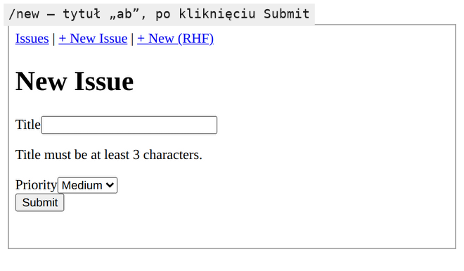
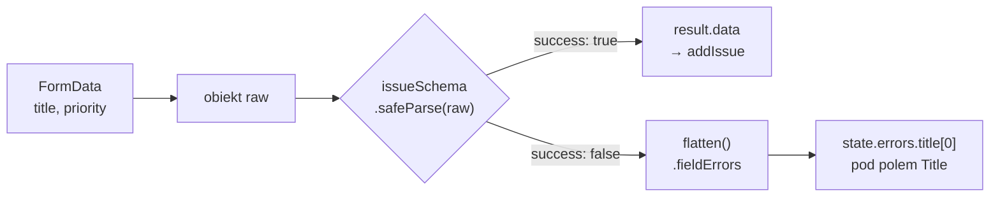
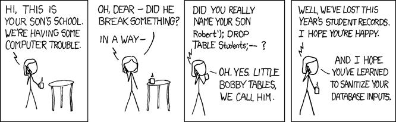

# Reguły walidacji zapisane w jednym schemacie

## Od instrukcji `if` do opisu poprawnych danych

Formularz `/new` sprawdza na razie jeden warunek: `if (!title || title.trim() === "")`. Każda kolejna reguła, na przykład minimalna długość tytułu albo dozwolone wartości priorytetu, dopisałaby następny `if` z własnym komunikatem. Schwarzmüller w *React Key Concepts* pokazuje taki ręczny warunek w akcji formularza i zwraca z niego obiekt z komunikatem. Opisuje to jako typowe zastosowanie `useActionState`: walidację wartości z formularza i wyświetlenie komunikatu, gdy dane są niepoprawne.

Ręczne warunki opisują, jak sprawdzać dane. **Walidacja schematem** (*schema validation*) odwraca kierunek: opisuje, jak wyglądają dane poprawne, a sprawdzanie zostawia bibliotece. **Schemat** to obiekt, który mówi na przykład „tytuł jest napisem o długości od 3 do 100 znaków”. Ten sam schemat można przyłożyć do danych z formularza, z żądania HTTP albo z pliku. Reguły są wtedy zapisane raz i nie rozjeżdżają się między miejscami, które ich używają.

Jedną z bibliotek tego typu w ekosystemie Reacta jest **Zod**. Jej strona zaczyna od typów TypeScriptu (*„TypeScript-first schema validation with static type inference”*), które w projekcie pisanym w JavaScripcie nie mają zastosowania. Zostaje druga połowa: schemat sprawdzany w czasie działania programu, w chwili, gdy przychodzą prawdziwe dane. Starszą biblioteką o tej samej roli jest Yup.

## Parsowanie: sprawdzenie, które oddaje nowe dane

Zwykła funkcja walidująca odpowiada „tak” albo „nie” i zostawia dane takie, jakie były. Zod robi coś więcej. Dla danych poprawnych zwraca nowy obiekt zbudowany według schematu, a dla niepoprawnych opis tego, co się nie zgadza. Taki sposób pracy nazywa się **parsowaniem** (*parsing*): na wejściu są dane niepewnego pochodzenia, na wyjściu dane o znanym kształcie albo błąd. Stąd nazwy obu metod sprawdzających, `parse` i `safeParse`.

Parsowanie zmienia to, gdzie w programie leży pewność. Kod przed wywołaniem schematu musi zakładać, że w tytule może być `null`, liczba albo trzy spacje. Kod po udanym wywołaniu dostaje napis o długości od 3 do 100 znaków i nie musi tego sprawdzać ponownie. Ta granica powinna leżeć jak najbliżej miejsca, w którym dane wchodzą do programu, czyli zaraz po odczycie `FormData`.

## Łańcuch reguł i jego kolejność

Schemat buduje się z wywołań łańcuchowych. Każda metoda zwraca nowy schemat z jedną regułą więcej, a Zod sprawdza je od lewej do prawej:

```js
import { z } from "zod";

const title = z.string().trim().min(3, "Title too short");

title.safeParse("  abc  "); // → { success: true, data: "abc" } (spacje obcięte)
title.safeParse("ab ");     // success: false, komunikat "Title too short"

// te same reguły w odwrotnej kolejności: min(3) liczy znaki przed obcięciem
z.string().min(3).trim().safeParse("ab "); // → { success: true, data: "ab" }
```

Ostatnia linia pokazuje, że kolejność w łańcuchu ma znaczenie. **`.trim()`** jest przekształceniem (dokumentacja Zod umieszcza je w grupie *„transforms”* z komentarzem *„trim whitespace”*) i zmienia napis dla wszystkich reguł stojących za nim. Postawione na końcu obcina spacje dopiero po sprawdzeniu długości, więc tytuł „ab ” przechodzi jako „ab”.

Ręczny warunek z poprzedniej wersji akcji odrzucał tytuł z samych spacji, bo wywoływał `title.trim()`. Schemat bez `.trim()` tego nie robi: `z.string().min(3)` przepuszcza trzy spacje, bo to trzy znaki. Przejście z `if` na schemat zgubiłoby więc regułę bez żadnego komunikatu. <u>Przekształcenie stoi w łańcuchu przed regułami, które mają widzieć jego wynik</u>.

## Instalacja w wersji 3

```bash
npm install -E zod@3.25.76
```

Samo `npm install zod` instaluje najnowsze wydanie, czyli Zod 4. Flaga **`-E`** (*save exact*) zapisuje w `package.json` dokładny numer bez znaku `^`. Znak `^` pozwala menedżerowi pakietów przejść na dowolne nowsze wydanie z tą samą pierwszą cyfrą, a dokładny numer blokuje także to. Projekt referencyjny ma ten wpis w `package.json` od początku.

Pierwsza cyfra numeru to **wersja główna** (*major*). Według konwencji numerowania semantycznego jej zmiana zapowiada zmiany niezgodne wstecz, czyli kod napisany dla starej wersji może przestać działać. Zod 4 zmienia trzy elementy API, których używa ten projekt albo jego najbliższe rozszerzenia. Metoda `.flatten()` na błędzie jest przestarzała (dokumentacja Zod, *Migration guide*: *„The `.flatten()` method on `ZodError` has also been deprecated”*), a jej miejsce zajmuje funkcja `z.flattenError(result.error)`. Opcja `errorMap` w `z.enum` zmieniła nazwę na `error`. Sprawdzenie adresu e-mail `z.string().email()` zastępuje funkcja `z.email()`. Kod w tym slajdzie używa zapisu z Zod 3.

## Schemat zgłoszenia

Nowy plik `app/lib/schema.js`:

```js
// app/lib/schema.js: utworzyć plik
// Schemat walidacji nowego zgłoszenia.
// Leży poza katalogiem trasy, więc może go zaimportować każdy moduł aplikacji.
import { z } from "zod";

export const issueSchema = z.object({
  title: z
    .string() // wymaga napisu: null, liczba ani undefined nie przejdą
    .trim() // obcina spacje z brzegów, zanim zadziałają reguły długości
    .min(3, "Title must be at least 3 characters.") // drugi argument: komunikat dla użytkownika
    .max(100, "Title is too long (max 100 characters)."),
  priority: z.enum(["low", "medium", "high"], {
    // tylko jedna z trzech wartości; errorMap to zapis z Zod 3
    errorMap: () => ({ message: "Priority must be low, medium, or high." }),
  }),
});
```

**`z.object({ … })`** opisuje kształt obiektu: jakie klucze ma mieć i jaki schemat obowiązuje każdy z nich. Komunikaty pisze się samemu, więc użytkownik czyta zdanie z aplikacji zamiast technicznego opisu typu. Funkcja strzałkowa w `errorMap` zwraca obiekt, dlatego jego klamry stoją w nawiasach okrągłych; bez nich zostałyby odczytane jako ciało funkcji. Plik leży w `app/lib/`, poza katalogami tras, więc schemat może zaimportować każdy formularz i każdy moduł serwera.

## `parse` rzuca, `safeParse` zwraca

Schemat ma dwie metody sprawdzania danych. Różnią się tym, co robią z błędem:

```js
try {
  title.parse("ab"); // dane niepoprawne: parse() rzuca wyjątek ZodError
} catch (e) {
  console.log(e instanceof z.ZodError); // → true
}

const result = title.safeParse("ab"); // safeParse() nigdy nie rzuca
console.log(result.success); // → false; przy true wynik leży w result.data
```

Dokumentacja Zod opisuje pierwszą metodę tak, że dla danych poprawnych zwraca ich głęboką kopię, a dla niepoprawnych rzuca `ZodError` ze szczegółami problemów. Druga metoda działa bez wyjątków:

> **„Metoda `.safeParse()` zwraca zwykły obiekt wyniku, który zawiera albo poprawnie sparsowane dane, albo `ZodError`.”**
>
> *„you can use the `.safeParse()` method to get back a plain result object containing either the successfully parsed data or a `ZodError`.”*
>
> — dokumentacja Zod, *Basic usage*

Wybór ma bezpośredni skutek w akcji z `useActionState`. Wyjątek w akcji przejmuje najbliższa granica błędów, a za krótki tytuł to sytuacja spodziewana, którą użytkownik poprawi sam. Gdyby akcja z demo wywołała `parse` zamiast `safeParse`, tytuł „ab” kończyłby się na `/new` domyślnym ekranem „This page couldn’t load”, a w konsoli przeglądarki pojawiłby się nieobsłużony `ZodError`. <u>W akcji formularza używa się `safeParse()`, a błędy zwraca jako stan</u>.

## Błędy pogrupowane według pól

`ZodError` zawiera listę problemów, a formularz potrzebuje komunikatów przypisanych do pól. Metoda `flatten()` przekłada jedno na drugie:

```js
const result = issueSchema.safeParse({ title: "ab", priority: "urgent" });

result.error.flatten().fieldErrors;
// → { title: ["Title must be at least 3 characters."],
//   priority: ["Priority must be low, medium, or high."] }

issueSchema.safeParse({ title: "abc", priority: "x" }).error.flatten().fieldErrors;
// → { priority: [...] } (pole poprawne w ogóle nie występuje)
```

Kluczem jest nazwa pola, a wartością tablica, bo jedno pole może złamać kilka reguł naraz. Pole poprawne nie ma w wyniku klucza, więc JSX musi sprawdzić, czy klucz istnieje, zanim weźmie pierwszy komunikat.

## Akcja ze schematem

W `app/new/page.jsx` zmienia się pięć miejsc: import schematu, stan początkowy, treść `submitIssue`, komunikaty pod polami i wartość domyślna listy priorytetu. Dotychczasowy akapit `{state.error && …}` znika, bo stan ma teraz pole `errors` zamiast `error`, a jego miejsce zajmują dwie linie JSX, po jednej pod każdym polem. Zapis `state.errors?.title` używa operatora **`?.`** (*optional chaining*): gdy `state.errors` ma wartość `null`, wyrażenie daje `undefined` i nie rzuca wyjątku. Pozostałe linie zostają takie jak w poprzedniej wersji. Akcja podstawia domyślny priorytet operatorem `||`, który zwraca prawą stronę, gdy lewa jest fałszywa: `null || "medium"` daje `"medium"`, podobnie pusty napis.

```jsx
// app/new/page.jsx: zastąpić całą zawartość
// Formularz nowego zgłoszenia: wynik akcji przechowuje useActionState.
// "use client": hook i akcja działają w przeglądarce,
// a addIssue zapisuje do kopii magazynu w przeglądarce.
"use client";
import { useActionState } from "react"; // React 19
import Link from "next/link";
import { issueSchema } from "../lib/schema";
import { addIssue } from "../lib/store";
import SubmitButton from "../components/SubmitButton";

// errors zamiast error: komunikatów może być kilka, po zestawie na pole
const INITIAL_STATE = { success: false, errors: null, issue: null };

// Sygnatura: (prevState, formData), prevState wstawia useActionState.
// prevState = wynik poprzedniego wywołania (albo INITIAL_STATE przy pierwszym).
// Bez async i opóźnienia: sprawdzanie schematem jest synchroniczne.
function submitIssue(prevState, formData) {
  // FormData powstaje automatycznie ze wszystkich pól z atrybutem name.
  const raw = {
    title: formData.get("title"),
    priority: formData.get("priority") || "medium", // brak pola: get() daje null, || podstawia "medium"
  };

  const result = issueSchema.safeParse(raw);

  if (!result.success) {
    return {
      success: false,
      errors: result.error.flatten().fieldErrors, // { title: [...], priority: [...] }
      issue: null,
    };
  }

  const issue = addIssue(result.data); // zapis danych sprawdzonych, nie surowych
  return { success: true, errors: null, issue };
}

export default function NewIssuePage() {
  // useActionState zwraca [state, formAction, isPending]; flaga isPending jest teraz w SubmitButton
  const [state, formAction] = useActionState(submitIssue, INITIAL_STATE);

  return (
    <div>
      <h1>New Issue</h1>

      {state.success && (
        <p>
          Issue #{state.issue.id} added!{" "}
          <Link href="/">View all issues</Link>
        </p>
      )}

      <form action={formAction}>
        <div>
          {/* htmlFor łączy etykietę z polem o id="title" */}
          <label htmlFor="title">Title</label>
          <input id="title" name="title" type="text" />
          {/* pod polem tytułu; ?. daje undefined, gdy errors jest null */}
          {state.errors?.title && <p>{state.errors.title[0]}</p>}
        </div>
        <div>
          <label htmlFor="priority">Priority</label>
          <select id="priority" name="priority" defaultValue="medium">
            <option value="low">Low</option>
            <option value="medium">Medium</option>
            <option value="high">High</option>
          </select>
          {/* pod listą priorytetu */}
          {state.errors?.priority && <p>{state.errors.priority[0]}</p>}
        </div>
        <SubmitButton /> {/* sam czyta stan oczekiwania, bez propsów */}
      </form>
    </div>
  );
}
```

Pusty tytuł i „ab” dają pod polem komunikat „Title must be at least 3 characters.”. Tytuł „abc” dopisuje zgłoszenie i pokazuje komunikat o sukcesie z jego numerem.



Na Rysunku 3.20 komunikat stoi dokładnie tam, gdzie `state.errors.title[0]`, pod polem tytułu. Pole jest puste, bo React po akcji czyści formularz, a ekran błędu się nie pojawia.

## Rysunek 3.21 — od `FormData` do komunikatu przy polu



Na Rysunku 3.21 strzałki idą od danych formularza do tego, co widzi użytkownik. Romb to granica parsowania: przed nim dane są niepewne, za nim albo sprawdzone, albo zamienione na komunikaty. Górna gałąź zapisuje zgłoszenie i dostaje obiekt zbudowany przez schemat. Dolna kończy się zwykłym obiektem stanu, więc ekran błędu w ogóle się nie pojawia.

## Dlaczego zapisuje się `result.data`

`result.data` to nowy obiekt zbudowany według schematu. Dokumentacja Zod podaje regułę: domyślnie nierozpoznane klucze są usuwane z wyniku (*„By default, unrecognized keys are stripped from the parsed result”*). Widać to na skrócie `Object.fromEntries(formData)`. Funkcja `Object.fromEntries` buduje obiekt z listy par `[klucz, wartość]`. `FormData` jest taką listą, więc wynik ma po jednym kluczu na każde pole formularza:

```js
Object.fromEntries([["a", 1], ["b", 2]]); // → { a: 1, b: 2 }

const formData = new FormData();
formData.set("title", "Bug");
formData.set("priority", "high");
formData.set("extra", "1"); // pole, którego schemat nie zna

Object.fromEntries(formData); // → { title: "Bug", priority: "high", extra: "1" }
issueSchema.safeParse(Object.fromEntries(formData)).data; // → { title: "Bug", priority: "high" }
```

Akcja demo buduje `raw` ręcznie z dwóch pól, więc nadmiarowych kluczy tu nie ma. Zapis `result.data` chroni jednak przed obydwoma przypadkami naraz: do magazynu trafia tytuł już obcięty ze spacji i tylko klucze opisane w schemacie.

## Te same reguły bez biblioteki i w Yup

Dwie reguły zgłoszenia da się zapisać także bez biblioteki albo w starszej bibliotece schematów. Porównanie pokazuje, za co płaci każdy wariant. **Ręczna funkcja** nie wymaga żadnej paczki:

```js
// Przykład spoza projektu: walidacja bez biblioteki zwraca błędy, a danych nie zmienia.
function checkIssue(raw) {
  const errors = {};
  if (typeof raw.title !== "string" || raw.title.trim().length < 3) {
    errors.title = "Title must be at least 3 characters.";
  }
  if (!["low", "medium", "high"].includes(raw.priority)) {
    errors.priority = "Priority must be low, medium, or high.";
  }
  return errors;
}

const raw = { title: "  abc  ", priority: "low" };
console.log(checkIssue(raw));             // → {}
console.log(JSON.stringify(raw.title)); // → "  abc  "
```

Pusty obiekt oznacza brak błędów, ale tytuł dalej ma spacje na brzegach. Funkcja sprawdziła wynik `raw.title.trim()` i nigdzie go nie zapisała, więc kod zapisu musi wywołać `trim()` drugi raz. Tak działa walidacja w czystej postaci: daje odpowiedź o danych, a nie nowe dane. Każda reguła, która przekształca wartość, stoi wtedy w dwóch miejscach.

**Yup** zapisuje reguły schematem, podobnie jak Zod. Barklund w *React in Depth* wymienia go w grupie bibliotek do zarządzania formularzami, obok Formika i React Hook Form. Różnice wychodzą dopiero przy uruchomieniu (Yup 1.7.1):

```js
// Przykład spoza projektu: schemat zgłoszenia w Yup.
import * as yup from "yup";

const schema = yup.object({
  title: yup.string().trim().min(3, "Title must be at least 3 characters."),
  priority: yup.string().oneOf(["low", "medium", "high"], "Priority must be low, medium, or high."),
});

console.log(schema.validate({ title: "  abc  ", priority: "low" }) instanceof Promise); // → true
console.log(await schema.validate({ title: "  abc  ", priority: "low", extra: "1" }));  // → { priority: 'low', title: 'abc', extra: '1' }
console.log(schema.cast({ title: 5, priority: "low" }));                                // → { priority: 'low', title: '5' }
```

Metoda `validate` zwraca Promise, więc synchroniczna akcja musiałaby użyć jej wariantu `validateSync`. Klucz `extra`, którego schemat nie zna, zostaje w wyniku. Liczbę 5 Yup zamienia na napis „5”, a Zod tę samą wartość odrzuca komunikatem „Expected string, received number”. Yup domyślnie przerywa też na pierwszym błędzie: dla tytułu „ab” i priorytetu „urgent” zwraca tylko komunikat o priorytecie, a oba dopiero z opcją `abortEarly: false`.

Obie biblioteki kosztują zależność w `package.json`. W zamian reguła, która przekształca wartość, i reguła, która ją sprawdza, stoją w jednym obiekcie, a wynik parsowania jest gotowy do zapisu. Między Yup a Zod rozstrzygają domyślne zachowania: Yup zamienia typy i zostawia nieznane klucze, a Zod odrzuca zły typ i usuwa klucze spoza schematu.

## Granica zaufania: przeglądarka i serwer

Strona `/new` ma dyrektywę `"use client"`, a `submitIssue` jest zwykłą funkcją w tym samym pliku. Cała walidacja działa więc w przeglądarce. Ochroną danych taka walidacja nie jest. Kod w przeglądarce należy do użytkownika: można go zmienić, wyłączyć albo pominąć i wysłać żądanie z innego programu. **Granica zaufania** (*trust boundary*) leży tam, gdzie dane przechodzą od strony, nad którą aplikacja nie ma kontroli, do strony, nad którą ma. Dla aplikacji webowej jest nią serwer.

Schemat w przeglądarce ma inne zadanie: daje użytkownikowi odpowiedź natychmiast, bez czekania na sieć. Ten sam plik `schema.js` może zaimportować kod wykonywany na serwerze, na przykład funkcja zapisu wywoływana przez formularz, i dopiero tam schemat daje ochronę. <u>Reguły piszą się raz, a sprawdzają dwa razy: w przeglądarce dla wygody, na serwerze dla bezpieczeństwa</u>.



*Przerywnik: xkcd 327 „Exploits of a Mom”. Autor: Randall Munroe, licencja CC BY-NC 2.5, <https://xkcd.com/327/>.* Szkoła zapisała dane od użytkownika bez sprawdzenia po stronie serwera, a ochronę daje tylko ta strona granicy zaufania.

## Reguła, która porównuje dwa pola

Reguły przy polach widzą tylko własną wartość. Warunek, który łączy dwa pola, na przykład „data końcowa nie wcześniej niż początkowa”, dopisuje się do całego obiektu metodą **`.refine()`**. Dostaje ona sparsowany obiekt i zwraca `true`, gdy dane są poprawne. Opcja `path` wskazuje pole, pod którym ma się pojawić komunikat:

```js
const range = z
  .object({ from: z.number(), to: z.number() })
  .refine((r) => r.from <= r.to, {
    message: "End date is before start date",
    path: ["to"], // komunikat trafi do fieldErrors.to
  });

range.safeParse({ from: 5, to: 2 }).error.flatten().fieldErrors;
// → { to: ["End date is before start date"] }

range.safeParse({ from: "x", to: 2 }).error.flatten().fieldErrors;
// → { from: ["Expected number, received string"] } (refine się nie wykonał)
```

Druga próba pokazuje kolejność. Funkcja z `.refine()` dostaje obiekt dopiero wtedy, gdy wszystkie pola przeszły własne reguły, bo porównywanie liczby z napisem nie ma sensu. Użytkownik, który popełnił dwa błędy naraz, zobaczy więc najpierw błąd pola, a komunikat o zależności dopiero po jego poprawieniu. Reguły przy jednym polu działają inaczej: `z.string().min(3, "krótki").regex(/^[A-Z]/, "wielka litera")` dla napisu „a” zwraca oba komunikaty jednocześnie.

## Komunikat dla brakującego pola

Pole, które nie dotarło w `FormData`, ma wartość `null`, a pole pominięte w obiekcie wartość `undefined`. Zod 3 traktuje oba przypadki jako zły typ i bez dodatkowych opcji zwraca techniczny opis po angielsku. Konstruktor `z.string()` przyjmuje dwa własne komunikaty:

```js
const title = z.string({
  required_error: "Title is missing", // gdy wartość to undefined
  invalid_type_error: "Title must be text", // gdy wartość ma inny typ, także null
});

title.safeParse(undefined).error.issues[0].message; // → "Title is missing"
title.safeParse(null).error.issues[0].message;      // → "Title must be text"
z.string().safeParse(null).error.issues[0].message; // → "Expected string, received null"
```

Rozróżnienie ma znaczenie dla formularzy. `formData.get("title")` dla pola bez atrybutu `name` zwraca `null`, więc zadziała `invalid_type_error`, a nie `required_error`. Schemat zgłoszenia nie ustawia żadnego z nich, dlatego po utracie atrybutu `name` pod polem zamiast „Title must be at least 3 characters.” pojawi się „Expected string, received null”. Komunikat o typie przy polu tekstowym oznacza, że wartość w ogóle nie przyszła z formularza.

## Rozszerzenie: atrybuty HTML jako trzeci poziom sprawdzania

Atrybuty HTML `required`, `minlength` i `maxlength` sprawdza sama przeglądarka, zanim w ogóle wywoła akcję, i pokazuje dymek w swoim języku. Są natychmiastowe, ale znają tylko proste reguły i chronią danych tak samo słabo jak kod w przeglądarce, bo żądanie można wysłać z pominięciem formularza. Dają szybką podpowiedź, a jedyną ochroną pozostaje schemat na serwerze.

> 💡 **Zapamiętaj:** schemat Zod parsuje dane: zwraca nowy obiekt o znanym kształcie albo opis błędów, a reguły sprawdza w kolejności łańcucha, więc `.trim()` stoi przed `.min()`. W akcji formularza używa się `safeParse()` i zapisuje `result.data`. Walidacja chroni dane dopiero po stronie serwera.

