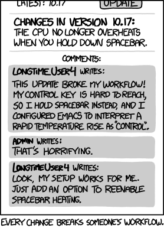
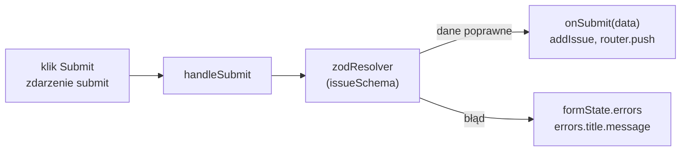

# Ten sam formularz z biblioteką React Hook Form

## Biblioteka zamiast akcji

Formularz `/new` korzysta wyłącznie z tego, co daje React 19: `<form action>`, `useActionState` i `useFormStatus`. Druga droga to biblioteka formularzy. Barklund w *React in Depth* wymienia w tej grupie między innymi Formika, React Hook Form i React Final Form. Strona React Hook Form zapowiada „wydajne, elastyczne i rozszerzalne formularze z łatwą walidacją” (*„Performant, flexible and extensible forms with easy-to-use validation”*).

Strona `/new-rhf` robi dokładnie to samo co `/new`: przyjmuje tytuł i priorytet, sprawdza je schematem `issueSchema` i dopisuje zgłoszenie do magazynu. Porównanie dwóch plików z tym samym schematem pokazuje, co jest cechą formularza, a co cechą narzędzia. Reguły walidacji są wspólne. Kształt błędów, moment sprawdzania i to, co dzieje się po sukcesie, zależą od wybranej drogi.

## Po co powstały biblioteki formularzy

Akcje formularzy weszły do Reacta dopiero w wersji 19. Wcześniej każdy formularz składał się ręcznie ze stanu, procedur `onChange`, funkcji `onSubmit` z `preventDefault()`, własnej walidacji i flag w rodzaju „pole już odwiedzone” albo „formularz się wysyła”. Pole kontrolowane (wartość w stanie komponentu) renderuje komponent przy każdej literze, a duży formularz potrzebuje wielu osobnych wartości stanu. Biblioteki formularzy powstały, żeby ten powtarzalny kod napisać raz.

React Hook Form odpowiada na obie wady naraz. Jeden hook `useForm` zastępuje osobne wartości stanu dla każdego pola, a wartości pól zostają w DOM. Część tej pracy w React 19 wykonują już akcje, dlatego wybór biblioteki przestał być oczywisty i wymaga porównania.

## Instalacja

```bash
npm install -E react-hook-form@7.89.0 @hookform/resolvers@3.10.0
```

Polecenie instaluje dwa pakiety z dokładnymi numerami. **`react-hook-form`** to sama biblioteka. **`@hookform/resolvers`** zawiera adaptery, które pozwalają użyć schematu z zewnętrznej biblioteki walidacji.

Numer resolvera musi pasować do wersji głównej Zod. Wydanie 3.10.0 to ostatnie w linii 3, zbudowanej dla Zod 3. Z Zod 4 i resolverem 3.10.0 formularz po wysłaniu za krótkiego tytułu nie pokazuje komunikatu, w konsoli pojawia się nieobsłużony `ZodError`, a przycisk wysyłania zostaje zablokowany. Zgodność z Zod 4 deklaruje dopiero `@hookform/resolvers` w wersji 5, z zależnością `zod ^3.25 || ^4`. <u>Biblioteka formularzy i biblioteka schematów zmieniają wersję główną razem</u>.

**Resolver** to funkcja pośrednicząca między biblioteką formularzy a biblioteką walidacji. React Hook Form ma własny prosty sposób zapisu reguł w `register`, na przykład wymagane pole albo minimalną długość. `zodResolver` zastępuje te reguły schematem: zbiera wartości pól, przekazuje je do `issueSchema` i tłumaczy wynik Zod na obiekt błędów w formacie biblioteki.



*Przerywnik: xkcd 1172 „Workflow”. Autor: Randall Munroe, licencja CC BY-NC 2.5, <https://xkcd.com/1172/>.* Nowa wersja biblioteki zawsze komuś coś psuje, stąd `-E` i dokładny numer.

## Pole niekontrolowane podpięte przez ref

React Hook Form zostawia pola niekontrolowane: wartość leży w węźle DOM, a biblioteka sięga po nią przez ref, czyli obiekt z polem `current` wskazującym element, tak jak przy `useRef`. Funkcja `register` zwraca zestaw propsów dla jednego pola:

```jsx
const field = register("title");
Object.keys(field); // → ["name", "onChange", "onBlur", "ref"]

// rozpakowanie operatorem ... wstawia wszystkie cztery propsy naraz
<input {...field} />
// to samo co:
<input name={field.name} onChange={field.onChange} onBlur={field.onBlur} ref={field.ref} />
```

Operator `...` w JSX działa jak w literale obiektu: każda właściwość obiektu staje się osobnym propsem. `ref` daje bibliotece dostęp do węzła, więc może odczytać wartość pola, gdy waliduje, i przenieść na nie fokus. `onChange` i `onBlur` informują ją, że coś się zmieniło, ale nie zapisują wartości w stanie komponentu. Pole nie ma atrybutu `value`, więc zostaje niekontrolowane.

Z tej budowy wynika słowo „wydajne” w haśle biblioteki. <u>Wpisanie litery w zarejestrowane pole nie zmienia stanu komponentu, więc nie wywołuje jego renderu</u>. Licznik w ciele komponentu po wpisaniu dwóch liter nie rośnie ani razu (React 19.3.0, React Hook Form 7.89.0). Render przychodzi dopiero wtedy, gdy zmienia się coś, co komponent wyświetla, na przykład komunikat błędu.

Gdy pole nie zostanie zarejestrowane, biblioteka go nie widzi. Resolver dostaje obiekt bez klucza `title`, a Zod zgłasza błąd typu, choć użytkownik coś wpisał. Objaw jest ten sam co przy polu bez atrybutu `name` w wersji z akcją.

## DOM jako źródło prawdy o polu

Pole niekontrolowane to decyzja o tym, gdzie leży prawda o wartości. Schwarzmüller w *React Key Concepts* opisuje ją wprost.

> **„Dlatego to DOM kontroluje stan (na przykład taki stan jak wartość wpisana przez użytkownika w pole).”**
>
> *„It’s therefore the DOM that controls the state (e.g., a state such as the value entered by a user into an input field).”*
>
> — Maximilian Schwarzmüller, *React Key Concepts*

Ten sam autor zaleca ograniczać pola niekontrolowane do sytuacji, w której trzeba tylko zebrać wpisane wartości (*„if you only need to gather some entered values”*). Gdy formularz ma więcej logiki, na przykład czyści pola, zaleca pola kontrolowane. Powodem jest styl kodu. Kod oparty na refach jest według niego **imperatywny**: zamiast opisać w JSX, jak ma wyglądać interfejs, wydaje elementom polecenia krok po kroku.

React Hook Form przyjmuje model z DOM i przenosi ten koszt do biblioteki. Ktoś nadal musi odczytać wartość z węzła, wyczyścić pole i przenieść fokus na pole z błędem. Robi to jednak kod biblioteki, schowany za `register` i funkcjami zwracanymi przez `useForm`. Komponent strony zostaje deklaratywny i opisuje w JSX tylko pola oraz komunikaty.

Formularz zbudowany w ten sposób ma więc **dwie warstwy**. Wartości pól leżą w DOM, a biblioteka czyta je przy walidacji i przy wysłaniu. W stanie Reacta leży to, co komponent wyświetla: błędy i flaga wysyłania. Granicę tego modelu wyznacza interfejs, który pokazuje wartość w trakcie pisania, na przykład licznik znaków pod polem. Licznik zmienia się przy każdej literze, więc każda litera musi wywołać render, niezależnie od biblioteki.

## Strona `/new-rhf`

Nowy plik `app/new-rhf/page.jsx` składa się z importów, konfiguracji formularza i JSX.

```jsx
// app/new-rhf/page.jsx: utworzyć plik
// Formularz nowego zgłoszenia: wariant React Hook Form + Zod.
// Do porównania z app/new/page.jsx (wariant z akcjami React 19).
"use client";
import { useForm } from "react-hook-form";
import { zodResolver } from "@hookform/resolvers/zod";
import { useRouter } from "next/navigation";
import { issueSchema } from "../lib/schema";
import { addIssue } from "../lib/store";

export default function NewIssueRHFPage() {
  const router = useRouter();
  const {
    register, // podpina pole: name, ref, onChange, onBlur
    handleSubmit, // owija funkcję wysyłki walidacją
    formState: { errors, isSubmitting }, // błędy pól i flaga wysyłania
  } = useForm({
    resolver: zodResolver(issueSchema), // schemat Zod jako walidator
    defaultValues: { priority: "medium" }, // wartość początkowa listy wyboru
  });

  function onSubmit(data) {
    // data przeszło już przez Zod, więc można je zapisać wprost
    addIssue(data);
    router.push("/");
  }

  return (
    <div>
      <h1>New Issue (React Hook Form)</h1>
      <form onSubmit={handleSubmit(onSubmit)}>
        <div>
          <label htmlFor="title">Title</label>
          <input id="title" {...register("title")} />
          {errors.title && <p>{errors.title.message}</p>}
        </div>
        <div>
          <label htmlFor="priority">Priority</label>
          <select id="priority" {...register("priority")}>
            <option value="low">Low</option>
            <option value="medium">Medium</option>
            <option value="high">High</option>
          </select>
          {errors.priority && <p>{errors.priority.message}</p>}
        </div>
        <button type="submit" disabled={isSubmitting}>Submit</button>
      </form>
    </div>
  );
}
```

Zapis `formState: { errors, isSubmitting }` to destrukturyzacja zagnieżdżona: z obiektu zwróconego przez `useForm` bierze pole `formState`, a z niego od razu dwa pola. Zmienna `formState` w ogóle nie powstaje. `defaultValues` pełni tę samą rolę co `defaultValue="medium"` w wersji z akcją. `router.push("/")` z hooka `useRouter` przenosi na listę bez przeładowania strony. Pola nie mają atrybutu `name` w JSX, bo dostają go z `register`.

W nawigacji layoutu głównego `app/layout.jsx` dochodzi trzeci link:

```jsx
// app/layout.jsx: w <nav>, pod linkiem „+ New Issue”, dopisać:
          {" | "}
          <Link href="/new-rhf">+ New (RHF)</Link>
```

## `handleSubmit` jako strażnik funkcji wysyłki

`handleSubmit` przyjmuje funkcję programisty i zwraca nową funkcję obsługi zdarzenia `submit`. Nowa funkcja blokuje domyślne wysłanie formularza, sprawdza dane resolverem i dopiero przy sukcesie wywołuje oryginał. Wzorzec ten nazywa się funkcją opakowującą: jedna funkcja dostaje drugą i dokłada do niej zachowanie przed wywołaniem.

```jsx
// handleSubmit(onSubmit) zwraca procedurę obsługi zdarzenia submit
<form onSubmit={handleSubmit((data) => console.log(data))}>

// "ab":  resolver zgłasza błąd, funkcja nie zostaje wywołana, błąd trafia do errors.title
// "abc": funkcja dostaje { title: "abc", priority: "medium" }
```

Dokumentacja `handleSubmit` opisuje tę samą regułę:

> **„Ta funkcja otrzyma dane formularza, jeśli walidacja zakończy się sukcesem.”**
>
> *„This function will receive the form data if form validation is successful.”*
>
> — dokumentacja React Hook Form, *handleSubmit*

## Rysunek 3.22 — droga wysyłki na `/new-rhf`



Na Rysunku 3.22 `handleSubmit` stoi między zdarzeniem a funkcją programisty i to on pyta resolver o zdanie. Dwa zakończenia się wykluczają. W górnym `onSubmit` dostaje już sprawdzone dane. W dolnym w ogóle nie zostaje wywołany, a błędy trafiają do `formState`. W tym wariancie nie ma obiektu `FormData` ani stanu zwracanego przez akcję. Dane wędrują jako zwykły obiekt `{ title, priority }`, zbudowany przez bibliotekę z zarejestrowanych pól.

## Kiedy biblioteka sprawdza pola

Domyślny tryb walidacji nazywa się `onSubmit`. Pierwsza walidacja rusza przy wysłaniu, a po niej pola zaczynają nasłuchiwać zmian.

> **„Walidacja rusza przy zdarzeniu `submit`, a pola dołączają nasłuchiwanie `onChange`, by sprawdzać się ponownie.”**
>
> *„Validation is triggered on the `submit` event, and inputs attach `onChange` event listeners to re-validate themselves.”*
>
> — dokumentacja React Hook Form, *useForm*

Tryb zmienia opcja `mode` w `useForm`. Ten sam formularz zachowuje się wtedy inaczej już przed pierwszym wysłaniem:

```jsx
useForm({ resolver: zodResolver(issueSchema) });                   // mode: "onSubmit"
// "ab" wpisane: brak komunikatu, zero renderów; komunikat dopiero po wysłaniu

useForm({ resolver: zodResolver(issueSchema), mode: "onChange" });
// "ab" wpisane: komunikat od razu, jeden render (pojawił się błąd)
```

W obu trybach po wysłaniu „ab” trzecia litera usuwa komunikat bez ponownego wysłania i kosztuje jeden render. Na `/new` komunikat zmienia się dopiero po kolejnym wysłaniu, bo akcja działa tylko przy wysłaniu.

Dokumentacja ostrzega, że walidacja przy każdej zmianie każdego pola daje wiele renderów i często ma wyraźny koszt wydajności. Domyślny tryb jest kompromisem: użytkownik nie widzi błędów, zanim skończy pisać, a po pierwszej próbie dostaje natychmiastową odpowiedź.

Kształt błędu też jest inny. Na `/new` każde pole ma tablicę napisów i JSX bierze `[0]`. Na `/new-rhf` błąd pola to obiekt, a tekst leży w `errors.title.message`. Flaga `isSubmitting` ma wartość `true` od kliknięcia do zakończenia `onSubmit` i zastępuje osobny komponent z `useFormStatus`.

## Fokus po nieudanym wysłaniu

Ref daje bibliotece jeszcze jedną możliwość, której w kodzie strony nie widać. Opcja `shouldFocusError` w `useForm` ma domyślnie wartość `true`:

> **„Gdy opcja ma wartość `true` (domyślnie), a użytkownik wyśle formularz, który nie przejdzie walidacji, fokus trafia na pierwsze pole z błędem.”**
>
> *„When set to `true` (default), and the user submits a form that fails validation, focus is set on the first field with an error.”*
>
> — dokumentacja React Hook Form, *useForm*

Po wysłaniu tytułu „ab” na `/new-rhf` fokus stoi w polu `title`. Na `/new` ta sama próba zostawia fokus na przycisku „Submit”, więc osoba używająca klawiatury sama musi wrócić do pola. Dokumentacja dodaje dwa warunki: fokus działa tylko dla pola, którego ref trafił do prawdziwego elementu DOM, a kolejność wyznacza kolejność wywołań `register`.

## Subskrypcja stanu przez `Proxy`

Biblioteka renderuje komponent tylko przy zmianie tych części stanu, które komponent czyta. Żeby to wiedzieć, oddaje `formState` opakowany w `Proxy`. **`Proxy`** to obiekt JavaScriptu, który przechwytuje operacje na innym obiekcie, na przykład odczyt pola:

```js
const read = new Set();
const state = { errors: {}, isSubmitting: false, isDirty: false };

const tracked = new Proxy(state, {
  get(target, key) { read.add(key); return target[key]; }, // zapisuje każdy odczyt
});

const { errors } = tracked;
console.log([...read]); // → ["errors"]: tylko to pole zostało odczytane
```

React Hook Form robi to samo w większej skali. Destrukturyzacja `formState: { errors, isSubmitting }` jest odczytem dwóch pól, więc biblioteka zapamiętuje, że komponent je **subskrybuje**, i tylko ich zmiana wywołuje render. Zmiana `isDirty`, której komponent nie czyta, renderu nie wywoła. Dokumentacja opisuje regułę tak:

> **„Zwracany `formState` jest opakowany w obiekt Proxy, żeby poprawić wydajność renderowania i pominąć dodatkową logikę, gdy dany stan nie jest subskrybowany. Dlatego trzeba go wywołać albo odczytać przed renderem, żeby włączyć aktualizację stanu.”**
>
> *„Returned `formState` is wrapped with a Proxy to improve render performance and skip extra logic if a specific state is not subscribed to. Therefore, make sure you invoke or read it before a render in order to enable the state update.”*
>
> — dokumentacja React Hook Form, *formState*

Z reguły wynika ostrożność przy odczycie warunkowym. W wyrażeniu `!formState.isDirty || !formState.isValid` operator `||` nie oblicza prawej strony, gdy lewa jest prawdziwa, więc przy pierwszym renderze `isValid` nie zostaje odczytane i nie jest subskrybowane. W wersji 7.89.0 przycisk mimo to się odblokowuje, bo pierwsza litera zmienia `isDirty`, a w renderze, który to wywołuje, odczyt `isValid` już następuje. Zapis, który nie zależy od takiego renderu pośredniego, rozpakowuje oba pola przed użyciem: `const { isDirty, isValid } = formState`.

## Błędy, których schemat nie zna

Schemat sprawdza kształt danych, ale nie wie, czy zapis się uda. W demo `addIssue` zawsze kończy się sukcesem, bo dopisuje element do tablicy w pamięci. Zapis na serwerze może zawieść, na przykład gdy baza nie odpowiada.

> **„`handleSubmit` nie połyka błędów rzuconych w `onSubmit`, dlatego zaleca się bloki try/catch wokół żądań asynchronicznych i łagodną obsługę tych błędów.”**
>
> *„`handleSubmit` function will not swallow errors that occurred inside your onSubmit callback, so we recommend that you use try/catch blocks inside your async requests and handle those errors gracefully for your customers.”*
>
> — dokumentacja React Hook Form, *handleSubmit*

Narzędziem jest funkcja `setError` z `useForm`. Wpisuje komunikat do `errors` tak samo jak resolver, więc wyświetla go zwykły JSX:

```jsx
const { register, handleSubmit, setError, formState: { errors } } = useForm({ /* ... */ });

async function onSubmit(data) {
  try {
    await save(data); // funkcja zapisu na serwerze (założenie przykładu)
  } catch (e) {
    setError("root.server", { message: e.message }); // błąd całego formularza
  }
}
// w JSX: {errors.root?.server && <p>{errors.root.server.message}</p>}
```

Klucz `root.server` oznacza błąd, który nie należy do żadnego pola. Gdy `save` rzuci wyjątek z komunikatem „Server is not responding”, ten tekst stoi pod formularzem, a `isSubmitting` wraca do `false`. Pola po udanym zapisie czyści funkcja `reset` z `useForm`. W demo nie jest potrzebna, bo `router.push("/")` opuszcza stronę formularza.

## Rozszerzenie: biblioteka i akcja w jednym formularzu

Czasem potrzebne są oba mechanizmy naraz: walidacja React Hook Form w trakcie pisania i stan wyniku z `useActionState`. Funkcję zwróconą przez `useActionState` wywołuje się wtedy w `onSubmit` wewnątrz `startTransition`, czyli jako przejście, bo tylko wtedy React śledzi jej status. Kod jest rozszerzeniem spoza demo:

```jsx
// Hybryda: RHF waliduje, useActionState trzyma wynik (poza demo)
import { startTransition } from "react";

function onSubmit(data) {
  const formData = new FormData(); // akcja oczekuje FormData, biblioteka oddaje obiekt
  formData.set("title", data.title);
  formData.set("priority", data.priority);
  startTransition(() => formAction(formData)); // poza przejściem isPending się nie zmieni
}
```

Taki formularz ma dwa mechanizmy stanu i obiekt `FormData` budowany ręcznie z danych biblioteki. Opłaca się dopiero wtedy, gdy walidacja w trakcie pisania jest potrzebna, a akcja ma pracować na serwerze.

> 💡 **Zapamiętaj:** React Hook Form podpina pola przez ref i zostawia je niekontrolowane, a stan formularza czyta przez `Proxy`, więc renderuje komponent tylko przy zmianie tego, co komponent wyświetla. `handleSubmit` wywołuje `onSubmit` wyłącznie z danymi, które przeszły przez `zodResolver`.

