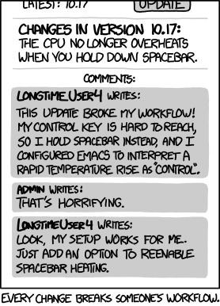
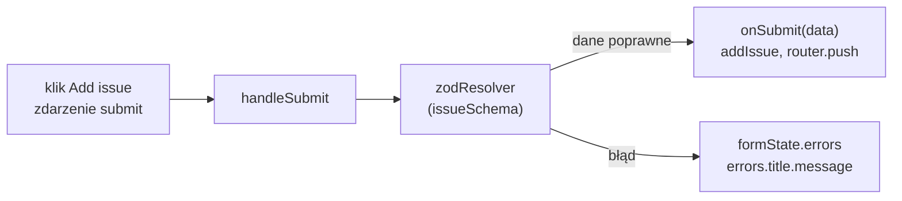

# Ten sam formularz z biblioteką React Hook Form

## Błąd widać dopiero po wysłaniu

Formularz `/new` sprawdza dane wyłącznie w akcji, czyli po kliknięciu „Add issue”. Pomiar na tej wersji: tytuł „ab” daje po wysłaniu komunikat „Title must be at least 3 characters.”, a pole tytułu jest puste, bo React po akcji czyści formularz. Po dopisaniu poprawnego tytułu komunikat dalej stoi obok pola. Zdejmuje go dopiero kolejne wysłanie. Użytkownik dowiaduje się o błędzie po całej rundzie wysyłki, wpisuje tytuł od nowa i nie wie, czy poprawił go dobrze, dopóki znów nie kliknie.

Wynika to z modelu akcji: stan zmienia się tylko przy wysłaniu. Aby komunikat reagował na pisanie, potrzebna jest warstwa, która obserwuje pola między wysłaniami, i tę daje biblioteka formularzy.

## Biblioteka zamiast akcji

Formularz `/new` korzysta wyłącznie z tego, co daje React 19: `<form action>` i `useActionState`. Druga droga to biblioteka formularzy. Barklund w *React in Depth* wymienia między innymi Formika, React Hook Form i React Final Form. Strona React Hook Form nazywa ją „wydajną, elastyczną i rozszerzalną biblioteką formularzy Reacta z łatwą walidacją” (*„A performant, flexible and extensible React form library with easy-to-use validation”*).

Strona `/new-rhf` robi to samo co `/new`: przyjmuje tytuł i priorytet, sprawdza je schematem `issueSchema` i dopisuje zgłoszenie do magazynu. Porównanie dwóch plików z tym samym schematem pokazuje, co jest cechą formularza, a co cechą narzędzia. Kształt błędów, moment sprawdzania i to, co dzieje się po sukcesie, zależą od drogi.

Akcje formularzy weszły do Reacta dopiero w wersji 19. Wcześniej każdy formularz składał się ze stanu, procedur `onChange`, funkcji `onSubmit` z `preventDefault()`, własnej walidacji i flag w rodzaju „pole już odwiedzone”. Biblioteki formularzy powstały, żeby ten powtarzalny kod napisać raz: jeden hook `useForm` zastępuje osobny stan każdego pola, a wartości zostają w DOM.

## Instalacja

```bash
npm install -E react-hook-form@7.89.0 @hookform/resolvers@3.10.0
```

Polecenie instaluje dwa pakiety z dokładnymi numerami. **`react-hook-form`** to sama biblioteka. **`@hookform/resolvers`** zawiera adaptery, które pozwalają użyć schematu z zewnętrznej biblioteki walidacji. W projekcie referencyjnym oba pakiety są zainstalowane od początku.

Numer resolvera musi pasować do wersji głównej Zod. Wydanie 3.10.0 to ostatnie w linii 3, zbudowanej dla Zod 3. Z Zod 4 i resolverem 3.10.0 formularz po wysłaniu za krótkiego tytułu nie pokazuje komunikatu, w konsoli pojawia się nieobsłużony `ZodError`, a przycisk wysyłania zostaje zablokowany. Zgodność z Zod 4 deklaruje dopiero `@hookform/resolvers` w wersji 5, z zależnością `zod ^3.25 || ^4`. <u>Biblioteka formularzy i biblioteka schematów zmieniają wersję główną razem</u>.

**Resolver** to funkcja pośrednicząca między biblioteką formularzy a biblioteką walidacji. React Hook Form ma własny prosty sposób zapisu reguł w `register`, na przykład wymagane pole albo minimalną długość. `zodResolver` zastępuje te reguły schematem: zbiera wartości pól, przekazuje je do `issueSchema` i tłumaczy wynik Zod na obiekt błędów w formacie biblioteki.



*Przerywnik: xkcd 1172 „Workflow”. Autor: Randall Munroe, licencja CC BY-NC 2.5, <https://xkcd.com/1172/>.* Nowa wersja biblioteki zawsze komuś coś psuje, stąd `-E` i dokładny numer.

## Pole niekontrolowane podpięte przez ref

React Hook Form zostawia pola niekontrolowane: wartość leży w węźle DOM, a biblioteka sięga po nią przez ref, czyli obiekt z polem `current` wskazującym element, tak jak przy `useRef`. Funkcja `register` zwraca zestaw propsów dla jednego pola:

```jsx
// Przykład spoza demo: co zwraca register.
const field = register("title");
Object.keys(field); // → ["name", "onChange", "onBlur", "ref"]

// rozpakowanie operatorem ... wstawia wszystkie cztery propsy naraz
<input {...field} />
// to samo co:
<input name={field.name} onChange={field.onChange} onBlur={field.onBlur} ref={field.ref} />
```

Operator `...` w JSX działa jak w literale obiektu: każda właściwość obiektu staje się osobnym propsem. `ref` daje bibliotece dostęp do węzła, więc może odczytać wartość pola, gdy waliduje, i przenieść na nie fokus. `onChange` i `onBlur` informują ją, że coś się zmieniło, ale nie zapisują wartości w stanie komponentu. Pole nie ma atrybutu `value`, więc zostaje niekontrolowane.

Z tej budowy wynika słowo „wydajne” w haśle biblioteki. <u>Wpisanie litery w zarejestrowane pole nie zmienia stanu komponentu, więc nie wywołuje jego renderu</u>. Licznik w ciele komponentu po wpisaniu dwóch liter nie rośnie ani razu (React 19.3.0, React Hook Form 7.89.0). Render przychodzi dopiero wtedy, gdy zmienia się coś, co komponent wyświetla, na przykład komunikat błędu.

Pole niezarejestrowane jest dla biblioteki niewidoczne: resolver dostaje obiekt bez klucza `title`, a Zod zgłasza błąd typu, choć użytkownik coś wpisał. Tak samo działa pole bez atrybutu `name` w wersji z akcją.

## DOM jako źródło prawdy o polu

Pole niekontrolowane to decyzja o tym, gdzie leży prawda o wartości. Schwarzmüller w *React Key Concepts* opisuje ją tak.

> **„Dlatego to DOM kontroluje stan (na przykład taki stan jak wartość wpisana przez użytkownika w pole).”**
>
> *„It’s therefore the DOM that controls the state (e.g., a state such as the value entered by a user into an input field).”*
>
> — Maximilian Schwarzmüller, *React Key Concepts*

Ten sam autor zaleca ograniczać pola niekontrolowane do sytuacji, w której trzeba tylko zebrać wpisane wartości (*„if you only need to gather some entered values”*). Gdy formularz ma więcej logiki, na przykład czyści pola, zaleca pola kontrolowane. Powodem jest styl kodu. Kod oparty na refach jest według niego **imperatywny**: zamiast opisać w JSX, jak ma wyglądać interfejs, wydaje elementom polecenia krok po kroku.

React Hook Form przyjmuje model z DOM i przenosi ten koszt do biblioteki. Odczyt wartości z węzła, czyszczenie pola i fokus na polu z błędem robi kod biblioteki, schowany za `register` i `useForm`, a komponent strony zostaje deklaratywny.

Formularz zbudowany w ten sposób ma **dwie warstwy**: wartości pól leżą w DOM, a w stanie Reacta tylko to, co komponent wyświetla, czyli błędy. Granicę modelu wyznacza licznik znaków pod polem, bo zmienia się przy każdej literze i każda litera musi wtedy wywołać render, niezależnie od biblioteki.

## Strona `/new-rhf`

Plik `app/new-rhf/page.jsx` składa się z importów, konfiguracji formularza i JSX:

```jsx
// app/new-rhf/page.jsx
"use client";
import { useForm } from "react-hook-form";
import { zodResolver } from "@hookform/resolvers/zod";
import { useRouter } from "next/navigation";
import { issueSchema } from "../lib/schema";
import { addIssue } from "../lib/store";

export default function NewIssueRhfPage() {
  const router = useRouter();
  const { register, handleSubmit, formState: { errors } } = useForm({
    resolver: zodResolver(issueSchema), // ten sam schemat co w akcji
    defaultValues: { priority: "medium" },
  });

  function onSubmit(data) {
    addIssue(data); // data przeszło już przez schemat
    router.push("/");
  }

  return (
    <main>
      <h1>New issue (RHF)</h1>
      <form onSubmit={handleSubmit(onSubmit)}>
        <p>Title: <input {...register("title")} /> {errors.title?.message}</p>
        <p>
          Priority:{" "}
          <select {...register("priority")}>
            <option value="low">low</option>
            <option value="medium">medium</option>
            <option value="high">high</option>
          </select>
        </p>
        <button>Add issue</button>
      </form>
    </main>
  );
}
```

Zapis `formState: { errors }` to destrukturyzacja zagnieżdżona: z obiektu zwróconego przez `useForm` bierze pole `formState`, a z niego od razu pole `errors`. Zmienna `formState` w ogóle nie powstaje. `defaultValues` pełni tę samą rolę co `defaultValue="medium"` w wersji z akcją. `router.push("/")` z hooka `useRouter` przenosi na listę bez przeładowania strony. Pola nie mają atrybutu `name` w JSX, bo dostają go z `register`.

Pomiar: wysłanie pustego formularza daje komunikat „Title must be at least 3 characters.” obok pola, a wpisane „ab” zostaje w polu. Po dopisaniu „Da” komunikat dalej stoi, a po „Dark mode” znika bez ponownego wysłania. Wysłanie przenosi na `/`, gdzie na liście pojawia się wiersz „[medium] Dark mode”.

W nawigacji layoutu głównego dochodzi trzeci link, do nowej strony:

```jsx
// app/layout.jsx
import Link from "next/link";

export const metadata = { title: "Issue Tracker" };

export default function RootLayout({ children }) {
  return (
    <html lang="en">
      <body>
        <nav>
          <Link href="/">Issues</Link> | <Link href="/new">New</Link> | <Link href="/new-rhf">New (RHF)</Link>
        </nav>
        {children}
      </body>
    </html>
  );
}
```

## `handleSubmit` jako strażnik funkcji wysyłki

`handleSubmit` przyjmuje funkcję programisty i zwraca nową funkcję obsługi zdarzenia `submit`. Nowa funkcja blokuje domyślne wysłanie formularza, sprawdza dane resolverem i dopiero przy sukcesie wywołuje oryginał. Wzorzec ten nazywa się funkcją opakowującą: jedna funkcja dostaje drugą i dokłada do niej zachowanie przed wywołaniem.

```jsx
// Przykład spoza demo: handleSubmit(onSubmit) zwraca procedurę obsługi zdarzenia submit.
<form onSubmit={handleSubmit((data) => console.log(data))}>

// "ab":  resolver zgłasza błąd, funkcja nie zostaje wywołana, błąd trafia do errors.title
// "abc": funkcja dostaje { title: "abc", priority: "medium" }
```

Dokumentacja `handleSubmit` opisuje tę samą regułę:

> **„Ta funkcja otrzyma dane formularza, jeśli walidacja zakończy się sukcesem.”**
>
> *„This function will receive the form data if form validation is successful.”*
>
> — dokumentacja React Hook Form, *handleSubmit*

## Rysunek 3.22 — droga wysyłki na `/new-rhf`



Na Rysunku 3.22 `handleSubmit` stoi między zdarzeniem a funkcją programisty i to on pyta resolver o zdanie. Dwa zakończenia się wykluczają. W górnym `onSubmit` dostaje już sprawdzone dane. W dolnym w ogóle nie zostaje wywołany, a błędy trafiają do `formState`. W tym wariancie nie ma obiektu `FormData` ani stanu zwracanego przez akcję. Dane wędrują jako zwykły obiekt `{ title, priority }`, zbudowany przez bibliotekę z zarejestrowanych pól.

## Kiedy biblioteka sprawdza pola

Domyślny tryb walidacji nazywa się `onSubmit`. Pierwsza walidacja rusza przy wysłaniu, a po niej pola zaczynają nasłuchiwać zmian.

> **„Walidacja rusza przy zdarzeniu `submit`, a pola dołączają nasłuchiwanie `onChange`, by sprawdzać się ponownie.”**
>
> *„Validation is triggered on the `submit` event, and inputs attach `onChange` event listeners to re-validate themselves.”*
>
> — dokumentacja React Hook Form, *useForm*

Tryb zmienia opcja `mode` w `useForm`. Ten sam formularz zachowuje się wtedy inaczej już przed pierwszym wysłaniem:

```jsx
// Przykład spoza demo: opcja mode w useForm.
useForm({ resolver: zodResolver(issueSchema) });                   // mode: "onSubmit"
// "ab" wpisane: brak komunikatu, zero renderów; komunikat dopiero po wysłaniu

useForm({ resolver: zodResolver(issueSchema), mode: "onChange" });
// "ab" wpisane: komunikat od razu, jeden render (pojawił się błąd)
```

W obu trybach po wysłaniu „ab” trzecia litera usuwa komunikat bez ponownego wysłania i kosztuje jeden render. Dokumentacja ostrzega, że walidacja przy każdej zmianie każdego pola daje wiele renderów i często ma wyraźny koszt wydajności. Domyślny tryb jest kompromisem: użytkownik nie widzi błędów, zanim skończy pisać, a po pierwszej próbie dostaje natychmiastową odpowiedź.

Kształt błędu też jest inny. Na `/new` każde pole ma tablicę napisów, którą JSX wypisuje wprost. Na `/new-rhf` błąd pola to obiekt, a tekst leży w `errors.title.message`.

## Fokus po nieudanym wysłaniu

Ref daje bibliotece jeszcze jedną możliwość, której w kodzie strony nie widać. Opcja `shouldFocusError` w `useForm` ma domyślnie wartość `true`:

> **„Gdy opcja ma wartość `true` (domyślnie), a użytkownik wyśle formularz, który nie przejdzie walidacji, fokus trafia na pierwsze pole z błędem.”**
>
> *„When set to `true` (default), and the user submits a form that fails validation, focus is set on the first field with an error.”*
>
> — dokumentacja React Hook Form, *useForm*

Po wysłaniu tytułu „ab” na `/new-rhf` fokus stoi w polu `title`. Na `/new` ta sama próba zostawia fokus na `body`, bo przycisk był wyłączony na czas akcji. Fokus działa tylko dla pola, którego ref trafił do prawdziwego elementu DOM, a kolejność wyznacza kolejność wywołań `register`.

## Subskrypcja stanu przez `Proxy`

Biblioteka renderuje komponent tylko przy zmianie tych części stanu, które komponent czyta. Żeby to wiedzieć, oddaje `formState` opakowany w `Proxy`. **`Proxy`** to obiekt JavaScriptu, który przechwytuje operacje na innym obiekcie, na przykład odczyt pola:

```js
// Przykład spoza demo: Proxy zapisuje, które pola obiektu odczytano.
const read = new Set();
const state = { errors: {}, isSubmitting: false, isDirty: false };

const tracked = new Proxy(state, {
  get(target, key) { read.add(key); return target[key]; }, // zapisuje każdy odczyt
});

const { errors } = tracked;
console.log([...read]); // → ["errors"]: tylko to pole zostało odczytane
```

React Hook Form robi to samo w większej skali. Destrukturyzacja `formState: { errors }` jest odczytem jednego pola, więc biblioteka zapamiętuje, że komponent je **subskrybuje**, i tylko jego zmiana wywołuje render. Zmiana `isDirty`, której komponent nie czyta, renderu nie wywoła. Dokumentacja opisuje regułę tak:

> **„Zwracany `formState` jest opakowany w obiekt Proxy, żeby poprawić wydajność renderowania i pominąć dodatkową logikę, gdy dany stan nie jest subskrybowany. Dlatego trzeba go wywołać albo odczytać przed renderem, żeby włączyć aktualizację stanu.”**
>
> *„Returned `formState` is wrapped with a Proxy to improve render performance and skip extra logic if a specific state is not subscribed to. Therefore, make sure you invoke or read it before a render in order to enable the state update.”*
>
> — dokumentacja React Hook Form, *formState*

Z reguły wynika ostrożność przy odczycie warunkowym, na przykład w wyrażeniu `!formState.isDirty || !formState.isValid`. Operator `||` nie oblicza prawej strony, gdy lewa jest prawdziwa, więc `isValid` może nie zostać odczytane i subskrybowane. Bezpieczny zapis rozpakowuje oba pola przed użyciem: `const { isDirty, isValid } = formState`.

## Błędy, których schemat nie zna

Schemat sprawdza kształt danych, ale nie wie, czy zapis się uda. W demo `addIssue` zawsze kończy się sukcesem, bo dopisuje element do tablicy w pamięci. Zapis na serwerze może zawieść, na przykład gdy baza nie odpowiada.

> **„`handleSubmit` nie połyka błędów rzuconych w `onSubmit`, dlatego zaleca się bloki try/catch wokół żądań asynchronicznych i łagodną obsługę tych błędów.”**
>
> *„`handleSubmit` function will not swallow errors that occurred inside your onSubmit callback, so we recommend that you use try/catch blocks inside your async requests and handle those errors gracefully for your customers.”*
>
> — dokumentacja React Hook Form, *handleSubmit*

Narzędziem jest funkcja `setError` z `useForm`. Wpisuje komunikat do `errors` tak samo jak resolver, więc wyświetla go zwykły JSX. Przycisk można przy tym wyłączyć na czas zapisu flagą `isSubmitting` z `formState`, której demo nie używa:

```jsx
// Przykład spoza demo: błąd serwera przez setError i przycisk z isSubmitting.
const { register, handleSubmit, setError, formState: { errors, isSubmitting } } = useForm({ /* ... */ });

async function onSubmit(data) {
  try {
    await save(data); // funkcja zapisu na serwerze (założenie przykładu)
  } catch (e) {
    setError("root.server", { message: e.message }); // błąd całego formularza
  }
}
// w JSX: {errors.root?.server && <p>{errors.root.server.message}</p>}
//        <button disabled={isSubmitting}>Add issue</button>
```

Klucz `root.server` oznacza błąd, który nie należy do żadnego pola. Gdy `save` rzuci wyjątek z komunikatem „Server is not responding”, ten tekst stoi pod formularzem, a `isSubmitting` wraca do `false`. W kopii projektu przycisk był wyłączony przez 0,5 s zapisu i znów włączony po błędzie. Pola po udanym zapisie czyści funkcja `reset` z `useForm`. W demo nie jest potrzebna, bo `router.push("/")` opuszcza stronę formularza.

## Zalety i koszty React Hook Form

Biblioteka odpowiada na brak walidacji między wysłaniami i oszczędza renderów, ale zmienia model wysyłki: zamiast akcji z `FormData` jest zdarzenie `submit` i obiekt wartości.

| Zyskujemy | Płacimy | Kiedy nie warto / co zamiast |
|---|---|---|
| Walidacja przy pisaniu po pierwszym wysłaniu (pomiar: „Da” zostawia komunikat, „Dark mode” go zdejmuje); wpisane „ab” zostaje w polu | Dwie paczki w `package.json`, a wersja resolvera musi pasować do wersji głównej Zod | Krótki formularz bez walidacji przy pisaniu: `<form action>` z `useActionState` |
| Fokus na pierwszym błędnym polu, a na `/new` fokus ląduje na `body` (pomiar) | `onSubmit` zamiast `action`: obiekt wartości zamiast `FormData`, bez wysyłki przed załadowaniem JavaScriptu | Formularz, który ma zapisywać się bez JavaScriptu albo wołać Server Action: akcja |
| Mało renderów, bo pola są niekontrolowane (pomiar: zero po dwóch literach); ten sam schemat co w akcji | Przekierowanie, reset i stan oczekiwania pisze się ręcznie (`router.push`, `reset`, `isSubmitting`) | Interfejs pokazujący wartość przy każdej literze: pola kontrolowane (wartość w stanie), bez zysku z `register` |

> 💡 **Zapamiętaj:** React Hook Form podpina pola przez ref i zostawia je niekontrolowane, a stan formularza czyta przez `Proxy`, więc renderuje komponent tylko przy zmianie tego, co komponent wyświetla. `handleSubmit` wywołuje `onSubmit` wyłącznie z danymi, które przeszły przez `zodResolver`, a po pierwszym wysłaniu komunikat reaguje na pisanie.


Materiał rozszerzony do tego slajdu: [`rozszerzenia/r11_react-hook-form.md`](rozszerzenia/r11_react-hook-form.md)
