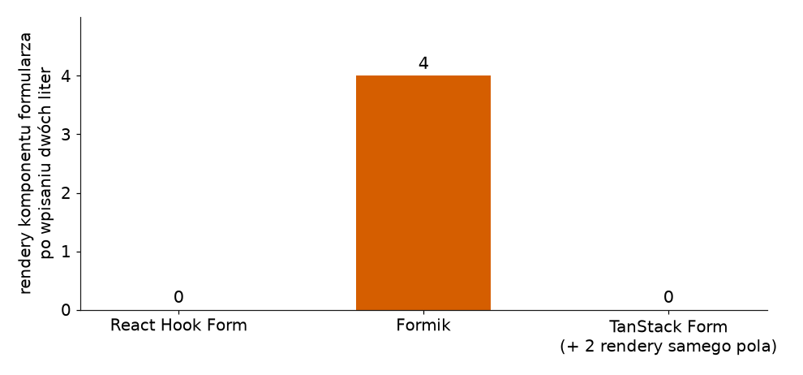
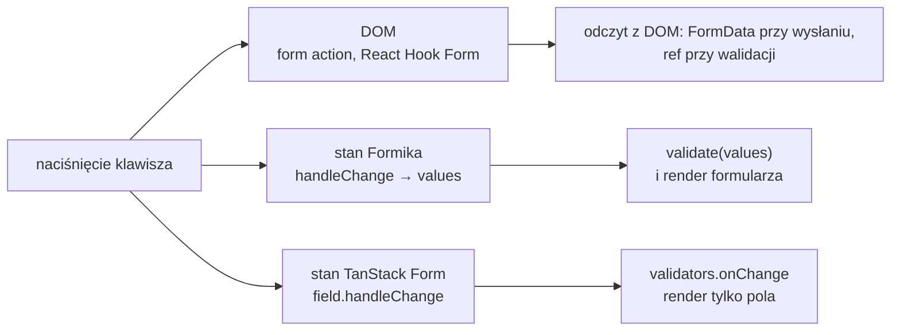

# Formik i TanStack Form: dwie biblioteki z polami kontrolowanymi

## Dwie biblioteki spoza projektu

Projekt `issuetracker` ma dwa warianty formularza: akcje React 19 na `/new` i React Hook Form na `/new-rhf`. Oba zostawiają wartość pola w DOM i sięgają po nią same, gdy jest potrzebna. Biblioteki z drugiej rodziny robią odwrotnie i trzymają każdą literę we własnym stanie, czyli robią z każdego pola pole kontrolowane. Demo ich nie używa, bo przy dwóch polach nic nie wnoszą, ale bez nich porównanie byłoby niepełne. **Formik** spotyka się głównie w istniejącym kodzie, a **TanStack Form** to najmłodsza z omawianych bibliotek formularzy.

Przykłady poniżej to kod spoza projektu. Używają jednak pól i schematu `issueSchema` z `app/lib/schema.js`, żeby dało się je położyć obok dwóch wariantów z demo. Każdy przykład przyjmuje prop `onCreate`, czyli funkcję zapisu przekazaną z zewnątrz, na przykład `addIssue`. Przykłady są napisane dla wersji React 19.3.0, Formik 2.4.9, `@tanstack/react-form` 1.33.5 i Zod 3.25.76.

## Formik: hasło i stan projektu

Strona projektu obiecuje formularze „bez łez” (*„Build forms in React, without the tears”*). Schwarzmüller w *React Key Concepts* wymienia Formika obok React Hook Form jako drugą popularną bibliotekę do obsługi i walidacji danych z formularzy.

Starsze materiały dodają często, że Formik jest „w trybie utrzymania”. Źródła tego nie potwierdzają: repozytorium nie jest zarchiwizowane, a paczka nie jest oznaczona jako przestarzała. Ostatnie wydanie, 2.4.9, pochodzi z 10 listopada 2025 roku. Biblioteka żyje, ale rozwija się wolno, a akcje formularzy z React 19 nie są w niej punktem wyjścia.

## Formularz zgłoszenia w Formiku

Formik ma wbudowaną obsługę tylko jednej biblioteki schematów:

> **„specjalna opcja konfiguracji (prop) dla schematów obiektowych Yup, nazwana `validationSchema`”**
>
> *„a special config option / prop for Yup object schemas called `validationSchema`”*
>
> — dokumentacja Formik, *Validation*

Schemat Zod przekazany wprost do `validationSchema` nie zadziała. Przykład podłącza go przez zwykłą funkcję `validate`, która tłumaczy wynik `safeParse` na format Formika: obiekt z jednym napisem na pole.

```jsx
// Przykład spoza demo: formularz zgłoszenia w Formiku.
"use client";
import { useFormik } from "formik";
import { issueSchema } from "../lib/schema";

// Formik rozumie wprost tylko schematy Yup (validationSchema),
// więc schemat Zod podłącza się ręcznie przez funkcję validate.
function validate(values) {
  const result = issueSchema.safeParse(values);
  if (result.success) return {}; // pusty obiekt: brak błędów
  const fieldErrors = result.error.flatten().fieldErrors;
  return {
    title: fieldErrors.title?.[0], // ?.[0]: pierwszy komunikat albo undefined
    priority: fieldErrors.priority?.[0],
  };
}

export default function NewIssueFormik({ onCreate }) {
  const formik = useFormik({
    initialValues: { title: "", priority: "medium" }, // nazwy pól i wartości startowe
    validate,
    onSubmit: async (values, { resetForm }) => {
      await onCreate(values); // values to zwykły obiekt { title, priority }
      resetForm(); // powrót do initialValues
    },
  });

  return (
    <form onSubmit={formik.handleSubmit}>
      <label>
        Title
        {/* value + onChange: pole kontrolowane, każda litera trafia do stanu Formika */}
        <input name="title" value={formik.values.title}
          onChange={formik.handleChange} onBlur={formik.handleBlur} />
      </label>
      {/* touched: komunikat dopiero po opuszczeniu pola */}
      {formik.touched.title && formik.errors.title && <p>{formik.errors.title}</p>}
      <button type="submit" disabled={formik.isSubmitting}>Create</button>
    </form>
  );
}
```

Zapis `?.[0]` to ten sam operator `?.`, który chroni przed odczytem z `undefined`, tym razem przy indeksie tablicy. Pole poprawne nie ma klucza w `fieldErrors`, więc bez niego odczyt `[0]` rzuciłby wyjątek.

Trzy pola obiektu `formik` robią większość pracy. `values` trzyma wartości, `errors` wynik walidacji, a `touched` zapamiętuje, które pole użytkownik już opuścił. `handleChange` odczytuje atrybut `name` pola, z którego przyszło zdarzenie, i pod tym kluczem zapisuje nową wartość w `values`. Walidacja i jej pokazanie to dwie osobne rzeczy. Po wpisaniu „ab” `formik.errors.title` zawiera już „Title must be at least 3 characters.”, ale `touched.title` ma wartość `false` i akapit z błędem się nie pojawia. Komunikat wychodzi dopiero po opuszczeniu pola. Po wysłaniu „abc” `onCreate` dostaje `{ title: "abc", priority: "medium" }`, a `resetForm` czyści pole.

Ta sama strona dokumentacji opisuje momenty walidacji: po zdarzeniach zmiany, po opuszczeniu pola i przy próbie wysłania. Flagi `validateOnChange` i `validateOnBlur` wyłączają dwa pierwsze. Formik oznacza wszystkie pola jako odwiedzone dopiero przy próbie wysłania, więc pole bez `onBlur` pokaże swój błąd dopiero po kliknięciu przycisku.

## Koszt jednego stanu na cały formularz

Stan Formika jest jeden dla całego formularza i mieszka w komponencie, który wywołuje `useFormik`. Każda zmiana `values` albo `errors` renderuje więc ten komponent razem ze wszystkimi polami. Licznik w ciele `NewIssueFormik` rośnie o dwa przy każdej wpisanej literze, także wtedy, gdy wynik walidacji się nie zmienia. Przy dwóch polach to bez znaczenia. Dla bardzo dużych formularzy dokumentacja Formika przewiduje komponent `<FastField />`, opisany jako zoptymalizowana wersja `<Field />` dla formularzy z około trzydziestoma i więcej polami. Zastępuje on `<Field />` w polu niezależnym od innych pól.

## Biblioteka bez interfejsu

TanStack Form pochodzi od autorów TanStack Query, biblioteki do pobierania danych z serwera, którą Bugl stosuje w *Modern Full-Stack React Projects*. Wersja 1.0.0 ukazała się 2 marca 2025 roku. Materiały sprzed niej pokazują kod z wydań 0.x, który w wersji 1 już nie zadziała.

> **„Bezinterfejsowe, wydajne i bezpieczne typowo zarządzanie stanem formularza…”**
>
> *„Headless, performant, and type-safe form state management…”*
>
> — opis repozytorium TanStack/form na GitHubie

Słowo **headless** oznacza bibliotekę bez warstwy wyglądu. TanStack Form nie dostarcza żadnego pola ani przycisku. Dostarcza stan i funkcje, a cały wygląd formularza zostaje po stronie aplikacji. Do przekazania stanu do wyglądu służy wzorzec **render-prop**: komponent biblioteki nie zwraca własnego JSX, tylko wywołuje funkcję podaną w `children` i zwraca jej wynik.

```jsx
function Counter({ children }) {
  const [n, setN] = useState(0);
  return children(n, () => setN(n + 1)); // stan i funkcja oddane do funkcji z children
}

// wygląd wybiera kod wywołujący
<Counter>{(n, inc) => <button onClick={inc}>Clicks: {n}</button>}</Counter>
// po jednym kliknięciu: <button>Clicks: 1</button>
```

`Counter` nie wie, czy licznik będzie przyciskiem, czy akapitem. Zna tylko stan i funkcję, która go zmienia. Tak samo działa `form.Field` w TanStack Form.

## Formularz zgłoszenia w TanStack Form

```jsx
// Przykład spoza demo: formularz zgłoszenia w TanStack Form.
"use client";
import { useForm } from "@tanstack/react-form";
import { issueSchema } from "../lib/schema";

export default function NewIssueTanStack({ onCreate }) {
  const form = useForm({
    defaultValues: { title: "", priority: "medium" },
    validators: { onChange: issueSchema }, // schemat Zod przekazany wprost, bez adaptera
    onSubmit: async ({ value }) => {
      await onCreate(value); // value to zwykły obiekt { title, priority }
      form.reset();
    },
  });

  return (
    <form
      onSubmit={(e) => {
        e.preventDefault(); // biblioteka nie korzysta z atrybutu action
        e.stopPropagation(); // zdarzenie nie idzie do procedur wyżej w drzewie
        form.handleSubmit();
      }}
    >
      {/* render-prop: Field oddaje obiekt field do funkcji w children */}
      <form.Field
        name="title"
        children={(field) => (
          <label>
            Title
            <input
              value={field.state.value}
              onChange={(e) => field.handleChange(e.target.value)}
              onBlur={field.handleBlur}
            />
            {/* przy schemacie każdy błąd jest obiektem z polem message */}
            {field.state.meta.errors.map((issue) => (
              <p key={issue.message}>{issue.message}</p>
            ))}
          </label>
        )}
      />
      <button type="submit">Create</button>
    </form>
  );
}
```

Obiekt `field` ma bieżącą wartość w `field.state.value`, funkcje `handleChange` i `handleBlur` oraz metadane w `field.state.meta`, w tym listę błędów. Wysłanie przechodzi przez `form.handleSubmit()`, a `onSubmit` dostaje gotowe wartości w polu `value`.

Przy walidatorze w `onChange` komunikat pojawia się od pierwszej litery: po wpisaniu „ab” pod polem stoi „Title must be at least 3 characters.”. Kod `{field.state.meta.errors.join(", ")}` wyświetliłby w tym miejscu „[object Object]”, bo elementy listy są obiektami, a nie napisami.

## Schemat wprost, bez adaptera

> **„TanStack Form natywnie obsługuje wszystkie biblioteki zgodne ze specyfikacją Standard Schema, przede wszystkim Zod, Valibot, ArkType i Effect/Schema.”**
>
> *„TanStack Form natively supports all libraries following the Standard Schema specification, most notably: Zod, Valibot, ArkType, and Effect/Schema.”*
>
> — dokumentacja TanStack Form, *Form and Field Validation*

**Standard Schema** to wspólny interfejs, który implementują biblioteki walidacji. Jego README podaje cel: narzędzia mają przyjmować jedno wejście ze wszystkim, czego potrzebują, *„no library-specific adapters, no extra dependencies”*, czyli bez adapterów dla konkretnej biblioteki i bez dodatkowych zależności. Dzięki temu schemat Zod trafia do `validators` bez funkcji pośredniej, na poziomie całego formularza albo pojedynczego pola. Zod implementuje ten interfejs od wersji 3.24.0. Materiały z okresu wersji 0.x importują paczkę `@tanstack/zod-form-adapter` i ustawiają opcję `validatorAdapter`. Adapter zakończył rozwój na wersji 0.42.1, a opcji `validatorAdapter` w wersji 1 nie ma.

TanStack Form przyjmuje ten interfejs wprost, React Hook Form potrzebuje do niego resolvera, a Formik go nie zna.

## Render tylko tam, gdzie zmienił się stan

Za `form.Field` stoi zasada całej biblioteki, zapisana w przewodniku *Reactivity*: „TanStack Form nie powoduje renderów przy interakcji z formularzem” (*„Tanstack Form doesn't cause re-renders when interacting with the form”*). Pole subskrybuje własną wartość i tylko ono renderuje się po zmianie. Liczniki w ciele `NewIssueTanStack` i w funkcji `children` pokazują po dwóch literach zero renderów komponentu formularza i dwa rendery pola. Odczyt `form.state.values.title` w treści komponentu pokazałby więc wartość sprzed zmiany.



Na Rysunku 3.23 słupek to liczba renderów komponentu formularza po dwóch literach. Formik renderuje formularz przy każdej literze, React Hook Form i TanStack Form wcale, a w TanStack renderują się tylko same pola.

Stan wysyłki też leży w `form.state`. Do jego odczytu biblioteka ma komponent `form.Subscribe`, którego cel strona *Basic Concepts* opisuje jako optymalizację renderów: aktualizowanie komponentów „tylko wtedy, gdy to konieczne” (*„only updating components when necessary”*).

```jsx
<form.Subscribe
  selector={(state) => [state.canSubmit, state.isSubmitting]} // wybór dwóch wartości ze stanu
  children={([canSubmit, isSubmitting]) => (
    // render tylko wtedy, gdy któraś z dwóch wartości się zmieni
    <button type="submit" disabled={!canSubmit}>
      {isSubmitting ? "Creating..." : "Create"}
    </button>
  )}
/>
```

Po wpisaniu „ab” przycisk jest zablokowany, bo `canSubmit` ma wartość `false`.

## Render-prop obok hooków

Kumar w *Fluent React* nazywa komponent z render-prop bezinterfejsowym, bo „nie ma zdania o tym, jaki interfejs pokazać” (*„it has no opinions about what UI to present”*). Komponent oddaje decyzję o wyglądzie temu, kto go renderuje. Kumar opisuje to jako **odwrócenie sterowania** (*inverting control*): o wyglądzie decyduje kod wywołujący, a komponent tylko podaje mu stan. Dodaje też zastrzeżenie:

> **„Ten wzorzec nie jest już tak popularny i w praktyce zastąpiły go hooki Reacta.”**
>
> *„This pattern is no longer as popular and has since been effectively replaced with React Hooks.”*
>
> — Tejas Kumar, *Fluent React*

TanStack Form używa obu narzędzi, każdego do czego innego. Hook `useForm` tworzy stan całego formularza i nie zwraca JSX. Render-prop w `form.Field` i `form.Subscribe` wyznacza **granicę renderu**. Funkcja z `children` należy do osobnego komponentu, więc zmiana stanu pola renderuje tylko ten komponent, a komponent z `useForm` zostaje bez renderu. Tę granicę widać w pomiarze: zero renderów formularza i dwa rendery pola. Sam hook takiej granicy nie wyznaczy, bo stan odczytany przez hook należy do komponentu, który go wywołał, i to ten komponent się renderuje.

Brak interfejsu ma też koszt. TanStack Form zostawia aplikacji pełną kontrolę nad znacznikami i stylami, ale także całą pracę przy każdym polu: `value`, `onChange` i `onBlur` podpina się ręcznie w każdym `form.Field`. W przykładzie zgłoszenia samo pole tytułu, od `<form.Field` do zamykającego `/>`, zajmuje 17 linii.

## Rysunek 3.24 — trzy miejsca na wartość pola



Na Rysunku 3.24 jedno naciśnięcie klawisza prowadzi w trzy miejsca, zależnie od podejścia. Górna gałąź łączy dwa z czterech podejść, akcje i React Hook Form: wartość zostaje w DOM i nie trafia do stanu komponentu. Dwie dolne gałęzie to biblioteki z polami kontrolowanymi: litera trafia do stanu biblioteki i od razu uruchamia walidację. Różni je zakres renderu, zmierzony wyżej: Formik renderuje cały komponent formularza, a TanStack Form tylko pole.

## Obiekt wartości i `FormData`

Obie biblioteki przechwytują wysłanie w JavaScripcie i przekazują dalej zwykły obiekt wartości, tak samo jak React Hook Form. <u>Akcja w stylu `submitIssue(prevState, formData)` oczekuje `FormData`</u>. Między biblioteką a taką akcją potrzebna jest więc funkcja, która zbuduje jedno z drugiego.

```js
function toFormData(values) {
  const formData = new FormData();
  for (const [key, value] of Object.entries(values)) formData.set(key, value); // para klucz–wartość
  return formData;
}

toFormData({ title: "abc", priority: "low" }).get("title"); // → "abc"
Object.fromEntries(toFormData({ title: "abc", priority: "low" })); // z powrotem: { title: "abc", priority: "low" }
```

`Object.entries` zamienia obiekt na tablicę par `[klucz, wartość]`, czyli robi odwrotność `Object.fromEntries`. Konwersja jest tania. Do połączenia z Server Action TanStack Form ma osobny pakiet `@tanstack/react-form-nextjs`. Dokumentacja integracji z frameworkami przypomina, że pola muszą wtedy mieć jawny atrybut `name` (*„must explicitly set the name attribute for the POST request”*). Formik takiego połączenia w dokumentacji nie opisuje.

## Rozszerzenie: wysyłanie i błędy z serwera

Przykład Formika ma `onSubmit` ze słowem `async` i to ma znaczenie dla przycisku. Dokumentacja zastrzega:

> **„Jeśli `onSubmit` jest asynchroniczne, Formik sam ustawi `isSubmitting` na `false`, gdy Promise się rozwiąże. […] Jeśli jednak funkcja `onSubmit` jest synchroniczna, trzeba samemu wywołać `setSubmitting(false)`.”**
>
> *„IMPORTANT: If `onSubmit` is async, then Formik will automatically set `isSubmitting` to `false` on your behalf once it has resolved. […] However, if your `onSubmit` function is synchronous, then you need to call `setSubmitting(false)` on your own.”*
>
> — dokumentacja Formik, *&lt;Formik /&gt;*

Synchroniczne `onSubmit` bez tego wywołania zostawiłoby `isSubmitting` z wartością `true`, a przycisk „Create” zablokowany. Błąd zgłoszony przez serwer trafia do formularza funkcjami z drugiego argumentu `onSubmit`. W przykładzie serwer zastępuje funkcja `checkTitle`. Po 300 ms odpowiada ona, czy zgłoszenie o takim tytule już istnieje.

```jsx
// Przykład spoza demo: błąd z serwera w formularzu Formika.
import { getIssues } from "../lib/store";

// zamiast serwera: odpowiedź po 300 ms, komunikat albo null
function checkTitle(title) {
  return new Promise((resolve) =>
    setTimeout(() => {
      const taken = getIssues().some((issue) => issue.title === title);
      resolve(taken ? "An issue with this title already exists." : null);
    }, 300),
  );
}

// w useFormik zamiast dotychczasowego onSubmit:
onSubmit: async (values, { resetForm, setFieldError, setStatus }) => {
  const error = await checkTitle(values.title);
  if (error) {
    setFieldError("title", error); // komunikat jednego pola, pod polem tytułu
    setStatus("Issue not saved."); // dowolna wartość dla całego formularza
    return; // onCreate się nie wykonuje
  }
  await onCreate(values);
  resetForm(); // czyści też status
},

// w JSX, nad polem tytułu:
{formik.status && <p>{formik.status}</p>}
```

Dla tytułu „Login button does not work on Safari” formularz pokazuje nad polem „Issue not saved.”, a pod nim „An issue with this title already exists.”. Następna litera uruchamia `validate` od nowa i błąd pola znika, a status zostaje do `resetForm()`.

TanStack Form przenosi taki błąd do walidatora `onSubmitAsync` na poziomie formularza. Sprawdza on wszystkie pola jednym zapytaniem do API.

```jsx
// Przykład spoza demo: ten sam błąd z serwera w TanStack Form.
// w useForm zamiast dotychczasowego validators:
validators: {
  onChange: issueSchema,
  onSubmitAsync: async ({ value }) => {
    const error = await checkTitle(value.title); // checkTitle jak wyżej
    // klucz fields: błąd trafia do meta.errors pola title;
    // obiekt z message, bo pole wyświetla issue.message, jak przy błędach schematu
    return error ? { fields: { title: { message: error } } } : undefined;
  },
},
```

Ten sam tytuł daje pod polem „An issue with this title already exists.”, a `onSubmit` się nie wykonuje. Dokumentacja zastrzega, że walidator pola ma pierwszeństwo i może nadpisać błąd z poziomu formularza.

## Rozszerzenie: komponenty `<Formik>` i `<Field>`

W starszym kodzie częściej niż `useFormik` spotyka się wariant z komponentami `<Formik>`, `<Form>`, `<Field>` i `<ErrorMessage>`.

```jsx
// Przykład spoza demo: formularz zgłoszenia z komponentami Formika.
"use client";
import { Formik, Form, Field, ErrorMessage } from "formik";
import { issueSchema } from "../lib/schema";

// function validate(values) { … } bez zmian, jak w wariancie z useFormik

export default function NewIssueFormik({ onCreate }) {
  return (
    <Formik
      initialValues={{ title: "", priority: "medium" }}
      validate={validate}
      onSubmit={async (values, { resetForm }) => {
        await onCreate(values); // po „abc”: values → { title: "abc", priority: "medium" }
        resetForm();
      }}
    >
      {/* render-prop: Formik oddaje swój stan funkcji w children */}
      {({ isSubmitting }) => (
        <Form>
          <label>
            Title
            {/* samo name wystarcza: value, onChange i onBlur podpina Field */}
            <Field name="title" />
          </label>
          {/* akapit tylko przy touched.title i errors.title */}
          <ErrorMessage name="title" component="p" />
          <button type="submit" disabled={isSubmitting}>Create</button>
        </Form>
      )}
    </Formik>
  );
}
```

Zachowanie jest takie samo jak w wersji z `useFormik`. Po „ab” akapitu jeszcze brak. Po opuszczeniu pola `<ErrorMessage>` renderuje `<p>Title must be at least 3 characters.</p>`. `<Form>` to zwykły element `<form action="#">` z podpiętym `handleSubmit`, a każde `<Field>` jest polem kontrolowanym, którego wartość leży w stanie Formika pod kluczem równym atrybutowi `name`.

## Rozszerzenie: walidacja na serwerze w trakcie pisania

Biblioteka umie też sprawdzać pole na serwerze w trakcie pisania, czego akcje nie mają. Strona *Form and Field Validation* opisuje walidator `onChangeAsync` z opóźnieniem `onChangeAsyncDebounceMs`. Opóźnienie (*debounce*) to odczekanie, aż zdarzenia przestaną napływać, zanim kod zareaguje. Walidator ustawia się przy polu tytułu w `NewIssueTanStack`.

```jsx
// Przykład spoza demo: sprawdzenie tytułu na serwerze w trakcie pisania.
<form.Field
  name="title"
  validators={{
    onChangeAsyncDebounceMs: 500, // zapytanie dopiero po 500 ms bez nowego znaku
    onChangeAsync: async ({ value }) => {
      const error = await checkTitle(value); // checkTitle: odpowiedź po 300 ms
      return error ? { message: error } : undefined;
    },
  }}
  children={(field) => (
    <label>
      Title
      <input
        value={field.state.value}
        onChange={(e) => field.handleChange(e.target.value)}
        onBlur={field.handleBlur}
      />
      {field.state.meta.errors.map((issue) => (
        <p key={issue.message}>{issue.message}</p>
      ))}
    </label>
  )}
/>
```

```text
„Page loads slowly on mobile” (27 znaków), 100 ms między znakami  → 1 wywołanie checkTitle
ten sam tytuł, 600 ms między znakami                              → 25 wywołań
bez onChangeAsyncDebounceMs, 100 ms między znakami                → 25 wywołań
po ostatnim wywołaniu pod polem: An issue with this title already exists.
```

Dwie pierwsze litery nie wysyłają zapytania, bo walidator asynchroniczny rusza tylko wtedy, gdy schemat w `onChange` formularza nie zgłosił błędu.

> 💡 **Zapamiętaj:** Formik i TanStack Form trzymają wartości pól we własnym stanie. Formik renderuje cały formularz przy każdej literze i rozumie wprost tylko schematy Yup, a TanStack Form renderuje samo pole i przyjmuje schemat Zod przez Standard Schema. Wszystkie trzy biblioteki oddają do funkcji wysyłki obiekt wartości, a akcja oczekuje `FormData`.

