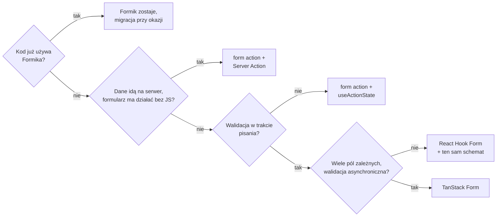

# Akcje czy biblioteka: jak wybrać sposób obsługi formularza

## Ten sam formularz w dwóch wersjach

Projekt `issuetracker` ma formularz zgłoszenia w dwóch wariantach. `/new` używa `<form action>` z `useActionState` i komponentu `SubmitButton` opartego na `useFormStatus`. `/new-rhf` używa React Hook Form z `zodResolver`. Różni je to, gdzie mieszka wartość pola, co dostaje funkcja wysyłki, kiedy użytkownik widzi błąd i co dzieje się, zanim JavaScript strony się załaduje.

Formik i TanStack Form dokładają do porównania dwa kolejne warianty. Tabela zestawia wszystkie cztery, a każdy wiersz porównuje jedną rolę w formularzu:

| | `<form action>` + `useActionState` | React Hook Form | Formik | TanStack Form |
|---|---|---|---|---|
| Wysłanie w JSX | `action={formAction}` | `onSubmit={handleSubmit(fn)}` | `onSubmit={formik.handleSubmit}` | `onSubmit`, w nim `form.handleSubmit()` |
| Co dostaje funkcja wysyłki? | `FormData` | obiekt wartości | obiekt wartości | obiekt `value` |
| Jak podłącza schemat Zod? | `safeParse()` w akcji | `zodResolver` | funkcja `validate` | `validators`, bez adaptera |
| Kiedy domyślnie działa walidacja? | po wysłaniu, w akcji | przy wysłaniu, potem przy zmianach | przy zmianie, opuszczeniu pola i wysłaniu | według walidatorów `onChange`/`onBlur`/`onSubmit` |
| Dodatkowe paczki | brak (wbudowane w React) | `react-hook-form` + `@hookform/resolvers` | `formik` | `@tanstack/react-form` |
| Reset po sukcesie | automatyczny (React 19) | `reset()` ręcznie | `resetForm()` | `form.reset()` |
| Czy zapisuje bez JavaScriptu? | tak, gdy akcja działa na serwerze | nie | nie | nie |

Ostatni wiersz wynika z mechaniki wysyłania. Formularz obsługiwany wyłącznie przez `onSubmit` nie ma w HTML celu wysłania. Bez JavaScriptu przeglądarka wysyła go więc metodą GET pod bieżący adres: `/new-rhf` przeładowuje się jako `/new-rhf?title=Test+issue&priority=low`, a dane nie trafiają do żadnej funkcji zapisu. W `issuetracker` także pierwsza kolumna ma w tym wierszu odpowiedź „nie”, bo akcja działa w przeglądarce. Wiersz o walidacji wyznacza z kolei chwilę, w której użytkownik widzi komunikat, więc wybór biblioteki jest także wyborem tej chwili.

Do decyzji potrzebny jest jeszcze koszt w kodzie. Oba pliki z demo dają się porównać liczbowo: `app/new/page.jsx` ma 75 linii, a `app/new-rhf/page.jsx` 49 (w obu liczą się komentarze). Różnicę robi głównie ręczne budowanie obiektu `raw` i przekładanie błędów `flatten()` na stan, które w drugim wariancie wykonuje resolver. Za to `/new` nie potrzebuje żadnej paczki poza Reactem i daje komunikat o sukcesie na tej samej stronie, a `/new-rhf` po zapisie przenosi na listę.

Wariant z akcjami wygrywa przy prostych formularzach i tam, gdzie dane idą na serwer. W `/new` akcja działa jeszcze w przeglądarce, więc tę zaletę daje dopiero funkcja z dyrektywą `"use server"`, czyli **Server Action**, którą formularz wywołuje bez pośrednika. Biblioteka wygrywa przy formularzach rozbudowanych, które pracują w przeglądarce. React Hook Form łączy się z Server Action dopiero przez `FormData` zbudowany ręcznie w `onSubmit`.

## Nie ma jednej dobrej odpowiedzi

Wieruch w *The Road to React* stawia na atrybut `action`, a Schwarzmüller w *React Key Concepts* uzależnia wybór od wymagań aplikacji. Stanowiska da się pogodzić, bo oba prowadzą do tego samego pytania: czy formularz ma wymaganie, którego wbudowany mechanizm nie pokrywa. Dopóki takiego wymagania nie ma, każda dodatkowa paczka jest kosztem bez zysku.

Barklund dokłada argument ogólny, dotyczący całego ekosystemu:

> **„Nie wszystkie biblioteki w ekosystemie React są sobie równe i nie wszystkie są potrzebne w każdym projekcie.”**
>
> *„It’s worth noting that not all libraries in the React ecosystem are created equal, and not all of them are necessary for every project.”*
>
> — Morten Barklund, *React in Depth*

## Rysunek 3.25 — drzewo decyzji

Na Rysunku 3.25 formularz z demo idzie najkrótszą drogą przez gałąź przeglądarki. Projekt nie ma Formika, zapis trafia do modułu `store.js` w przeglądarce, a dwa pola nie potrzebują walidacji w trakcie pisania, więc wynikiem jest `<form action>` z `useActionState`, bez nowej zależności w `package.json`. Drugie pytanie kieruje formularz, którego dane mają trafić na serwer albo który ma działać przed załadowaniem JavaScriptu, do akcji z `"use server"`. Pierwsze pytanie dotyczy istniejącego kodu, bo działający Formik nie jest powodem do przepisania. Wymianę uzasadniają konkretne potrzeby: wysyłanie przez akcję na serwerze albo przejście zespołu na schematy Zod. Bibliotekę wybiera się dopiero wtedy, gdy formularz ma sprawdzać pola w trakcie pisania. Ostatnie pytanie oddziela formularze, w których pola zależą od siebie albo wymagają zapytania do serwera w trakcie pisania. Tam subskrypcja pojedynczych pól i walidator asynchroniczny TanStack Form zaczynają się opłacać.

## Koszt, ryzyko i odwracalność zależności

Schwarzmüller w *React Key Concepts* przyznaje, że cały potrzebny kod da się napisać samemu. Przy coraz bardziej złożonych aplikacjach „może jednak mieć sens oddanie niektórych problemów na zewnątrz” (*„it might make sense to outsource certain problems”*). Decyzję o oddaniu problemu bibliotece opisują trzy pojęcia.

- **Koszt** płaci się przez cały czas życia projektu. Składa się na niego paczka w `package.json`, jej własne zależności i API, którego musi się nauczyć każda osoba w zespole. Według rejestru npm `react-hook-form` 7.89.0 ma zero zależności, Formik 2.4.9 ma ich osiem, a `@tanstack/react-form` 1.33.5 dwie. Porównanie opiera się na liczbie zależności, którą da się sprawdzić w rejestrze, a rozmiaru w kilobajtach bez oficjalnego źródła się tu nie podaje.
- **Ryzyko** to zmiany, na które projekt nie ma wpływu: nowa wersja główna ze zmienionym API albo biblioteka, która przestaje się rozwijać. Rośnie ono z liczbą miejsc, w których kod aplikacji woła API biblioteki, bo każde z nich trzeba sprawdzić przy aktualizacji.
- **Odwracalność** mówi, ile kosztuje wycofanie się z decyzji. Zależy od tego, czy zmianę da się wprowadzać po kawałku.

Barklund w *React in Depth* pokazuje skrajny przypadek na scenariuszu starego panelu firmowego. Pisze o nim, że „przepisanie go na nowy stos jest prawie niemożliwe, bo projekt jest ogromny” (*„Refactoring this to a new stack is nigh on impossible as the project is huge.”*). Stary stos uznaje mimo to za dobry wybór, bo zachowuje zgodność z istniejącym kodem i zostawia „otwarte drzwi do stopniowej modernizacji” (*„leaving an open door for gradual modernization”*). Formularze dobrze znoszą taką stopniową zmianę, bo każdy jest osobnym komponentem. `issuetracker` ma jednocześnie formularz na akcjach i formularz z biblioteką, a projekt może przenosić formularze po jednym. Na tej zasadzie opiera się pierwsza gałąź Rysunku 3.25, w której Formik zostaje, a migracja przychodzi przy okazji.

*Przerywnik: xkcd 2347 „Dependency”. Autor: Randall Munroe, licencja CC BY-NC 2.5, <https://xkcd.com/2347/>.* Każda zależność w `package.json` jest takim klockiem: aplikacja działa, dopóki działają biblioteki pod nią.

## Co przechodzi przy zmianie podejścia

Wybór da się później zmienić. Koszt takiej zmiany zależy od tego, co da się przenieść bez przepisywania. Przenosi się schemat: ten sam plik `app/lib/schema.js` obsługuje wszystkie cztery warianty, od `safeParse` w akcji po `validators` w TanStack Form. Przenoszą się komunikaty, bo leżą w schemacie, i funkcja zapisu `addIssue`, bo każde podejście kończy się wywołaniem z obiektem `{ title, priority }`. Przepisuje się to, co łączy pole z narzędziem: atrybuty pól w JSX, wyrażenia, które wyświetlają błąd, i sposób, w jaki komponent dowiaduje się o trwającym wysyłaniu. Kod trzymający reguły poza komponentem formularza zmienia się więc najtaniej.

## Przy mieszaniu podejść

Mieszanie mechanizmów w jednym formularzu grozi tym, że **jedna wartość pola leży w dwóch miejscach**. Tak się dzieje, gdy pole kontrolowane przez Formika albo TanStack Form odczytuje jednocześnie `FormData` w akcji. Po wysłaniu React czyści pola niekontrolowane, a biblioteka trzyma w stanie starą wartość. Na ekranie pole wygląda wtedy na wyczyszczone albo na wypełnione, zależnie od tego, które źródło akurat wygrało ostatni render. <u>Jeden formularz ma jeden model przechowywania wartości</u>, wybrany dla całego formularza, a nie pole po polu.

## Test przyszłej zmiany

Dobrym testem wyboru jest pytanie o zmianę, która przyjdzie później. Gdy do formularza dojdzie nowe pole, na przykład opis zgłoszenia, liczba miejsc do zmiany zależy od podejścia. W wariancie z akcjami trzeba zmienić schemat, znacznik pola i budowę obiektu `raw` z `FormData`. W wariancie z React Hook Form wystarczy schemat i znacznik pola z `register`. W TanStack Form dochodzą schemat, wartości początkowe i znacznik pola. W Formiku do tych trzech miejsc dochodzi czwarte: nowy wiersz w funkcji `validate`, jak `title: fieldErrors.title?.[0]`. Bez tego wiersza nowe pole nie pokaże komunikatu, choć schemat go zgłosi. Liczba miejsc nie przesądza wyboru, ale pokazuje, gdzie przy danym podejściu najłatwiej o pomyłkę.

## Rozszerzenie: formularz edycji, czyli wartości z serwera

Formularz zgłoszenia zaczyna od pustego tytułu. Formularz edycji istniejącego zgłoszenia startuje od danych, które trzeba najpierw pobrać, a podejścia różnią się tym, jak te dane przyjmują. W wariancie z akcją wartość trafia do atrybutu `defaultValue` pola niekontrolowanego, na przykład `defaultValue={issue.title}`. Reset po udanej akcji przywraca pole właśnie do tej wartości.

React Hook Form zapamiętuje wartości początkowe przy pierwszym renderze. Dokumentacja `useForm` mówi wprost, że `defaultValues` są zapamiętywane, a zmienić je można funkcją `reset`. Dla danych, które przychodzą później, biblioteka ma od wersji 7.41.0 opcję `values`:

> **„Opcja `values` reaguje na zmiany i aktualizuje wartości formularza, co przydaje się, gdy formularz ma być aktualizowany przez zewnętrzny stan albo dane z serwera.”**
>
> *„The `values` prop will react to changes and update the form values, which is useful when your form needs to be updated by external state or server data.”*
>
> — dokumentacja React Hook Form, *useForm*

Każda taka aktualizacja wywołuje wewnętrznie `reset`. Ustawienie `resetOptions: { keepDirtyValues: true }` zachowuje przy tym pola, które użytkownik zdążył zmienić. Opcja `errors` z wersji 7.49.0 działa podobnie dla błędów zwróconych przez serwer. Formularz edycji, który dostaje dane z opóźnieniem albo odświeża je w tle, jest więc kolejnym powodem, by wybrać bibliotekę.

## Rozszerzenie: pola dodawane w trakcie pracy i formularze w kilku krokach

Formularz zgłoszenia ma stałą liczbę pól. Lista kroków do odtworzenia błędu, z przyciskiem „dodaj krok”, już nie. React Hook Form ma do tego hook `useFieldArray`, który zwraca tablicę `fields` i funkcje `append`, `remove` oraz `insert`. Dokumentacja stawia przy nim jeden twardy warunek:

> **„Jako klucz komponentu trzeba podać `field.id` (a nie `index`), żeby ponowne rendery nie psuły pól.”**
>
> *„The `field.id` (and not `index`) must be added as the component key to prevent re-renders breaking the fields”*
>
> — dokumentacja React Hook Form, *useFieldArray*

Identyfikator `id` generuje sam hook, bo indeks opisuje pozycję wiersza i zmienia się przy każdym usunięciu. Hook ma też ograniczenie z dokumentacji: każdy element tablicy pól musi być obiektem, więc lista kroków ma postać `[{ text: "..." }]`, a nie tablicy napisów. W wariancie z akcjami lista pól o tej samej nazwie trafia do `FormData`, a akcja odczytuje ją przez `formData.getAll("steps")`. Dodawanie i usuwanie wierszy wymaga jednak stanu z listą identyfikatorów, który trzeba napisać samemu.

Formularz w kilku krokach, na przykład zgłoszenie rozłożone na trzy strony, ma inny problem: dane z poprzedniego kroku muszą gdzieś przetrwać zmianę trasy. Dokumentacja React Hook Form, w części *Advanced Usage*, zaleca na to bibliotekę zarządzania stanem, bo sam `useForm` żyje tylko w komponencie jednej strony. W wariancie z akcjami taką rolę pełni magazyn podobny do `store.js` albo akcja na serwerze, która zapisuje każdy krok osobno.

## Lista, która zna nowe zgłoszenie

Nowe zgłoszenie trafia na listę bez przeładowania, ale żyje tylko w module `store.js` w przeglądarce. Przeładowanie strony je kasuje, a strona szczegółów, renderowana na serwerze, w ogóle go nie zna. Trwały zapis wymaga akcji, która wykonuje się na serwerze, i miejsca na dane po tamtej stronie granicy zaufania.

> 💡 **Zapamiętaj:** przy zmianie podejścia schemat, komunikaty i funkcja zapisu przechodzą bez zmian, a wiązania pól z narzędziem przepisuje się od nowa. Jeden formularz ma jeden model przechowywania wartości.

