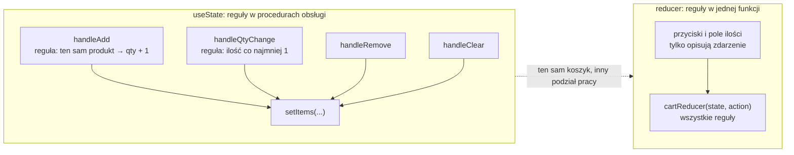

# Sklep kawowy i reducer: wszystkie zmiany koszyka w jednej funkcji

## Jeden koszyk, wiele miejsc

Sklep kawowy ma pięć produktów i koszyk. Ten sam koszyk zmienia lista produktów, nagłówek z sumą i osobna strona `/cart`, a każda zmiana musi przestrzegać tych samych reguł ilości. Dodanie produktu wymaga odpowiedzi serwera, która przychodzi po półtorej sekundy. Sekcja z rekomendacjami ładuje się dwie sekundy i może się nie załadować wcale. Aplikacja ma mimo to reagować od razu i nie tracić koszyka ani reszty strony przez jedną wolną albo zepsutą sekcję.

Projekt `cart-app` powstaje z kreatora `create-next-app` 16.4.0 bez TypeScriptu, Tailwinda, ESLinta, katalogu `src/` i kompilatora Reacta. Kompilator Reacta to narzędzie budowania, które samo dopisuje do komponentów memoizację, czyli zapamiętanie wyników. Bez niego liczba renderów zależy tylko od kodu, który widać na slajdach. Wersje w `package.json` są przypięte: `next` 16.4.0 oraz `react` i `react-dom` 19.3.0. Pliki `page.js` i `layout.js` dostają rozszerzenie `.jsx`, a stary `page.js` znika, bo przy dwóch plikach strony Next.js wybiera `page.js`. Aplikacja nie ma stylów: `app/globals.css` zawiera tylko komentarz, żeby uwaga szła na to, kto zmienia dane.

## Katalog produktów, layout i pierwsza strona

Katalog produktów leży w pliku `app/data/products.js`:

```js
// Statyczny katalog; w prawdziwej aplikacji przyszedłby z serwera.
export const products = [
  { id: 1, name: 'Arabica coffee beans 1kg', price: 49.99 },
  { id: 2, name: 'Earl Grey tea 100g',     price: 18.50 },
  { id: 3, name: 'Ceramic mug 350ml',     price: 34.00 },
  { id: 4, name: 'Tea infuser',        price: 22.00 },
  { id: 5, name: 'Cane sugar 500g',       price:  8.99 },
];
```

Każdy produkt ma trzy pola. **`id`** posłuży jako klucz listy i jako sposób rozpoznania produktu w koszyku. **`name`** to nazwa na stronie. **`price`** jest liczbą, bo będzie mnożona przez ilość i sumowana. Liczbę na ekranie formatuje metoda `toFixed`, która zwraca napis z podaną liczbą cyfr po przecinku:

```js
(18.5).toFixed(2);        // "18.50", napis, a nie liczba
(49.99 * 3).toFixed(2);   // "149.97", zaokrąglenie do dwóch miejsc
```

Layout główny obejmuje każdą stronę aplikacji, a stronę dostaje jako `children`. Eksport `metadata` ustawia tytuł karty przeglądarki:

```jsx
export const metadata = { title: 'Coffee shop — demo' };

export default function RootLayout({ children }) {
  return (
    <html lang="en">
      <body>
        {children}
      </body>
    </html>
  );
}
```

Plik `app/page.jsx` pokazuje listę produktów. Arkusz `page.module.css` z szablonu przestaje być potrzebny, więc znika z projektu:

```jsx
import { products } from './data/products';

export default function HomePage() {
  return (
    <main>
      <h1>Coffee shop</h1>
      <ul>
        {products.map(p => (
          <li key={p.id}>{p.name} — {p.price.toFixed(2)} PLN</li>
        ))}
      </ul>
    </main>
  );
}
```

Plik nie ma dyrektywy `'use client'`, więc strona jest komponentem serwerowym. Nic na niej się nie zmienia, bo nie ma jeszcze stanu.

## Koszyk ma cztery rodzaje zmian

Koszyk przyjmuje cztery operacje. Produkt można **dodać**, a gdy już jest w koszyku, rośnie jego ilość. Pozycję można **usunąć**. Można **zmienić ilość** wpisaną w pole liczbowe, przy czym nie spadnie ona poniżej jednej sztuki. Cały koszyk można **wyczyścić**. Pozycja ma kształt `{ id, name, price, qty }`, czyli dane produktu z dopisaną ilością.

Dwie z tych reguł opierają się na metodach `find` i `Math.max`. `find` zwraca pierwszy element spełniający warunek albo `undefined`, a `Math.max` zwraca większy z argumentów:

```js
[{ id: 1 }, { id: 2 }].find(i => i.id === 2);  // { id: 2 }
[{ id: 1 }].find(i => i.id === 9);             // undefined: brak takiego elementu
Math.max(1, 0);                                // 1: dolna granica wygrywa
Math.max(1, 3);                                // 3
```

Najprostsza droga to jedna tablica w `useState` i osobna funkcja dla każdej operacji. Poniższy kod nie należy do projektu. Pokazuje, czego kolejne kroki unikają:

```jsx
"use client";
import { useState } from "react";

export default function HomePage() {
  const [items, setItems] = useState([]);

  // Reguła „ten sam produkt zwiększa ilość” żyje tylko tutaj.
  function handleAdd(product) {
    const existing = items.find((i) => i.id === product.id);
    setItems(
      existing
        ? items.map((i) => (i.id === product.id ? { ...i, qty: i.qty + 1 } : i))
        : [...items, { ...product, qty: 1 }]
    );
  }

  // Reguła „ilość co najmniej 1” żyje tylko tutaj.
  function handleQtyChange(id, qty) {
    setItems(items.map((i) => (i.id === id ? { ...i, qty: Math.max(1, qty) } : i)));
  }

  function handleRemove(id) {
    setItems(items.filter((i) => i.id !== id));
  }

  function handleClear() {
    setItems([]);
  }
  // ...JSX z czterema przyciskami i polem <input>
}
```

Każda funkcja z osobna jest poprawna, kłopot leży w miejscu reguł. Zasada „ten sam produkt zwiększa ilość” istnieje tylko w `handleAdd`. Zasada „ilość co najmniej 1” istnieje tylko w `handleQtyChange`. <u>Nowy przycisk „+1” przy pozycji musiałby sam pamiętać o obu</u>, a każda kolejna procedura obsługi powtarzałaby to samo ryzyko.

> **„Komponenty z wieloma aktualizacjami stanu rozsianymi po wielu procedurach obsługi zdarzeń mogą stać się przytłaczające. W takich przypadkach całą logikę aktualizacji stanu można zebrać poza komponentem, w jednej funkcji nazywanej »reducerem«.”**
>
> *„Components with many state updates spread across many event handlers can get overwhelming. For these cases, you can consolidate all the state update logic outside your component in a single function, called “reducer”.”*
>
> — dokumentacja React, *Managing State*

## Rysunek 4.1 — gdzie mieszkają reguły koszyka



Na Rysunku 4.1 lewa ramka odpowiada kodowi powyżej. Cztery procedury obsługi same liczą nową tablicę, a dwie z nich niosą reguły, których pozostałe nie znają. W prawej ramce przyciski i pole ilości tylko opisują, co się stało, a jedyne miejsce znające reguły to funkcja `cartReducer`.

## Czym jest reducer

**Reducer** to czysta funkcja, która z bieżącego stanu i akcji wylicza stan następny: `(stan, akcja) => nowy stan`. Schwarzmüller tłumaczy nazwę tym, że funkcja „redukuje stary stan (w połączeniu z akcją) do nowego stanu” (*„reduces the old state (combined with an action) to a new state”*). Dokumentacja wiąże ją z operacją na tablicach.

> **„Choć reducery mogą »zredukować« ilość kodu w komponencie, w rzeczywistości nazwano je od operacji `reduce()`, którą wykonuje się na tablicach.”**
>
> *„Although reducers can “reduce” the amount of code inside your component, they are actually named after the reduce() operation that you can perform on arrays.”*
>
> — dokumentacja React, *Extracting State Logic into a Reducer*

Metoda `reduce` przechodzi po tablicy i za każdym razem podaje funkcji wynik dotychczasowy oraz bieżący element. Drugi argument `reduce` to wynik startowy:

```js
// (wynik dotychczasowy, element) => wynik następny; startujemy od 0
[1, 2, 3].reduce((acc, x) => acc + x, 0);   // 6
```

Reducer Reacta działa tak samo, tylko elementami są akcje, a wynikiem stan. Koszyk po dziesięciu kliknięciach jest więc wynikiem przepuszczenia dziesięciu akcji przez tę samą funkcję, zaczynając od pustego koszyka. Ten sam wynik daje `akcje.reduce(cartReducer, initialCartState)`, bo `cartReducer` ma dokładnie kształt funkcji, której oczekuje `reduce`.

Tejas Kumar w *Fluent React* nazywa to podejście modelem opartym na zdarzeniach (*event sourced*): zapisuje się, co się wydarzyło, a nie tylko wynik.

> **„`useReducer` to model oparty na zdarzeniach. Można nim modelować zdarzenia zachodzące w aplikacji, a potem śledzić je w czymś w rodzaju dziennika audytu.”**
>
> *„`useReducer` is an _event sourced_ model, meaning it can be used to model events that happen in our application, which we can then keep track of in some type of audit log.”*
>
> — Tejas Kumar, *Fluent React*

Dziennik audytu to zapis zdarzeń w kolejności. Według Kumara pozwala odtworzyć je przy szukaniu błędu. Reducer nie czyta propsów ani niczego spoza swoich argumentów, więc może leżeć w osobnym module, bez Reacta.

## Akcja opisuje, co się stało

**Akcja** (*action*) to zwykły obiekt opisujący zdarzenie. Według dokumentacji może mieć dowolny kształt. Zwyczajowo dostaje tekstowe pole `type`, które opisuje, co się stało (*„it is common to give it a string type that describes what happened”*). Koszyk zna cztery akcje i każda niesie tylko swoje dane. `ADD_ITEM` niesie produkt w polu `product`, `REMOVE_ITEM` niesie `id`, `UPDATE_QTY` niesie `id` i `qty`, a `CLEAR_CART` nie niesie nic. Słowo „akcja” ma w React 19 także drugie znaczenie: funkcję asynchroniczną wykonywaną w przejściu, na przykład przekazaną do `<form action>`. W reducerze akcja jest zawsze obiektem z `type`, a o tym, które znaczenie chodzi, rozstrzyga kontekst.

> **„Powinna zawierać minimum informacji potrzebnych reducerowi do obliczenia następnego stanu.”**
>
> *„It should include the minimal necessary information that the reducer needs to compute the next state.”*
>
> — dokumentacja React, *useReducer*

Nazwy akcji w koszyku, `ADD_ITEM` i `CLEAR_CART`, brzmią jak polecenia. Dokumentacja woli nazwy w czasie przeszłym, jak `'added'` i `'deleted'` (*„Choose a name that says what happened!”*), ale obie konwencje działają. Ważniejsza jest reguła o liczbie akcji. Jedna interakcja to jedna akcja, nawet jeśli zmienia wiele danych, dlatego „Clear cart” wysyła jedno `CLEAR_CART`, a nie pięć `REMOVE_ITEM`. Dziennik akcji czyta się wtedy jak historię zakupów.

## Instrukcja `switch`, klamry i `return`

Reducer wybiera gałąź według pola `type`, a do takiego wyboru służy instrukcja `switch`. Porównuje wartość z kolejnymi etykietami `case` i zaczyna wykonywać kod od pierwszej pasującej. Bez `return` albo `break` wykonanie nie zatrzymuje się na końcu gałęzi, tylko przechodzi do następnej:

```js
function noBreak(t) {
  const out = [];
  switch (t) {
    case 'a': out.push('a');          // brak break: wykonanie spada niżej
    case 'b': out.push('b'); break;
    default:  out.push('d');
  }
  return out;
}
noBreak('a');   // ['a', 'b']: gałąź 'a' przeszła do 'b'
noBreak('b');   // ['b']
```

Dokumentacja zaleca dwa nawyki, które usuwają ten problem w reducerze.

> **„Zalecamy zamykanie każdego bloku `case` w klamrach `{` i `}`, żeby zmienne zadeklarowane w różnych gałęziach ze sobą nie kolidowały. Gałąź powinna też zwykle kończyć się instrukcją `return`. Bez niej kod »przejdzie« do następnej gałęzi, co może prowadzić do błędów!”**
>
> *„We recommend wrapping each case block into the { and } curly braces so that variables declared inside of different cases don’t clash with each other. Also, a case should usually end with a return. If you forget to return, the code will “fall through” to the next case, which can lead to mistakes!”*
>
> — dokumentacja React, *Extracting State Logic into a Reducer*

## Plik z regułami koszyka

Reguły trafiają do pliku `app/lib/cartReducer.js`. Plik nie importuje Reacta i nie zawiera JSX. Pierwsza część to stan początkowy i gałąź dodawania:

```js
// Czysty reducer stanu koszyka.
// Kształt stanu: { items: [{ id, name, price, qty }] }
// Reducer zawsze zwraca NOWY obiekt i nigdy nie zmienia stanu w miejscu.

export const initialCartState = { items: [] };

export function cartReducer(state, action) {
  switch (action.type) {
    case 'ADD_ITEM': {
      const existing = state.items.find(i => i.id === action.product.id);
      if (existing) {
        // Produkt już jest w koszyku: rośnie tylko jego ilość.
        return {
          ...state,
          items: state.items.map(i =>
            i.id === action.product.id
              ? { ...i, qty: i.qty + 1 }
              : i
          ),
        };
      }
      // Nowy produkt: dopisana pozycja z ilością 1.
      return {
        ...state,
        items: [...state.items, { ...action.product, qty: 1 }],
      };
    }
```

Pozostałe gałęzie zamykają funkcję:

```js
    case 'REMOVE_ITEM':
      return {
        ...state,
        items: state.items.filter(i => i.id !== action.id),
      };
    case 'UPDATE_QTY':
      return {
        ...state,
        items: state.items.map(i =>
          i.id === action.id
            ? { ...i, qty: Math.max(1, action.qty) }   // ilość co najmniej 1
            : i
        ),
      };
    case 'CLEAR_CART':
      return { ...state, items: [] };
    default:
      throw new Error(`Unknown cart action: ${action.type}`);
  }
}
```

Stan jest obiektem `{ items: [] }`, a nie gołą tablicą, więc da się do niego dopisać kolejne pole bez zmiany kształtu gałęzi. W koszyku tylko `ADD_ITEM` deklaruje zmienną (`existing`), więc tylko ta gałąź potrzebuje klamer. Każda gałąź kończy się `return`, więc żadna nie przechodzi do następnej. Każda zaczyna też nowy obiekt od `...state`, więc dopisane później pole, na przykład kod rabatowy, nie zginie przy zmianie pozycji.

Reducer jest zwykłą funkcją, więc działa także poza komponentem. Dwa wywołania z produktem, który drugim razem niesie inną cenę, pokazują jedną regułę, której nikt nie zapisał wprost:

```js
const coffee = { id: 1, name: 'Coffee', price: 49.99 };
let s = cartReducer(initialCartState, { type: 'ADD_ITEM', product: coffee });
s = cartReducer(s, { type: 'ADD_ITEM', product: { ...coffee, price: 59.99 } });
s.items;   // [{ id: 1, name: 'Coffee', price: 49.99, qty: 2 }]
```

`ADD_ITEM` niesie cały obiekt produktu, bo reducer nie ma dostępu do katalogu. Gałąź dla produktu, który już jest w koszyku, zmienia jednak tylko `qty`. **Koszyk zapamiętuje dane produktu z chwili pierwszego dodania.** W sklepie z cenami zmienianymi w trakcie sesji tę regułę trzeba by zapisać świadomie.

## Kopia w każdej gałęzi i czystość reducera

<u>Reducer zwraca nowy obiekt zbudowany z kopii i nigdy nie modyfikuje argumentu `state`</u>. Wyjątkiem jest akcja, która niczego nie zmienia: wtedy wolno oddać ten sam obiekt. Każda gałąź `cartReducer` buduje wynik od `{ ...state }`, więc z wyjątku nie korzysta.

Reducer obowiązują te same zasady co funkcję komponentu, bo działa w trakcie renderowania.

> **„Reducery muszą być czyste. Podobnie jak aktualizatory stanu, reducery działają w trakcie renderowania! (Akcje są kolejkowane do następnego renderu). Oznacza to, że reducery muszą być czyste: te same dane wejściowe zawsze dają ten sam wynik. Nie powinny wysyłać żądań, planować timerów ani wywoływać efektów ubocznych.”**
>
> *„Reducers must be pure. Similar to state updater functions, reducers run during rendering! (Actions are queued until the next render.) This means that reducers must be pure—same inputs always result in the same output. They should not send requests, schedule timeouts, or perform any side effects”*
>
> — dokumentacja React, *Extracting State Logic into a Reducer*

W `cartReducer` nie ma `fetch`, `Date.now()` ani zapisu do `document.title`. Czystość daje dwie korzyści. Reducer da się wywołać na próbę, bez skutków dla aplikacji. Tryb ścisły (*Strict Mode*) sprawdza czystość podwójnym wywołaniem, więc React może wywołać reducer dwa razy dla tej samej akcji i dostanie ten sam wynik.

## Nieznana akcja to błąd programisty

Ostatnia gałąź rzuca wyjątek `Unknown cart action`, a literał szablonowy w odwrotnych apostrofach wstawia do komunikatu nazwę typu przez `${action.type}`. Literówka w typie, na przykład `'ADD_ITM'`, kończy się od razu czytelnym błędem z nazwą złego typu. Bez tej gałęzi funkcja zwróciłaby `undefined`, które zostałoby nowym stanem. Następny render przerwałby wtedy wyjątek `Cannot read properties of undefined (reading 'items')`, wskazujący na odczyt `cart.items`, a nie na literówkę.

Daniel Bugl w *Learn React Hooks* zauważa, że w Reduxie, czyli zewnętrznej bibliotece trzymającej stan całej aplikacji w jednym magazynie, reducer w przypadku domyślnym zwykle zwraca bieżący stan. Hook reducera nie trzyma całego stanu aplikacji. Każdy reducer obsługuje tylko akcje swojego kawałka stanu, więc akcja spoza listy jest błędem.

> 💡 **Zapamiętaj:** reducer zna wszystkie dozwolone zmiany stanu, a akcja tylko opisuje zdarzenie. Nieznany typ akcji kończy się wyjątkiem.

