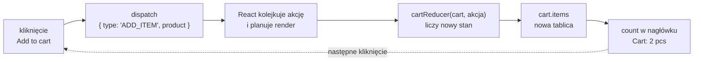

# `useReducer`: strona wysyła akcje, reducer liczy stan

## Reducer sam niczego nie zmienia na ekranie

Funkcja `cartReducer` z pliku `app/lib/cartReducer.js` liczy poprawny koszyk, ale wywołana ręcznie zwraca tylko nowy obiekt. Nikt go nie zapamięta, a ekran nie dowie się o zmianie. Żeby kliknięcie dało nowy nagłówek, ktoś musi trzymać stan między renderami, zaplanować kolejny render po każdej akcji i dać przyciskom drogę do reducera. Robi to hook `useReducer`, a komponent zostaje przy opisywaniu kliknięć.

## Hook, który podłącza reducer

Dokumentacja definiuje hook jednym zdaniem.

> **„`useReducer` to hook Reacta, który pozwala dodać do komponentu reducer.”**
>
> *„useReducer is a React Hook that lets you add a reducer to your component.”*
>
> — dokumentacja React, *useReducer*

Hook przyjmuje reducer i stan początkowy, a zwraca parę: bieżący stan i funkcję `dispatch`. Najmniejszy przykład spoza projektu to licznik:

```jsx
import { useReducer } from 'react';

function counter(state, action) {
  switch (action.type) {
    case 'inc': return state + 1;
    default: throw new Error('Unknown action');
  }
}

function Counter() {
  const [n, dispatch] = useReducer(counter, 0);   // [stan, funkcja wysyłająca akcje]
  return <button onClick={() => dispatch({ type: 'inc' })}>n={n}</button>;
}
```

Dwa kliknięcia dają napis „n=2”. Komponent nie liczy nowej wartości. Wysyła tylko akcję, a wynik oblicza reducer.

Pełna sygnatura to `useReducer(reducer, initialArg, init?)`, gdzie trzeci argument jest opcjonalny. Schwarzmüller w *React Key Concepts* podkreśla, że hook zwraca tablicę z dokładnie dwoma elementami. Drugi to funkcja `dispatch`, której jedynym argumentem jest akcja trafiająca do reducera. Obie nazwy wybiera programista, ale `dispatch` jest nazwą przyjętą powszechnie. Dokumentacja dodaje, że `dispatch` nie zwraca żadnej wartości.

Alex Banks i Eve Porcello w *Learning React* wskazują, kiedy ten hook się przydaje.

> **„Ten wzorzec jest użyteczny, gdy stan ma wiele wartości podrzędnych albo gdy następny stan zależy od poprzedniego.”**
>
> *„This pattern is useful when state has multiple subvalues or when the next state depends on a previous state.”*
>
> — Alex Banks, Eve Porcello, *Learning React*

Koszyk spełnia oba warunki. Ma tablicę pozycji z osobnymi ilościami, a wynik dodania produktu zależy od tego, czy produkt już w koszyku jest.

## Strona sklepu z koszykiem

Strona główna sklepu staje się właścicielem koszyka. Hooki stanu wymagają komponentu klienckiego, dlatego pierwsza linia `app/page.jsx` to `'use client'`. Plik zaczyna się od importów i wywołania hooka:

```jsx
'use client';

import { useReducer } from 'react';
import { products } from './data/products';
import { cartReducer, initialCartState } from './lib/cartReducer';

export default function HomePage() {
  // Reducer i pusty koszyk; hook oddaje stan i funkcję wysyłającą akcje.
  const [cart, dispatch] = useReducer(cartReducer, initialCartState);
  const count = cart.items.reduce((sum, i) => sum + i.qty, 0);
```

Zmienna `count` jest liczbą sztuk w koszyku. Metoda `reduce` zaczyna od zera i dodaje ilość każdej pozycji. Dwie kawy i herbata dają 3 sztuki przy dwóch pozycjach, a pusty koszyk daje 0:

```js
[{ qty: 2 }, { qty: 1 }].reduce((sum, i) => sum + i.qty, 0);   // → 3
[].reduce((sum, i) => sum + i.qty, 0);                         // → 0: wynik startowy
```

Zwrócony JSX ma nagłówek z liczbą sztuk i listę produktów. Każdy produkt dostaje przycisk, który wysyła akcję `ADD_ITEM` z całym obiektem produktu. Pod listą stoi przycisk czyszczący koszyk:

```jsx
  return (
    <main>
      <h1>Coffee shop</h1>
      <h2>Cart: {count} pcs</h2>
      <ul>
        {products.map(product => (
          <li key={product.id}>
            {product.name} — {product.price.toFixed(2)} PLN{' '}
            {/* Przycisk tylko opisuje zdarzenie; regułę zna reducer. */}
            <button onClick={() => dispatch({ type: 'ADD_ITEM', product })}>Add to cart</button>
          </li>
        ))}
      </ul>
      <button onClick={() => dispatch({ type: 'CLEAR_CART' })}>Clear cart</button>
    </main>
  );
}
```

Zapis `{ type: 'ADD_ITEM', product }` to skrócony zapis obiektu. Gdy nazwa pola jest taka sama jak nazwa zmiennej, wystarczy napisać ją raz:

```js
const product = { id: 1 };
const action = { type: 'ADD_ITEM', product }; // to samo co { type: 'ADD_ITEM', product: product }
console.log(JSON.stringify(action));          // → {"type":"ADD_ITEM","product":{"id":1}}
```

Strona nie ma ani jednej linii, która sama zmienia tablicę pozycji. Komponent tylko opisuje kliknięcia, a reguły koszyka zostają w reducerze. Dwa kliknięcia „Add to cart” przy kawie dają nagłówek „Cart: 2 pcs”, a w stanie jedną pozycję z `qty: 2`. Kliknięcie przy herbacie podnosi nagłówek do „Cart: 3 pcs”.

## Droga jednego kliknięcia

Kliknięcie „Add to cart” przy kawie wywołuje `dispatch({ type: 'ADD_ITEM', product })`. Funkcja `dispatch` nie zmienia stanu od razu. **Kolejkuje akcję** i prosi Reacta o nowy render. Dopiero w tym renderze React wywołuje `cartReducer` z bieżącym stanem i akcją, a wynik staje się nową wartością `cart`.

W tej samej procedurze obsługi zmienna stanu ma więc nadal wartość sprzed kliknięcia, tak samo jak przy setterze z `useState`. Pokazuje to licznik, który po wysłaniu akcji zapisuje bieżącą wartość:

```jsx
function Counter() {
  const [n, dispatch] = useReducer(counter, 0);
  function handleClick() {
    dispatch({ type: 'inc' });
    console.log(n);   // → 0 przy pierwszym kliknięciu, 1 przy drugim: migawka z tego renderu
  }
  return <button onClick={handleClick}>n={n}</button>;
}
```

Kolejka ma drugą, mniej oczywistą konsekwencję. Dwie akcje wysłane w jednej procedurze obsługi nie widzą tej samej migawki. React stosuje je po kolei i każdej podaje wynik poprzedniej, a cały ekran renderuje się raz. Setter z `useState` wywołany dwa razy z wartością z migawki zachowuje się inaczej:

```jsx
import { useReducer, useState } from 'react';
// counter jak wyżej

function Both() {
  const [n, dispatch] = useReducer(counter, 0);
  const [m, setM] = useState(0);
  function handleClick() {
    dispatch({ type: 'inc' });   // reducer dostaje 0, zwraca 1
    dispatch({ type: 'inc' });   // reducer dostaje 1, zwraca 2
    setM(m + 1);                 // m + 1 liczone z migawki: 1
    setM(m + 1);                 // znowu 1, bo m w tym renderze to nadal 0
  }
  return <button onClick={handleClick}>n={n} m={m}</button>;
}
// → n=2 m=1 po jednym kliknięciu: jeden render.
```

Reducer działa więc jak aktualizator przekazany do settera, czyli funkcja w rodzaju `(m) => m + 1`. Różnica polega na tym, że aktualizator pisze się przy każdym wywołaniu od nowa, a reducer raz, w jednym miejscu. Ta sama seria akcji zawsze daje ten sam koszyk, bo każda gałąź liczy wynik wyłącznie z poprzedniego stanu i akcji.

Gdy procedura potrzebuje następnego stanu od razu, dokumentacja podsuwa proste wyjście.

> **„Jeśli trzeba przewidzieć następną wartość stanu, można ją obliczyć ręcznie, wywołując reducer samodzielnie.”**
>
> *„If you need to guess the next state value, you can calculate it manually by calling the reducer yourself”*
>
> — dokumentacja React, *useReducer*

W koszyku wyglądałoby to tak: `const next = cartReducer(cart, action)`, a potem `dispatch(action)`. Wywołanie jest bezpieczne tylko dlatego, że reducer jest czysty. Policzenie wyniku na boku nie zmienia koszyka ani niczego poza nim.

Każdy przycisk dostaje w `onClick` funkcję strzałkową, więc `dispatch` wykona się dopiero po kliknięciu. Zapis `onClick={dispatch({ type: 'CLEAR_CART' })}` wywołałby `dispatch` już w trakcie renderu. Każdy render wysyłałby wtedy akcję, która żąda kolejnego renderu. React przerywa tę pętlę wyjątkiem „Too many re-renders. React limits the number of renders to prevent an infinite loop.”

## Rysunek 4.2 — droga kliknięcia od przycisku do nagłówka



Na Rysunku 4.2 komponent występuje dwa razy: na początku, gdy przycisk wysyła akcję, i na końcu, gdy nagłówek pokazuje wynik. Pośrodku komponent nie robi nic. Kolejkę prowadzi React, a nową tablicę pozycji liczy reducer. Strzałka kropkowana zamyka obieg: następne kliknięcie startuje z koszykiem, który został w stanie.

## Liczba sztuk jako wartość pochodna

Zmienna `count` nie ma własnego stanu. Jest **wartością pochodną**: liczy się przy każdym renderze z tablicy pozycji, więc zawsze zgadza się z koszykiem. Osobny stan z licznikiem sztuk wymagałby aktualizacji w każdej gałęzi reducera i mógłby się rozjechać z listą. Gdy koszyk się zmienia, React renderuje komponent od nowa, a `reduce` liczy sumę ze świeżej tablicy.

## Co robi zmiana w miejscu

Gdyby gałąź `ADD_ITEM` zrobiła `existing.qty += 1; return state;`, oddałaby Reactowi ten sam obiekt. React porównuje stary i nowy stan przez `Object.is`, które dla obiektów sprawdza tylko, czy to ten sam obiekt w pamięci. Ten sam obiekt oznacza pominięty render, więc ekran by się nie zmienił.

W trybie deweloperskim dochodzi drugi skutek. Tryb ścisły wywołuje reducer dwa razy na każdą akcję, więc mutacja wykonuje się dwukrotnie. Pierwsze dodanie kawy daje `qty: 1`, każde następne podnosi ilość o 2: do 3, potem do 5. Nagłówek pokazuje cały czas „Cart: 1 pcs”, bo ten sam obiekt nie wywołuje renderu. Wartość `qty: 5` odsłania dopiero render z innego powodu, na przykład dodanie herbaty: nagłówek skacze wtedy od razu na „Cart: 6 pcs”.

Gałąź z kopią `{ ...i, qty: i.qty + 1 }` przy dwóch wywołaniach dostaje dwa razy ten sam stan i dwa razy zwraca ten sam wynik. Podwójne wywołanie jest więc nieszkodliwe dla czystego reducera i widoczne dla każdego, który zmienia argument. Z tego powodu tryb ścisły pomaga znaleźć mutację, zanim trafi do wersji produkcyjnej, w której reducer wykonuje się raz.

> 💡 **Zapamiętaj:** `dispatch` tylko zgłasza akcję. Nowy stan liczy reducer w następnym renderze i obowiązują w nim wyłącznie reguły zapisane w reducerze.


Materiał rozszerzony do tego slajdu: [`rozszerzenia/r02_usereducer.md`](rozszerzenia/r02_usereducer.md)
