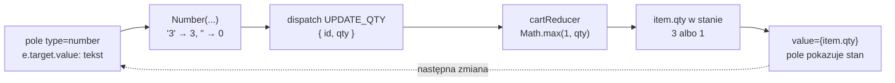

# `useReducer`: strona wysyła akcje, reducer liczy stan

## Hook, który podłącza reducer

Reducer z pliku `app/lib/cartReducer.js` sam niczego nie wyświetla. Podłącza go do komponentu hook `useReducer`. Dokumentacja definiuje go jednym zdaniem.

> **„`useReducer` to hook Reacta, który pozwala dodać do komponentu reducer.”**
>
> *„useReducer is a React Hook that lets you add a reducer to your component.”*
>
> — dokumentacja React, *useReducer*

Hook przyjmuje reducer i stan początkowy, a zwraca parę: bieżący stan i funkcję `dispatch`. Najmniejszy przykład spoza projektu to licznik:

```jsx
import { useReducer } from 'react';

function counter(state, action) {
  switch (action.type) {
    case 'inc': return state + 1;
    default: throw new Error('Unknown action');
  }
}

function Counter() {
  const [n, dispatch] = useReducer(counter, 0);   // [stan, funkcja wysyłająca akcje]
  return <button onClick={() => dispatch({ type: 'inc' })}>n={n}</button>;
}
```

Dwa kliknięcia dają napis „n=2”. Komponent nie liczy nowej wartości. Wysyła tylko akcję, a wynik oblicza reducer.

Pełna sygnatura to `useReducer(reducer, initialArg, init?)`, gdzie trzeci argument jest opcjonalny. Schwarzmüller w *React Key Concepts* podkreśla, że hook zwraca tablicę z dokładnie dwoma elementami. Drugi to funkcja `dispatch`, której jedynym argumentem jest akcja trafiająca do reducera. Obie nazwy wybiera programista, ale `dispatch` jest nazwą przyjętą powszechnie. Dokumentacja dodaje, że `dispatch` nie zwraca żadnej wartości.

Alex Banks i Eve Porcello w *Learning React* wskazują, kiedy ten hook się przydaje.

> **„Ten wzorzec jest użyteczny, gdy stan ma wiele wartości podrzędnych albo gdy następny stan zależy od poprzedniego.”**
>
> *„This pattern is useful when state has multiple subvalues or when the next state depends on a previous state.”*
>
> — Alex Banks, Eve Porcello, *Learning React*

Koszyk spełnia oba warunki. Ma tablicę pozycji z osobnymi ilościami, a wynik dodania produktu zależy od tego, czy produkt już w koszyku jest.

## Strona sklepu z koszykiem

Strona główna sklepu staje się właścicielem koszyka. Hooki stanu wymagają komponentu klienckiego, dlatego pierwsza linia `app/page.jsx` to `'use client'`. Nowe są początek pliku i sekcja koszyka:

```jsx
'use client';

import { useReducer } from 'react';
import { products } from './data/products';
import { cartReducer, initialCartState } from './lib/cartReducer';

export default function HomePage() {
  // Reducer i pusty koszyk; hook oddaje stan i funkcję wysyłającą akcje.
  const [cart, dispatch] = useReducer(cartReducer, initialCartState);
```

```jsx
      <section>
        <h2>Koszyk ({cart.items.length} pozycji)</h2>
        <ul>
          {cart.items.map(item => (
            <li key={item.id}>
              {item.name} × {item.qty} = {(item.price * item.qty).toFixed(2)} zł
              {/* Przycisk tylko opisuje zdarzenie; regułę zna reducer. */}
              <button onClick={() => dispatch({ type: 'REMOVE_ITEM', id: item.id })}>
                Usuń
              </button>
            </li>
          ))}
        </ul>
        <button onClick={() => dispatch({ type: 'CLEAR_CART' })}>Wyczyść koszyk</button>
      </section>
```

Lista produktów dostaje przycisk, który wysyła `ADD_ITEM` z całym obiektem produktu:

```jsx
          {products.map(p => (
            <li key={p.id}>
              {p.name} — {p.price.toFixed(2)} zł
              <button onClick={() => dispatch({ type: 'ADD_ITEM', product: p })}>
                Dodaj do koszyka
              </button>
            </li>
          ))}
```

Sekcja koszyka czyta `cart.items`, liczy pozycje przez `length`, a wartość każdej jako `item.price * item.qty`. Żaden fragment strony nie zmienia tablicy pozycji: komponent tylko opisuje kliknięcia, a reguły koszyka zostają w reducerze.

## Droga jednego kliknięcia

Kliknięcie „Dodaj do koszyka” przy kawie wywołuje `dispatch({ type: 'ADD_ITEM', product: p })`. Funkcja `dispatch` nie zmienia stanu od razu. **Kolejkuje akcję** i prosi Reacta o nowy render. Dopiero w tym renderze React wywołuje `cartReducer` z bieżącym stanem i akcją, a wynik staje się nową wartością `cart`.

W tej samej procedurze obsługi zmienna stanu ma więc nadal wartość sprzed kliknięcia, tak samo jak przy setterze z `useState`. Pokazuje to licznik, który po wysłaniu akcji zapisuje bieżącą wartość:

```jsx
function Counter() {
  const [n, dispatch] = useReducer(counter, 0);
  function handleClick() {
    dispatch({ type: 'inc' });
    console.log(n);   // 0 przy pierwszym kliknięciu, 1 przy drugim: migawka z tego renderu
  }
  return <button onClick={handleClick}>n={n}</button>;
}
```

Kolejka ma drugą, mniej oczywistą konsekwencję. Dwie akcje wysłane w jednej procedurze obsługi nie widzą tej samej migawki. React stosuje je po kolei i każdej podaje wynik poprzedniej, a cały ekran renderuje się raz. Setter z `useState` wywołany dwa razy z wartością z migawki zachowuje się inaczej:

```jsx
function Both() {
  const [n, dispatch] = useReducer(counter, 0);
  const [m, setM] = useState(0);
  function handleClick() {
    dispatch({ type: 'inc' });   // reducer dostaje 0, zwraca 1
    dispatch({ type: 'inc' });   // reducer dostaje 1, zwraca 2
    setM(m + 1);                 // m + 1 liczone z migawki: 1
    setM(m + 1);                 // znowu 1, bo m w tym renderze to nadal 0
  }
  return <button onClick={handleClick}>n={n} m={m}</button>;
}
// Po jednym kliknięciu: n=2, m=1, jeden render.
```

Reducer działa więc jak aktualizator przekazany do settera, czyli funkcja w rodzaju `(m) => m + 1`. Różnica polega na tym, że aktualizator pisze się przy każdym wywołaniu od nowa, a reducer raz, w jednym miejscu. Ta sama seria akcji zawsze daje ten sam koszyk, bo każda gałąź liczy wynik wyłącznie z poprzedniego stanu i akcji.

Gdy procedura potrzebuje następnego stanu od razu, dokumentacja podsuwa proste wyjście.

> **„Jeśli trzeba przewidzieć następną wartość stanu, można ją obliczyć ręcznie, wywołując reducer samodzielnie.”**
>
> *„If you need to guess the next state value, you can calculate it manually by calling the reducer yourself”*
>
> — dokumentacja React, *useReducer*

W koszyku wyglądałoby to tak: `const next = cartReducer(cart, action)`, a potem `dispatch(action)`. Wywołanie jest bezpieczne tylko dlatego, że reducer jest czysty. Policzenie wyniku na boku nie zmienia koszyka ani niczego poza nim.

Każdy przycisk dostaje w `onClick` funkcję strzałkową, więc `dispatch` wykona się dopiero po kliknięciu. Zapis `onClick={dispatch({ type: 'CLEAR_CART' })}` wywołałby `dispatch` już w trakcie renderu. Każdy render wysyłałby wtedy akcję, która żąda kolejnego renderu. React przerywa tę pętlę wyjątkiem „Too many re-renders. React limits the number of renders to prevent an infinite loop.”

## Rysunek 4.2 — tekst z pola ilości w drodze do stanu



Na Rysunku 4.2 wartość z pola przechodzi przez trzy miejsca, z których każde coś zmienia. Przeglądarka oddaje tekst, `Number` zamienia go na liczbę, a reducer pilnuje dolnej granicy. Strzałka kropkowana zamyka obieg: pole pokazuje to, co zostało w stanie, a nie to, co wpisano. Dlatego jedyną regułą, która obowiązuje, jest reguła w reducerze.

## Zmiana ilości wpisana w pole

Przeglądarka oddaje zawartość pola zawsze jako tekst. Funkcja `Number` zamienia tekst na liczbę, a pusty tekst zamienia na zero:

```js
Number('3');     // 3
Number('');      // 0: pusty tekst to zero
Number('1.5');   // 1.5: ułamek przechodzi
```

Wiersz koszyka dostaje pole liczbowe. Wyrażenie `{cart.items.map(…)}` wewnątrz `<ul>` dostaje rozbudowany element `<li>`:

```jsx
{cart.items.map(item => (
  <li key={item.id}>
    {item.name}
    {' — '}
    {item.price.toFixed(2)} zł
    {' × '}
    <input
      type="number"
      value={item.qty}
      min="1"
      onChange={e =>
        // Tekst z pola zamieniony na liczbę; granicę 1 pilnuje reducer.
        dispatch({ type: 'UPDATE_QTY', id: item.id, qty: Number(e.target.value) })
      }
    />
    {' = '}
    {(item.price * item.qty).toFixed(2)} zł
    <button onClick={() => dispatch({ type: 'REMOVE_ITEM', id: item.id })}>Usuń</button>
  </li>
))}
```

Pole jest kontrolowane, a każda zmiana wysyła akcję `UPDATE_QTY` zamiast wywołania settera. Ilość 3 przy kawie daje „= 149.97 zł”, a zero reducer zamienia na 1, więc pole znów pokazuje 1. Atrybut `min="1"` blokuje strzałkę w dół na wartości 1, ale nie powstrzyma wpisania zera z klawiatury. <u>Prawdziwą granicę wyznacza `Math.max(1, action.qty)` w reducerze</u>. Wstawki `{' — '}` i `{' × '}` to zwykłe napisy w JSX, które rozdzielają liczby spacjami.

## Suma pod listą

Pod listą, przed przyciskiem „Wyczyść koszyk”, pojawia się suma:

```jsx
{/* Wartość pochodna: liczona przy każdym renderze, bez osobnego stanu. */}
{cart.items.length > 0 && (
  <p>Razem: {cart.items.reduce((s, i) => s + i.price * i.qty, 0).toFixed(2)} zł</p>
)}
```

Suma to wartość pochodna, liczona przy każdym renderze z tablicy pozycji. `reduce` zaczyna od zera i dodaje wartość kolejnych pozycji, więc kawa z herbatą dają „Razem: 68.49 zł”, a zmiana ilości kawy na 3 daje „Razem: 168.47 zł”. Akapit pokazuje się tylko przy niepustym koszyku dzięki operatorowi `&&`.

## Co robi zmiana w miejscu

Gdyby gałąź `ADD_ITEM` zrobiła `existing.qty += 1; return state;`, oddałaby Reactowi ten sam obiekt. React porównuje stary i nowy stan przez `Object.is`, które dla obiektów sprawdza tylko, czy to ten sam obiekt w pamięci. Ten sam obiekt oznacza pominięty render, więc ekran by się nie zmienił.

W trybie deweloperskim dochodzi drugi skutek. Tryb ścisły wywołuje reducer dwa razy na każdą akcję, więc mutacja wykonuje się dwukrotnie. Pierwsze dodanie kawy daje `qty: 1`, każde następne podnosi ilość o 2: do 3, potem do 5. Ekran pokazuje cały czas `× 1`, bo ten sam obiekt nie wywołuje renderu. Wartość `× 5` odsłania dopiero render z innego powodu, na przykład dodanie herbaty.

Gałąź z kopią `{ ...i, qty: i.qty + 1 }` przy dwóch wywołaniach dostaje dwa razy ten sam stan i dwa razy zwraca ten sam wynik. Podwójne wywołanie jest więc nieszkodliwe dla czystego reducera i widoczne dla każdego, który zmienia argument. Z tego powodu tryb ścisły pomaga znaleźć mutację, zanim trafi do wersji produkcyjnej, w której reducer wykonuje się raz.

## Rozszerzenie: trzeci argument `init`

Trzeci, opcjonalny argument `init` wylicza stan początkowy z drugiego argumentu. Dokumentacja opisuje regułę tak: bez `init` stanem początkowym jest `initialArg`, a z nim wynik wywołania `init(initialArg)`. React wywołuje tę funkcję tylko przy pierwszym renderze, a w trybie ścisłym, jak reducer, dwa razy.

Różnica wobec leniwego inicjalizatora `useState` leży w argumencie. Funkcja przekazana do `useState` nie dostaje niczego, a `init` dostaje `initialArg`. Można więc przekazać osobno funkcję i dane, z których ma policzyć stan, bez opakowywania jej w funkcję strzałkową. Poniższy kod nie należy do projektu. Pokazuje koszyk, który startuje z listy produktów przekazanej w propsie:

```jsx
// Spoza demo: koszyk startowy buduje sam reducer, raz, przy pierwszym renderze.
function createInitialCart(savedProducts) {
  return savedProducts.reduce(
    (state, product) => cartReducer(state, { type: 'ADD_ITEM', product }),
    initialCartState
  );
}

function CartPage({ savedProducts }) {
  // Drugi argument to dane, trzeci to funkcja, która z nich liczy stan.
  const [cart, dispatch] = useReducer(cartReducer, savedProducts, createInitialCart);
  // ...
}
```

Funkcja `createInitialCart` nie zna żadnej reguły koszyka. Przepuszcza zapisane produkty przez `cartReducer`, więc lista `[kawa, herbata, kawa]` daje dwie pozycje, w tym kawę z `qty: 2`. Reguła koszyka obowiązuje więc już przy starcie, a nie dopiero od pierwszego kliknięcia. Gdy funkcja nie potrzebuje danych, dokumentacja pozwala przekazać `null` jako drugi argument. Pusty koszyk sklepu niczego nie wylicza, więc strona przekazuje gotowy obiekt `initialCartState`.

## Rozszerzenie: trzy przypadki, których reguła nie przewidziała

Reguła w reducerze działa przy każdej zmianie, także wtedy, gdy nikt tego nie planował. Pole ilości z konwersją przez `Number` ma trzy zachowania warte znajomości.

- **Pole nie daje się opróżnić.** Backspace na wartości 1 daje pusty tekst, `Number('')` zwraca 0, reducer zamienia je na 1 i pole od razu znów pokazuje 1. Żeby wpisać 3, trzeba zaznaczyć zawartość i wpisać nową liczbę. Dopisanie 5 za cyfrą 3 daje 35.
- **Ułamek przechodzi.** Wpisanie 1.5 zostawia w stanie `qty: 1.5`, a wiersz pokazuje „= 74.98 zł”. `Math.max(1, 1.5)` pilnuje tylko dolnej granicy. Reguły „ilość jest liczbą całkowitą” w reducerze nie ma, więc nie działa.
- **Liczba ujemna znika.** Wklejenie −2 daje w polu 1, tak samo jak zero. Przy pisaniu znak po znaku sam minus daje pusty tekst, więc pole wraca do 1, a następna cyfra dopisuje się do niego i wychodzi 12.

Pierwszy przypadek zależy od wyboru `Number`. Pole liczbowe ma też właściwość `valueAsNumber`, która od razu daje liczbę. MDN opisuje jednak jej zachowanie przy pustym polu inaczej.

> **„Jeśli usunie się liczbę z kontrolki, wynikiem jest NaN.”**
>
> *„If you delete the number in the widget, the result is NaN.”*
>
> — MDN, *HTMLInputElement: valueAsNumber property*

`Math.max` zwraca `NaN`, gdy którykolwiek argument jest `NaN`, więc reguła minimum przestaje działać:

```js
Math.max(1, NaN);   // NaN: dolna granica nie pomaga
cartReducer(s, { type: 'UPDATE_QTY', id: 1, qty: NaN }).items;
// [{ id: 1, name: 'Kawa', price: 49.99, qty: NaN }]
```

Wersja z `valueAsNumber` zapisałaby więc w stanie `qty: NaN`, a wiersz pokazałby „= NaN zł”. Natomiast `Number('')` daje 0, które reguła minimum zamienia na 1. Konwersja w komponencie i reguła w reducerze działają razem i każda z nich zmienia wynik. Uzupełnienie reguły o liczby całkowite wymagałoby zmiany jednej gałęzi `UPDATE_QTY`, bez dotykania komponentu.

> 💡 **Zapamiętaj:** `dispatch` tylko zgłasza akcję. Nowy stan liczy reducer w następnym renderze i obowiązują w nim wyłącznie reguły zapisane w reducerze.

