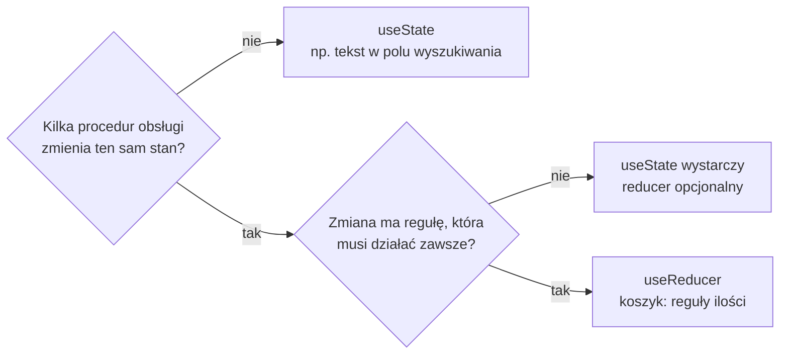

# `useReducer` czy `useState`: jeden mechanizm, dwa zapisy

## Ten sam stan, inne miejsce dla logiki

Oba hooki przechowują stan tak samo: React trzyma wartość przy komponencie i renderuje go po zmianie. Różni się tylko miejsce kodu, który oblicza nową wartość. Przy `useState` leży on w procedurach obsługi zdarzeń, a przy `useReducer` w osobnej funkcji, która dostaje akcję.

> **„Zawsze można przejść z `useState` na `useReducer` i z powrotem: są równoważne!”**
>
> *„You can always convert between useState and useReducer back and forth: they are equivalent!”*
>
> — dokumentacja React, *Extracting State Logic into a Reducer*

Równoważność oznacza, że wybór nie zmienia tego, co użytkownik widzi na ekranie. Zmienia to, gdzie programista szuka reguły, gdy coś działa źle, i ile miejsc musi poprawić przy nowej funkcji.

## Pięć kryteriów z dokumentacji

Dokumentacja porównuje oba hooki w pięciu punktach. Każdy da się sprawdzić na koszyku sklepu kawowego.

**Rozmiar kodu.** Na starcie `useState` wymaga mniej pisania. Reducer potrzebuje osobnej funkcji, instrukcji `switch` i obiektów akcji. Bez komentarzy i pustych linii `cartReducer.js` ma 40 linii, a cztery procedury obsługi z wersji na `useState` mają ich 17. Dokumentacja dodaje zastrzeżenie: reducer zmniejsza ilość kodu, gdy wiele procedur zmienia stan w podobny sposób. W koszyku pole ilości i przycisk „Remove” wysyłają po jednej linii `dispatch`, więc każdy kolejny komponent z koszykiem dokłada jedną linię, a nie kopię reguły.

**Czytelność.** Przy prostych zmianach `useState` czyta się łatwo. Gdy zmiany się komplikują, reducer według dokumentacji pozwala oddzielić to, *jak* zmienia się stan, od tego, *co się stało* w procedurze obsługi. W JSX strony procedury obsługi tylko wysyłają akcje.

**Debugowanie.** Jedno `console.log(action)` na początku reducera pokazuje każdą zmianę koszyka razem z jej przyczyną. Przy `useState` taki log trzeba wstawić do każdej procedury obsługi osobno. W trybie ścisłym każdy wpis pojawia się dwa razy, bo reducer wykonuje się tam dwukrotnie dla każdej akcji. Wpis do konsoli jest efektem ubocznym, ale nieszkodliwym: nie zmienia stanu ani wyniku reducera, a po znalezieniu błędu znika z kodu. Dokumentacja dodaje też zastrzeżenie.

> **„Jeśli każda akcja jest poprawna, wiadomo, że błąd tkwi w samej logice reducera. Trzeba jednak przejść przez więcej kodu niż przy `useState`.”**
>
> *„If each action is correct, you’ll know that the mistake is in the reducer logic itself. However, you have to step through more code than with useState.”*
>
> — dokumentacja React, *Extracting State Logic into a Reducer*

**Testowanie.** Reducer nie zależy od komponentu, więc sprawdza się go bez renderowania czegokolwiek. Wystarczy wywołać go ze stanem i akcją jako argumentami i porównać wynik z oczekiwanym stanem. Moduł `node:assert` z biblioteki standardowej Node.js wystarcza, żeby zapisać trzy reguły koszyka jako sprawdzenia:

```js
import assert from 'node:assert';
import { cartReducer, initialCartState } from './app/lib/cartReducer.js';

const coffee = { id: 1, name: 'Coffee', price: 49.99 };
const s1 = cartReducer(initialCartState, { type: 'ADD_ITEM', product: coffee });
const s2 = cartReducer(s1, { type: 'ADD_ITEM', product: coffee });
assert.equal(s2.items[0].qty, 2);   // ten sam produkt zwiększa ilość
assert.equal(s1.items[0].qty, 1);   // poprzedni stan został nietknięty
assert.equal(cartReducer(s2, { type: 'UPDATE_QTY', id: 1, qty: 0 }).items[0].qty, 1);   // minimum 1
```

Plik zapisany w katalogu projektu jako `cart.test.mjs` uruchamia polecenie `node cart.test.mjs`. Rozszerzenie `.mjs` mówi Node.js, że plik używa `import`. Node 24 doczyta też `cartReducer.js` jako moduł, choć wypisze ostrzeżenie o brakującym polu `"type": "module"` w `package.json`. `assert.equal` rzuca wyjątek, gdy wartości się różnią, więc zakończenie bez błędu oznacza, że wszystkie trzy reguły działają. Druga linia sprawdza coś, czego ekran nie pokaże: reducer nie zmienił stanu, który dostał.

**Preferencje.** Dokumentacja przyznaje, że jedni programiści lubią reducery, a inni nie, i nazywa to kwestią gustu.

## Co dokładają autorzy książek

Daniel Bugl w *Learn React Hooks* podaje dwa sygnały do zmiany. Pierwszy sygnał dotyczy kodu: kilka funkcji `setState` wywoływanych zawsze razem to dobra wskazówka, żeby połączyć je w jeden hook reducera. Drugi sygnał dotyczy zasięgu stanu.

> **„Stan globalny jest zwykle dobrym kandydatem do użycia hooka reducera zamiast hooka stanu, bo zmiany stanu globalnego mogą zachodzić w dowolnym miejscu aplikacji.”**
>
> *„Global state is usually a good candidate for using a Reducer Hook, rather than a State Hook, because global-state changes can happen anywhere in the app.”*
>
> — Daniel Bugl, *Learn React Hooks*

Stan globalny to stan, który czyta i zmienia wiele odległych komponentów. Koszyk sklepu jest właśnie takim stanem, więc spełnia drugi sygnał niezależnie od pierwszego.

Maximilian Schwarzmüller w *React Key Concepts* pokazuje granicę `useState` na stanach, które zależą od siebie. Komponent pobierający wpisy bloga trzyma dane, flagę ładowania i komunikat błędu, a ustawienie jednej wartości wymaga odczytu drugiej. Aktualizator, czyli funkcja przekazana do settera, daje dostęp tylko do poprzedniej wartości tego samego stanu. Reducer dostaje cały obiekt naraz, więc gałąź akcji może przeczytać dowolne pole i ustawić kilka pól w jednym kroku. Dopowiada też, do czego hook nie służy. Według niego „rzadko (zapewne nigdy) używa się go do zarządzania prostą wartością tekstową albo liczbową” (*„You will rarely (probably never) use it to manage simple string or number values”*).

## Rysunek 4.3 — decyzja dla jednego kawałka stanu



Na Rysunku 4.3 pytania czyta się od lewej strony dla każdego kawałka stanu osobno. Pierwsze pytanie odsiewa stan zmieniany w jednym miejscu. Drugie jest właściwym kryterium. Koszyk trafia do reducera dlatego, że jego reguły ilości muszą obowiązywać przy każdej zmianie, a rozmiar koszyka nie ma tu znaczenia. Drugie pytanie obejmuje też zmianę, która raz robi jedno, a raz drugie, jak `ADD_ITEM` dopisujące wiersz albo zwiększające ilość.

> **„Zalecamy reducer, jeśli w jakimś komponencie często pojawiają się błędy wynikające z niepoprawnych aktualizacji stanu i chce się nadać jego kodowi więcej struktury. Nie trzeba używać reducerów wszędzie: można je swobodnie mieszać!”**
>
> *„We recommend using a reducer if you often encounter bugs due to incorrect state updates in some component, and want to introduce more structure to its code. You don’t have to use reducers for everything: feel free to mix and match!”*
>
> — dokumentacja React, *Extracting State Logic into a Reducer*

## Oba hooki w jednym komponencie

Koszyk może siedzieć w reducerze, a flaga „panel koszyka otwarty” w `useState` obok niego, w tym samym komponencie. <u>Każdy kawałek stanu dostaje narzędzie dopasowane do własnych reguł</u>. Pole wyszukiwania w reducerze wymagałoby akcji `SET_QUERY` i gałęzi, która tylko przepisuje wartość. Zysku brak, bo nie ma czego scentralizować.

> 💡 **Zapamiętaj:** reducer wybiera się wtedy, gdy reguła zmiany stanu musi działać przy każdej zmianie. Wtedy reguły mieszkają w jednej funkcji, którą da się sprawdzić bez renderowania.


Materiał rozszerzony do tego slajdu: [`rozszerzenia/r03_usereducer-czy-usestate.md`](rozszerzenia/r03_usereducer-czy-usestate.md)
