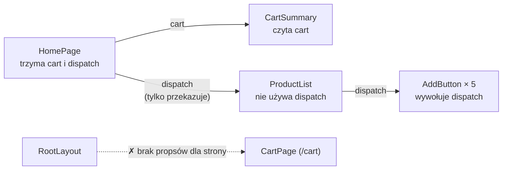

# Koszyk potrzebny w wielu miejscach naraz

## Jeden komponent przestaje wystarczać

Strona sklepu z reducerem działa, ale cały interfejs siedzi w jednym pliku `app/page.jsx`. Lista produktów, pozycje koszyka, pole ilości i suma mieszczą się w jednej funkcji `HomePage`. Taki komponent trudno czytać i nie da się go użyć w innym miejscu.

Naturalny krok to podział na mniejsze części: listę produktów z przyciskami „Dodaj do koszyka”, nagłówek z liczbą sztuk, sumą i przyciskiem czyszczenia oraz wiersz koszyka z polem ilości i przyciskiem „Usuń”. Sklep ma też mieć osobną stronę `/cart` z pełną listą pozycji. Przykłady poniżej nazywają trzy pierwsze części `ProductList`, `CartSummary` i `CartItem`.

Każda z tych części potrzebuje czegoś z koszyka. Nagłówek czyta pozycje, żeby policzyć sumę. Lista produktów potrzebuje funkcji `dispatch`, żeby wysłać `ADD_ITEM`. Wiersz potrzebuje `dispatch` do zmiany ilości i usunięcia. Strona `/cart` potrzebuje i pozycji, i `dispatch`. Stan musi więc mieszkać w komponencie, który jest przodkiem ich wszystkich.

## Dwa komponenty, dwa osobne stany

Każde wywołanie hooka stanu tworzy osobny stan, przypisany do miejsca komponentu w drzewie. Dwa komponenty z własnym `useState` albo `useReducer` niczego więc nie dzielą, nawet gdy pokazują to samo. Najmniejszy przykład spoza projektu:

```jsx
// Przycisk zmienia stan HomePage, a OwnBadge ma własny, osobny stan.
function OwnBadge() {
  const [n] = useState(0);   // bez settera: nikt poza OwnBadge nie może zmienić n
  return <span>koszyk: {n}</span>;
}
function HomePage() {
  const [a, setA] = useState(0);
  return <div><button onClick={() => setA(a + 1)}>+</button><OwnBadge /></div>;
}
// Po kliknięciu „+”: nadal „koszyk: 0”.
```

Kliknięcie zmienia `a`, ale napis pokazuje `n` z innego komponentu, więc zostaje „koszyk: 0”. Sklep, w którym `ProductList` i `CartSummary` trzymałyby każdy własny `useReducer`, miałby dokładnie ten problem: dwa niezależne koszyki. Kliknięcie „Dodaj” zmieniłoby koszyk listy, a nagłówek dalej pokazywałby zero.

## Podnoszenie stanu w trzech krokach

Przeniesienie stanu do wspólnego przodka ma nazwę: **podnoszenie stanu** (*lifting state up*). Dokumentacja Reacta definiuje je jako usunięcie stanu z dwóch komponentów, przeniesienie go do najbliższego wspólnego rodzica i przekazanie w dół przez propsy. Schwarzmüller w *React Key Concepts* doprecyzowuje miejsce docelowe.

> **„Ściślej mówiąc, stanem zarządza najbliższy wspólny przodek.”**
>
> *„To be precise, it is managed in the closest shared ancestor component.”*
>
> — Maximilian Schwarzmüller, *React Key Concepts*

Dokumentacja (*Sharing State Between Components*) rozpisuje tę zmianę na trzy kroki.

1. **Usunąć stan z dzieci.** Z `ProductList` i `CartSummary` znika wywołanie `useReducer`. W jego miejsce `CartSummary` dostaje propsy `cart` i `dispatch`, a `ProductList` tylko `dispatch`, bo sama nie czyta pozycji.
2. **Przekazać dane wpisane na sztywno.** `HomePage` podaje `CartSummary` gotowy obiekt, na przykład `cart={{ items: [] }}`. Ten krok sprawdza, czy dziecko poprawnie wyświetla to, co dostaje, zanim w grze pojawi się zmiana.
3. **Dodać stan we wspólnym rodzicu.** `HomePage` wywołuje `useReducer` i przekazuje w dół zarówno `cart`, jak i `dispatch`.

Ten sam licznik po podniesieniu stanu działa poprawnie, bo napis i przycisk czytają jedną wartość z rodzica:

```jsx
function Badge({ n }) { return <span>koszyk: {n}</span>; }
function AddBtn({ onAdd }) { return <button onClick={onAdd}>+</button>; }
function HomePage() {
  const [n, setN] = useState(0);   // jeden stan u wspólnego przodka
  return <div><AddBtn onAdd={() => setN(n + 1)} /><Badge n={n} /></div>;
}
// Po kliknięciu „+”: „koszyk: 1”.
```

Po trzecim kroku oba dzieci są **kontrolowane** przez rodzica. Dokumentacja nazywa tak komponent, w którym ważne informacje pochodzą z propsów, a nie z jego własnego stanu. Rodzic w pełni określa wtedy zachowanie dziecka. `Badge` nie decyduje już, co pokazuje. Wyświetla liczbę, którą dostał. To inne znaczenie niż w polu kontrolowanym z formularza: tam stan trzyma wartość pola, a tu rodzic trzyma dane całego komponentu.

Ta sama strona dokumentacji zauważa, że „podniesienie stanu często zmienia charakter tego, co się przechowuje” (*„Lifting state up often changes the nature of what you're storing as state”*). W sklepie dwa osobne koszyki zamieniają się w jeden, a sprzeczny stan, w którym lista i nagłówek pokazują różne liczby, przestaje być możliwy.

## Przekazywanie przez propsy warstwa po warstwie

Poniższy kod nie należy do projektu demo. Pokazuje stronę główną po podniesieniu stanu. Przycisk „Dodaj do koszyka” wydziela się w nim do hipotetycznego komponentu `AddButton`. Dostaje on produkt i `dispatch`, a po kliknięciu wysyła `ADD_ITEM`:

```jsx
// Spoza demo: HomePage trzyma reducer i podaje go w dół przez propsy.
export default function HomePage() {
  const [cart, dispatch] = useReducer(cartReducer, initialCartState);
  return (
    <main>
      <CartSummary cart={cart} dispatch={dispatch} />
      <ProductList dispatch={dispatch} />
    </main>
  );
}

// Hipotetyczny przycisk: jedyny komponent, który naprawdę wywołuje dispatch.
function AddButton({ product, dispatch }) {
  return <button onClick={() => dispatch({ type: 'ADD_ITEM', product })}>Dodaj do koszyka</button>;
}

// ProductList sam nie używa dispatch, tylko oddaje go przyciskom.
function ProductList({ dispatch }) {
  return (
    <ul>
      {products.map(product => (
        <li key={product.id}>
          <AddButton product={product} dispatch={dispatch} />
        </li>
      ))}
    </ul>
  );
}
```

Przekazanie `cart` do `CartSummary` jest w porządku, bo ten komponent naprawdę czyta koszyk. Inaczej jest z `ProductList`, który przyjmuje `dispatch` tylko po to, żeby oddać go przyciskom poziom niżej. To jest *prop drilling*: prop przechodzi przez komponent, który sam go nie używa. Gdyby między listą a przyciskiem stał jeszcze komponent wiersza, on również musiałby przyjąć i przekazać ten sam prop. Kierunek zostaje ten sam: wartość schodzi w dół, a kliknięcie wraca w górę jako wywołanie `dispatch`, które należy do właściciela stanu.

## Trzy koszty przeprowadzania propsów

Maximilian Schwarzmüller w *React Key Concepts* wymienia trzy słabości prop drillingu. Każdą widać na sklepie.

1. **Komponent pośredni traci możliwość ponownego użycia.** `ProductList` da się wstawić w inne miejsce tylko wtedy, gdy ktoś dostarczy mu `dispatch`, choć lista z niego nie korzysta.
2. **Przybywa kodu, który nic nie robi.** Każdy pośrednik ma w sygnaturze prop, który tylko przyjmuje i oddaje.
3. **Zmiany wymagają więcej pracy.** Gdy przycisk zacznie potrzebować informacji, czy produkt już jest w koszyku, nowy prop trzeba dopisać w każdym pośredniku po drodze.

Autor dopuszcza jednak ten wzorzec w jednym przypadku. Przeprowadzanie propsów jest według niego akceptowalne, gdy wszystkie zaangażowane komponenty służą tylko w tej jednej części aplikacji, a prawdopodobieństwo ich ponownego użycia albo przebudowy jest małe.

Alex Banks i Eve Porcello w *Learning React* zauważają, że przekazywanie stanu w górę i w dół drzewa przez dziesiątki komponentów jest żmudne i podatne na błędy. Drugą drogą jest mechanizm kontekstu, który omija komponenty pośrednie.

## Rysunek 4.4 — `dispatch` w drodze do przycisku



Na Rysunku 4.4 górny rząd to strona główna po podniesieniu stanu. Strzałka do `CartSummary` jest uzasadniona, bo ten komponent czyta koszyk. Strzałka przez `ProductList` to właściwy przykład prop drillingu: pośrednik przyjmuje wartość, której nie używa. Dolna linia przerywana oznacza drogę, której w App Routerze nie ma wcale.

## Layout nie przekaże danych stronie

Koszyk musi być widoczny na dwóch trasach: `/` i `/cart`. Wspólnym przodkiem obu stron jest dopiero layout główny z pliku `app/layout.jsx`. Dokumentacja Next.js opisuje, co layout dostaje: prop `children` wypełniany w trakcie renderu segmentami trasy, które layout obejmuje, czyli głównie stroną albo layoutem niższego poziomu. Layout nie tworzy więc elementu strony i nie ma gdzie dopisać jej propsa. Ta sama strona dokumentacji stawia sprawę wprost.

> **„Layouty nie mogą przekazywać danych swoim `children`.”**
>
> *„Layouts cannot pass data to their `children`.”*
>
> — dokumentacja Next.js, *layout.js*

Podnoszenie stanu zatrzymuje się więc w połowie. Layout oznaczony `'use client'` mógłby wywołać `useReducer`, ale i tak nie miałby jak oddać koszyka stronom, a layout serwerowy nie może trzymać stanu wcale. <u>Gdy wspólnym przodkiem jest layout, stan do stron dociera tylko przez kontekst</u>. Dla danych z serwera dokumentacja proponuje inne wyjście: każda strona pobiera je sama. Koszyk nie jest jednak danymi z serwera, tylko stanem w przeglądarce, który obie strony muszą widzieć w tej samej postaci, więc to wyjście go nie obejmuje.

## Kiedy propsy są właściwym wyborem

Prop drilling nie jest błędem samym w sobie. Dokumentacja Reacta zaczyna listę alternatyw dla kontekstu właśnie od zwykłych propsów.

> **„Może to wyglądać na mozolną pracę, ale bardzo jasno pokazuje, które komponenty używają których danych! Osoba utrzymująca kod będzie zadowolona, że przepływ danych jest jawny dzięki propsom.”**
>
> *„It may feel like a slog, but it makes it very clear which components use which data! The person maintaining your code will be glad you’ve made the data flow explicit with props.”*
>
> — dokumentacja React, *Passing Data Deeply with Context*

Ta sama strona ostrzega przed kontekstem: łatwo go nadużyć, a sama potrzeba przekazania propsów o parę poziomów w dół nie oznacza, że informacja powinna trafić do kontekstu. Schwarzmüller podaje regułę liczbową. Stan podnosi się w górę, gdy trzeba go dzielić przez jeden lub dwa poziomy zagnieżdżenia. Kontekst ma sens przy długich łańcuchach komponentów oraz wtedy, gdy drzewo jest płaskie, ale komponenty mają być używane wielokrotnie bez przekazywania stanu przez propsy.

Daniel Bugl w *Learn React Hooks* zwraca uwagę na koszt drugiej strony. Kontekstu nie należy używać zbyt często, bo utrudnia ponowne użycie komponentów. Komponent czytający kontekst działa tylko pod odpowiednim dostawcą. Wiersz koszyka, który sam sięga po koszyk, działa w innej aplikacji dopiero razem z dostawcą koszyka.

Oba stanowiska da się zestawić na jednym przykładzie. Wersja z propsami pokazuje w sygnaturze każdego komponentu, czego on potrzebuje. Kto otworzy `ProductList({ dispatch })`, od razu wie, że lista zależy od funkcji koszyka. Wersja z kontekstem ukrywa tę zależność w wywołaniu hooka. Sygnatura jest krótsza, ale do zrozumienia komponentu trzeba zajrzeć do jego treści.

## Do czego służy kontekst

Dokumentacja wymienia cztery typowe zastosowania kontekstu. Są to motyw wyglądu, zalogowany użytkownik, bieżąca trasa w bibliotece routingu oraz zarządzanie stanem, który zmienia wiele odległych komponentów. O ostatnim przypadku pisze, że stan bliżej korzenia aplikacji często łączy się z reducerem, żeby przekazać go w dół bez nadmiernego wysiłku. Koszyk należy do tej ostatniej grupy, a jego reducer już istnieje.

## Rozszerzenie: jedno źródło prawdy dla każdego stanu

Podnoszenie stanu wynika z ogólniejszej zasady. Według dokumentacji Reacta każdy osobny kawałek stanu ma komponent, który jest jego właścicielem (*„For each unique piece of state, you will choose the component that "owns" it”*). Zasada nazywa się **jednym źródłem prawdy** (*single source of truth*). Dokumentacja zastrzega, że nie chodzi o trzymanie całego stanu w jednym miejscu. Chodzi o to, żeby każdy kawałek stanu miał dokładnie jednego właściciela.

W sklepie właścicieli jest więcej niż jeden. Koszyk należy do komponentu na samej górze. Wartość wpisywana w pole ilości mogłaby należeć do samego wiersza, gdyby wiersz pozwalał edytować liczbę przed zatwierdzeniem. Nikt poza tym wierszem jej nie potrzebuje, więc podnoszenie jej wyżej dodałoby tylko pośredników.

Ta sama strona dokumentacji opisuje też proces. Stan przenosi się w dół albo z powrotem w górę, dopóki nie wiadomo, gdzie ma mieszkać. Dokumentacja pisze, że to zwykła część pracy (*„This is all part of the process!”*). Decyzja o miejscu stanu zmienia się więc razem z listą komponentów, które go czytają.

## Rozszerzenie: druga alternatywa, kompozycja

Zanim sięgnie się po kontekst, dokumentacja proponuje kompozycję: rodzic buduje dzieci sam i przekazuje je przez `children`, więc pośrednik znika z łańcucha propsów. Metoda ma dwie granice. Rodzic przejmuje wiedzę, która wcześniej należała do listy, bo musi znać przyciski i sposób budowania wierszy. Kompozycja skraca też łańcuch tylko w obrębie jednej strony, a `/cart` leży poza nią.

> 💡 **Zapamiętaj:** stan dzielony przez kilka komponentów podnosi się do najbliższego wspólnego przodka. Propsy są pierwszym wyborem przy jednym lub dwóch poziomach. Kontekst wchodzi wtedy, gdy łańcuch pośredników robi się długi albo gdy wspólny przodek, jak layout w Next.js, nie może przekazać propsów.

