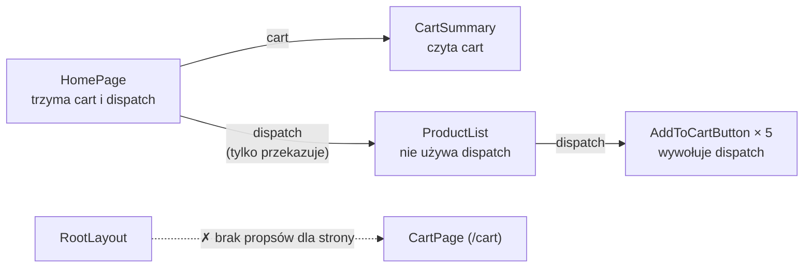

# Koszyk potrzebny w wielu miejscach naraz

## Jeden komponent przestaje wystarczać

Strona sklepu z reducerem działa, ale cały interfejs siedzi w jednym pliku `app/page.jsx`. Nagłówek z liczbą sztuk, lista produktów i przyciski „Add to cart” mieszczą się w jednej funkcji `HomePage`. Taki komponent trudno czytać i nie da się go użyć w innym miejscu.

Naturalny krok to podział na mniejsze części: nagłówek koszyka z liczbą sztuk i sumą oraz przycisk „Add to cart” przy produkcie. Sklep ma też mieć osobną stronę `/cart` z pełną listą pozycji. Przykłady poniżej nazywają te części `CartSummary` i `AddToCartButton`, a listę, która je układa, `ProductList`.

Każda z tych części potrzebuje czegoś z koszyka. Nagłówek czyta pozycje, żeby policzyć sztuki i sumę. Przycisk potrzebuje funkcji `dispatch`, żeby wysłać `ADD_ITEM`. Strona `/cart` potrzebuje i pozycji, i `dispatch`, bo wyświetla listę z przyciskami „Remove”. Stan musi więc mieszkać w komponencie, który jest przodkiem ich wszystkich.

## Dwa komponenty, dwa osobne stany

Każde wywołanie hooka stanu tworzy osobny stan, przypisany do miejsca komponentu w drzewie. Dwa komponenty z własnym `useState` albo `useReducer` niczego więc nie dzielą, nawet gdy pokazują to samo. Najmniejszy przykład spoza projektu:

```jsx
// Przycisk zmienia stan HomePage, a OwnBadge ma własny, osobny stan.
function OwnBadge() {
  const [n] = useState(0);   // bez settera: nikt poza OwnBadge nie może zmienić n
  return <span>cart: {n}</span>;
}
function HomePage() {
  const [a, setA] = useState(0);
  return <div><button onClick={() => setA(a + 1)}>+</button><OwnBadge /></div>;
}
// Po kliknięciu „+”: → cart: 0
```

Kliknięcie zmienia `a`, ale napis pokazuje `n` z innego komponentu, więc zostaje „cart: 0”. Sklep, w którym `ProductList` i `CartSummary` trzymałyby każdy własny `useReducer`, miałby dokładnie ten problem: dwa niezależne koszyki. Kliknięcie „Add to cart” zmieniłoby koszyk listy, a nagłówek dalej pokazywałby zero.

## Podnoszenie stanu w trzech krokach

Przeniesienie stanu do wspólnego przodka ma nazwę: **podnoszenie stanu** (*lifting state up*). Dokumentacja Reacta definiuje je jako usunięcie stanu z dwóch komponentów, przeniesienie go do najbliższego wspólnego rodzica i przekazanie w dół przez propsy. Schwarzmüller w *React Key Concepts* doprecyzowuje miejsce docelowe.

> **„Ściślej mówiąc, stanem zarządza najbliższy wspólny przodek.”**
>
> *„To be precise, it is managed in the closest shared ancestor component.”*
>
> — Maximilian Schwarzmüller, *React Key Concepts*

Dokumentacja (*Sharing State Between Components*) rozpisuje tę zmianę na trzy kroki.

1. **Usunąć stan z dzieci.** Z `ProductList` i `CartSummary` znika wywołanie `useReducer`. W jego miejsce `CartSummary` dostaje prop `cart`, a `ProductList` prop `dispatch`, bo sama nie czyta pozycji.
2. **Przekazać dane wpisane na sztywno.** `HomePage` podaje `CartSummary` gotowy obiekt, na przykład `cart={{ items: [] }}`. Ten krok sprawdza, czy dziecko poprawnie wyświetla to, co dostaje, zanim w grze pojawi się zmiana.
3. **Dodać stan we wspólnym rodzicu.** `HomePage` wywołuje `useReducer` i przekazuje w dół zarówno `cart`, jak i `dispatch`.

Ten sam licznik po podniesieniu stanu działa poprawnie, bo napis i przycisk czytają jedną wartość z rodzica:

```jsx
function Badge({ n }) { return <span>cart: {n}</span>; }
function AddBtn({ onAdd }) { return <button onClick={onAdd}>+</button>; }
function HomePage() {
  const [n, setN] = useState(0);   // jeden stan u wspólnego przodka
  return <div><AddBtn onAdd={() => setN(n + 1)} /><Badge n={n} /></div>;
}
// Po kliknięciu „+”: → cart: 1
```

Po trzecim kroku oba dzieci są **kontrolowane** przez rodzica. Dokumentacja nazywa tak komponent, w którym ważne informacje pochodzą z propsów, a nie z jego własnego stanu. Rodzic w pełni określa wtedy zachowanie dziecka. `Badge` nie decyduje już, co pokazuje. Wyświetla liczbę, którą dostał. To inne znaczenie niż w polu kontrolowanym z formularza: tam stan trzyma wartość pola, a tu rodzic trzyma dane całego komponentu.

Ta sama strona dokumentacji zauważa, że „podniesienie stanu często zmienia charakter tego, co się przechowuje” (*„Lifting state up often changes the nature of what you're storing as state”*). W sklepie dwa osobne koszyki zamieniają się w jeden, a sprzeczny stan, w którym lista i nagłówek pokazują różne liczby, przestaje być możliwy.

## Przekazywanie przez propsy warstwa po warstwie

Poniższy kod nie należy do projektu demo. Demo ma tylko `CartSummary` i `AddToCartButton`, a przycisk bierze `dispatch` z kontekstu, bez propsa. Przykład pokazuje stronę główną po podniesieniu stanu. Przycisk `AddToCartButton` dostaje w nim produkt i `dispatch`, a po kliknięciu wysyła `ADD_ITEM`:

```jsx
// Przykład spoza demo: HomePage trzyma reducer i podaje go w dół przez propsy.
export default function HomePage() {
  const [cart, dispatch] = useReducer(cartReducer, initialCartState);
  return (
    <main>
      <CartSummary cart={cart} />
      <ProductList dispatch={dispatch} />
    </main>
  );
}

// Przycisk: jedyny komponent, który naprawdę wywołuje dispatch.
function AddToCartButton({ product, dispatch }) {
  return <button onClick={() => dispatch({ type: 'ADD_ITEM', product })}>Add to cart</button>;
}

// Przykład spoza demo: ProductList oddaje dispatch przyciskom i sam go nie używa.
function ProductList({ dispatch }) {
  return (
    <ul>
      {products.map(product => (
        <li key={product.id}>
          <AddToCartButton product={product} dispatch={dispatch} />
        </li>
      ))}
    </ul>
  );
}
```

Przekazanie `cart` do `CartSummary` jest w porządku, bo ten komponent naprawdę czyta koszyk. Inaczej jest z `ProductList`, który przyjmuje `dispatch` tylko po to, żeby oddać go przyciskom poziom niżej. To jest *prop drilling*: prop przechodzi przez komponent, który sam go nie używa. Gdyby między listą a przyciskiem stał jeszcze komponent wiersza, on również musiałby przyjąć i przekazać ten sam prop. Kierunek zostaje ten sam: wartość schodzi w dół, a kliknięcie wraca w górę jako wywołanie `dispatch`, które należy do właściciela stanu.

## Trzy koszty przeprowadzania propsów

Maximilian Schwarzmüller w *React Key Concepts* wymienia trzy słabości prop drillingu. Każdą widać na sklepie.

1. **Komponent pośredni traci możliwość ponownego użycia.** `ProductList` da się wstawić w inne miejsce tylko wtedy, gdy ktoś dostarczy mu `dispatch`, choć lista z niego nie korzysta.
2. **Przybywa kodu, który nic nie robi.** Każdy pośrednik ma w sygnaturze prop, który tylko przyjmuje i oddaje.
3. **Zmiany wymagają więcej pracy.** Gdy przycisk zacznie potrzebować informacji, czy produkt już jest w koszyku, nowy prop trzeba dopisać w każdym pośredniku po drodze.

Autor dopuszcza jednak ten wzorzec w jednym przypadku. Przeprowadzanie propsów jest według niego akceptowalne, gdy wszystkie zaangażowane komponenty służą tylko w tej jednej części aplikacji, a prawdopodobieństwo ich ponownego użycia albo przebudowy jest małe.

Alex Banks i Eve Porcello w *Learning React* zauważają, że przekazywanie stanu w górę i w dół drzewa przez dziesiątki komponentów jest żmudne i podatne na błędy. Drugą drogą jest mechanizm kontekstu, który omija komponenty pośrednie.

## Rysunek 4.4 — `dispatch` w drodze do przycisku



Na Rysunku 4.4 górny rząd to strona główna po podniesieniu stanu (przykład spoza demo). Strzałka do `CartSummary` jest uzasadniona, bo ten komponent czyta koszyk. Strzałka przez `ProductList` to właściwy przykład prop drillingu: pośrednik przyjmuje wartość, której nie używa. Dolna linia przerywana oznacza drogę, której w App Routerze nie ma wcale.

## Layout nie przekaże danych stronie

Koszyk musi być widoczny na dwóch trasach: `/` i `/cart`. Wspólnym przodkiem obu stron jest dopiero layout główny z pliku `app/layout.jsx`. Dokumentacja Next.js opisuje, co layout dostaje: prop `children` wypełniany w trakcie renderu segmentami trasy, które layout obejmuje, czyli głównie stroną albo layoutem niższego poziomu. Layout nie tworzy więc elementu strony i nie ma gdzie dopisać jej propsa. Ta sama strona dokumentacji stawia sprawę wprost.

> **„Layouty nie mogą przekazywać danych swoim `children`.”**
>
> *„Layouts cannot pass data to their `children`.”*
>
> — dokumentacja Next.js, *layout.js*

Podnoszenie stanu zatrzymuje się więc w połowie. Layout oznaczony `'use client'` mógłby wywołać `useReducer`, ale i tak nie miałby jak oddać koszyka stronom, a layout serwerowy nie może trzymać stanu wcale. <u>Gdy wspólnym przodkiem jest layout, stan do stron dociera tylko przez kontekst</u>. Dla danych z serwera dokumentacja proponuje inne wyjście: każda strona pobiera je sama. Koszyk to jednak stan w przeglądarce, który obie strony muszą widzieć w tej samej postaci, więc to wyjście go nie obejmuje.

## Do czego służy kontekst

Dokumentacja wymienia cztery typowe zastosowania kontekstu. Są to motyw wyglądu, zalogowany użytkownik, bieżąca trasa w bibliotece routingu oraz zarządzanie stanem, który zmienia wiele odległych komponentów. O ostatnim przypadku pisze, że stan bliżej korzenia aplikacji często łączy się z reducerem, żeby przekazać go w dół bez nadmiernego wysiłku. Koszyk należy do tej ostatniej grupy, a jego reducer już istnieje.

## Zalety i koszty propsów

Prop drilling nie jest błędem samym w sobie. Dokumentacja Reacta zaczyna listę alternatyw dla kontekstu właśnie od zwykłych propsów i ostrzega, że kontekst łatwo nadużyć. Sama potrzeba przekazania propsów o parę poziomów w dół nie oznacza, że informacja powinna trafić do kontekstu.

> **„Może to wyglądać na mozolną pracę, ale bardzo jasno pokazuje, które komponenty używają których danych! Osoba utrzymująca kod będzie zadowolona, że przepływ danych jest jawny dzięki propsom.”**
>
> *„It may feel like a slog, but it makes it very clear which components use which data! The person maintaining your code will be glad you’ve made the data flow explicit with props.”*
>
> — dokumentacja React, *Passing Data Deeply with Context*

Schwarzmüller podaje regułę liczbową: stan podnosi się w górę, gdy trzeba go dzielić przez jeden lub dwa poziomy zagnieżdżenia. Bugl dodaje koszt drugiej strony: komponent czytający kontekst działa tylko pod odpowiednim dostawcą, więc kontekst utrudnia jego ponowne użycie. Wersja z propsami pokazuje w sygnaturze, czego komponent potrzebuje: kto otworzy `ProductList({ dispatch })`, od razu wie, że lista zależy od funkcji koszyka. Wersja z kontekstem chowa tę zależność w wywołaniu hooka.

| Zyskujemy | Płacimy | Kiedy nie warto / co zamiast |
|---|---|---|
| Jawny przepływ danych: sygnatura mówi, od czego komponent zależy | Pośrednicy przyjmują i oddają prop, którego nie używają (`ProductList` z `dispatch`) | Łańcuch dłuższy niż jeden lub dwa poziomy: kontekst (następna część) |
| Komponent nie zależy od dostawcy, wystarczy, że rodzic poda prop | Każdy nowy odbiorca informacji to nowy prop w każdym pośredniku po drodze | Drzewo płaskie, a komponenty używane wielokrotnie bez przekazywania stanu: kontekst (Schwarzmüller) |
| Stan podniesiony do wspólnego przodka daje jeden koszyk zamiast dwóch niezależnych | Layout nie przekaże danych swoim `children`, więc podniesienie stanu nie obejmuje tras `/` i `/cart` | Koszyk na dwóch trasach: kontekst z dostawcą w layoucie (dwie części dalej) |

> 💡 **Zapamiętaj:** stan dzielony przez kilka komponentów podnosi się do najbliższego wspólnego przodka. Propsy są pierwszym wyborem przy jednym lub dwóch poziomach. Kontekst wchodzi wtedy, gdy łańcuch pośredników robi się długi albo gdy wspólny przodek, jak layout w Next.js, nie może przekazać propsów.


Materiał rozszerzony do tego slajdu: [`rozszerzenia/r04_prop-drilling.md`](rozszerzenia/r04_prop-drilling.md)
