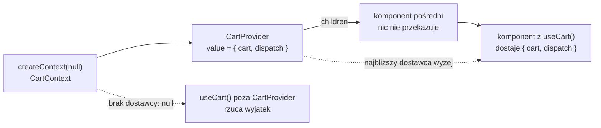

# Kontekst: koszyk dostępny w całym poddrzewie

## Wartość potrzebna daleko od miejsca, w którym powstaje

Koszyk mieszka w jednym komponencie, a czytają go komponenty położone kilka poziomów niżej, także na innej trasie. Propsy musiałyby przejść przez każdego pośrednika po drodze, a od layoutu do strony nie da się ich przekazać wcale. React ma na to osobny mechanizm.

> **„Kontekst pozwala komponentowi rodzica dostarczyć dane całemu drzewu pod nim.”**
>
> *„Context lets a parent component provide data to the entire tree below it.”*
>
> — dokumentacja React, *Passing Data Deeply with Context*

**Kontekst** (*context*) to kanał, którym wartość z jednego komponentu trafia do dowolnego potomka bez przekazywania przez propsy. Ta sama strona dokumentacji dodaje, że kontekst „przechodzi przez wszystkie komponenty pośrodku” (*„passes through any components in the middle”*). Pośrednicy nie wiedzą o nim nic i nie przyjmują żadnego dodatkowego propa.

## Trzy kroki: utworzyć, dostarczyć, odczytać

Maximilian Schwarzmüller w *React Key Concepts* dzieli użycie kontekstu na trzy kroki. Najpierw tworzy się wartość kontekstu, która ma być dzielona. Potem dostarcza się ją w komponencie, który jest przodkiem wszystkich zainteresowanych. Na końcu komponenty potrzebujące odczytu lub zapisu subskrybują kontekst, czyli zgłaszają, że od niego zależą. Autor opisuje też, kto pilnuje zmian.

> **„React zarządza wartością kontekstu (i jej zmianami) wewnętrznie i automatycznie rozsyła ją do wszystkich komponentów, które subskrybują kontekst.”**
>
> *„React manages the context value (and its changes) internally and automatically distributes it to all components that have subscribed to the context.”*
>
> — Maximilian Schwarzmüller, *React Key Concepts*

Najmniejszy przykład, poza sklepem, przekazuje nazwę motywu przez komponent pośredni:

```jsx
import { createContext, useContext } from 'react';

const ThemeContext = createContext('light'); // krok 1: obiekt kontekstu, 'light' to wartość domyślna

function Label() {
  const theme = useContext(ThemeContext);    // krok 3: odczyt wartości od dostawcy
  return <p>motyw: {theme}</p>;
}

function Middle() {
  return <Label />;                          // pośrednik: żadnego propa o motywie
}

// krok 2: dostawca, wszystko pod nim widzi 'dark'
<ThemeContext value="dark"><Middle /></ThemeContext>  // renderuje: <p>motyw: dark</p>
```

Funkcja **`createContext`** zwraca obiekt kontekstu. Ten obiekt nie trzyma żadnej bieżącej wartości. Jest tylko identyfikatorem kanału, którego używają obie strony. Element `<ThemeContext value="dark">` to **dostawca** (*provider*): udostępnia wartość z atrybutu `value` całemu poddrzewu. Hook **`useContext`** odczytuje tę wartość w dowolnym komponencie pod dostawcą. `Middle` nic o motywie nie wie, a `Label` i tak dostaje `'dark'`.

## Dostawca w React 19

Zapis `<ThemeContext value={…}>` pojawił się w React 19. Wcześniej dostawcą był osobny komponent `ThemeContext.Provider`, który nadal działa.

> **„`SomeContext.Provider` to starszy sposób dostarczania wartości kontekstu, sprzed React 19.”**
>
> *„SomeContext.Provider is a legacy way to provide the context value before React 19.”*
>
> — dokumentacja React, *createContext*

Blog z wydaniem React 19 zapowiada, że w przyszłych wersjach zapis z `.Provider` zostanie oznaczony jako przestarzały. Poradnik, w którym dostawca ma postać `<ThemeContext.Provider value={…}>`, pochodzi więc sprzed tej wersji i nie zawiera błędu. Oba zapisy dają ten sam efekt.

## Najbliższy dostawca wygrywa

Dokumentacja *useContext* opisuje, jak React znajduje wartość. Idzie od komponentu w górę drzewa aż do **najbliższego dostawcy** danego kontekstu. Dostawca położony głębiej przesłania wyższego w swoim poddrzewie:

```jsx
<ThemeContext value="dark">
  <Label />                          {/* najbliższy dostawca: 'dark' */}
  <ThemeContext value="sepia">
    <Label />                        {/* głębszy dostawca przesłania wyższego: 'sepia' */}
  </ThemeContext>
</ThemeContext>
// renderuje: <p>motyw: dark</p><p>motyw: sepia</p>
```

Dokumentacja porównuje to do dziedziczenia właściwości w CSS. Kolor ustawiony na `<div>` dziedziczą wszystkie węzły w środku, dopóki któryś nie ustawi innego. Porównanie ma granicę: w CSS dziedziczą się tylko niektóre właściwości, a kontekst dociera do każdego potomka, który go czyta.

Z porównania wynika druga reguła. **Różne konteksty nie przesłaniają się nawzajem.** Każdy obiekt z `createContext` tworzy osobny kanał. Gdyby obok motywu istniał kontekst języka, dostawca motywu postawiony wewnątrz dostawcy języka nie zmieniłby odczytu języka.

## Wartość domyślna działa tylko bez dostawcy

Argument `createContext` nie jest stanem startowym. Jest wartością, którą dostaje komponent, gdy nad nim nie ma żadnego dostawcy:

```jsx
<Middle />                                // brak dostawcy: <p>motyw: light</p>
<ThemeContext><Label /></ThemeContext>    // dostawca bez value: value={undefined}, <p>motyw: </p>
```

Druga linia pokazuje pułapkę. Dostawca bez atrybutu `value` działa tak, jakby przekazał `value={undefined}`, a wartość domyślna nie wchodzi wtedy do gry, bo dostawca w drzewie istnieje. Dokumentacja opisuje rolę wartości domyślnej tak:

> **„Wartość domyślna ma być awaryjnym zabezpieczeniem na ostateczność. Jest statyczna i nigdy nie zmienia się w czasie.”**
>
> *„The default value is meant as a "last resort" fallback. It is static and never changes over time.”*
>
> — dokumentacja React, *createContext*

Sensowna wartość domyślna, jak motyw `'light'`, pasuje tam, gdzie aplikacja może działać bez dostawcy. Dla koszyka takiej wartości nie ma. Gdyby wartością domyślną był pusty koszyk `{ items: [] }`, komponent postawiony przez pomyłkę poza dostawcą pokazałby zero produktów, a przycisk „Add to cart” nie robiłby nic. Nikt by tego nie zauważył. <u>Dla stanu, który ma jedno źródło, głośny błąd jest lepszy od cichej wartości zastępczej</u>, więc kontekst koszyka dostaje `null`.

## Plik kontekstu koszyka

W sklepie trzy kroki zbiera jeden nowy plik, `app/context/CartContext.jsx`. Reducer koszyka przenosi się do niego ze strony głównej:

```jsx
'use client';

import { createContext, useContext, useReducer } from 'react';
import { cartReducer, initialCartState } from '../lib/cartReducer';

// Jeden kontekst: niesie i stan koszyka, i dispatch.
const CartContext = createContext(null);

export function CartProvider({ children }) {
  const [cart, dispatch] = useReducer(cartReducer, initialCartState);

  // React 19: sam obiekt kontekstu jest dostawcą (bez .Provider).
  return (
    <CartContext value={{ cart, dispatch }}>
      {children}
    </CartContext>
  );
}

// Własny hook: komponenty nie widzą obiektu kontekstu, tylko ten hook.
export function useCart() {
  const ctx = useContext(CartContext);
  if (ctx === null) throw new Error('useCart must be used inside <CartProvider>');
  return ctx;
}
```

Hooki wymagają komponentu klienckiego, stąd `'use client'` na początku pliku. `createContext(null)` stoi na poziomie modułu, więc obiekt `CartContext` powstaje raz, przy pierwszym wczytaniu pliku. Dostawca i odbiorca muszą używać tego samego obiektu, a wywołanie w ciele komponentu tworzyłoby przy każdym renderze nowy. Zapis `value={{ cart, dispatch }}` ma dwie pary klamer: zewnętrzne otwierają wyrażenie JavaScriptu w JSX, a wewnętrzne tworzą obiekt z dwoma polami.

Plik eksportuje tylko `CartProvider` i `useCart`. Sam obiekt `CartContext` zostaje prywatny dla modułu. Reszta aplikacji zna dostawcę, którego trzeba postawić w drzewie, i hook, którym czyta się koszyk.

## Kontekst przenosi wartość, stan trzyma dostawca

Obiekt kontekstu sam niczego nie przechowuje. Dokumentacja *createContext* podkreśla, że reprezentuje tylko to, jaki kontekst komponenty czytają albo dostarczają. Alex Banks i Eve Porcello piszą o tym od strony dostawcy.

> **„Dostawca kontekstu może umieścić obiekt w kontekście, ale sam nie zmieni wartości w kontekście. Potrzebuje pomocy komponentu rodzica.”**
>
> *„The context provider can place an object into context, but it can’t mutate the values in context on its own. It needs some help from a parent component.”*
>
> — Alex Banks, Eve Porcello, *Learning React*

Tą pomocą jest stan. W `CartProvider` trzyma go `useReducer`. Każda akcja daje nowy `cart`, komponent `CartProvider` renderuje się ponownie i przekazuje dostawcy nową wartość. React rozsyła ją wtedy do komponentów, które czytają kontekst. Wartość kontekstu działa więc jak interfejs koszyka dla reszty aplikacji: komponent może odczytać `cart` i wysłać przez `dispatch` tylko akcję, którą zna reducer.

## Dlaczego nie zwykła zmienna w module

Tę samą tablicę dałoby się trzymać w zmiennej na poziomie modułu i importować ją wszędzie. Takiej zmiany React jednak nie widzi: przypisanie do zmiennej modułu nie wywołuje żadnego renderu, więc ekran pokazywałby stary koszyk aż do przypadkowego odświeżenia komponentu. Kontekst z wartością pochodzącą ze stanu ma dwie cechy, których zmiennej brakuje. Zmiana stanu w dostawcy uruchamia render i nowa wartość dociera do odbiorców. Wartość należy też do konkretnego miejsca w drzewie, więc dwa dostawcy dają dwie niezależne wartości, a zmienna modułu jest jedna dla całej karty.

## Rysunek 4.5 — skąd komponent bierze wartość kontekstu



Na Rysunku 4.5 pierwsza ciągła strzałka oznacza, że `CartProvider` używa obiektu z `createContext`. Pozostałe ciągłe strzałki to drzewo komponentów, a przerywane pokazują drogę, którą komponent dostaje wartość. Komponent z `useCart()` leży dwa poziomy pod dostawcą, a mimo to czyta wartość bezpośrednio od niego. Pośrednik niczego nie przekazuje. Dolna strzałka opisuje przypadek bez dostawcy: wtedy wartością jest `null` z `createContext`.

## Własny hook ze strażnikiem

Funkcja `useCart` to własny hook, czyli funkcja `use…` wołająca inne hooki. Chowa odczyt `useContext(CartContext)` w jednym miejscu. Przed hookami odbiorca czytał kontekst elementem `<CartContext.Consumer>` z funkcją w środku, więc musiał importować sam obiekt kontekstu. Banks i Porcello piszą, że hooki usunęły tę potrzebę (*„we don’t have to expose context to consumer components at all”*).

Hook daje dwie korzyści. Komponent importuje `useCart` i nie musi wiedzieć, że istnieje `CartContext`. Hook jest też jedynym miejscem, w którym da się sprawdzić, czy odczyt odbywa się pod dostawcą. Warunek `if (ctx === null)` to **strażnik**: zamienia ciche `null` na wyjątek z czytelnym komunikatem. Różnicę widać na dwóch wariantach odczytu poza dostawcą:

```jsx
// ze strażnikiem: Error: useCart must be used inside <CartProvider>
const { cart } = useCart();

// bez strażnika: TypeError: Cannot destructure property 'cart' of '…' as it is null.
const { cart } = useContext(CartContext);
```

Drugi komunikat mówi tylko, że coś jest `null`. Pierwszy wymienia nazwę dostawcy, więc przy takim błędzie wystarczy sprawdzić, czy komponent leży w drzewie pod `<CartProvider>`. Dokumentacja Next.js stosuje ten sam wzorzec w przewodniku o aplikacjach jednostronicowych: jej hook `useUser` rzuca wyjątek `useUser must be used within a UserProvider`.

> 💡 **Zapamiętaj:** kontekst tworzy się przez `createContext` poza komponentem, dostarcza przez `<Ctx value>` i czyta przez `useContext` schowany we własnym hooku. Odczyt sięga do najbliższego dostawcy wyżej, a wartość domyślna działa tylko wtedy, gdy dostawcy nie ma wcale.


Materiał rozszerzony do tego slajdu: [`rozszerzenia/r05_context.md`](rozszerzenia/r05_context.md)
