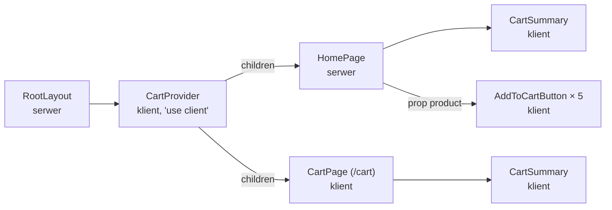

# Dostawca w layoucie, komponenty z koszykiem

## Koszyk ma przeżyć zmianę trasy

Kontekst koszyka istnieje, ale nikt go jeszcze nie dostarcza. Klient dodaje kawę na stronie głównej i klika link „Cart”. Koszyk ma być na `/cart` taki sam, jak przed chwilą na `/`. Stan, który zniknąłby przy przejściu, byłby bezużyteczny. Stan nie może też mieszkać w stronie serwerowej, bo hooki działają tylko w komponentach klienckich, a mimo to strona główna ma zostać komponentem serwerowym. Oba warunki spełnia dostawca postawiony we właściwym miejscu drzewa.

## Dostawca w layoucie głównym

Kontekst działa tylko pod swoim dostawcą. Sklep potrzebuje jednego egzemplarza `CartProvider`, wspólnego dla strony głównej i strony `/cart`, więc dostawca musi stać nad obiema. Layout nie dopisze stronie propsów, ale może ją owinąć, więc dostawca trafia do layoutu głównego. W pliku `app/layout.jsx` dochodzi jeden import:

```jsx
import Link from 'next/link';
import { CartProvider } from './context/CartContext'; // dostawca koszyka (komponent kliencki)
```

Layout ma już nawigację z `Link`, więc w `<body>` zmienia się jedna linia: `{children}` trafia pod dostawcę.

```jsx
      <body>
        <nav>
          <Link href="/">Shop</Link> | <Link href="/cart">Cart</Link>
        </nav>
        {/* każda strona aplikacji trafia tu, czyli pod dostawcę */}
        <CartProvider>{children}</CartProvider>
      </body>
```

Wszystko, co router wstawi w miejsce `children`, znajdzie się pod dostawcą. Sam layout pozostaje serwerowy i mimo to renderuje kliencki `CartProvider`, a strony przekazane mu jako `children` mogą nadal powstawać na serwerze.

## Komponent kliencki z serwerową zawartością

Stan i hooki działają tylko w komponentach klienckich. Dokumentacja Next.js (*Server and Client Components*) mówi wprost, że dotyczy to także kontekstu.

> **„Kontekst Reacta jest często używany do współdzielenia stanu globalnego, na przykład bieżącego motywu. Kontekst Reacta nie jest jednak obsługiwany w komponentach serwerowych.”**
>
> *„React context is commonly used to share global state like the current theme. However, React context is not supported in Server Components.”*
>
> — dokumentacja Next.js, *Server and Client Components*

Next.js pilnuje tej granicy już przy budowaniu. Moduł serwerowy z `createContext` kończy się błędem, który dokumentacja Next.js opisuje zdaniem *„You are using `createContext` in a server component but it only works in client components.”*, czyli w komponencie serwerowym `createContext` nie działa. Samo wywołanie `useContext` w komponencie serwerowym kończy się przy prerenderze wyjątkiem `TypeError` z informacją, że `useContext` nie jest funkcją, bo serwerowa wersja Reacta tego hooka nie udostępnia.

Ta sama strona dokumentacji podaje regułę, która ratuje układ z layoutem: komponent serwerowy można przekazać komponentowi klienckiemu jako prop, najczęściej jako `children`. Najmniejszy przykład, oddzielny od koszyka, korzysta z modułu `node:os` z biblioteki standardowej Node.js, który podaje dane o systemie serwera. Przykład jest osobną trasą `/server-client` w projekcie, dwoma plikami w katalogu `app/server-client/`:

```jsx
// app/server-client/ClientBox.jsx: komponent kliencki ze stanem
'use client';
import { useState } from 'react';

export default function ClientBox({ children }) {
  const [open, setOpen] = useState(true);   // stan istnieje tylko w komponencie klienckim
  return <section><button onClick={() => setOpen(o => !o)}>toggle</button>{open && children}</section>;
}
```

```jsx
// app/server-client/page.jsx: komponent serwerowy, bez 'use client'
import os from 'node:os';                  // moduł Node.js, którego nie ma w przeglądarce
import ClientBox from './ClientBox';

function ServerInfo() {
  return <p>platform: {os.platform()}</p>; // → platform: linux (wykonuje się na serwerze)
}

export default function Page() {
  return <ClientBox><ServerInfo /></ClientBox>; // gotowy wynik ServerInfo wchodzi jako children
}
```

`ServerInfo` wykonuje się na serwerze, a do `ClientBox` trafia już tylko jego wynik. Kod z `os.platform()` nie pojawia się w plikach wysyłanych do przeglądarki. `ClientBox` nie wie, co dostał w `children`, i niczego tam nie renderuje od nowa, tylko wstawia gotowy fragment. <u>Komponent kliencki przyjmujący `children` nie zamienia swoich dzieci w komponenty klienckie</u>. Dzięki temu `CartProvider` może owinąć całą aplikację, a strony pod nim pozostają serwerowe, dopóki same nie zadeklarują `'use client'`.

## Dostawca jako osobny komponent

Maximilian Schwarzmüller w *React Key Concepts* opisuje osobny komponent dostawcy jako wzorzec do rozważenia. Bez niego, jak pisze, komponenty „mogą stać się niepotrzebnie złożone, jeśli muszą zajmować się zarządzaniem kontekstem” (*„can get unnecessarily complex if they have to deal with context management”*). Autor zaznacza jego granice.

> **„Ten wzorzec jest całkowicie opcjonalny. Nie jest ani oficjalną dobrą praktyką, ani nie przynosi żadnych korzyści wydajnościowych.”**
>
> *„This pattern is entirely optional. It’s neither an official best practice nor does it yield any performance benefits.”*
>
> — Maximilian Schwarzmüller, *React Key Concepts*

W Next.js osobny komponent dostawcy jest jednak konieczny, bo layout serwerowy nie wywoła `useReducer`.

## Jak wysoko postawić dostawcę

Dokumentacja Next.js radzi renderować dostawców jak najgłębiej w drzewie. W jej przykładzie dostawca owija tylko `{children}`, a nie cały dokument `<html>`, co według dokumentacji ułatwia optymalizację statycznych części komponentów serwerowych. W sklepie `<nav>` stoi poza dostawcą, a `CartProvider` owija tylko zawartość strony. Głębiej zejść się nie da, bo koszyk czytają dwie trasy, a ich jedynym wspólnym przodkiem jest layout główny.

## Stan żyje tak długo jak dostawca

Wartość kontekstu pochodzi ze stanu dostawcy, a stan komponentu istnieje tylko wtedy, gdy komponent jest zamontowany, czyli obecny w drzewie. Najmniejszy przykład pokazuje obie sytuacje:

```jsx
const CountContext = createContext(null);

function CountProvider({ children }) {
  const [count, setCount] = useState(0);      // stan należy do dostawcy
  return <CountContext value={{ count, setCount }}>{children}</CountContext>;
}

function Counter() {
  const { count, setCount } = useContext(CountContext);
  return <button onClick={() => setCount(c => c + 1)}>{count}</button>;
}

// show = false usuwa dostawcę z drzewa; show = true montuje go od nowa z useState(0)
function Shell({ show }) {
  return show ? <CountProvider><Counter /></CountProvider> : <p>inna trasa</p>;
}
```

Po dwóch kliknięciach licznik pokazuje 2 i zachowuje tę wartość przy każdym kolejnym renderze `Shell` z `show = true`, bo dostawca zostaje w drzewie. Gdy `show` na chwilę zmieni się na `false`, a potem wróci do `true`, dostawca montuje się od nowa i licznik zaczyna od 0. <u>Stan w kontekście trwa tak długo, jak długo zamontowany jest jego dostawca</u>.

W sklepie wynika z tego zachowanie koszyka. Layout główny zostaje na ekranie przy każdym przejściu przez `Link`, który podmienia tylko `children`, więc koszyk przetrwa nawigację po sklepie. Przeładowanie strony klawiszem F5 tworzy całą aplikację w przeglądarce od nowa, więc `useReducer` startuje od `initialCartState` i koszyk jest pusty.

## Reducer i kontekst jako jeden wzorzec

Sklep ma już obie części. Funkcja `cartReducer` trzyma wszystkie reguły koszyka, a `CartProvider` udostępnia jej wynik w całym poddrzewie. Dokumentacja Reacta nazywa takie połączenie osobnym wzorcem.

> **„Reducery pozwalają zebrać logikę aktualizacji stanu komponentu w jednym miejscu. Kontekst pozwala przekazać informację głęboko w drzewo. Oba można połączyć, żeby zarządzać stanem złożonego ekranu.”**
>
> *„Reducers let you consolidate a component’s state update logic. Context lets you pass information deep down to other components. You can combine reducers and context together to manage state of a complex screen.”*
>
> — dokumentacja React, *Scaling Up with Reducer and Context*

Strona główna z jednego dużego pliku rozpada się teraz na komponenty, z których każdy sam pobiera z kontekstu to, czego potrzebuje. Strona przestaje trzymać reducer, więc z jej początku znikają importy `useReducer` i `cartReducer`. Morten Barklund w *React in Depth* opisuje cel takiego podziału. Chodzi o „wyraźną granicę między prezentacją a zarządzaniem danymi” (*„a clear boundary between presentation and data management”*). Dzięki niej jedną część da się wymienić bez dotykania drugiej. W sklepie ta granica przebiega przez hook `useCart`.

## Komponenty, które same sięgają po koszyk

Nowy plik `app/components/CartSummary.jsx` to nagłówek koszyka. Jego funkcja nie ma żadnych parametrów:

```jsx
'use client';

import { useCart } from '../context/CartContext';

export default function CartSummary() {
  const { cart } = useCart();                                        // wszystko z kontekstu
  const count = cart.items.reduce((sum, i) => sum + i.qty, 0);        // liczba sztuk
  const total = cart.items.reduce((sum, i) => sum + i.price * i.qty, 0); // wartość zamówienia

  return <h2>Cart: {count} pcs — {total.toFixed(2)} PLN</h2>;
}
```

Liczba sztuk `count` powstaje tak samo jak na stronie głównej. Nowa jest wartość `total`: cena razy ilość, dodana po wszystkich pozycjach, więc dwie kawy i herbata kosztują razem 118.48 PLN. Komponent czyta z kontekstu tylko `cart`, bo `dispatch` nie jest mu potrzebny. Gdyby `CartSummary` leżał dziesięć poziomów głębiej, jego kod wyglądałby tak samo.

Nowy plik `app/components/AddToCartButton.jsx` to przycisk przy produkcie. Korzysta z obu dróg naraz:

```jsx
'use client';

import { useCart } from '../context/CartContext';

export default function AddToCartButton({ product }) {   // produkt przychodzi propsem od rodzica
  const { dispatch } = useCart();                         // dispatch przychodzi z kontekstu

  return <button onClick={() => dispatch({ type: 'ADD_ITEM', product })}>Add to cart</button>;
}
```

Produkt `product` przycisk dostaje od rodzica, bo rodzic przechodzi po liście produktów i wie, który wiersz właśnie rysuje. Funkcję `dispatch` bierze z kontekstu, bo jest wspólna dla całej aplikacji. Propsy niosą dane konkretnego egzemplarza, a kontekst niesie to, co wspólne. Gdyby przycisk sam szukał swojego produktu w kontekście, musiałby i tak dostać jego `id`, a do tego zależałby od kształtu całego stanu.

Oba pliki zaczynają się od `'use client'` i importu `useCart`. Przycisk można wstawić na dowolną stronę pod dostawcą bez dopisywania propsa z `dispatch`.

## Strona główna znów jest serwerowa

Plik `app/page.jsx` traci całą logikę i dyrektywę `'use client'`. Nowa treść pliku:

```jsx
// Komponent serwerowy: każdy kliencki fragment ma własne 'use client'.
import { products } from './data/products';
import CartSummary from './components/CartSummary';
import AddToCartButton from './components/AddToCartButton';

export default function HomePage() {
  return (
    <main>
      <h1>Coffee shop</h1>
      <CartSummary />
      <ul>
        {products.map(product => (
          <li key={product.id}>
            {product.name} — {product.price.toFixed(2)} PLN{' '}
            <AddToCartButton product={product} />
          </li>
        ))}
      </ul>
    </main>
  );
}
```

Strona nie używa żadnego hooka, więc może znów być komponentem serwerowym. Sama przechodzi po katalogu produktów i wstawia pięć klienckich przycisków, każdemu podając jego produkt. Wszystkie komponenty klienckie znajdują kontekst, bo w drzewie Reacta stoją pod `CartProvider` z layoutu. Strona nie trzyma stanu i nie przekazuje go dzieciom, bo dostawca stoi nad nią, a dzieci pobierają dane same. Dwa kliknięcia przy kawie zmieniają nagłówek na „Cart: 2 pcs — 99.98 PLN”.

## Strona koszyka

Ostatni plik tego etapu to nowa trasa `/cart`, czyli `app/cart/page.jsx`. Zaczyna się od `'use client'` i czyta koszyk tak jak nagłówek, ale potrzebuje też `dispatch`:

```jsx
'use client';

import { useCart } from '../context/CartContext';
import CartSummary from '../components/CartSummary';

export default function CartPage() {
  const { cart, dispatch } = useCart();

  return (
    <main>
      <h1>Cart</h1>
      <CartSummary />
      <ul>
        {cart.items.map(item => (
          <li key={item.id}>
            {item.name} × {item.qty}{' '}
            <button onClick={() => dispatch({ type: 'REMOVE_ITEM', id: item.id })}>Remove</button>
          </li>
        ))}
      </ul>
      <button onClick={() => dispatch({ type: 'CLEAR_CART' })}>Clear cart</button>
    </main>
  );
}
```

Plik musi być kliencki, choć strona główna z tego zrezygnowała. `HomePage` tylko układa gotowe komponenty, a `CartPage` sama czyta koszyk i wysyła akcje. Nagłówek podsumowania to ten sam `CartSummary` co na stronie głównej, więc suma nie jest liczona drugi raz. Wiersze listy rysuje sama strona, bo tylko ona z nich korzysta.

Kliknięcie linku „Cart” w nawigacji podmienia tylko zawartość `children` w layoucie. `CartProvider` zostaje na miejscu, a `CartPage` przy pierwszym renderze dostaje ten sam obiekt `cart`, który przed chwilą wyświetlał nagłówek. Komponent nigdy nie zmienia koszyka sam: kliknięcie „Remove” wysyła `REMOVE_ITEM`, reducer zwraca nowy stan, a dostawca przekazuje go dalej.

## Rysunek 4.6 — gdzie w sklepie przebiega granica klienta



Rysunek 4.6 pokazuje, które komponenty sklepu wykonują się tylko na serwerze, a które także w przeglądarce. Granica klienta nie przebiega jedną linią przez całe drzewo. `CartProvider` jest kliencki, ale `HomePage` pod nim zostaje serwerowa, bo dociera do dostawcy jako `children`. Dopiero `CartSummary` i pięć przycisków `AddToCartButton` znów są klienckie, każdy z własnej dyrektywy. Wszystkie komponenty klienckie pod dostawcą czytają kontekst, także `CartSummary` na stronie `/cart`. Jedyny prop w obrazku płynie od `HomePage` do przycisku i niesie konkretny produkt.

## Zalety i koszty dostawcy w layoucie

Dostawca w layoucie głównym rozwiązuje oba warunki ze wstępu, ale im wyżej stoi, tym więcej komponentów jest pod nim, a jego stan żyje tylko do przeładowania strony.

| Zyskujemy | Płacimy | Kiedy nie warto / co zamiast |
|---|---|---|
| Dostawca w layoucie przeżywa nawigację przez `Link`, więc koszyk przechodzi z `/` na `/cart` | Im wyżej dostawca, tym więcej komponentów pod nim. Dokumentacja Next.js radzi stawiać go jak najgłębiej, a w sklepie głębiej się nie da, bo koszyk czytają dwie trasy | Stan jednej trasy: dostawca w layoucie tej trasy albo stan samej strony |
| Strony pod dostawcą mogą zostać serwerowe, bo docierają do niego jako `children` | Stan znika po F5, bo przeładowanie tworzy aplikację od nowa i `useReducer` startuje od `initialCartState` (sekcja „Gdzie koszyk mieszka na końcu” na końcu wykładu) | Koszyk, który ma przetrwać przeładowanie, wymaga zapisu w miejscu, które przeżyje przeładowanie (koniec wykładu) |

> 💡 **Zapamiętaj:** dostawca kontekstu w Next.js to komponent kliencki przyjmujący `children`, osadzony w layoucie serwerowym. Strony przekazane jako `children` mogą zostać serwerowe, a stan w kontekście żyje tak długo jak dostawca.


Materiał rozszerzony do tego slajdu: [`rozszerzenia/r06_dostawca-i-konsumenci.md`](rozszerzenia/r06_dostawca-i-konsumenci.md)
