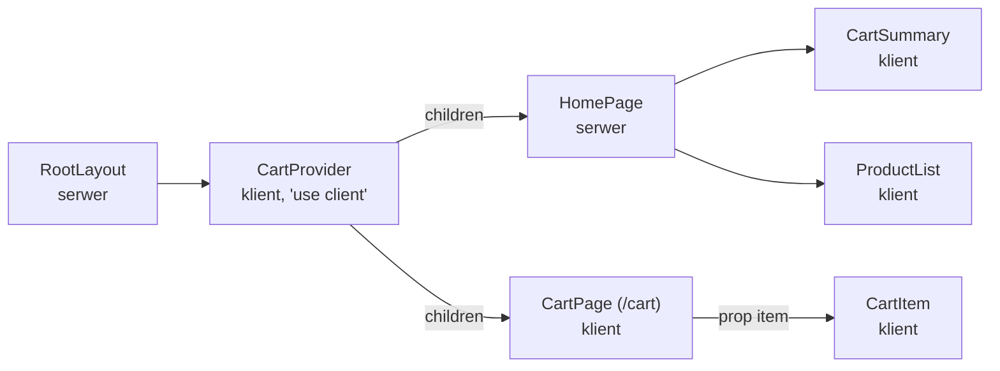

# Dostawca w layoucie, komponenty z koszykiem

## Dostawca w layoucie głównym

Kontekst działa tylko pod swoim dostawcą. Sklep potrzebuje jednego egzemplarza `CartProvider`, wspólnego dla strony głównej i strony `/cart`, więc dostawca musi stać nad obiema. Layout nie dopisze stronie propsów, ale może ją owinąć, więc dostawca trafia do layoutu głównego. W pliku `app/layout.jsx` dochodzą trzy importy:

```jsx
import Link from 'next/link';                       // nawigacja bez przeładowania strony
import { CartProvider } from './context/CartContext'; // dostawca koszyka (komponent kliencki)
import './globals.css';
```

Zawartość `<body>` dostaje nawigację i dostawcę:

```jsx
      <body>
        <nav>
          <Link href="/">Shop</Link>
          {' | '}
          <Link href="/cart">Cart</Link>
        </nav>
        <CartProvider>
          {children}      {/* każda strona aplikacji trafia tu, czyli pod dostawcę */}
        </CartProvider>
      </body>
```

Wszystko, co router wstawi w miejsce `children`, znajdzie się pod dostawcą. Sam layout pozostaje serwerowy i mimo to renderuje kliencki `CartProvider`, a strony przekazane mu jako `children` mogą nadal powstawać na serwerze.

## Komponent kliencki z serwerową zawartością

Stan i hooki działają tylko w komponentach klienckich. Dokumentacja Next.js (*Server and Client Components*) mówi wprost, że dotyczy to także kontekstu.

> **„Kontekst Reacta jest często używany do współdzielenia stanu globalnego, na przykład bieżącego motywu. Kontekst Reacta nie jest jednak obsługiwany w komponentach serwerowych.”**
>
> *„React context is commonly used to share global state like the current theme. However, React context is not supported in Server Components.”*
>
> — dokumentacja Next.js, *Server and Client Components*

Next.js pilnuje tej granicy już przy budowaniu. Moduł serwerowy z `createContext` kończy się błędem, który dokumentacja Next.js opisuje zdaniem *„You are using `createContext` in a server component but it only works in client components.”*, czyli w komponencie serwerowym `createContext` nie działa. Samo wywołanie `useContext` w komponencie serwerowym kończy się przy prerenderze wyjątkiem `TypeError` z informacją, że `useContext` nie jest funkcją, bo serwerowa wersja Reacta tego hooka nie udostępnia.

Ta sama strona dokumentacji podaje regułę, która ratuje układ z layoutem: komponent serwerowy można przekazać komponentowi klienckiemu jako prop, najczęściej jako `children`. Najmniejszy przykład poza sklepem korzysta z modułu `node:os` z biblioteki standardowej Node.js, który podaje dane o systemie serwera:

```jsx
// ClientBox.jsx: komponent kliencki ze stanem
'use client';
import { useState } from 'react';

export default function ClientBox({ children }) {
  const [open, setOpen] = useState(true);   // stan istnieje tylko w komponencie klienckim
  return <section><button onClick={() => setOpen(o => !o)}>toggle</button>{open && children}</section>;
}
```

```jsx
// page.jsx: komponent serwerowy, bez 'use client'
import os from 'node:os';                  // moduł Node.js, którego nie ma w przeglądarce
import ClientBox from './ClientBox';

function ServerInfo() {
  return <p>platforma: {os.platform()}</p>; // wykonuje się na serwerze: „platforma: linux”
}

export default function Page() {
  return <ClientBox><ServerInfo /></ClientBox>; // gotowy wynik ServerInfo wchodzi jako children
}
```

`ServerInfo` wykonuje się na serwerze, a do `ClientBox` trafia już tylko jego wynik. Kod z `os.platform()` nie pojawia się w plikach wysyłanych do przeglądarki. `ClientBox` nie wie, co dostał w `children`, i niczego tam nie renderuje od nowa, tylko wstawia gotowy fragment. <u>Komponent kliencki przyjmujący `children` nie zamienia swoich dzieci w komponenty klienckie</u>. Dzięki temu `CartProvider` może owinąć całą aplikację, a strony pod nim pozostają serwerowe, dopóki same nie zadeklarują `'use client'`.

## Dostawca jako osobny komponent

Maximilian Schwarzmüller w *React Key Concepts* opisuje osobny komponent dostawcy jako wzorzec do rozważenia. Bez niego, jak pisze, komponenty „mogą stać się niepotrzebnie złożone, jeśli muszą zajmować się zarządzaniem kontekstem” (*„can get unnecessarily complex if they have to deal with context management”*). Autor zaznacza jego granice.

> **„Ten wzorzec jest całkowicie opcjonalny. Nie jest ani oficjalną dobrą praktyką, ani nie przynosi żadnych korzyści wydajnościowych.”**
>
> *„This pattern is entirely optional. It’s neither an official best practice nor does it yield any performance benefits.”*
>
> — Maximilian Schwarzmüller, *React Key Concepts*

W Next.js osobny komponent dostawcy jest jednak konieczny, bo layout serwerowy nie wywoła `useReducer`.

## Jak wysoko postawić dostawcę

Dokumentacja Next.js radzi renderować dostawców jak najgłębiej w drzewie. W jej przykładzie dostawca owija tylko `{children}`, a nie cały dokument `<html>`, co według dokumentacji ułatwia optymalizację statycznych części komponentów serwerowych. W sklepie `<nav>` stoi poza dostawcą, a `CartProvider` owija tylko zawartość strony. Głębiej zejść się nie da, bo koszyk czytają dwie trasy, a ich jedynym wspólnym przodkiem jest layout główny.

## Stan żyje tak długo jak dostawca

Wartość kontekstu pochodzi ze stanu dostawcy, a stan komponentu istnieje tylko wtedy, gdy komponent jest zamontowany, czyli obecny w drzewie. Najmniejszy przykład pokazuje obie sytuacje:

```jsx
const CountContext = createContext(null);

function CountProvider({ children }) {
  const [count, setCount] = useState(0);      // stan należy do dostawcy
  return <CountContext value={{ count, setCount }}>{children}</CountContext>;
}

function Counter() {
  const { count, setCount } = useContext(CountContext);
  return <button onClick={() => setCount(c => c + 1)}>{count}</button>;
}

// show = false usuwa dostawcę z drzewa; show = true montuje go od nowa z useState(0)
function Shell({ show }) {
  return show ? <CountProvider><Counter /></CountProvider> : <p>inna trasa</p>;
}
```

Po dwóch kliknięciach licznik pokazuje 2 i zachowuje tę wartość przy każdym kolejnym renderze `Shell` z `show = true`, bo dostawca zostaje w drzewie. Gdy `show` na chwilę zmieni się na `false`, a potem wróci do `true`, dostawca montuje się od nowa i licznik zaczyna od 0. <u>Stan w kontekście trwa tak długo, jak długo zamontowany jest jego dostawca</u>.

W sklepie wynika z tego zachowanie koszyka. Layout główny zostaje na ekranie przy każdym przejściu przez `Link`, który podmienia tylko `children`, więc koszyk przetrwa nawigację po sklepie. Przeładowanie strony klawiszem F5 tworzy całą aplikację w przeglądarce od nowa, więc `useReducer` startuje od `initialCartState` i koszyk jest pusty.

## Strona czyta koszyk przez `useCart()`

Plik `app/page.jsx` przestaje trzymać reducer. Znikają importy `useReducer` i `cartReducer`, a w ich miejscu stoi import hooka:

```jsx
import { useCart } from './context/CartContext';
```

Dwie pierwsze linie funkcji `HomePage` czytają koszyk z kontekstu:

```jsx
  const { cart, dispatch } = useCart();   // stan i dispatch od najbliższego CartProvider
  const total = cart.items.reduce((s, i) => s + i.price * i.qty, 0);
```

Strona przestała deklarować stan. Teraz go odczytuje, a `useReducer` żyje w `CartProvider`. Strona nadal zaczyna się od `'use client'`, bo wywołuje hook. Wersja jest uproszczona: nagłówek z liczbą pozycji i sumą, przycisk „Clear cart” z `disabled={cart.items.length === 0}` oraz przyciski „Remove” i „Add to cart”. Pole ilości i akapit „Total” znikają.

## Reducer i kontekst jako jeden wzorzec

Sklep ma już obie części. Funkcja `cartReducer` trzyma wszystkie reguły koszyka, a `CartProvider` udostępnia jej wynik w całym poddrzewie. Dokumentacja Reacta nazywa takie połączenie osobnym wzorcem.

> **„Reducery pozwalają zebrać logikę aktualizacji stanu komponentu w jednym miejscu. Kontekst pozwala przekazać informację głęboko w drzewo. Oba można połączyć, żeby zarządzać stanem złożonego ekranu.”**
>
> *„Reducers let you consolidate a component’s state update logic. Context lets you pass information deep down to other components. You can combine reducers and context together to manage state of a complex screen.”*
>
> — dokumentacja React, *Scaling Up with Reducer and Context*

Strona główna z jednego dużego pliku rozpada się teraz na komponenty, z których każdy sam pobiera z kontekstu to, czego potrzebuje. Morten Barklund w *React in Depth* opisuje cel takiego podziału. Chodzi o „wyraźną granicę między prezentacją a zarządzaniem danymi” (*„a clear boundary between presentation and data management”*). Dzięki niej jedną część da się wymienić bez dotykania drugiej. W sklepie ta granica przebiega przez hook `useCart`.

## Komponenty, które same sięgają po koszyk

Nowy plik `app/components/CartSummary.jsx` to nagłówek koszyka. Jego funkcja nie ma żadnych parametrów:

```jsx
'use client';

import Link from 'next/link';
import { useCart } from '../context/CartContext';

export default function CartSummary() {
  const { cart, dispatch } = useCart();                            // wszystko z kontekstu
  const count = cart.items.reduce((s, i) => s + i.qty, 0);          // liczba sztuk
  const total = cart.items.reduce((s, i) => s + i.price * i.qty, 0); // wartość zamówienia

  return (
    <section>
      <h2>Cart: {count} pcs — {total.toFixed(2)} PLN</h2>
      {/* ... link „Go to cart” (Link z importu) i przycisk „Clear cart” z dispatch */}
    </section>
  );
}
```

Licznik `count` sumuje ilości: dwie kawy i jedna herbata dają 3 sztuki przy dwóch pozycjach. Gdyby `CartSummary` leżał dziesięć poziomów głębiej, jego kod wyglądałby tak samo.

Nowy plik `app/components/CartItem.jsx` to jeden wiersz koszyka. Korzysta z obu dróg naraz:

```jsx
export default function CartItem({ item }) {   // pozycja przychodzi propsem od rodzica
  const { dispatch } = useCart();               // dispatch przychodzi z kontekstu
  // ... return (<li> z nazwą i ceną pozycji, potem pole ilości:
      <input
        type="number"
        value={item.qty}
        min="1"
        onChange={e =>
          dispatch({ type: 'UPDATE_QTY', id: item.id, qty: Number(e.target.value) })
        }
      />
```

Pozycję `item` wiersz dostaje od rodzica, bo rodzic przechodzi po `cart.items` i wie, który wiersz właśnie rysuje. Funkcję `dispatch` bierze z kontekstu, bo jest wspólna dla całej aplikacji. Propsy niosą dane konkretnego egzemplarza, a kontekst niesie to, co wspólne. Gdyby `CartItem` sam szukał swojej pozycji w kontekście, musiałby i tak dostać jej `id`, a do tego zależałby od kształtu całego stanu.

Nowy plik `app/components/ProductList.jsx` wyświetla katalog i czyta z kontekstu tylko `dispatch`:

```jsx
  const { dispatch } = useCart();
  // ... return (<section> z nagłówkiem i listą <ul>:
        {products.map(product => (
          <li key={product.id}>
            {product.name} — {product.price.toFixed(2)} PLN
            {' '}
            <button onClick={() => dispatch({ type: 'ADD_ITEM', product })}>
              Add to cart
            </button>
          </li>
        ))}
```

Zapis `{ type: 'ADD_ITEM', product }` to skrócony zapis obiektu. Gdy nazwa pola jest taka sama jak nazwa zmiennej, wystarczy napisać ją raz:

```js
const product = { id: 1 };
const action = { type: 'ADD_ITEM', product }; // to samo co { type: 'ADD_ITEM', product: product }
console.log(JSON.stringify(action));          // {"type":"ADD_ITEM","product":{"id":1}}
```

Każdy z trzech plików zaczyna się od `'use client'` i importu `useCart`. Listę można wstawić na dowolną stronę pod dostawcą bez dopisywania żadnego propsa.

## Strona główna znów jest serwerowa

Plik `app/page.jsx` traci całą logikę i dyrektywę `'use client'`. Nowa treść pliku:

```jsx
// Komponent serwerowy: 'use client' nie jest tu potrzebne.
// CartSummary i ProductList to komponenty klienckie z własną dyrektywą 'use client'.
import CartSummary from './components/CartSummary';
import ProductList from './components/ProductList';

export default function HomePage() {
  return (
    <main>
      <h1>Coffee shop</h1>
      <CartSummary />
      <ProductList />
    </main>
  );
}
```

Strona nie używa żadnego hooka, więc może znów być komponentem serwerowym. Renderuje dwa komponenty klienckie z własnymi dyrektywami. Oba znajdują kontekst, bo w drzewie Reacta stoją pod `CartProvider` z layoutu. Strona nie trzyma stanu i nie przekazuje go dzieciom, bo dostawca stoi nad nią, a dzieci pobierają dane same.

## Strona koszyka

Ostatni plik tego etapu to nowa trasa `/cart`, czyli `app/cart/page.jsx`. Zaczyna się od `'use client'` i czyta koszyk tak jak nagłówek. Strona ma dwa warianty:

```jsx
'use client';

import Link from 'next/link';
import { useCart } from '../context/CartContext';
import CartItem from '../components/CartItem';

export default function CartPage() {
  const { cart, dispatch } = useCart();

  if (cart.items.length === 0) {        // wariant 1: pusty koszyk, wcześniejszy return
    return (
      <main>
        <h1>Cart</h1>
        <p>Your cart is empty.</p>
        <Link href="/">Back to shop</Link>
      </main>
    );
  }
  // wariant 2: lista wierszy, każdy ze stałym kluczem
  // ...
        {cart.items.map(item => (
          <CartItem key={item.id} item={item} />
        ))}
```

Pod listą stoją jeszcze suma „Total”, przycisk „Clear cart” i link „Continue shopping”. Plik musi być kliencki, choć strona główna z tego zrezygnowała. `HomePage` tylko układa gotowe komponenty, a `CartPage` sama czyta koszyk: od długości `cart.items` zależy, który wariant pokaże.

Kliknięcie „Go to cart” podmienia tylko zawartość `children` w layoucie. `CartProvider` zostaje na miejscu, a `CartPage` przy pierwszym renderze dostaje ten sam obiekt `cart`, który przed chwilą wyświetlał nagłówek. Komponent nigdy nie zmienia koszyka sam: zmiana pola ilości w `CartItem` wysyła `UPDATE_QTY`, reducer zwraca nowy stan, a dostawca przekazuje go dalej.

## Rysunek 4.6 — gdzie w sklepie przebiega granica klienta



Rysunek 4.6 pokazuje, które komponenty sklepu wykonują się tylko na serwerze, a które także w przeglądarce. Granica klienta nie przebiega jedną linią przez całe drzewo. `CartProvider` jest kliencki, ale `HomePage` pod nim zostaje serwerowa, bo dociera do dostawcy jako `children`. Dopiero `CartSummary` i `ProductList` znów są klienckie, każdy z własnej dyrektywy. Wszystkie komponenty klienckie pod dostawcą czytają kontekst. Jedyny prop w obrazku płynie od `CartPage` do `CartItem` i niesie konkretną pozycję.

> 💡 **Zapamiętaj:** dostawca kontekstu w Next.js to komponent kliencki przyjmujący `children`, osadzony w layoucie serwerowym. Strony przekazane jako `children` mogą zostać serwerowe, a stan w kontekście żyje tak długo jak dostawca.


Materiał rozszerzony do tego slajdu: [`rozszerzenia/r06_dostawca-i-konsumenci.md`](rozszerzenia/r06_dostawca-i-konsumenci.md)
