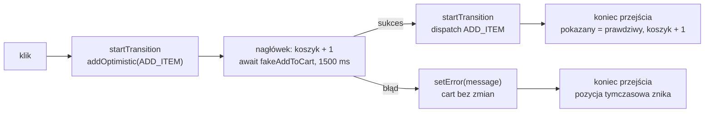

# Koszyk, który odpowiada przed serwerem

## Dodanie do koszyka trwa

W prawdziwym sklepie kliknięcie „Dodaj do koszyka” wysyła żądanie do serwera, który zapisuje koszyk w bazie. Odpowiedź przychodzi po czasie, którego aplikacja nie kontroluje. Do tej pory koszyk zmieniał się natychmiast, bo `dispatch` działa lokalnie. Żeby zobaczyć problem czekania, sklep dostaje symulację sieci w nowym pliku `app/lib/fakeApi.js`:

```js
// Symulacja wywołań sieciowych z opóźnieniem.
// Nie ma prawdziwego serwera: dane są wpisane w kod i nic nie jest pobierane.

// Symulacja dodania produktu do koszyka na serwerze (opóźnienie 1,5 s).
// shouldFail = true: serwer odmawia, czyli droga błędu w przycisku.
export function fakeAddToCart(product, shouldFail = false) {
  return new Promise((resolve, reject) =>
    setTimeout(
      () =>
        shouldFail
          ? reject(new Error('Błąd sieci — nie udało się dodać produktu'))
          : resolve({ success: true, product }),
      1500
    )
  );
}
```

Funkcja zwraca obiekt Promise, czyli wynik, który pojawi się później. Timer `setTimeout` odkłada rozstrzygnięcie o 1500 ms. Po tym czasie Promise spełnia się obiektem `{ success: true, product }` albo, gdy drugi argument ma wartość `true`, zostaje odrzucony z błędem „Błąd sieci”. Obie drogi da się w ten sposób przejść bez prawdziwego serwera.

Półtorej sekundy bez żadnej reakcji to długo. Użytkownik nie wie, czy kliknięcie zadziałało, więc klika drugi raz. Drugie kliknięcie wysyła drugie żądanie, a w koszyku ląduje druga paczka kawy, której nikt nie zamierzał kupić.

## Czym jest interfejs optymistyczny

**Interfejs optymistyczny** (*optimistic UI*) odwraca kolejność. Najpierw pokazuje wynik, którego się spodziewa, a dopiero potem czeka na potwierdzenie. Jeśli potwierdzenie przyjdzie, nic się nie zmienia, bo ekran już wygląda właściwie. Jeśli przyjdzie błąd, ekran wraca do stanu sprzed kliknięcia.

Morten Barklund w *React in Depth* opisuje tę technikę przy pamięci podręcznej danych, czyli lokalnej kopii danych z serwera, którą aplikacja trzyma w przeglądarce. Przy wysłaniu zmiany lokalny obraz danych od razu zmienia się tak, jak zmieni go serwer. Nieudane żądanie cofa wszystkie zmiany optymistyczne:

> **„Nieudana zmiana to to samo co stan wyjściowy: nic się nie zmienia.”**
>
> *„A failed mutation is the same as status quo: nothing changes.”*
>
> — Morten Barklund, *React in Depth*

Po udanym żądaniu miejsce danych optymistycznych zajmują prawdziwe dane z odpowiedzi serwera. Barklund zaznacza, że optymistyczna wartość ma tylko zakryć krótki czas oczekiwania, więc może być uproszczona.

React 19 ma do tego własny hook. Dokumentacja definiuje go jednym zdaniem:

> **„`useOptimistic` to hook Reacta, który pozwala optymistycznie zaktualizować interfejs.”**
>
> *„useOptimistic is a React Hook that lets you optimistically update the UI.”*
>
> — dokumentacja React, *useOptimistic*

Hook nie wysyła żądań i nic nie wie o sieci. Zarządza wyłącznie tym, co widać na ekranie w czasie trwania operacji.

## Najmniejszy przykład

Przycisk „polub” poza sklepem pokazuje nową liczbę od razu, a prawdziwy licznik zwiększa dopiero po odpowiedzi „serwera”. Wariant z propem `fail` dostaje odmowę:

```jsx
import { useState, useOptimistic, startTransition } from 'react';

const wait = ms => new Promise(r => setTimeout(r, ms));

function Like({ fail }) {
  const [likes, setLikes] = useState(0);           // wartość prawdziwa
  const [shown, setShown] = useOptimistic(likes);  // to, co widać na ekranie

  function click() {
    startTransition(async () => {
      setShown(likes + 1);                     // ekran od razu pokazuje 1
      try {
        await wait(300);                       // „serwer” odpowiada po 300 ms
        if (fail) throw new Error('odmowa');
        setLikes(l => l + 1);                  // prawdziwa wartość dogania wyświetlaną
      } catch {}                               // odmowa: wartość prawdziwa zostaje 0
    });
  }
  return <button onClick={click}>{shown}</button>;
}
// <Like />:      0 → 1 od razu, po 300 ms nadal 1
// <Like fail />: 0 → 1 od razu, po 300 ms z powrotem 0
```

Hook **`useOptimistic(value)`** zwraca parę: wartość do wyświetlenia i funkcję, która ustawia wartość tymczasową. Gdy nic nie trwa, wyświetlana wartość jest równa prawdziwej. Wartość tymczasowa potrzebuje okna, czyli chwili, od której stoi na ekranie, i końca, po którym znika. To okno wyznacza **przejście** (*Transition*), aktualizacja, której przebieg React śledzi od startu do końca. Funkcja **`startTransition`** oznacza przekazaną funkcję jako przejście. Dopóki ono trwa, ekran pokazuje wartość tymczasową, a po jego końcu hook oddaje wartość prawdziwą. W wariancie z odmową wartość prawdziwa się nie zmieniła, więc przycisk wraca do 0 bez żadnego kodu cofającego.

Funkcję przekazaną do `startTransition` dokumentacja nazywa **akcją**. To inne znaczenie słowa niż przy reducerze: tam akcja jest obiektem, który opisuje zmianę, a tu funkcją, która ją wykonuje.

## Wartość prawdziwa i wartość optymistyczna

Pełna sygnatura hooka to `useOptimistic(value, reducer?)`. Pierwszy argument to **wartość prawdziwa**. Według dokumentacji hook zwraca ją zawsze wtedy, gdy nie trwa żadna akcja. Drugi, opcjonalny argument to czysta funkcja, która z bieżącego stanu i przekazanej wartości wylicza stan optymistyczny. Bez niej stanem optymistycznym staje się wartość przekazana do settera.

Dokumentacja rozpisuje drogę jednej aktualizacji na pięć kroków, które w `Like` wyglądają tak:

1. `setShown(likes + 1)` od razu wywołuje render z wartością 1.
2. W czasie `await` ta wartość zostaje na ekranie.
3. `setLikes` planuje zmianę wartości prawdziwej.
4. Gdyby nowa wartość wymagała jeszcze czekania na dane, ekran nadal pokazywałby 1.
5. Na końcu obie wartości trafiają na ekran w jednym **zatwierdzeniu**, czyli w jednej zmianie DOM.

> **„Nie ma dodatkowego renderu, który by go »czyścił«. Stan optymistyczny i prawdziwy schodzą się w tym samym renderze, gdy przejście się kończy.”**
>
> *„There’s no extra render to “clear” the optimistic state. The optimistic and real state converge in the same render when the Transition completes.”*
>
> — dokumentacja React, *useOptimistic*

Render, który pokazuje nową wartość prawdziwą, jest tym samym renderem, który zdejmuje wartość tymczasową. Na ekranie nie ma więc chwili, w której przycisk pokazuje znów starą liczbę.

Ten sam mechanizm obsługuje porażkę. Gdy akcja rzuci wyjątek, przejście i tak się kończy, a React renderuje z aktualną wartością prawdziwą. Zasada „nieudana zmiana niczego nie zmienia” działa więc sama, o ile akcja nie zdążyła przed błędem zmienić wartości prawdziwej.

## Przejście trzyma wartość tymczasową

Setter z `useOptimistic` działa tylko w akcji, czyli w funkcji przekazanej do `startTransition` albo do atrybutu `action` formularza. Bez przejścia React nie wie, kiedy okno wartości tymczasowej ma się zamknąć. Wywołanie settera w zwykłej procedurze obsługi zdarzenia React zgłasza błędem:

```
An optimistic state update occurred outside a transition or action. To fix, move the update to an action, or wrap with startTransition.
```

Komunikat podaje obie dopuszczalne drogi: przenieść aktualizację do akcji albo owinąć ją w `startTransition`. Dokumentacja dodaje, że stan optymistyczny wyrenderuje się wtedy tylko na moment. Druga granica dotyczy renderu: setter wywołany wprost w ciele komponentu rzuca wyjątek „Cannot update optimistic state while rendering.” i strona kończy się ekranem błędu. <u>Setter stanu optymistycznego wywołuje się wyłącznie wewnątrz akcji albo przejścia</u>.

Formularz z funkcją w atrybucie `action` uruchamia ją w przejściu sam, więc tam `startTransition` nie jest potrzebne. Przycisk z `onClick` takiego udogodnienia nie ma i wywołuje `startTransition` jawnie.

## Koszyk optymistyczny w dostawcy

W sklepie wartością prawdziwą jest cały koszyk. Trzyma go `useReducer` w `CartProvider`, więc tam stoi też hook optymistyczny. W pliku `app/context/CartContext.jsx` import z `react` dostaje `useOptimistic`. Dostawca dostaje jedną linię i nową wartość kontekstu:

```jsx
import { createContext, useContext, useOptimistic, useReducer } from 'react';
```

```jsx
export function CartProvider({ children }) {
  const [cart, dispatch] = useReducer(cartReducer, initialCartState);
  // Koszyk optymistyczny: prawdziwy koszyk plus akcje, które czekają na serwer.
  const [optimisticCart, addOptimistic] = useOptimistic(cart, cartReducer);

  return (
    <CartContext value={{ cart: optimisticCart, dispatch, addOptimistic }}>
      {children}
    </CartContext>
  );
}
```

Drugim argumentem hooka jest **reducer stanu optymistycznego**: funkcja, która z bieżącej wartości i przekazanej akcji liczy wartość do pokazania. Tu to ten sam `cartReducer`, więc akcja tymczasowa `ADD_ITEM` liczy się dokładnie tak jak prawdziwa: nowy produkt dostaje `qty: 1`, a produkt już obecny ilość większą o jeden. Kontekst podaje `optimisticCart` pod starą nazwą `cart`. `CartSummary` i strona `/cart` pokazują więc koszyk razem z akcjami w drodze, bez żadnej zmiany w ich kodzie.

Dokumentacja wyjaśnia, dlaczego przy danych złożonych reducer jest potrzebny. Jeśli wartość prawdziwa zmieni się w trakcie akcji, React uruchomi reducer jeszcze raz, z nowym koszykiem i tymi samymi akcjami tymczasowymi. Akcja optymistyczna trafia więc zawsze na wierzch najnowszych danych. Setter z gotową wartością, w stylu `addOptimistic(cart + 1)`, widziałby tylko koszyk z chwili kliknięcia.

## Przycisk, który wysyła akcję optymistyczną

Nowy plik `app/components/AddToCartButton.jsx` pobiera z kontekstu obie funkcje i wysyła tę samą akcję dwa razy: najpierw jako tymczasową, po odpowiedzi serwera jako prawdziwą.

```jsx
'use client';

import { startTransition, useState } from 'react';
import { useCart } from '../context/CartContext';
import { fakeAddToCart } from '../lib/fakeApi';

export default function AddToCartButton({ product }) {
  const { dispatch, addOptimistic } = useCart();
  const [error, setError] = useState(null);

  function handleAdd() {
    setError(null);
    startTransition(async () => {
      addOptimistic({ type: 'ADD_ITEM', product }); // ekran od razu: produkt w koszyku
      try {
        await fakeAddToCart(product);               // symulowane żądanie, 1,5 s
        startTransition(() => {
          dispatch({ type: 'ADD_ITEM', product });  // zapis w prawdziwym koszyku po sukcesie
        });
      } catch (err) {
        setError(err.message);                      // pozycja tymczasowa sama zniknie
      }
    });
  }

  return (
    <>
      <button onClick={handleAdd}>Dodaj do koszyka</button>
      {error && <span> Błąd: {error}</span>}
    </>
  );
}
```

Funkcja `handleAdd` czyści poprzedni błąd i uruchamia przejście z funkcją asynchroniczną. W przejściu `addOptimistic` dopisuje akcję tymczasową, a nagłówek koszyka zmienia się w tej samej chwili. Potem akcja czeka na `fakeAddToCart`. Po sukcesie `dispatch` zapisuje produkt w prawdziwym koszyku. Po porażce `catch` zapisuje komunikat w `error`, a koszyka nikt nie cofa ręcznie. Pusty fragment `<>…</>` zwraca przycisk i komunikat obok siebie bez dodatkowego elementu w DOM.

Wewnętrzne `startTransition` wokół `dispatch` ma konkretny powód. Dokumentacja zaznacza, że aktualizacje stanu po `await` nie należą już do przejścia. Bez owinięcia `dispatch` wykonałby się od razu, jeszcze przed końcem przejścia, a reducer stanu optymistycznego dołożyłby akcję tymczasową do koszyka, który ma już kawę. Na jeden render nagłówek pokazałby wtedy „2 szt. — 99.98 zł”, a przy dwóch szybkich kliknięciach podwojenie trwa około 0,3 s. Owinięty `dispatch` trafia na ekran w tym samym zatwierdzeniu, w którym znika akcja tymczasowa. <u>Aktualizację wartości prawdziwej po `await` owija się w kolejne `startTransition`</u>.

Przycisk nie jest blokowany na czas zapisu. Drugie kliknięcie od razu widać w nagłówku jako drugą sztukę, więc użytkownik nie klika w ciemno, a każde kliknięcie wysyła własne żądanie i własną akcję.

## Rysunek 4.7 — półtorej sekundy w życiu koszyka



Na Rysunku 4.7 pozycja tymczasowa żyje w środkowym prostokącie, a wynik widać od pierwszej chwili. Gałąź sukcesu kończy się tym samym obrazem, który był już na ekranie, więc w nagłówku nic się nie zmienia. <u>Gałąź błędu kończy się koszykiem sprzed kliknięcia</u>, bo prawdziwy `cart` nigdy nie dostał tej akcji.

## Lista produktów z nowym przyciskiem

W pliku `app/components/ProductList.jsx` znika import `useCart` i linia `const { dispatch } = useCart();`. Dochodzi import przycisku, a sam przycisk zastępuje wbudowany `<button>`:

```jsx
import AddToCartButton from './AddToCartButton';
```

```jsx
            <AddToCartButton product={product} />
```

Lista przestała czytać kontekst, bo funkcje koszyka potrzebne są teraz tylko przyciskowi, a przycisk pobiera je sam. Każdy z pięciu egzemplarzy `AddToCartButton` ma własny komunikat błędu, a wszystkie wysyłają akcje do jednego koszyka optymistycznego. Po kliknięciu przy kawie nagłówek od razu pokazuje „Koszyk: 1 szt. — 49.99 zł” i po 1,5 s nic się w nim nie zmienia. Kawa, a 0,3 s później herbata, dają kolejno 1 i 2 sztuki, bez żadnego cofania: druga akcja tymczasowa liczy się na wierzchu pierwszej.

## Gdy serwer odmówi

Drogę błędu daje wywołanie z drugim argumentem `true`:

```jsx
await fakeAddToCart(product, true); // shouldFail = true: Promise zostaje odrzucony po 1,5 s
```

Odrzucony Promise rzuca wyjątek w miejscu `await`. Łapie go blok `catch`, który zapisuje komunikat w `error`, a `dispatch` nie pada. Nagłówek od razu pokazuje „Koszyk: 1 szt. — 49.99 zł”, a po 1,5 s, razem z końcem przejścia, wraca do „Koszyk: 0 szt. — 0.00 zł”. Obok przycisku stoi „Błąd: Błąd sieci — nie udało się dodać produktu”. To pełny wzorzec interfejsu optymistycznego: wynik na ekranie przed odpowiedzią i cofnięcie przy odmowie.

Bez `catch` odrzucenie przepadłoby dla interfejsu. **Granica błędów** to komponent pokazujący komunikat w miejscu poddrzewa, które rzuciło wyjątek. Samodzielna funkcja `startTransition` nie należy jednak do żadnego komponentu, więc żadna granica go nie przejmie. Koszyk i tak by się cofnął, ale bez słowa wyjaśnienia.

## Kiedy optymizm się nie opłaca

Stan optymistyczny obiecuje wynik, którego jeszcze nie ma. Takie założenie kosztuje mało tylko wtedy, gdy odmowa zdarza się rzadko i łatwo ją zrozumieć. Dodanie kawy spełnia oba warunki: przy błędzie użytkownik widzi, że kawa zniknęła z koszyka, czyta komunikat i klika jeszcze raz. Płatność ich nie spełnia. Napis „zapłacono” pokazany przed odpowiedzią banku, a potem cofnięty, myli bardziej niż zwykły wskaźnik ładowania.

Hook niczego nie zapisuje na stałe i nie pamięta wyniku. Wartość tymczasowa istnieje tylko do końca przejścia, a o porażce informuje osobny stan, jak `error` w przycisku. Gdy komponent potrzebuje tylko informacji, czy coś trwa, wystarczy porównanie: `optimisticCart !== cart` oznacza, że któraś akcja wciąż czeka na serwer.

## Rozszerzenie: pozycja oznaczona jako niepotwierdzona

Reducer stanu optymistycznego nie musi być tym samym reducerem co prawdziwy. Dokumentacja pokazuje wariant, w którym pozycja tymczasowa niesie flagę. Poniższy fragment nie należy do projektu:

```jsx
// Rozszerzenie spoza demo: optymistyczne wiersze z flagą, wzór z dokumentacji useOptimistic.
const [optimisticItems, addOptimisticItem] = useOptimistic(
  items,
  (currentItems, product) => [
    ...currentItems,
    { ...product, qty: 1, pending: true }, // pending: serwer jeszcze nie potwierdził
  ]
);
```

Wiersz z polem `pending: true` może pokazać dopisek „(dodawanie)” albo szarszy kolor. Gdy rodzic zapisze potwierdzoną pozycję w `items`, na ekranie zostaje wersja bez flagi. Użytkownik widzi wtedy nie tylko wynik, ale i to, że nie jest on jeszcze pewny.

## Rozszerzenie: dwa przyciski w tym samym czasie

Każde kliknięcie uruchamia osobne przejście, ale przejścia nie są od siebie niezależne. Dokumentacja `startTransition` mówi, że przy kilku trwających przejściach React obecnie łączy je w jedno (*„React currently batches them together”*) i nazywa to ograniczeniem, które może zniknąć w przyszłych wersjach. Dla koszyka optymistycznego skutek jest niewidoczny: obie akcje tymczasowe stoją na ekranie od chwili kliknięcia, a prawdziwy koszyk dogania je po zakończeniu połączonych przejść. <u>Wartość tymczasowa trwa do końca wszystkich połączonych przejść</u>, a nie tylko własnej akcji.

> 💡 **Zapamiętaj:** `useOptimistic(cart, cartReducer)` pokazuje koszyk z akcjami w drodze tylko w czasie trwania przejścia i sam wraca do wartości prawdziwej, także po odmowie serwera. Zapis wartości prawdziwej po `await` owija się w kolejne `startTransition`, inaczej przez chwilę na ekranie stoją obie wersje naraz.

