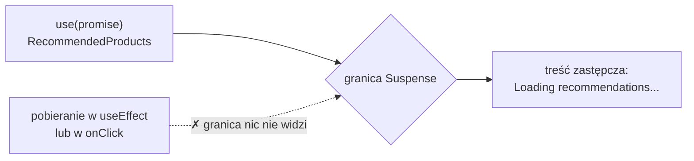

# Komponent, który czeka na dane

## Odczyt, którego nie da się przewidzieć

Przycisk dodawania obsługiwał **zapis**, czyli zmianę danych wywołaną przez użytkownika. Przy zapisie wiadomo, jak ma wyglądać wynik, więc koszyk pokazuje go z wyprzedzeniem, zanim serwer odpowie. Rekomendacje to **odczyt**: strona potrzebuje danych, których jeszcze nie ma, więc nie ma czego pokazać zawczasu. Zostaje czekanie, a czekanie trzeba czymś wypełnić. <u>Zapis użytkownika obsługuje `useOptimistic`, a odczyt danych z opóźnieniem `use` razem z granicą Suspense</u>.

Pod listą produktów sklep pokaże sekcję „You may also like”. Dane do niej przychodzą z symulowanego serwera. Na końcu pliku `app/lib/fakeApi.js`, pod funkcją `fakeAddToCart`, dochodzi druga funkcja:

```js
// Symulacja pobrania polecanych produktów (opóźnienie 2 s).
// shouldFail = true: Promise zostaje odrzucony, czyli droga błędu sekcji.
export function fetchRecommended(shouldFail = false) {
  return new Promise((resolve, reject) =>
    setTimeout(
      () =>
        shouldFail
          ? reject(new Error('No connection — could not load recommendations'))
          : resolve([
              { id: 10, name: 'Manual coffee grinder', price: 89.99 },
              { id: 11, name: 'Thermos 0.5L',            price: 55.00 },
              { id: 12, name: 'Coffee filters x100',     price: 12.50 },
            ]),
      2000
    )
  );
}
```

Funkcja działa jak `fakeAddToCart`, tylko czeka dłużej. Po 2000 ms Promise spełnia się tablicą trzech produktów: młynka do kawy, termosu i filtrów. Z argumentem `true` zostaje odrzucony z komunikatem o braku połączenia. Identyfikatory zaczynają się od 10, więc nie kolidują z produktami z katalogu.

Przez te dwie sekundy strona musi coś pokazać. Koszyk i lista produktów mają dane od razu. Bez osobnego mechanizmu cała strona czekałaby na najwolniejszy fragment albo każdy komponent musiałby sam pilnować flagi ładowania.

## Najmniejszy przykład: `use` pod granicą Suspense

Mechanizm ma dwie części. Komponent, który potrzebuje danych, czyta Promise funkcją `use`. Komponent wyżej w drzewie stawia **granicę Suspense** (*Suspense boundary*), czyli element `<Suspense>`, który do czasu gotowości dzieci pokazuje **treść zastępczą** (*fallback*). Najmniejszy przykład poza sklepem:

```jsx
import { Suspense, use } from 'react';

// Promise powstaje poza komponentem, więc każdy render dostaje ten sam obiekt
const namesPromise = new Promise(r => setTimeout(() => r(['Ala', 'Ola']), 500));

function Names() {
  const names = use(namesPromise);     // czeka tu, aż Promise się spełni
  return <ul>{names.map(n => <li key={n}>{n}</li>)}</ul>;
}

<Suspense fallback={<p>Loading...</p>}>  {/* granica: co pokazać w czasie czekania */}
  <Names />
</Suspense>
// najpierw: <p>Loading...</p>, po 500 ms: <ul><li>Ala</li><li>Ola</li></ul>
```

Przez pierwsze 500 ms w miejscu granicy stoi napis z propa `fallback`. Po spełnieniu Promise React renderuje `Names` jeszcze raz i lista zastępuje napis. Ten sam układ wyrenderowany już po spełnieniu Promise od razu pokazuje listę, bez treści zastępczej.

## Co robi `use`

Funkcja **`use`** z React 19 odczytuje wartość z Promise albo z kontekstu. Gdy Promise jest już spełniony, `use` od razu zwraca jego wynik. Gdy jeszcze trwa, komponent **zawiesza się** (*suspends*): React przerywa jego render i wraca do niego, gdy wynik będzie gotowy. Kod poniżej linii z `use` zakłada więc, że dane już są. W `Names` nie ma `useState` z danymi, `useEffect` ani flagi `isLoading`.

Przerwany render nie zostawia po sobie niczego. React nie wstrzymuje wykonania funkcji w połowie, tylko porzuca ten render i po spełnieniu Promise wywołuje komponent od początku. Dlatego Promise w przykładzie powstaje poza komponentem.

Maximilian Schwarzmüller w *React Key Concepts* opisuje współpracę obu części krótko. Według niego `use()` automatycznie współdziała z otaczającym komponentem `Suspense` i informuje go o bieżącym stanie pobierania, czyli o tym, czy Promise jest już rozstrzygnięty. Dodaje, że w komponencie serwerowym prościej napisać `await`, a `use` przydaje się tam, gdzie `async/await` jest niedostępne, czyli w komponencie klienckim.

## Komponent z rekomendacjami

Nowy plik `app/components/RecommendedProducts.jsx` stosuje ten sam wzór w sklepie:

```jsx
'use client';

import { use } from 'react';

// Komponent zawiesza się, dopóki Promise się nie spełni.
// Rodzic musi go owinąć w <Suspense fallback={...}>.
// Gdy Promise zostanie odrzucony, wyjątek przejmuje najbliższa granica błędów.
export default function RecommendedProducts({ recommendedPromise }) {
  const recommended = use(recommendedPromise); // tu komponent czeka na dane

  return (
    <section>
      <h3>You may also like</h3>
      <ul>
        {recommended.map(p => (
          <li key={p.id}>
            {p.name} — {p.price.toFixed(2)} PLN
          </li>
        ))}
      </ul>
    </section>
  );
}
```

Komponent dostaje Promise w propsie `recommendedPromise` i czyta go wywołaniem `use(recommendedPromise)`. Kod poniżej tej linii zakłada, że dane już są: `recommended` to zwykła tablica, po której przechodzi `map`. Komentarze w kodzie mówią, kto obsłuży oba przypadki brzegowe. <u>Czekanie obsłuży granica Suspense postawiona przez rodzica, a odrzucenie najbliższa granica błędów</u>, czyli komponent, który w miejsce zepsutego poddrzewa pokazuje komunikat.

Komponent nie dowiaduje się o czekaniu w żaden jawny sposób. Jego kod jest napisany tak, jakby dane były zawsze gotowe, a cała obsługa czekania leży poza nim. Promise przychodzi z zewnątrz, w propsie. `RecommendedProducts` tylko czyta wynik, a o tym, kiedy zapytanie startuje, decyduje rodzic. W sklepie rodzic tworzy ten Promise raz, na poziomie swojego modułu.

## Dwie sekundy z życia `RecommendedProducts`

Przebieg w sklepie, gdy komponent stoi pod granicą z treścią zastępczą „Loading recommendations...”, a Promise jeszcze trwa:

1. **Chwila 0.** React renderuje stronę. `CartSummary` i `ProductList` kończą render od razu. `RecommendedProducts` dochodzi do linii z `use`, a Promise jest w toku.
2. **Zawieszenie.** `use` przerywa render komponentu. Kod poniżej tej linii, z `map` i listą, w ogóle się nie wykonuje.
3. **Treść zastępcza.** React szuka najbliższej granicy Suspense nad komponentem i w jej miejscu wyświetla napis ładowania. Reszta strony jest już na ekranie i działa: przycisk „Add to cart” można kliknąć w czasie ładowania.
4. **Po 2000 ms.** Promise spełnia się tablicą trzech produktów, a React próbuje wyrenderować komponent jeszcze raz.
5. **Drugi render.** `use` widzi spełniony Promise i od razu zwraca tablicę. `map` tworzy trzy elementy `<li>` z kluczami 10, 11 i 12, a treść zastępcza znika.

Zawieszenie dotyczy tylko poddrzewa pod granicą Suspense. Stan koszyka, jego reducer i przyciski działają w tym czasie tak samo jak na stronie bez sekcji rekomendacji.

## Granica stoi wyżej niż komponent, który czeka

Tejas Kumar w *Fluent React* tłumaczy kierunek działania porównaniem z obsługą wyjątków.

> **„React Suspense działa jak blok try/catch. […] Leniwie ładowane i asynchroniczne elementy można umieścić w dowolnym miejscu drzewa komponentów, a potem złapać je komponentem `Suspense` w dowolnym miejscu powyżej, nawet jeśli granica leży w zupełnie innym pliku.”**
>
> *„React Suspense works like a try/catch block. […] You can place lazy-loaded and asynchronous primitives anywhere in your component tree, and then catch them with a `Suspense` component anywhere above it in the tree, even if your Suspense boundary is in a completely different file.”*
>
> — Tejas Kumar, *Fluent React*

Sklep stosuje dokładnie ten układ. `use` stoi w pliku `RecommendedProducts.jsx`, a granicę z napisem ładowania stawia osobny komponent nadrzędny i obejmuje nią tylko ten jeden komponent. Komponent, który czeka, nie ma informacji o tym, kto i gdzie pokaże napis ładowania. Kumar sam zaznacza, że Suspense działa „podobnie, ale nie dokładnie tak samo” jak `catch`. Blok `catch` kończy wykonanie kodu w `try`. Granica Suspense tylko wstrzymuje wyświetlenie poddrzewa i pokazuje je, gdy dane dotrą.

## Rysunek 4.8 — co włącza granicę Suspense



Na Rysunku 4.8 ciągła strzałka pokazuje źródło, które włącza granicę: w sklepie jest nim `use(promise)` w `RecommendedProducts`. Strzałka przerywana oznacza drogę, która wygląda podobnie, ale nie działa. Dane pobierane w efekcie albo w procedurze obsługi zdarzenia nie zawieszają renderu, więc granica nie ma czego złapać. Dokumentacja mówi to wprost:

> **„Suspense nie wykrywa pobierania danych wewnątrz efektu ani procedury obsługi zdarzenia. Włącza się wyłącznie w przypadkach wymienionych poniżej.”**
>
> *„Suspense does not detect when data is fetched inside an Effect or event handler. It only activates in the cases listed below.”*
>
> — dokumentacja React, *Suspense*

Efekt uruchamia się dopiero po zakończeniu renderu, a procedura obsługi zdarzenia działa poza renderem w ogóle. Obie drogi kończą render normalnie i czekanie muszą obsłużyć same.

> 💡 **Zapamiętaj:** komponent czytający Promise przez `use` zawiesza się do jego rozstrzygnięcia, a najbliższa granica `<Suspense>` nad nim pokazuje w tym czasie treść zastępczą. Komponent nie wie, że czeka: o tym, kiedy Promise powstaje i co widać w czasie czekania, decydują komponenty nad nim.


Materiał rozszerzony do tego slajdu: [`rozszerzenia/r08_use-i-suspense.md`](rozszerzenia/r08_use-i-suspense.md)
