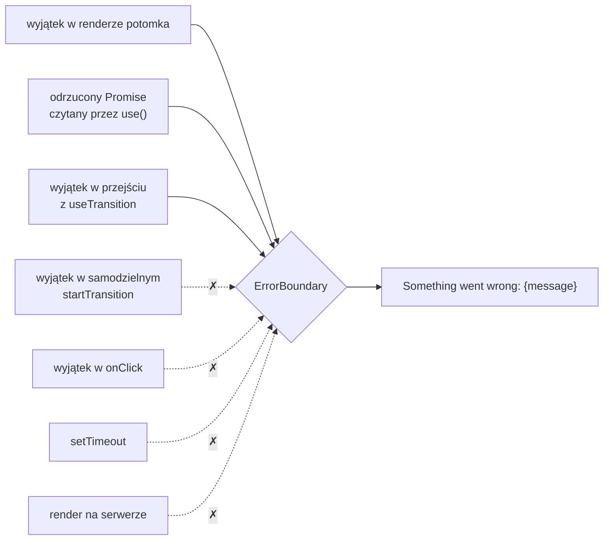

# Granica błędów: awaria jednej sekcji zamiast całej strony

## Co React robi z wyjątkiem w renderze

Promise z rekomendacjami może zostać odrzucony. Wtedy `use` w komponencie `RecommendedProducts` zamiast danych rzuci wyjątek w trakcie renderu. Bez żadnej ochrony skutek obejmuje całą aplikację:

> **„Domyślnie, jeśli aplikacja rzuci wyjątek w trakcie renderowania, React usunie jej interfejs z ekranu. Żeby temu zapobiec, fragment interfejsu można owinąć w granicę błędów.”**
>
> *„By default, if your application throws an error during rendering, React will remove its UI from the screen. To prevent this, you can wrap a part of your UI into an Error Boundary.”*
>
> — dokumentacja React, *Component*

W sklepie oznaczałoby to, że awaria jednej sekcji z polecanymi produktami zabiera ze sobą koszyk, katalog i nawigację. Użytkownik zostaje z pustą stroną, choć zepsuł się fragment, bez którego da się kupować.

Ta reguła jest decyzją projektową. Dokumentacja starszej wersji Reacta, przy wprowadzaniu tej zasady w React 16, uzasadnia ją tak:

> **„Dyskutowaliśmy nad tą decyzją, ale z naszego doświadczenia wynika, że gorzej jest zostawić na ekranie uszkodzony interfejs, niż usunąć go całkowicie.”**
>
> *„We debated this decision, but in our experience it is worse to leave corrupted UI in place than to completely remove it.”*
>
> — dokumentacja React, *Error Boundaries* (wersja archiwalna)

Ta sama strona podaje przykłady. W komunikatorze uszkodzony interfejs mógłby sprawić, że ktoś wyśle wiadomość do niewłaściwej osoby. W aplikacji płatniczej gorzej jest pokazać złą kwotę niż nie pokazać nic. **Granica błędów**, czyli komponent pokazujący treść zastępczą w miejscu poddrzewa, które rzuciło wyjątek, zawęża to usunięcie do jednego fragmentu. Alex Banks i Eve Porcello w *Learning React* zwracają uwagę, że granice da się składać. Jedna obejmuje całą aplikację, a w jej wnętrzu osobne chronią menu, ramkę z informacją i główną treść.

W Next.js granicę wokół całego segmentu trasy stawia plik `error.jsx`. Sekcja rekomendacji jest jednak tylko fragmentem strony głównej, więc potrzebuje granicy w kodzie komponentów. Taką granicę pisze się jako klasę.

## Klasa w JavaScripcie

Komponent klasowy to starszy zapis komponentu, który w nowym kodzie zastąpiły funkcje z hookami. Granica błędów nadal wymaga klasy, więc potrzebne są cztery elementy składni klas JavaScriptu. **Klasa** to wzór obiektów: opisuje pola i metody, a każde wywołanie `new` tworzy z niej nowy **egzemplarz** (*instance*).

```js
class Counter {
  constructor(start) { this.value = start; }           // new wywołuje konstruktor, this to nowy egzemplarz
  increment() { this.value += 1; }
  static describe(c) { return `licznik: ${c.value}`; } // metoda klasy, a nie egzemplarza
}
class StepCounter extends Counter {                    // dziedziczy pola i metody po Counter
  constructor(start, step) { super(start); this.step = step; } // super przed pierwszym this
  increment() { this.value += this.step; }             // zastępuje metodę z Counter
}
const c = new StepCounter(0, 5);
c.increment(); c.increment();
Counter.describe(c);  // 'licznik: 10'
c.describe;           // undefined: egzemplarz nie ma metody statycznej
```

**Konstruktor** (`constructor`) wykonuje się raz, przy `new`, i ustawia pola nowego egzemplarza. Słowo **`this`** wewnątrz konstruktora i metod wskazuje egzemplarz, na którym metoda została wywołana.

**`extends`** sprawia, że `StepCounter` ma wszystkie metody `Counter`, a własna metoda `increment` zastępuje odziedziczoną. **`super(start)`** uruchamia konstruktor klasy bazowej. Klasa pochodna musi go wywołać przed pierwszym użyciem `this`, inaczej `new` kończy się wyjątkiem `ReferenceError: Must call super constructor in derived class before accessing 'this' or returning from derived constructor`.

Metoda oznaczona **`static`** należy do samej klasy. Wywołuje się ją przez nazwę klasy (`Counter.describe(c)`), a egzemplarz jej nie ma, stąd `undefined` w ostatniej linii. Metoda statyczna nie ma też dostępu do pól egzemplarza przez `this`. Wszystko, czego potrzebuje, dostaje w argumentach.

## Komponent klasowy w Reakcie

Komponent klasowy to klasa dziedzicząca po `Component` z pakietu `react`. Najmniejszy przykład ze stanem liczy kliknięcia:

```jsx
class Clicker extends Component {
  constructor(props) {
    super(props);                  // konstruktor Component zapisuje propsy w this.props
    this.state = { count: 0 };     // stan to jedno pole egzemplarza
  }
  render() {                       // React wywołuje tę metodę przy każdym renderze
    return (
      <button onClick={() => this.setState({ count: this.state.count + 1 })}>
        {this.props.label}: {this.state.count}
      </button>
    );
  }
}
```

Po dwóch kliknięciach przycisk `<Clicker label="Kliknięcia" />` pokazuje „Kliknięcia: 2”. React tworzy egzemplarz klasy raz, przy montowaniu, a potem przy każdym renderze wywołuje tylko jego metodę `render`. Stan jest jednym obiektem w `this.state`. Metoda `this.setState` przyjmuje obiekt z polami do zmiany, według dokumentacji `Component` łączy go płytko z bieżącym stanem i planuje render. Funkcja strzałkowa w `onClick` przejmuje `this` z metody `render`, więc wskazuje ten sam egzemplarz.

## Klasa `ErrorBoundary` w sklepie

Sklep dostaje własną granicę w nowym pliku `app/components/ErrorBoundary.jsx`:

```jsx
'use client';

import { Component } from 'react';

// Granica błędów w React 19 musi być komponentem klasowym.
// Łapie wyjątki z renderu poddrzewa, także odrzucony Promise czytany przez use().
export default class ErrorBoundary extends Component {
  constructor(props) {
    super(props);
    this.state = { hasError: false, error: null };
  }

  // React wywołuje ją w trakcie renderu, gdy któreś dziecko rzuci wyjątek.
  // Musi być czystą funkcją: dostaje błąd i zwraca nowy stan.
  static getDerivedStateFromError(error) {
    return { hasError: true, error };
  }

  // React wywołuje ją po zatwierdzeniu zmian, więc wolno tu wykonać efekt uboczny (zapis do konsoli).
  componentDidCatch(error, info) {
    console.error('ErrorBoundary caught:', error, info.componentStack);
  }

  render() {
    if (this.state.hasError) {
      return <p>Something went wrong: {this.state.error?.message}</p>;
    }
    return this.props.children;
  }
}
```

Konstruktor i `render` działają tak jak w liczniku. Nowe są dwie metody, które React wywołuje sam, gdy któryś potomek rzuci wyjątek. `getDerivedStateFromError` zwraca stan z flagą `hasError` i obiektem błędu, a `render` pokazuje wtedy komunikat z treścią błędu. Dopóki nic się nie psuje, granica jest niewidoczna, bo oddaje `this.props.children` bez zmian.

Operator `?.` w `this.state.error?.message` zabezpiecza odczyt na wypadek wyjątku, który nie jest obiektem `Error`. Dokumentacja `Component` przypomina, że JavaScript pozwala rzucić dowolną wartość, także napis, a nawet `null` (*„JavaScript allows to `throw` any value, including strings or even `null`”*). Po `throw null` zwykłe `error.message` samo rzuciłoby wyjątek w komunikacie zastępczym, a z `?.` komunikat kończy się na „Something went wrong:”.

Plik zaczyna się od `'use client'`, bo granica trzyma stan i przełącza widok w przeglądarce, a stan mają tylko komponenty klienckie. Metoda statyczna nie widzi `this`, więc `getDerivedStateFromError` nie może niczego zapisać ani wysłać. Może tylko wyliczyć nowy stan z błędu.

## Dlaczego nadal klasa

Dokumentacja zaleca pisanie komponentów jako funkcji. Granica błędów jest wyjątkiem:

> **„Obecnie nie da się napisać granicy błędów jako komponentu funkcyjnego. Nie trzeba jednak pisać tej klasy samodzielnie. Można na przykład użyć zamiast niej biblioteki `react-error-boundary`.”**
>
> *„There is currently no way to write an Error Boundary as a function component. However, you don’t have to write the Error Boundary class yourself. For example, you can use react-error-boundary instead.”*
>
> — dokumentacja React, *Component*

Dokumentacja przy obu metodach zaznacza, że w komponentach funkcyjnych nie ma jeszcze ich bezpośredniego odpowiednika. Hooki nie mają więc sposobu, żeby przechwycić wyjątek z renderu potomka. Sklep pisze klasę samodzielnie, żeby było widać, co robi każda metoda.

## Dwie metody, dwie fazy

Podział na dwie metody wynika z faz pracy Reacta: najpierw render, czyli wyliczenie nowego drzewa, potem zatwierdzenie, czyli zmiana DOM. Dokumentacja opisuje `getDerivedStateFromError` jako metodę, która powinna być **czystą funkcją**. Działa w trakcie renderowania, więc dostaje błąd i zwraca stan, na podstawie którego `render` pokaże komunikat. Render może zostać przerwany i powtórzony, dlatego nie wolno w nim wysyłać żądań ani zapisywać czegokolwiek na zewnątrz. Jeśli potrzebny jest efekt uboczny, na przykład wysłanie raportu do serwisu analitycznego, trzeba według dokumentacji zaimplementować także `componentDidCatch`.

`componentDidCatch` działa po zatwierdzeniu zmian, więc efekty uboczne są w niej dozwolone. Drugi argument, obiekt `info`, ma pole `componentStack`. To lista komponentów od tego, który rzucił wyjątek, w górę drzewa, z nazwami i położeniem w kodzie. W wersji produkcyjnej nazwy są według dokumentacji skrócone przez minifikację.

## Rysunek 4.9 — co granica łapie, a czego nie



Na Rysunku 4.9 ciągłe strzałki to błędy, które granica przejmuje i zamienia na komunikat. Przerywane strzałki to błędy, których granica nie widzi. Dwie strzałki z przejściami wyglądają podobnie, a kończą się inaczej. O wyniku decyduje to, skąd pochodzi funkcja `startTransition`.

## Przejście związane z komponentem

Przejście (*Transition*) oznacza aktualizację, którą React śledzi i może odłożyć. Funkcję `startTransition` daje się wziąć z dwóch miejsc: z hooka `useTransition` albo bezpośrednio z pakietu `react`. Tylko pierwsza wersja należy do konkretnego komponentu, więc tylko jej błąd ma gdzie trafić w drzewie:

```jsx
function SaveButton() {
  const [isPending, startTransition] = useTransition(); // przejście związane z tym komponentem
  function handleClick() {
    startTransition(async () => {
      await save(); // odrzucony Promise rzuca wyjątek tutaj
    });
  }
  return <button onClick={handleClick}>{isPending ? 'Zapisywanie...' : 'Zapisz'}</button>;
}
```

Gdy `save()` zwraca odrzucony Promise, `<ErrorBoundary><SaveButton /></ErrorBoundary>` pokazuje „Something went wrong: Zapis nieudany”. Ślad komponentów w `componentDidCatch` zaczyna się wtedy od `SaveButton`. React zgłasza błąd przejścia w renderze komponentu, do którego przejście należy, więc wyjątek trafia do drzewa w tym samym miejscu co błąd renderu i przejmuje go najbliższa granica nad przyciskiem. Ten sam przycisk z `startTransition` zaimportowanym z `react` zostaje na ekranie, a wyjątek dociera do przeglądarki jako niezłapany błąd strony. Dokumentacja `useTransition` podaje przyczynę:

> **„Ponieważ samodzielna funkcja nie jest związana z żadnym komponentem, granica błędów nie może obsłużyć błędów z jej przejścia.”**
>
> *„Because the standalone function is not associated with a component, an Error Boundary cannot handle errors from its Transition.”*
>
> — dokumentacja React, *useTransition*

`AddToCartButton` w sklepie używa samodzielnej funkcji `startTransition`. <u>Jedynym miejscem, które obsługuje odmowę serwera przy dodawaniu do koszyka, jest blok `try/catch` w samym przycisku</u>. Bez niego wyjątek nie trafiłby do żadnej granicy, a kawa zniknęłaby z koszyka bez komunikatu.

## Czego granica nie widzi

Granica chroni to, co React wykonuje w trakcie renderu, bo tylko wtedy nie wie, co narysować. Dokumentacja `Component` wymienia cztery wyjątki od tej reguły: procedury obsługi zdarzeń, renderowanie po stronie serwera, błędy rzucone w samej granicy oraz kod asynchroniczny, jak `setTimeout`. Procedura `onClick` wykonuje się już po renderze, więc jej błąd łapie zwykły `try/catch` w jej kodzie. Na serwerze rolę granicy przejmuje najbliższa granica Suspense, która wstawia do HTML swoją treść zastępczą.

Granica nie chroni samej siebie. Błąd w jej komunikacie zastępczym trafia do granicy wyżej, a w sklepie wyżej żadnej granicy nie ma. Komunikat zastępczy powinien więc być najprostszym kodem w całej sekcji.

Zwykły `try/catch` nie zastąpi granicy także w komponencie nadrzędnym. Blok `try` wokół `return <RecommendedProducts … />` nie złapie błędu dziecka, bo zwrócenie elementu niczego jeszcze nie renderuje. Dziecko renderuje się później, a jego błąd idzie w górę drzewa komponentów, omijając ten blok. <u>Błąd renderu dziecka łapie tylko granica błędów nad nim.</u>

> 💡 **Zapamiętaj:** granica błędów to klasa z `getDerivedStateFromError` (czysta, zwraca stan) i opcjonalnie `componentDidCatch` (logowanie). Łapie błędy renderu poddrzewa i przejść z `useTransition`, ale nie błędy z procedur obsługi zdarzeń ani z samodzielnej funkcji `startTransition`. Po awarii granica nie wraca sama, potrzebuje nowego `key`.


Materiał rozszerzony do tego slajdu: [`rozszerzenia/r09_error-boundary.md`](rozszerzenia/r09_error-boundary.md)
