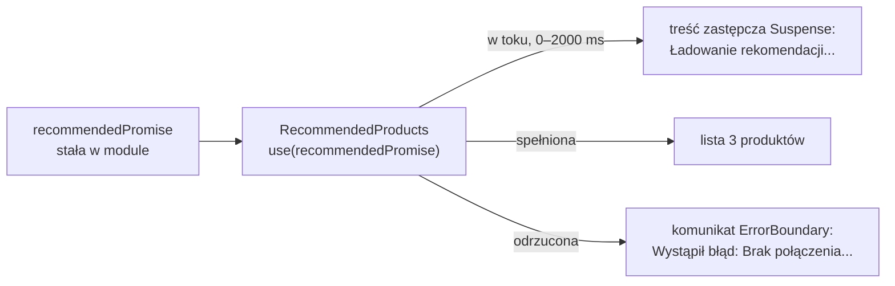

# Ładowanie i błąd wokół jednej sekcji

## Trzy stany sekcji rekomendacji

Sekcja „Polecamy również” może znaleźć się w jednym z trzech stanów. Dane jeszcze nie przyszły, dane przyszły albo zapytanie się nie udało. Komponent `RecommendedProducts` obsługuje tylko środkowy przypadek: dostaje gotową tablicę i rysuje listę. Czekanie przejmuje granica Suspense, a błąd granica błędów. Obie stawia nad nim nowy komponent `app/components/RecommendedSection.jsx`:

```jsx
'use client';

import { Suspense } from 'react';
import { fetchRecommended } from '../lib/fakeApi';
import RecommendedProducts from './RecommendedProducts';
import ErrorBoundary from './ErrorBoundary';

// Promise powstaje raz, przy pierwszym imporcie modułu, a nie przy każdym renderze.
// Wariant z błędem: fetchRecommended(true) daje odrzucony Promise, który łapie granica błędów.
const recommendedPromise = fetchRecommended();

export default function RecommendedSection() {
  return (
    <ErrorBoundary>
      <Suspense fallback={<p>Ładowanie rekomendacji...</p>}>
        <RecommendedProducts recommendedPromise={recommendedPromise} />
      </Suspense>
    </ErrorBoundary>
  );
}
```

Wywołanie `fetchRecommended()` stoi poza funkcją komponentu, więc wykonuje się raz, gdy moduł zostaje załadowany. `<Suspense>` przez dwie sekundy pokazuje napis „Ładowanie rekomendacji...”, a `<ErrorBoundary>` przejmuje odrzucony Promise.

Granica błędów stoi na zewnątrz, a granica Suspense wewnątrz, więc wyjątek rzucony także w samej treści zastępczej trafi do `ErrorBoundary`. `RecommendedProducts` dostaje Promise w propsie i czyta go przez `use`.

## Dlaczego Promise powstaje poza komponentem

Promise utworzony w komponencie, który sam wywołuje `use`, powstawałby przy każdej próbie renderu od nowa. Dokumentacja `use` wyjaśnia mechanizm:

> **„React nie zachowuje stanu dla renderów, które zawiesiły się przed zamontowaniem. Po każdym zawieszeniu React ponawia renderowanie od zera, więc każdy Promise utworzony w trakcie renderu powstaje od nowa.”**
>
> *„React doesn’t preserve state for renders that suspended before mounting. After each suspension, React retries rendering from scratch, so any Promise created during render is recreated.”*
>
> — dokumentacja React, *use*

Różnicę widać na dwóch komponentach, które czytają te same dane:

```jsx
const teaPromise = fetchTea();     // raz, przy pierwszym imporcie modułu

function TeaFromModule() {
  const teas = use(teaPromise);    // przy każdej próbie ten sam obiekt
  return <p>{teas.join(', ')}</p>;
}

function TeaFromRender() {
  const teas = use(fetchTea());    // każda próba renderu tworzy nowy, znów oczekujący Promise
  return <p>{teas.join(', ')}</p>;
}
```

Gdy `fetchTea` spełnia się po 100 ms, pierwszy komponent pokazuje listę. Drugi po półtorej sekundy nadal stoi przy treści zastępczej, a `fetchTea` wywołuje się przy każdej jego próbie od nowa. Nowy Promise jest znów nierozstrzygnięty, więc komponent znów się zawiesza. Konsola nie wypisuje przy tym żadnego ostrzeżenia, więc objaw wygląda jak bardzo wolne łącze.

Liczy się położenie Promise względem granicy Suspense. Model z trzema wariantami `fetchTea` daje trzy różne wyniki:

- **Promise w ciele komponentu nad granicą**, tak jakby `fetchRecommended()` stało w funkcji `RecommendedSection`, ładowania nie zapętla. Po spełnieniu Promise React ponawia render pod granicą, a nie komponentu nad nią. Każdy kolejny render tego komponentu tworzy jednak nowy Promise i granica znów pokazuje treść zastępczą.
- **Promise w `useState` komponentu nad granicą**, tworzony leniwym inicjalizatorem `useState(() => fetchTea())`, zostaje ten sam przy kolejnych renderach, bo ten komponent jest już zamontowany i ma swój stan.
- **Ten sam `useState` w komponencie, który wywołuje `use`**, zawodzi. Komponent zawieszony przed pierwszym zamontowaniem nie ma jeszcze stanu, więc przy każdej próbie inicjalizator tworzy nowy Promise. W ciągu niecałych dwóch sekund `fetchTea` wywołuje się 31 razy, a lista się nie pojawia.

Dokumentacja formułuje wymóg. Obiekty Promise przekazywane do `use` w komponentach klienckich muszą być zapamiętane, czyli przy kolejnych renderach ma wracać ten sam egzemplarz. Sposób zapamiętania zależy od frameworka, a bez frameworka dokumentacja dopuszcza prostą pamięć na poziomie modułu. Stała w module to jej najprostsza wersja: moduł JavaScriptu wykonuje się raz, przy pierwszym imporcie, więc stała przechowuje jeden obiekt przez cały czas życia strony. Promise może też powstać w komponencie serwerowym i przyjść do klienckiego w propsie. Sklep zostaje przy stałej w module, bo to najprostsza postać zapamiętania, a rekomendacje nie zależą ani od użytkownika, ani od żądania.

## Strona główna z sekcją rekomendacji

Strona główna dostaje import i jedną sekcję pod listą produktów. W `app/page.jsx` dochodzą dwie linie i pozioma kreska:

```jsx
import RecommendedSection from './components/RecommendedSection';

      <ProductList />
      <hr />
      <RecommendedSection />
```

Strona nadal jest komponentem serwerowym i tylko układa sekcje. Koszyk i katalog leżą poza obiema granicami, więc nie czekają na rekomendacje. Przycisk „Dodaj do koszyka” kliknięty w czasie ładowania działa normalnie: nagłówek od razu pokazuje „Koszyk: 1 szt.”, a pod kreską dalej trwa ładowanie.

## Rysunek 4.10 — jeden Promise, trzy obrazy na ekranie



Na Rysunku 4.10 lewa strona to jeden Promise utworzony raz, w module. Trzy strzałki to trzy stany tego samego Promise i to, co każdy zostawia na ekranie. Przez pierwsze dwie sekundy działa tylko granica Suspense. Po spełnieniu Promise żadna z granic niczego nie zasłania. Po odrzuceniu `use` rzuca wyjątek, który przechodzi przez granicę Suspense w górę i trafia do `ErrorBoundary`, a ta zastępuje komunikatem całą sekcję.

## Jedna stała w przeglądarce i na serwerze

Plik `RecommendedSection.jsx` ma dyrektywę `'use client'`, a jego kod wykonuje się w dwóch miejscach: na serwerze, przy przygotowaniu HTML, i w przeglądarce. Stała `recommendedPromise` powstaje więc w dwóch egzemplarzach.

- **W przeglądarce** moduł wykonuje się raz na załadowanie strony. Promise należy do jednej karty i znika przy przeładowaniu.
- **Na serwerze** moduł wykonuje się raz na proces serwera, a w trybie deweloperskim także po każdej zmianie pliku. Ten sam Promise obsługuje wszystkich użytkowników.

Z tego podziału wynikają cztery zachowania:

| Sytuacja | Co widać | Który Promise decyduje |
|---|---|---|
| pierwsze wejście po starcie serwera deweloperskiego | napis ładowania, po 2 s lista | serwerowy, jeszcze w toku |
| przeładowanie strony | lista od razu, w HTML | serwerowy, już spełniony |
| powrót z `/cart` linkiem po co najmniej 2 s od załadowania strony | lista od razu | przeglądarkowy, już spełniony |
| strona po `next build` | lista w zbudowanym HTML, bez napisu ładowania | ten z budowania, które czeka na spełnienie Promise |

## Awaria rekomendacji na serwerze i w przeglądarce

Drogę błędu pokazuje wariant z odrzuconym Promise w `app/components/RecommendedSection.jsx`:

```jsx
const recommendedPromise = fetchRecommended(true); // shouldFail = true: Promise odrzucony po 2 s
```

Najpierw błąd pojawia się na serwerze, gdzie granica błędów nie działa. Rolę przejmuje granica Suspense:

> **„Jeśli komponent rzuci wyjątek na serwerze, React nie przerwie renderowania na serwerze. Zamiast tego znajdzie najbliższy komponent `<Suspense>` nad nim i umieści jego treść zastępczą w wygenerowanym HTML.”**
>
> *„If a component throws an error on the server, React will not abort the server render. Instead, it will find the closest <Suspense> component above it and include its fallback (such as a spinner) into the generated server HTML.”*
>
> — dokumentacja React, *Suspense*

Na serwerze wyjątek trafia do logu (`⨯ Error: Brak połączenia — nie udało się załadować rekomendacji`), a HTML przychodzi z napisem ładowania. Tak samo wygląda w tym wariancie zbudowana strona `/`. W przeglądarce React renderuje sekcję jeszcze raz, a w trybie deweloperskim zgłasza, że przełączył się na renderowanie w przeglądarce (*„Switched to client rendering because the server rendering errored”*). Dalej błąd przechodzi tę drogę:

1. **`use` rzuca wyjątek.** Przeglądarkowy Promise zostaje odrzucony, więc `use` w `RecommendedProducts` rzuca zapisany obiekt `Error` z komunikatem „Brak połączenia — nie udało się załadować rekomendacji”.
2. **Błąd mija granicę Suspense.** Suspense obsługuje tylko czekanie, więc React idzie wyżej, do najbliższej granicy błędów.
3. **Granica błędów przejmuje wyjątek.** Jej metody ustawiają flagę błędu i zapisują go w konsoli, a `render` zwraca akapit „Wystąpił błąd: Brak połączenia — nie udało się załadować rekomendacji” w miejsce całej sekcji.

Komunikat zastępuje napis ładowania po 2,2–2,4 s od wejścia, bez przeładowania i bez zmiany adresu. Do tej chwili sekcją zajmuje się granica Suspense. Koszyk leży poza obiema granicami, więc kawa dodana w trakcie ładowania zostaje w nagłówku. W trybie deweloperskim React dopisuje własny wpis: „The above error occurred in the <RecommendedProducts> component. It was handled by the <ErrorBoundary> error boundary.”, który nazywa komponent zepsuty i granicę, która go przejęła.

<u>Odrzucony Promise zostaje odrzucony na zawsze</u>. Nowy `key` na `ErrorBoundary` montuje granicę od nowa, ale jej dziecko czyta ten sam obiekt z modułu i od razu rzuca ten sam wyjątek: komunikat wraca bez czekania. Ponowienie wymaga wymiany starego Promise na nowy.

## Jak duża ma być granica

Tejas Kumar w *Fluent React* pokazuje skrajny przypadek: granicę wokół całej aplikacji, w której jedno dziecko ładuje ciężki panel boczny. Treść zastępcza zasłania wtedy całą aplikację, dopóki panel się nie załaduje. Autor nazywa to kiepskim pomysłem, bo użytkownik traci dostęp do wszystkiego z powodu jednego panelu. Granica ma więc obejmować tylko komponenty, które czekają.

Dokumentacja Suspense ostrzega przed drugą skrajnością. Domyślnie całe drzewo wewnątrz jednej granicy traktowane jest jako jedna całość: gdy zawiesi się choćby jedno dziecko, treść zastępcza zastępuje wszystkie. Zagnieżdżone granice tworzą za to **sekwencję ładowania**, w której każdy poziom odsłania się, gdy dotrą jego dane. Dokumentacja dodaje, że granice nie powinny być drobniejsze niż sekwencja, którą użytkownik ma zobaczyć, a jej miejsca najlepiej uzgodnić z projektantem interfejsu.

Dla granic błędów dokumentacja podaje podobne kryterium:

> **„Przy wyborze szczegółowości granic błędów należy się zastanowić, gdzie ma sens wyświetlenie komunikatu o błędzie. Na przykład w komunikatorze sens ma granica wokół listy rozmów. Sens ma też granica wokół każdej pojedynczej wiadomości. Nie miałaby jednak sensu granica wokół każdego awatara.”**
>
> *„When you think about the granularity of Error Boundaries, consider where it makes sense to display an error message. For example, in a messaging app, it makes sense to place an Error Boundary around the list of conversations. It also makes sense to place one around every individual message. However, it wouldn’t make sense to place a boundary around every avatar.”*
>
> — dokumentacja React, *Component*

Sklep stosuje oba kryteria. Rekomendacje to osobna, niezależna sekcja, więc dostają własną parę granic. Koszyk i katalog nie korzystają z `use`, więc nie potrzebują granicy Suspense. Para wokół każdego z trzech polecanych produktów dałaby trzy napisy ładowania i trzy komunikaty o błędzie dla jednego zapytania. <u>Parę granic stawia się wokół fragmentu, który ma sens pokazać lub ukryć jako całość</u>. Pliki `loading.jsx` i `error.jsx` z Next.js tworzą tę samą parę dla całego segmentu trasy.

Zagnieżdżanie ma jeszcze jedną konsekwencję. Według dokumentacji treść zastępcza, która sama się zawiesi, włącza najbliższą granicę Suspense nad nią. Treść zastępcza nie powinna więc ładować własnych danych. Napis „Ładowanie rekomendacji...” niczego nie pobiera, więc pokazuje się od razu.

## Rozszerzenie: cena Promise w module

Stabilność ma cenę: dane nigdy się nie odświeżają. Promise rozstrzyga się raz i zostaje rozstrzygnięty do przeładowania strony, więc powrót z `/cart` po upływie dwóch sekund od załadowania strony pokaże od razu te same trzy produkty. W sklepie z prawdziwymi rekomendacjami byłby to błąd.

Stała w module ma jeszcze jedno ograniczenie: mieści dokładnie jeden Promise. Rekomendacje osobne dla kawy i dla herbaty potrzebowałyby osobnego Promise na każdą kategorię. Dokumentacja `use` pokazuje na to **pamięć Promise z kluczem**, czyli mapę, w której kluczem jest adres zapytania, a wartością Promise. Stała `recommendedPromise` to szczególny przypadek tej mapy z jednym kluczem.

Odświeżenie danych dokumentacja opisuje jako unieważnienie wpisu w pamięci i nowe pobieranie wewnątrz `startTransition`, czyli aktualizacji, przy której React trzyma na ekranie poprzedni widok. Nowy Promise powstaje wtedy w procedurze obsługi kliknięcia i trafia do stanu komponentu nadrzędnego. W sklepie przycisk „Odśwież rekomendacje” wymagałby więc przeniesienia Promise ze stałej modułu do stanu `RecommendedSection`.

## Rozszerzenie: wartość w module serwera jest wspólna dla żądań

Wspólny Promise na serwerze jest w sklepie dopuszczalny, bo rekomendacje są takie same dla każdego i nie zawierają danych użytkownika. <u>Wartość w module serwera jest wspólna dla wszystkich żądań, więc nie może trzymać niczego, co należy do jednego użytkownika</u>. Koszyk tego problemu nie ma, bo żyje w `useReducer` wewnątrz `CartProvider`, czyli w stanie egzemplarza komponentu, osobnym dla każdego żądania i każdej karty.

## Rozszerzenie: komponent tylko dla przeglądarki

Dokumentacja Suspense opisuje drugi wariant. Gdy w przeglądarce render się uda, React nie pokazuje błędu użytkownikowi, bo treść ostatecznie się wyświetliła. Dokumentacja wykorzystuje to celowo: komponent, który ma działać tylko w przeglądarce, rzuca wyjątek, gdy `typeof window === 'undefined'`, a granica Suspense nad nim wstawia do HTML z serwera treść zastępczą. W sklepie ten wariant nie zachodzi, bo Promise odrzuca się w obu środowiskach.

> 💡 **Zapamiętaj:** Promise czytany przez `use` powstaje poza komponentem, który go czyta, bo komponent zawieszony przed zamontowaniem nie ma stanu. W sklepie zapamiętuje go stała w module, granica błędów stoi na zewnątrz, a granica Suspense wewnątrz.

