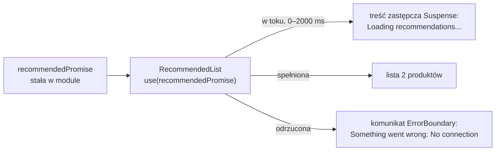

# Ładowanie i błąd wokół jednej sekcji

## Trzy stany sekcji rekomendacji

Sekcja „You may also like” może znaleźć się w jednym z trzech stanów. Dane jeszcze nie przyszły, dane przyszły albo zapytanie się nie udało. Komponent `RecommendedList` obsługuje tylko środkowy przypadek: czyta Promise przez `use` i rysuje listę. Czekanie przejmuje granica Suspense, a błąd granica błędów. Obie stoją w `Recommended`, który dostaje teraz `ErrorBoundary` nad `Suspense`:

```jsx
'use client';

import { Suspense, use } from 'react';
import { fetchRecommended } from '../lib/fakeApi';
import ErrorBoundary from './ErrorBoundary';

// Promise powstaje raz, przy załadowaniu modułu, a nie przy każdym renderze.
// Wariant z błędem: fetchRecommended(true) daje odrzucony Promise, który łapie granica błędów.
const recommendedPromise = fetchRecommended();

function RecommendedList() {
  const recommended = use(recommendedPromise); // tu komponent czeka na dane
  return (
    <ul>
      {recommended.map(p => (
        <li key={p.id}>{p.name} — {p.price.toFixed(2)} PLN</li>
      ))}
    </ul>
  );
}

export default function Recommended() {
  return (
    <section>
      <h2>You may also like</h2>
      <ErrorBoundary>
        <Suspense fallback={<p>Loading recommendations...</p>}>
          <RecommendedList />
        </Suspense>
      </ErrorBoundary>
    </section>
  );
}
```

Wywołanie `fetchRecommended()` stoi poza funkcjami komponentów, więc wykonuje się raz, gdy moduł zostaje załadowany. `<Suspense>` przez dwie sekundy pokazuje napis „Loading recommendations...”, a `<ErrorBoundary>` przejmuje odrzucony Promise.

Granica błędów stoi na zewnątrz, a granica Suspense wewnątrz, więc wyjątek rzucony także w samej treści zastępczej trafi do `ErrorBoundary`. `RecommendedList` czyta Promise ze stałej modułu przez `use`, a nagłówek „You may also like” leży poza obiema granicami, więc zostaje na ekranie także po awarii.

## Dlaczego Promise powstaje poza komponentem

Promise utworzony w komponencie, który sam wywołuje `use`, powstawałby przy każdej próbie renderu od nowa. Dokumentacja `use` wyjaśnia mechanizm:

> **„React nie zachowuje stanu dla renderów, które zawiesiły się przed zamontowaniem. Po każdym zawieszeniu React ponawia renderowanie od zera, więc każdy Promise utworzony w trakcie renderu powstaje od nowa.”**
>
> *„React doesn’t preserve state for renders that suspended before mounting. After each suspension, React retries rendering from scratch, so any Promise created during render is recreated.”*
>
> — dokumentacja React, *use*

Różnicę widać na komponencie, który czyta Promise z modułu:

```jsx
const teaPromise = fetchTea();     // raz, przy pierwszym imporcie modułu

function TeaFromModule() {
  const teas = use(teaPromise);    // przy każdej próbie ten sam obiekt
  return <p>{teas.join(', ')}</p>;
}
```

Gdy `fetchTea` spełnia się po 100 ms, `TeaFromModule` pokazuje listę. Przy `use(fetchTea())` w ciele komponentu każda próba renderu tworzy nowy, znów oczekujący Promise, więc komponent zawiesza się za każdym razem. Lista się nie pojawia, a `fetchTea` wywołuje się przy każdej próbie od nowa. Konsola nie wypisuje przy tym żadnego ostrzeżenia, więc objaw wygląda jak bardzo wolne łącze.

Liczy się położenie Promise względem granicy Suspense. Model z trzema wariantami `fetchTea` daje trzy różne wyniki:

- **Promise w ciele komponentu nad granicą**, tak jakby `fetchRecommended()` stało w funkcji `Recommended`, ładowania nie zapętla. Po spełnieniu Promise React ponawia render pod granicą, a nie komponentu nad nią. Każdy kolejny render tego komponentu tworzy jednak nowy Promise i granica znów pokazuje treść zastępczą.
- **Promise w `useState` komponentu nad granicą**, tworzony leniwym inicjalizatorem `useState(() => fetchTea())`, zostaje ten sam przy kolejnych renderach, bo ten komponent jest już zamontowany i ma swój stan.
- **Ten sam `useState` w komponencie, który wywołuje `use`**, zawodzi. Komponent zawieszony przed pierwszym zamontowaniem nie ma jeszcze stanu, więc przy każdej próbie inicjalizator tworzy nowy Promise. W ciągu 1,9 s `fetchTea` wywołuje się 22 razy (wersja zbudowana), a lista się nie pojawia.

Dokumentacja formułuje wymóg. Obiekty Promise przekazywane do `use` w komponentach klienckich muszą być zapamiętane, czyli przy kolejnych renderach ma wracać ten sam egzemplarz. Sposób zapamiętania zależy od frameworka, a bez frameworka dokumentacja dopuszcza prostą pamięć na poziomie modułu. Stała w module to jej najprostsza wersja: moduł JavaScriptu wykonuje się raz, przy pierwszym imporcie, więc stała przechowuje jeden obiekt przez cały czas życia strony. Promise może też powstać w komponencie serwerowym i przyjść do klienckiego w propsie. Sklep zostaje przy stałej w module, bo to najprostsza postać zapamiętania, a rekomendacje nie zależą ani od użytkownika, ani od żądania.

## Rysunek 4.10 — jeden Promise, trzy obrazy na ekranie



Na Rysunku 4.10 lewa strona to jeden Promise utworzony raz, w module. Trzy strzałki to trzy stany tego samego Promise i to, co każdy zostawia na ekranie. Przez pierwsze dwie sekundy działa tylko granica Suspense. Po spełnieniu Promise żadna z granic niczego nie zasłania. Po odrzuceniu `use` rzuca wyjątek, który przechodzi przez granicę Suspense w górę i trafia do `ErrorBoundary`, a ta zastępuje komunikatem całą sekcję.

## Jedna stała w przeglądarce i na serwerze

Plik `Recommended.jsx` ma dyrektywę `'use client'`, a jego kod wykonuje się w dwóch miejscach: na serwerze, przy przygotowaniu HTML, i w przeglądarce. Stała `recommendedPromise` powstaje więc w dwóch egzemplarzach.

- **W przeglądarce** moduł wykonuje się raz na załadowanie strony. Promise należy do jednej karty i znika przy przeładowaniu.
- **Na serwerze** moduł wykonuje się raz na proces serwera, a w trybie deweloperskim także po każdej zmianie pliku. Ten sam Promise obsługuje wszystkich użytkowników.

Z tego podziału wynikają cztery zachowania. Pod `next dev` zapis `Recommended.jsx` tworzy nowy Promise serwerowy. Pierwsze przeładowanie po zapisie wygląda więc jak pierwsze wejście. Lista od razu w HTML pojawia się dopiero od drugiego:

| Sytuacja | Co widać | Który Promise decyduje |
|---|---|---|
| pierwsze wejście po starcie serwera deweloperskiego albo pierwsze żądanie po każdym zapisie `Recommended.jsx` | napis ładowania, po ok. 2,2 s lista | serwerowy, jeszcze w toku |
| przeładowanie strony (drugie i kolejne po zapisie pliku) | lista od razu, w HTML | serwerowy, już spełniony |
| powrót z `/cart` linkiem „Shop” po co najmniej 2 s od załadowania strony | lista od razu | przeglądarkowy, już spełniony |
| strona po `next build` | lista w zbudowanym HTML, bez napisu ładowania | ten z budowania, które czeka na spełnienie Promise |

## Awaria rekomendacji na serwerze i w przeglądarce

Drogę błędu pokazuje wariant z odrzuconym Promise w `app/components/Recommended.jsx`:

```jsx
const recommendedPromise = fetchRecommended(true); // fail = true: Promise odrzucony po 2 s
```

Najpierw błąd pojawia się na serwerze, gdzie granica błędów nie działa. Rolę przejmuje granica Suspense:

> **„Jeśli komponent rzuci wyjątek na serwerze, React nie przerwie renderowania na serwerze. Zamiast tego znajdzie najbliższy komponent `<Suspense>` nad nim i umieści jego treść zastępczą w wygenerowanym HTML.”**
>
> *„If a component throws an error on the server, React will not abort the server render. Instead, it will find the closest <Suspense> component above it and include its fallback (such as a spinner) into the generated server HTML.”*
>
> — dokumentacja React, *Suspense*

Na serwerze wyjątek trafia do logu (`⨯ Error: No connection`), a HTML przychodzi z napisem ładowania. Tak samo wygląda w tym wariancie zbudowana strona `/`. W przeglądarce React renderuje sekcję jeszcze raz i zgłasza błąd. Serwer nie dokończył granicy, więc nastąpiło przełączenie na renderowanie w przeglądarce. W trybie deweloperskim konsola pokazuje „Switched to client rendering because the server rendering errored: No connection”, a w wersji zbudowanej „Minified React error #419”. Dalej błąd przechodzi tę drogę:

1. **`use` rzuca wyjątek.** Przeglądarkowy Promise zostaje odrzucony, więc `use` w `RecommendedList` rzuca zapisany obiekt `Error` z komunikatem „No connection”.
2. **Błąd mija granicę Suspense.** Suspense obsługuje tylko czekanie, więc React idzie wyżej, do najbliższej granicy błędów.
3. **Granica błędów przejmuje wyjątek.** `getDerivedStateFromError` zapisuje błąd w stanie, a `render` zwraca akapit „Something went wrong: No connection” w miejsce całej sekcji.

Komunikat zastępuje napis ładowania po ok. 2,1 s od wejścia, bez przeładowania i bez zmiany adresu. Do tej chwili sekcją zajmuje się granica Suspense. Koszyk leży poza obiema granicami, więc kawa dodana w trakcie ładowania zostaje w nagłówku. W trybie deweloperskim React dopisuje własny wpis: „The above error occurred in the <RecommendedList> component. It was handled by the <ErrorBoundary> error boundary.”, który nazywa komponent zepsuty i granicę, która go przejęła.

<u>Odrzucony Promise zostaje odrzucony na zawsze</u>. Nowy `key` na `ErrorBoundary` montuje granicę od nowa, ale jej dziecko czyta ten sam obiekt z modułu i od razu rzuca ten sam wyjątek: komunikat wraca bez czekania. Ponowienie wymaga wymiany starego Promise na nowy.

## Zalety i koszty małej i dużej granicy

Granicę da się postawić wokół jednego komponentu albo wokół całej aplikacji, a każda skrajność ma swoją cenę. Tejas Kumar w *Fluent React* opisuje granicę Suspense wokół całej aplikacji, w której jedno dziecko ładuje ciężki panel boczny. Treść zastępcza zasłania wtedy wszystko, dopóki panel się nie załaduje. Autor nazywa to kiepskim pomysłem, bo użytkownik traci dostęp do wszystkiego z powodu jednego panelu. Dokumentacja Suspense ostrzega przed drugą skrajnością: granice nie powinny być drobniejsze niż sekwencja ładowania, którą użytkownik ma zobaczyć, a jej miejsca najlepiej uzgodnić z projektantem interfejsu. Dla granic błędów dokumentacja podaje podobne kryterium:

> **„Przy wyborze szczegółowości granic błędów należy się zastanowić, gdzie ma sens wyświetlenie komunikatu o błędzie. Na przykład w komunikatorze sens ma granica wokół listy rozmów. Sens ma też granica wokół każdej pojedynczej wiadomości. Nie miałaby jednak sensu granica wokół każdego awatara.”**
>
> *„When you think about the granularity of Error Boundaries, consider where it makes sense to display an error message. For example, in a messaging app, it makes sense to place an Error Boundary around the list of conversations. It also makes sense to place one around every individual message. However, it wouldn’t make sense to place a boundary around every avatar.”*
>
> — dokumentacja React, *Component*

Sklep stosuje oba kryteria. Rekomendacje to osobna, niezależna sekcja, więc dostają własną parę granic. Koszyk i katalog nie korzystają z `use`, więc nie potrzebują granicy Suspense. <u>Parę granic stawia się wokół fragmentu, który ma sens pokazać lub ukryć jako całość</u>. Pliki `loading.jsx` i `error.jsx` z Next.js tworzą tę samą parę dla całego segmentu trasy.

| Zyskujemy | Płacimy | Kiedy nie warto / co zamiast |
|---|---|---|
| **Mała granica**, na przykład para wokół każdego z dwóch polecanych produktów: nic nie zasłania reszty, a ładowanie i awaria dotyczą tylko jednego kawałka. | Dwa napisy ładowania i dwa komunikaty o błędzie dla jednego zapytania. Zagnieżdżone granice dają sekwencję ładowania, której miejsca trzeba zaplanować. | Gdy kawałki i tak pojawiają się razem: jedna para wokół całego fragmentu, jak w `Recommended`. |
| **Duża granica**, na przykład jedna wokół całej aplikacji: jedna para i jedno miejsce na komunikat. | Gdy zawiesi się choćby jedno dziecko, treść zastępcza zasłania wszystkie. Awaria jednego panelu odbiera dostęp do całej aplikacji. | Gdy fragmenty są niezależne, jak rekomendacje i koszyk: granica tylko wokół tych, które czekają. |

Zagnieżdżanie ma jeszcze jedną konsekwencję. Według dokumentacji treść zastępcza, która sama się zawiesi, włącza najbliższą granicę Suspense nad nią. Treść zastępcza nie powinna więc ładować własnych danych. Napis „Loading recommendations...” niczego nie pobiera, więc pokazuje się od razu.

> 💡 **Zapamiętaj:** Promise czytany przez `use` powstaje poza komponentem, który go czyta, bo komponent zawieszony przed zamontowaniem nie ma stanu. W sklepie zapamiętuje go stała w module, granica błędów stoi na zewnątrz, a granica Suspense wewnątrz.


Materiał rozszerzony do tego slajdu: [`rozszerzenia/r10_granice-razem.md`](rozszerzenia/r10_granice-razem.md)
