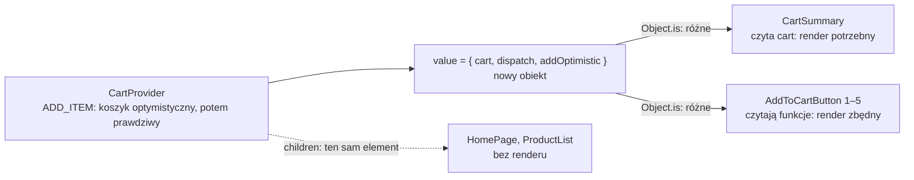

# Kto renderuje się po zmianie kontekstu

## Render to wywołanie funkcji komponentu

Wspólny kontekst ma koszt, który da się policzyć. **Render** komponentu funkcyjnego to jedno wywołanie jego funkcji: React woła ją, dostaje nowy JSX i porównuje go z poprzednim. DOM zmienia dopiero w fazie zatwierdzenia i tylko tam, gdzie wynik się różni. Render, po którym nic się na ekranie nie zmienia, nadal kosztuje wywołanie funkcji i porównanie wyniku, ale nie kosztuje operacji na DOM.

Licznik renderów to więc linia `console.log` w ciele funkcji komponentu. W wersji sklepu z jednym kontekstem `CartContext` (wartość `{ cart, dispatch, addOptimistic }`) taka linia stoi w `AddToCartButton` i analogicznie w `CartSummary`.

```jsx
export default function AddToCartButton({ product }) {
  const { dispatch, addOptimistic } = useCart();
  console.log('AddToCartButton render', product.id); // tymczasowo: jeden wpis na każde wywołanie funkcji
  // ...
}
```

W trybie deweloperskim działa tryb ścisły (*Strict Mode*), który wywołuje funkcję komponentu dwa razy na każdy render, więc jeden render daje parę wpisów. Kontekst czytają na stronie głównej dwa rodzaje komponentów. Pięć egzemplarzy `AddToCartButton` bierze z `useCart()` tylko dwie funkcje: `dispatch` i `addOptimistic`. `CartSummary` bierze `cart` i `dispatch`. `ProductList` od wprowadzenia przycisku nie sięga do kontekstu wcale.

## Wynik: renderują się wszystkie przyciski

Pomiar obejmuje jedno kliknięcie „Add to cart” przy kawie i 1,5 s do końca akcji. W trybie deweloperskim (Next.js 16.4.0, React 19.3.0) daje taki wynik:

| Komponent | Wpisy w konsoli | Kiedy |
|---|---|---|
| `AddToCartButton render 1` (kliknięty) | 4 | przy kliknięciu i po 1,5 s |
| `AddToCartButton render 2` … `5` | po 4 | przy kliknięciu i po 1,5 s |
| `CartSummary render` | 4 | przy kliknięciu i po 1,5 s |

Wartość kontekstu zmienia się dwa razy. Przy kliknięciu dostawca renderuje się z koszykiem optymistycznym, a po 1,5 s z prawdziwym, który ma już kawę. Każdy z tych renderów to para wpisów, stąd cztery. Wpisy `CartSummary` są oczywiste: komponent pokazuje liczbę sztuk i sumę, które za każdym razem się zmieniają. Zaskakuje pięć przycisków, także cztery nieklikane. Każdy czyta z kontekstu wyłącznie dwie funkcje, a `dispatch` z `useReducer` i setter z `useOptimistic` są przy każdym renderze tymi samymi funkcjami. Przyciski nie dostały żadnej nowej informacji, a React mimo to wywołał ich funkcje ponownie.

Ich render niczego na ekranie nie zmienia. W modelu sklepu z pięcioma przyciskami i jednym kontekstem obserwator zmian DOM (`MutationObserver`, interfejs przeglądarki zgłaszający każdą zmianę w drzewie DOM) nie notuje po kliknięciu ani jednej zmiany w przyciskach. Zbędny render kosztuje więc obliczenia, a ekran zostaje bez zmian. Przy pięciu przyciskach jest pomijalny, ale rośnie z liczbą konsumentów.

## Dlaczego: React porównuje całą wartość

Przyczyna leży w tym, co React porównuje. Komponent pisze `const { dispatch, addOptimistic } = useCart();`, ale ta destrukturyzacja dzieje się już po odczycie kontekstu. Hook `useContext` subskrybuje całą wartość dostawcy, a nie wybrane pole. Dokumentacja opisuje regułę tak:

> **„React automatycznie renderuje ponownie wszystkie dzieci, które używają danego kontekstu, zaczynając od dostawcy, który otrzymał inną wartość `value`. Poprzednia i następna wartość są porównywane za pomocą `Object.is`.”**
>
> *„React automatically re-renders all the children that use a particular context starting from the provider that receives a different value. The previous and the next values are compared with the Object.is comparison.”*
>
> — dokumentacja React, *useContext*

`Object.is` dla obiektów sprawdza tylko, czy to ten sam obiekt w pamięci. Literał `{ … }` tworzy nowy obiekt przy każdym wykonaniu, nawet z tymi samymi polami:

```js
const before = { cart, dispatch };  // wartość z poprzedniego renderu dostawcy (uproszczona)
const after = { cart, dispatch };   // ten sam koszyk, ta sama funkcja, nowy literał
Object.is(before, after);                    // false: dwa różne obiekty
Object.is(before.dispatch, after.dispatch);  // true: ta sama funkcja
```

Obiekt `{ cart, dispatch, addOptimistic }` powstaje w `CartProvider` od nowa przy każdym jego renderze. Po kliknięciu nowy jest koszyk optymistyczny, po 1,5 s prawdziwy, i za każdym razem `CartProvider` tworzy nowy obiekt wartości. Porównanie daje wynik „różne” i każdy komponent wywołujący `useCart()` renderuje się ponownie. Funkcje w środku obiektu są te same, ale React do nich nie zagląda.

Morten Barklund w *React in Depth* opisuje identyczny układ w aplikacji z przełącznikiem trybu ciemnego. Kontekst niesie tam flagę `isDarkMode` i funkcję `toggleDarkMode`, a przycisk przełącznika czyta tylko funkcję. Gdy kontekst jest obiektem z wieloma polami, wszyscy konsumenci renderują się przy zmianie dowolnego z nich. Autor podaje przyczynę: React widzi tylko to, że zmieniła się wartość kontekstu (*„React doesn’t care; it sees only that the context value changes”*).

<u>Komponent czytający kontekst renderuje się po każdej zmianie wartości dostawcy, niezależnie od tego, które pole z niej bierze</u>. Nie zatrzymuje tego także `memo`, czyli funkcja pomijająca render przy niezmienionych propsach. Według dokumentacji `useContext` pomijanie renderów przez `memo` nie powstrzymuje dzieci przed otrzymaniem świeżych wartości kontekstu (*„Skipping re-renders with memo does not prevent the children receiving fresh context values”*).

## Rysunek 4.11 — jedno `ADD_ITEM` przy jednym kontekście



Na Rysunku 4.11 ciągłe strzałki prowadzą do konsumentów kontekstu. Oba dostają nowy obiekt wartości i oba się renderują. Render `CartSummary` jest potrzebny, bo zmieniły się dane, które pokazuje. Render przycisków jest zbędny, bo obie funkcje pozostały te same. Przerywana strzałka pokazuje resztę drzewa pod dostawcą. Te komponenty nie renderują się wcale, choć leżą pod `CartProvider`.

## Dlaczego nie renderuje się całe drzewo pod dostawcą

`CartProvider` stoi w layoucie i dostaje stronę jako `children`. Gdy zmienia się jego stan, jego funkcja wykonuje się ponownie, ale `children` to ten sam element, który przyszedł od layoutu. W App Routerze strona `HomePage` jest komponentem serwerowym, więc w przeglądarce jej funkcja nie wykonuje się wcale. `CartProvider` dostaje `children` przygotowane na serwerze, a w nich elementy komponentów klienckich, takich jak `ProductList`. Element JSX to zwykły obiekt opisujący komponent i jego propsy. Jeśli rodzic nie utworzył go od nowa, React uznaje, że to poddrzewo nie ma powodu się zmienić. Różnicę widać na dwóch panelach z tym samym dzieckiem:

```jsx
function Panel({ children }) {        // dziecko przychodzi z zewnątrz jako children
  const [open, setOpen] = useState(false);
  return <div><button onClick={() => setOpen(!open)}>{open ? 'Collapse' : 'Expand'}</button>{children}</div>;
}

function PanelInline() {              // dziecko tworzone w środku, przy każdym renderze od nowa
  const [open, setOpen] = useState(false);
  return <div><button onClick={() => setOpen(!open)}>{open ? 'Collapse' : 'Expand'}</button><Child /></div>;
}
```

Kliknięcie w `<Panel><Child /></Panel>` renderuje tylko `Panel`. Kliknięcie w `<PanelInline />` renderuje `PanelInline` i `Child`, bo funkcja panelu przy każdym wykonaniu tworzy nowy element `<Child />`. Dokumentacja `memo` opisuje tę zasadę jako sposób na uniknięcie zbędnych renderów:

> **„Gdy komponent wizualnie owija inne komponenty, niech przyjmuje JSX jako `children`. Wtedy, gdy komponent owijający aktualizuje własny stan, React wie, że jego dzieci nie muszą się renderować.”**
>
> *„When a component visually wraps other components, let it accept JSX as children. This way, when the wrapper component updates its own state, React knows that its children don’t need to re-render.”*
>
> — dokumentacja React, *memo*

Dlatego `ProductList`, choć jest komponentem klienckim pod dostawcą, nie renderuje się po zmianie koszyka: jego element przychodzi w `children` i się nie zmienia. Koszt rośnie z liczbą konsumentów kontekstu, a nie z liczbą komponentów pod dostawcą.

Gdy stan i dostawca siedzą w komponencie, który sam tworzy resztę aplikacji, każda zmiana renderuje całe drzewo, tak jak w `PanelInline`. Samo wydzielenie dostawcy do osobnej funkcji, jak zaznacza Schwarzmüller w *React Key Concepts*, korzyści wydajnościowych nie przynosi. Zysk daje dopiero to, że stan mieszka w dostawcy, a reszta drzewa przychodzi do niego jako `children`. `CartProvider` w sklepie od początku ma tę postać: trzyma reducer u siebie, a layout nad nim nie ma stanu.

> 💡 **Zapamiętaj:** React renderuje każdego konsumenta kontekstu, gdy wartość dostawcy zmieni się według `Object.is`. Wybranie jednego pola przez destrukturyzację ani `memo` tego nie zatrzymują. Komponenty pod dostawcą, które kontekstu nie czytają, nie renderują się, gdy dostawca przyjmuje je jako `children`.


Materiał rozszerzony do tego slajdu: [`rozszerzenia/r11_rendery-kontekstu.md`](rozszerzenia/r11_rendery-kontekstu.md)
