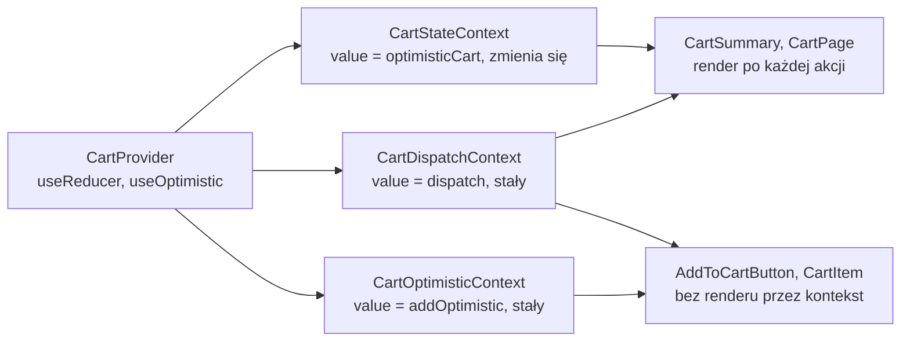

# Osobne konteksty: koszyk osobno, funkcje osobno

## Wartości, które zmieniają się w różnym tempie

Przy jednym kontekście `{ cart, dispatch, addOptimistic }` każde dodanie produktu renderuje wszystkie pięć przycisków, choć żaden z nich nie potrzebuje koszyka. Wartości w obiekcie zmieniają się jednak w różnym tempie. Koszyk jest nowym obiektem po każdej akcji, także optymistycznej, a obie funkcje pozostają tymi samymi funkcjami przez cały czas życia dostawcy. Skoro React porównuje wartość kontekstu w całości, rozwiązaniem jest danie każdej z nich osobnego kontekstu. W `app/context/CartContext.jsx` jeden kontekst zamienia się na trzy:

```jsx
const CartStateContext = createContext(null);      // zmienia się przy każdej akcji
const CartDispatchContext = createContext(null);   // stała tożsamość: dispatch z useReducer
const CartOptimisticContext = createContext(null); // stała tożsamość: setter z useOptimistic

export function CartProvider({ children }) {
  const [cart, dispatch] = useReducer(cartReducer, initialCartState);
  const [optimisticCart, addOptimistic] = useOptimistic(cart, cartReducer);
  return (
    <CartStateContext value={optimisticCart}>
      <CartDispatchContext value={dispatch}>
        <CartOptimisticContext value={addOptimistic}>
          {children}
        </CartOptimisticContext>
      </CartDispatchContext>
    </CartStateContext>
  );
}
```

`CartProvider` nadal trzyma jeden reducer i jeden hook optymistyczny, ale ich wyniki rozdziela między trzy konteksty. Każdy dostawca dostaje w `value` jedną wartość, a nie obiekt sklejany w JSX. Obu funkcji nie wkłada się do wspólnego obiektu: taki obiekt powstawałby od nowa przy każdym renderze dostawcy i zmieniałby wartość kontekstu tak samo jak koszyk. Pod dostawcą stoją trzy hooki zamiast `useCart`, każdy z własnym strażnikiem:

```jsx
export function useCartDispatch() {
  const ctx = useContext(CartDispatchContext);
  if (ctx === null) throw new Error('useCartDispatch must be used inside <CartProvider>');
  return ctx;
}
```

`useCartState()` i `useCartOptimistic()` wyglądają tak samo, tylko czytają własny kontekst i mają w komunikacie własną nazwę. Komponent poza dostawcą zgłosi więc na przykład `useCartState must be used inside <CartProvider>`. Layout się nie zmienia, bo `CartProvider` ma tę samą nazwę i przyjmuje te same `children`.

## Komponenty wybierają kontekst

Podział zmienia interfejs pliku: zamiast `useCart` są trzy hooki, a każdy konsument bierze tylko te, których potrzebuje. Przycisk dodawania korzysta z obu stałych funkcji, więc importuje dwa hooki.

```jsx
import { useCartDispatch, useCartOptimistic } from '../context/CartContext';

const dispatch = useCartDispatch();
const addOptimistic = useCartOptimistic();
```

`CartItem` zmienia ilość i usuwa pozycję, więc wystarczy mu `const dispatch = useCartDispatch();` z tym samym importem bez drugiej nazwy.

`CartSummary` i `app/cart/page.jsx` pokazują koszyk i mają przycisk czyszczenia, więc biorą oba hooki.

```jsx
import { useCartState, useCartDispatch } from '../context/CartContext';

const cart = useCartState();
const dispatch = useCartDispatch();
```

Komponent, który wywołuje oba hooki, subskrybuje oba konteksty, więc po zmianie koszyka renderuje się tak jak przed podziałem. Zysk pojawia się tylko w komponentach, które czytają same funkcje.

## Wynik drugiego pomiaru

Ten sam pomiar co przy jednym kontekście, z `console.log` w `AddToCartButton` i `CartSummary` oraz jednym dodaniem kawy, daje teraz inny wynik:

| Komponent | Jeden kontekst | Trzy konteksty |
|---|---|---|
| `AddToCartButton render 1` (kliknięty) | 4 wpisy | 0 |
| `AddToCartButton render 2` … `5` | po 4 wpisy | 0 |
| `CartSummary render` | 4 wpisy | 4 wpisy |

Żaden przycisk nie pojawia się już w konsoli, także kliknięty. Ich konteksty niosą dwie funkcje, a `value` każdego z nich po kliknięciu i po odpowiedzi serwera wskazuje na tę samą funkcję co wcześniej. Dla Reacta wartość jest więc niezmieniona. Własny stan przycisku, `error`, przy sukcesie zostaje `null`, więc i on nie daje renderu. Liczba wpisów `CartSummary` jest w obu kolumnach równa, bo koszyk, który pokazuje, zmienia się w obu wersjach dwa razy: przy kliknięciu na optymistyczny i po 1,5 s na prawdziwy.

## Rysunek 4.12 — kto słucha którego kontekstu



Na Rysunku 4.12 stan koszyka powstaje tylko w `CartProvider`. Stan i obie funkcje rozchodzą się do trzech kontekstów. Komponenty po lewej stronie dolnego rzędu czytają oba, bo wyświetlają koszyk i mogą go wyczyścić. Komponenty po prawej czytają tylko konteksty z funkcjami, których wartość nigdy się nie zmienia. Zmiana koszyka nie dociera do nich przez kontekst w ogóle. `CartItem` renderuje się mimo to po zmianie koszyka, bo tworzy go od nowa rodzic `CartPage`, który czyta stan.

## Ten sam podział w dokumentacji

Dwa osobne konteksty to układ, który dokumentacja Reacta pokazuje jako podstawowy przy łączeniu reducera z kontekstem:

> **„Żeby przekazać je w dół drzewa, tworzy się dwa osobne konteksty: `TasksContext` dostarcza bieżącą listę zadań, a `TasksDispatchContext` dostarcza funkcję, która pozwala komponentom wysyłać akcje.”**
>
> *„To pass them down the tree, you will create two separate contexts: TasksContext provides the current list of tasks. TasksDispatchContext provides the function that lets components dispatch actions.”*
>
> — dokumentacja React, *Scaling Up with Reducer and Context*

Sklep dokłada do tego układu trzeci kontekst, bo ma drugą stałą funkcję, setter koszyka optymistycznego. Dokumentacja nie uzasadnia podziału liczbą renderów. Uzasadnienie wynika z pomiaru i z mechanizmu porównania wartości. Podział ma też drugi zysk: z importów widać od razu, który komponent coś zmienia, a który tylko wyświetla.

## Dlaczego `dispatch` się nie zmienia

Dokumentacja `useReducer` podaje, że funkcja `dispatch` ma stałą tożsamość (*„The dispatch function has a stable identity”*). React tworzy ją raz, gdy komponent z `useReducer` się montuje, i przy każdym kolejnym renderze oddaje ten sam obiekt funkcji. Funkcja zapisana w ciele komponentu zachowuje się inaczej:

```jsx
function CartProbe() {
  const [cart, dispatch] = useReducer(cartReducer, initialCartState);
  const clear = () => dispatch({ type: 'CLEAR_CART' }); // nowa funkcja przy każdym wykonaniu ciała
  // po ADD_ITEM: dispatch ten sam co przy montowaniu, clear już inny
}
```

Po jednym `ADD_ITEM` komponent ma za sobą dwa rendery. `dispatch` z pierwszego i z drugiego renderu to ta sama funkcja, a dwa egzemplarze `clear` są różne. Wyrażenie strzałkowe w ciele komponentu wykonuje się przy każdym renderze i za każdym razem daje świeży obiekt funkcji. React przechowuje `dispatch` poza ciałem komponentu, razem z jego stanem, i dlatego może oddawać ten sam egzemplarz. Tak samo zachowuje się setter z `useOptimistic`: przyciski, które go czytają, po zmianie koszyka się nie renderują, więc jego tożsamość też się nie zmienia.

Stąd bierze się przewaga reducera przy podziale kontekstu. Dostawca zbudowany na `useState` z funkcjami `addItem`, `removeItem` i `clearCart`, zapisanymi w jego ciele, tworzyłby je przy każdym renderze od nowa. Kontekst z takimi funkcjami zmieniałby wartość tak samo jak kontekst ze stanem i przyciski znów renderowałyby się po każdej akcji. Takie funkcje da się zapamiętać między renderami hookiem `useCallback`, ale memoizacja to osobna technika, z własną tablicą zależności do pilnowania. <u>Reducer daje stałą funkcję bez memoizacji, bo wszystkie zmiany koszyka idą przez jedno `dispatch` o stałej tożsamości</u>, a ich logika siedzi w `cartReducer` poza komponentem.

Ta sama reguła działa w drugą stronę dla stanu. `cartReducer` zwraca nowy obiekt także wtedy, gdy akcja niczego nie zmienia: `CLEAR_CART` na pustym koszyku daje `{ ...state, items: [] }`, czyli inny obiekt niż poprzedni. Konsumenci stanu wyrenderowaliby się wtedy mimo braku zmiany, a konsumenci funkcji nadal by milczeli. W sklepie ten przypadek nie zachodzi z interfejsu, bo przycisk „Clear cart” w `CartSummary` jest przy pustym koszyku zablokowany, a `/cart` pokazuje wtedy osobny widok bez przycisku.

## Gdzie koszyk mieszka na końcu

Koszyk żyje w stanie `CartProvider`, czyli w pamięci jednej karty przeglądarki: przeładowanie strony na `/cart` pokazuje „Your cart is empty.”. Funkcje `fakeAddToCart` i `fetchRecommended` tylko udają serwer opóźnieniem, a nic poza kartą nie wie o zawartości koszyka. Trwały koszyk wymaga zapisu w miejscu, które przeżyje przeładowanie i będzie wspólne dla urządzeń użytkownika.

> 💡 **Zapamiętaj:** koszyk i każda stała funkcja trafiają do osobnych kontekstów. Komponent, który tylko wysyła akcje, czyta konteksty z funkcjami i nie renderuje się po zmianie koszyka, bo `dispatch` z `useReducer` i setter z `useOptimistic` mają stałą tożsamość. Gdy potrzebny jest render po zmianie jednego pola, wbudowany kontekst nie wystarcza i potrzebny jest selektor z biblioteki.


Materiał rozszerzony do tego slajdu: [`rozszerzenia/r12_podzial-kontekstu.md`](rozszerzenia/r12_podzial-kontekstu.md)
