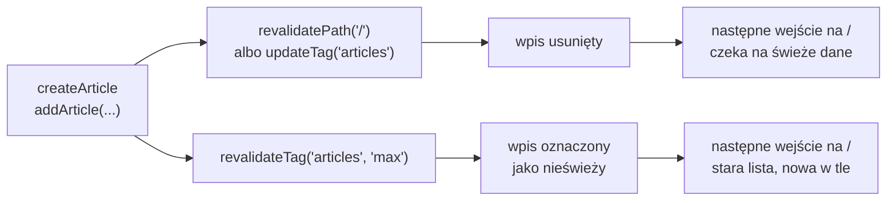

# Rozszerzenia do slajdu 09: Po zapisie lista musi się odświeżyć

Powrót: [`slide_09_rewalidacja.md`](../slide_09_rewalidacja.md)

## Rozszerzenie: `refresh()` odświeża widok, a nie dane

Next.js ma dwie funkcje o podobnej nazwie, które działają tylko na pamięć klienta. `router.refresh()` z hooka `useRouter` pobiera od serwera nowy widok bieżącej trasy, bez utraty stanu komponentów klienckich. Funkcja `refresh()` z `next/cache` robi to samo z wnętrza Server Action:

```js
// lib/actions.js, wariant spoza demo: akcja odświeża widok, ale nie unieważnia pamięci fetch
"use server";
import { refresh } from "next/cache";
import { addArticle } from "./store";

export async function addAndRefresh(article) {
  addArticle(article);
  refresh(); // nowy render trasy z tą samą zapamiętaną odpowiedzią
}
```

Dokumentacja `useRouter` stawia granicę wprost:

> **„Czyści pamięć klienta dla bieżącej trasy, ale nie unieważnia pamięci po stronie serwera.”**
>
> *„This clears the Client Cache for the current route, but does **not** invalidate the server-side cache.”*
>
> — dokumentacja Next.js, *useRouter*

Na stronie z `force-cache` ponowny render dostaje tę samą odpowiedź z pamięci `fetch`. Magazyn ma już nowy artykuł, a licznik na liście stoi w miejscu, tak samo jak po akcji bez żadnego wywołania z `next/cache`. `refresh` przydaje się, gdy widok zależy od stanu poza pamięcią, na przykład od ciasteczka. Po zmianie danych zapamiętanych potrzebne jest unieważnienie.

## Rozszerzenie: tag zamiast ścieżki

Ścieżka wskazuje stronę, a tag z opcji `next: { tags }` wskazuje dane na dowolnej liczbie stron. Tag dopisuje się w wywołaniu `fetch`.

```js
// app/page.jsx, wariant spoza demo: każde wywołanie fetch z tagiem "articles" należy do jednej grupy
const res = await fetch(`${BASE_URL}/api/articles`, {
  cache: "force-cache",
  next: { tags: ["articles"] },
});
```

Zapis unieważnia grupę funkcją z `next/cache`. Akcja i Route Handler używają różnych funkcji.

```js
// lib/actions.js, wariant spoza demo
"use server";
import { updateTag } from "next/cache";

export async function createArticle(prevState, formData) {
  // ... walidacja i addArticle(result.data) bez zmian
  updateTag("articles"); // wpis wygasa, następny odczyt czeka na świeże dane
  return { success: true };
}
```

```js
// app/api/articles/route.js, wariant spoza demo
import { NextResponse } from "next/server";
import { revalidateTag } from "next/cache";
import { addArticle } from "@/lib/store";

export async function POST(request) {
  const article = addArticle(await request.json()); // zapis jak w demo
  revalidateTag("articles", "max"); // wpis staje się nieświeży
  return NextResponse.json(article, { status: 201 });
}
```

Tag to dowolny napis do 256 znaków, najwyżej 128 tagów na jedno wywołanie `fetch`. <u>Wszystkie wywołania `fetch` z tym samym tagiem, na dowolnej stronie, tworzą jedną grupę</u>, którą unieważnia się jednym wywołaniem. Dwie funkcje różnią się tym, co zobaczy następny czytelnik:

- **`updateTag("articles")`** działa wyłącznie w Server Action i od razu usuwa wpis. Następne żądanie czeka na świeże dane, więc autor widzi swój zapis już przy pierwszym wejściu na listę. Przewodnik dodaje, że oczekiwanie obejmuje też render dołączany do odpowiedzi akcji. To narzędzie dokładnie na sytuację z formularzem `/new`.
- **`revalidateTag("articles", "max")`** działa także w Route Handlerze. Profil `'max'` daje zachowanie *stale-while-revalidate*: pierwsze wejście po wywołaniu dostaje jeszcze starą listę i uruchamia pobranie w tle, a dopiero kolejne widzi nowy artykuł.

Dokumentacja `revalidateTag` mówi wprost, że forma z jednym argumentem jest przestarzała (*„The single-argument form `revalidateTag(tag)` is deprecated.”*). Działa dziś jak natychmiastowe wygaśnięcie, ale może zniknąć w przyszłej wersji. Gdy dane muszą wygasnąć od razu poza Server Action, dokumentacja podaje wariant `revalidateTag(tag, { expire: 0 })`.

## Rysunek 5.9 — dwie ścieżki unieważnienia na osi czasu



Rysunek 5.9 dodaje oś czasu: różnica między ścieżkami leży w tym, które wejście na `/` pierwsze zobaczy nowy artykuł.

## Rozszerzenie: rewalidacja na żądanie z zewnątrz

Funkcja `revalidateTag` ma sens tam, gdzie zmiana nie przechodzi przez formularz. Bugl definiuje **webhook** jako API wywoływane zwrotnie: gdy dane się zmienią, zewnętrzne źródło, na przykład system zarządzania treścią, wywołuje punkt końcowy aplikacji, żeby dać znać, że trzeba pobrać dane ponownie. Bugl zaznacza, że webhooki definiuje się zwykle jako Route Handlery `POST`, bo wpływają na stan aplikacji. Adres jest publiczny, więc obowiązują go te same kontrole wejścia co akcję.

```js
// Przykład spoza demo: app/api/revalidate/route.js
import { NextResponse } from "next/server";
import { revalidateTag } from "next/cache";

export async function POST(request) {
  if (request.headers.get("x-webhook-secret") !== process.env.WEBHOOK_SECRET) {
    return NextResponse.json({ error: "Unauthorized" }, { status: 401 });
  }
  revalidateTag("articles", "max");
  return NextResponse.json({ revalidated: true });
}
// POST bez nagłówka                → 401 {"error":"Unauthorized"}
// POST z x-webhook-secret: s3cret  → 200 {"revalidated":true}
// strona z tagiem "articles": pierwsze wejście → stara liczba, drugie → nowa
```

Dokumentacja zaznacza też, że rewalidację uruchamia żądanie, a nie samo wywołanie `revalidateTag`. Strony z tagiem odświeżają się w miarę odwiedzin, a nie wszystkie naraz. Przy kilku instancjach serwera za równoważeniem ruchu wywołanie działa domyślnie tylko na instancji, która je dostała. Pozostałe podają stare dane, dopóki wspólny magazyn pamięci nie przekaże im zdarzenia.

## Rozszerzenie: ścieżka czy tag

`revalidatePath("/")` unieważnia wpisy pamięci `fetch`, które odczytała strona `/`. Druga strona z tą samą listą odświeża się przy tym tylko wtedy, gdy korzysta z tego samego wpisu.

```js
// Przykład spoza demo: trzy strony z connection() i tagiem "articles"
// /tag-a, /tag-b: fetch(`${BASE_URL}/api/articles`, { cache: "force-cache", next: { tags: ["articles"] } })
// /tag-c:         fetch(`${BASE_URL}/api/articles?page=c`, { cache: "force-cache", next: { tags: ["articles"] } })
addArticle(article);
revalidatePath("/tag-a");
// → /tag-a: Articles (4), /tag-b: Articles (4), /tag-c: Articles (3)
revalidateTag("articles", "max");
// → /tag-c: Articles (3) przy pierwszym wejściu, Articles (4) przy drugim
```

<u>Ścieżka trafia w dane strony, a tag w dane z tą nazwą na każdej stronie.</u> Bugl opisuje to tak: rewalidacja tagiem może objąć wiele ścieżek naraz.

Oba mechanizmy mają wspólny fundament. Przewodnik *How revalidation works* opisuje **tagi miękkie** (*soft tags*), które Next.js nadaje sam na podstawie ścieżki, z przedrostkiem `_N_T_`. Trasa `/blog/hello` dostaje między innymi `_N_T_/layout` i `_N_T_/blog/hello`, a `revalidatePath` unieważnia właśnie te tagi. Ścieżka to więc tag wyprowadzony z drzewa plików, a tag jawny to nazwa nadana danym.

W tej aplikacji wystarcza ścieżka. Lista artykułów występuje tylko na `/`, a strona szczegółów czyta magazyn bezpośrednio przez `getArticle`, bez pamięci `fetch`. <u>Unieważnia się dokładnie to, co pokazuje zmienione dane.</u>
