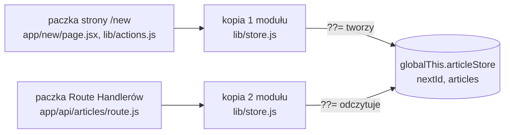

# Projekt, który ma własne dane

## Dane na serwerze, ekran w przeglądarce

Przeglądarka artykułów `articleviewer` pokazuje listę tekstów technicznych, stronę jednego artykułu i formularz dodawania nowego. Artykuły leżą w pamięci serwera, a lista wyświetla się w przeglądarce użytkownika, więc każdy ekran musi je skądś pobrać. Formularz dopisuje artykuł na serwerze, a lista wyświetlona minutę wcześniej nic o tym nie wie.

Dla każdego ekranu trzeba więc ustalić trzy rzeczy. Pierwsza to **miejsce, w którym ekran powstaje**: na serwerze albo w przeglądarce. Druga to **czas, przez jaki wolno pokazywać zapamiętaną odpowiedź**, czyli dane z pamięci podręcznej (*cache*). Trzecia to **odpowiedzialność za odświeżenie po zapisie**: kto i kiedy powie ekranowi, że dane się zmieniły. Przykład: autor, który dodał artykuł formularzem, ma go zobaczyć na liście od razu. Ten sam autor z listą otwartą w drugiej karcie zobaczy tam nowy artykuł dopiero wtedy, gdy strona w tej karcie ponownie poprosi serwer o dane.

Aplikacja dostaje po drodze własne API, czyli pliki `route.js` w katalogu `app/api`, które Next.js nazywa Route Handlerami. Dochodzą do tego lista pobierana na serwerze, formularz z funkcją zapisu wykonywaną na serwerze i strona pobierająca dane w przeglądarce. Wszystkie dane siedzą w tym samym projekcie, więc całość działa bez internetu i bez zewnętrznej usługi.

## Projekt i szablon

Projekt powstaje kreatorem `create-next-app` w wersji 16.4.0: JavaScript, App Router, alias importu `@/*`, bez Tailwinda, ESLinta, katalogu `src/` i dwóch opcji, których wykład nie używa. Kreator wpisuje do `package.json` dokładne wersje: `next` 16.4.0 oraz `react` i `react-dom` 19.3.0. Biblioteki SWR (2.5.1) i Zod (3.25.76) też mają w projekcie dokładne numery.

**Bundler** to narzędzie, które składa moduły aplikacji w pliki wykonywane na serwerze i w przeglądarce. Wynikiem jego pracy są **paczki** (*bundles*): pliki JavaScriptu, w których zebrany jest kod wszystkich modułów potrzebnych w danym miejscu aplikacji. Tabela zmian w dokumentacji Turbopacka przy wersji 16.0.0 zapisuje: „Turbopack staje się domyślnym bundlerem Next.js” (*„Turbopack becomes the default bundler for Next.js”*).

Szablonowa strona startowa ma logo, linki i style, więc zostaje z niej jeden akapit „Articles Viewer”. Szablonowy layout pobiera fonty Geist z modułu `next/font/google`, który przy pierwszym uruchomieniu łączy się z serwerami Google, a bez sieci kończy się błędem. Nowy layout zwraca tylko `<html lang="pl">` i `<body>` z `children`. Komponenty bez dyrektywy `"use client"` są komponentami serwerowymi, więc obie strony aplikacji zaczynają od serwera.

## Magazyn jako jedyne wejście do danych

Dostęp do danych mieści się w jednym pliku, `lib/store.js`. Plik zaczyna się od obiektu z artykułami, a kończy trzema funkcjami, które eksportuje i które zna reszta aplikacji. Obiekt powstaje zapisem z obiektem globalnym i operatorem `??=`.

## Obiekt globalny i operator `??=`

W JavaScripcie istnieje jeden **obiekt globalny**, wspólny dla całego programu. W Node.js nazywa się `global`, w przeglądarce `window`, a nazwa `globalThis` działa w obu środowiskach. Dokumentacja MDN opisuje ją tak:

> **„Właściwość `globalThis` daje standardowy sposób dostępu do globalnej wartości `this`, a więc do samego obiektu globalnego, niezależnie od środowiska.”**
>
> *„The `globalThis` property provides a standard way of accessing the global `this` value (and hence the global object itself) across environments.”*
>
> — MDN Web Docs, *globalThis*

Operator `??=` przypisuje wartość tylko wtedy, gdy zmienna jest pusta, czyli ma wartość `null` albo `undefined`. MDN nazywa go przypisaniem z operatorem koalescencji (*nullish coalescing assignment*). Razem dają obiekt, który powstaje raz, niezależnie od tego, ile razy wykona się kod.

```js
let a = null;
a ??= { n: 1 }; // a było puste: przypisanie się wykonuje
a ??= { n: 2 }; // a ma już wartość: prawa strona nawet się nie oblicza
a.n; // 1

const s1 = (globalThis.demoStore ??= { items: [] }); // pierwsze wywołanie tworzy obiekt
const s2 = (globalThis.demoStore ??= { items: [] }); // drugie dostaje ten sam
s1.items.push("x");
s1 === s2; // true, a s2.items.length to 1
```

Górna część `lib/store.js` używa dokładnie tego zapisu.

```js
// lib/store.js (górna część pliku)
// Dane leżą na globalThis, bo moduł ładuje się w kilku paczkach serwera,
// a wszystkie mają widzieć jedną tablicę.
const store = (globalThis.articleStore ??= {
  nextId: 4, // numery 1–3 są zajęte przez artykuły startowe
  articles: [
    {
      id: 1,
      title: "Intro to Server Components",
      author: "Alice",
      body: "Server Components run only on the server. They can fetch data directly without useEffect.",
      createdAt: "2025-01-01",
    },
    // ...dwa kolejne artykuły (Bob, Carol) w tym samym kształcie
  ],
});
```

## Trzy funkcje magazynu

Pod obiektem `store` stoją funkcje, przez które reszta aplikacji czyta i zapisuje artykuły:

```js
// lib/store.js (dolna część pliku, pod obiektem store)
export function getArticles() {
  return [...store.articles]; // kopia tablicy: dopisanie do niej nie zmieni magazynu
}

export function getArticle(id) {
  // id przychodzi z adresu jako napis, w magazynie jest liczbą
  return store.articles.find((a) => a.id === Number(id)) ?? null;
}

export function addArticle({ title, author, body }) {
  const article = {
    id: store.nextId++, // nadaje numer i od razu zwiększa licznik
    title,
    author,
    body,
    createdAt: new Date().toISOString().slice(0, 10), // RRRR-MM-DD
  };
  store.articles.push(article);
  return article;
}
```

Taki plik to **warstwa dostępu do danych**: jedno miejsce, które wie, gdzie dane leżą i jak je zmienić. W prawdziwej aplikacji wnętrze tych funkcji wysyłałoby zapytania do bazy, na przykład przez Prismę albo zwykły SQL. Nazwy i argumenty funkcji zostałyby takie same, więc komponenty i API nie musiałyby się zmieniać.

Kopia z `getArticles()` jest płytka. Rozwinięcie `[...]` tworzy nową tablicę, ale obiekty artykułów w niej są te same co w magazynie. `getArticle(id)` zwraca wręcz oryginał. Kod, który zmieni pole `title` w zwróconym obiekcie, zmieni je w magazynie dla wszystkich kolejnych żądań. W tej aplikacji żaden komponent tego nie robi.

## Pamięć serwera to pamięć wspólna

Magazyn w module istnieje także w przeglądarce, gdy plik importuje komponent kliencki. Taki magazyn ma jednak osobną kopię w każdej karcie i znika po przeładowaniu strony. `lib/store.js` importuje tylko kod serwera, więc tablica żyje w **pamięci procesu** Node.js. Z tego wynikają trzy różnice, które zmieniają sposób myślenia o danych.

Pierwsza dotyczy odbiorców. Wszyscy użytkownicy, którzy wchodzą na stronę, czytają tę samą tablicę, więc artykuł dodany przez jedną osobę jest od razu w danych drugiej. Druga dotyczy czasu życia: dane przetrwają dowolną liczbę żądań i przeładowań strony, ale znikną po zatrzymaniu serwera. Trzecia dotyczy dostępu. Przeglądarka nie ma bezpośredniej drogi do tej tablicy, bo kod `lib/store.js` nie trafia do jej plików. Każdy odczyt i zapis z przeglądarki musi więc przejść przez żądanie HTTP, a serwer decyduje, co z nim zrobić. Przeglądarka dostaje kopię danych, a oryginał zostaje na serwerze. Dlatego lista na ekranie może się zestarzeć: jest kopią z chwili, w której serwer ją wysłał.

## Dlaczego zwykła zmienna modułu nie wystarcza

Najprostszy magazyn to zmienna modułu: `let articles = [...]`. Moduł wykonuje się raz na paczkę, więc w obrębie jednej paczki każdy import dostaje tę samą tablicę. Dokumentacja Turbopacka mówi ogólnie, że „Next.js obsługuje wiele środowisk wyjściowych, na przykład klienta i serwer” (*„Next.js supports multiple output environments (e.g., client and server)”*). Po stronie serwera podział idzie jednak dalej. W Next.js 16.4.0 kod `lib/store.js` trafia przy budowaniu do kilku plików paczek: do osobnego pliku dla strony `/new` i osobnego dla `/articles/[id]` w katalogu `.next/server/chunks/ssr/` oraz do pliku wspólnego dla Route Handlerów z `app/api/`. Każdy taki plik ma własny rejestr załadowanych modułów i wykonuje własną kopię `lib/store.js`, a każda kopia miałaby własną tablicę. Reguła „moduł wykonuje się raz” obowiązuje więc w obrębie jednej paczki, a nie całego procesu.

Z magazynem w zwykłej zmiennej strona, która dopisuje artykuł przez `addArticle`, widzi po pierwszym wejściu 4 artykuły, a po drugim 5. Odpowiedź `/api/articles` cały czas zawiera 3. Z magazynem na `globalThis` obie liczby rosną razem: 4 i 4, potem 5 i 5. <u>Kod, który polega na jednej kopii modułu, działa przypadkiem i przestaje działać po zmianie narzędzia.</u>

## Rysunek 5.1 — jeden magazyn dla dwóch kopii modułu



Na Rysunku 5.1 po lewej stoją dwie paczki serwera, które Turbopack buduje osobno. Każda ładuje własną kopię `lib/store.js`. Strzałki z obu kopii prowadzą do jednego obiektu w pamięci procesu. Kopia, która wykona się pierwsza, zastaje `globalThis.articleStore` puste i tworzy magazyn, a druga tylko go odczytuje. Gdyby dane leżały w zmiennej modułu, w środku rysunku stałyby dwie niezależne tablice.

## Przeładowanie modułu nie czyści magazynu

Przy zapisie pliku serwer deweloperski podmienia zmieniony moduł bez restartu procesu. Zmienna modułu wróciłaby wtedy do trzech artykułów. Obiekt na `globalThis` przeżywa podmianę, więc artykuły dodane w trakcie pracy zostają do restartu serwera.

Ten sam mechanizm działa w drugą stronę. Zmiana autora pierwszego artykułu w `lib/store.js` z „Alice” na „Alicja” nie trafia do odpowiedzi `/api/articles/1` po zapisie pliku. Nowa wersja modułu się wykonuje, ale `??=` zastaje gotowy obiekt i nie oblicza prawej strony z nowymi danymi. <u>Zmiana danych startowych w `lib/store.js` wymaga restartu serwera.</u>

## Wiele żądań naraz, jeden ciąg kodu naraz

Licznik `nextId` jest bezpieczny, choć wiele żądań trafia do magazynu w tym samym czasie. Powód leży w modelu wykonania JavaScriptu:

> **„Każde zadanie zostaje przetworzone do końca, zanim zacznie się przetwarzanie jakiegokolwiek innego.”**
>
> *„Each job is processed completely before any other job is processed.”*
>
> — MDN Web Docs, *JavaScript execution model*

Funkcja w trakcie działania nie może więc zostać przerwana przez inny kod, dopóki sama nie odda sterowania. Oddaje je każde `await`. Różnicę widać na dwóch wersjach tego samego licznika. Przykład jest modułem ES, więc `await` wolno w nim napisać poza funkcją. `Promise.all` czeka na wszystkie trzy wywołania uruchomione naraz.

```js
let nextId = 1;
function addSync() { return nextId++; } // odczyt i zwiększenie w jednym ciągu

async function addWithAwait() {
  const id = nextId; // odczyt
  await null;        // tu inne zadania mogą wejść
  nextId = id + 1;   // zapis
  return id;
}

await Promise.all([1, 2, 3].map(async () => addSync())); // [1, 2, 3]
nextId = 1;
await Promise.all([1, 2, 3].map(() => addWithAwait()));  // [1, 1, 1]
```

`addArticle` nie ma w środku `await`, więc odczyt `nextId`, zwiększenie licznika i `push` wykonują się jednym ciągiem: 20 równoległych żądań `POST` daje 20 artykułów o różnych numerach. Wersja z bazą danych, która najpierw odczytuje największy numer, czeka na wynik, a potem zapisuje rekord, zachowuje się jak `addWithAwait`. Dlatego numer nadaje sama baza, na przykład kolumną z automatycznym licznikiem.

> 💡 **Zapamiętaj:** <u>stan wspólny dla Route Handlerów i stron trzyma się poza zmienną modułu</u>, bo pod Turbopackiem moduł ładuje się w kilku paczkach. Magazyn na `globalThis` przeżywa przeładowanie pliku, ale jest osobny w każdym procesie serwera.


Materiał rozszerzony do tego slajdu: [`rozszerzenia/r01_projekt-i-magazyn.md`](rozszerzenia/r01_projekt-i-magazyn.md)
