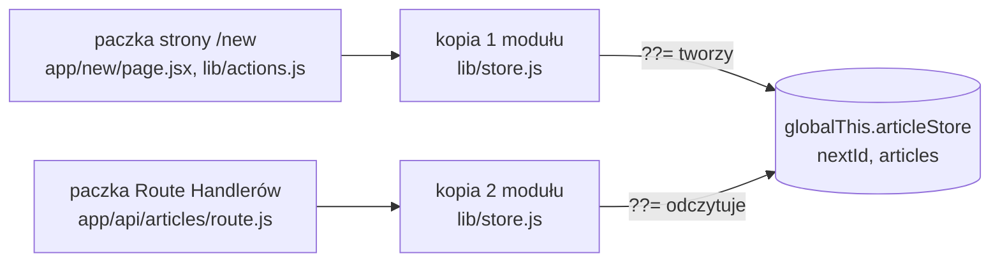

# Projekt, który ma własne dane

## Mapa klas problemów danych serwera

Przeglądarka artykułów `articleviewer` pokazuje listę tekstów technicznych, stronę jednego artykułu i formularz dodawania nowego. Artykuły leżą w pamięci serwera, a lista wyświetla się w przeglądarce użytkownika, więc każdy ekran musi je skądś pobrać. Dla każdego ekranu trzeba ustalić trzy rzeczy. Pierwsza to **miejsce, w którym ekran powstaje**: na serwerze albo w przeglądarce. Druga to **czas, przez jaki wolno pokazywać zapamiętaną odpowiedź**, czyli dane z pamięci podręcznej (*cache*). Trzecia to **odpowiedzialność za odświeżenie po zapisie**: kto i kiedy powie ekranowi, że dane się zmieniły.

Z tych pytań wynika siedem klas problemów. Każda ma w aplikacji miejsce, w którym bez odpowiedniego narzędzia coś działa źle, i każda dostaje własne narzędzie.

| Klasa problemu | Co psuje się w przeglądarce artykułów | Narzędzie | Temat |
|---|---|---|---|
| Dane potrzebne odbiorcy spoza procesu serwera | skrypt w terminalu ani inna aplikacja nie zaimportuje `lib/store.js` | Route Handler | własne API |
| Ekran potrzebuje danych, zanim powstanie, a źródło bywa wolne albo niedostępne | lista czeka sekundę na odpowiedź API, a przy awarii wyjątek nie ma gdzie się zatrzymać | komponent `async`, `loading.jsx`, `error.jsx`, odczyt z modułu | komponent, który czeka na dane; czekanie, awaria i strona artykułu |
| Część strony mogłaby się pokazać przed danymi | cała strona stoi pod napisem „Loading...”, choć nagłówek jest gotowy | Promise przekazany w dół i `use` | Promise z serwera |
| To samo źródło pytane przy każdym wejściu | każde odświeżenie czeka sekundę na tę samą listę | pamięć `fetch` | pamięć `fetch` |
| Zapis z formularza ma wykonać się na serwerze i przyjąć tylko poprawne dane | zapis wymaga ręcznego `POST`, a do magazynu trafia rekord z liczbą w tytule | Server Action i walidacja w każdym wejściu | formularz i bezpieczeństwo zapisu |
| Po zapisie lista pokazuje stare dane, a F5 wysyła formularz drugi raz | autor nie widzi swojego artykułu, a odświeżenie strony dopisuje drugi | `revalidatePath` i `redirect` | rewalidacja i przekierowanie |
| Dane zmieniają się w trakcie oglądania | lista nie pokazuje cudzych zapisów bez odświeżenia karty | pobieranie w przeglądarce | SWR i TanStack Query |

Pod wszystkimi wierszami leży jeszcze jeden kłopot: strony, Server Actions i Route Handlery muszą czytać i zapisywać jedną tablicę artykułów. Wszystkie dane siedzą w tym samym projekcie, więc całość działa bez internetu i bez zewnętrznej usługi.

## Projekt i szablon

Projekt powstaje kreatorem `create-next-app` w wersji 16.4.0: JavaScript, App Router, alias importu `@/*`, bez Tailwinda, ESLinta, katalogu `src/` i dwóch opcji, których wykład nie używa. Kreator wpisuje do `package.json` dokładne wersje: `next` 16.4.0 oraz `react` i `react-dom` 19.3.0. Biblioteka Zod (3.25.76) też ma w projekcie dokładny numer. SWR z końcowych tematów wykładu jest przykładem spoza demo, więc w `package.json` go nie ma.

**Bundler** to narzędzie, które składa moduły aplikacji w pliki wykonywane na serwerze i w przeglądarce. Wynikiem jego pracy są **paczki** (*bundles*): pliki JavaScriptu, w których zebrany jest kod wszystkich modułów potrzebnych w danym miejscu aplikacji. Tabela zmian w dokumentacji Turbopacka przy wersji 16.0.0 zapisuje: „Turbopack staje się domyślnym bundlerem Next.js” (*„Turbopack becomes the default bundler for Next.js”*).

Szablonowa strona startowa ma logo, linki i style, więc zostaje z niej `<main>` z nagłówkiem „Articles”, a plik `globals.css` znika. Szablonowy layout pobiera fonty Geist z modułu `next/font/google`, który przy pierwszym uruchomieniu łączy się z serwerami Google, a bez sieci kończy się błędem. Nowy layout zwraca tylko `<html lang="en">` i `<body>` z `children`. Komponenty bez dyrektywy `"use client"` są komponentami serwerowymi, więc obie strony aplikacji zaczynają od serwera.

## Magazyn jako jedyne wejście do danych

Dostęp do danych mieści się w jednym pliku, `lib/store.js`. Plik zaczyna się od obiektu z artykułami, a kończy trzema funkcjami, które eksportuje i które zna reszta aplikacji. Obiekt powstaje zapisem z obiektem globalnym i operatorem `??=`.

## Obiekt globalny i operator `??=`

W JavaScripcie istnieje jeden **obiekt globalny**, wspólny dla całego programu. W Node.js nazywa się `global`, w przeglądarce `window`, a nazwa `globalThis` działa w obu środowiskach. Dokumentacja MDN opisuje ją tak:

> **„Właściwość `globalThis` daje standardowy sposób dostępu do globalnej wartości `this`, a więc do samego obiektu globalnego, niezależnie od środowiska.”**
>
> *„The `globalThis` property provides a standard way of accessing the global `this` value (and hence the global object itself) across environments.”*
>
> — MDN Web Docs, *globalThis*

Operator `??=` przypisuje wartość tylko wtedy, gdy zmienna jest pusta, czyli ma wartość `null` albo `undefined`. MDN nazywa go przypisaniem z operatorem koalescencji (*nullish coalescing assignment*). Razem dają obiekt, który powstaje raz, niezależnie od tego, ile razy wykona się kod.

```js
let a = null;
a ??= { n: 1 }; // a było puste: przypisanie się wykonuje
a ??= { n: 2 }; // a ma już wartość: prawa strona nawet się nie oblicza
a.n; // → 1

const s1 = (globalThis.demoStore ??= { items: [] }); // pierwsze wywołanie tworzy obiekt
const s2 = (globalThis.demoStore ??= { items: [] }); // drugie dostaje ten sam
s1.items.push("x");
s1 === s2; // → true, a s2.items.length to 1
```

Górna część `lib/store.js` używa dokładnie tego zapisu. Magazyn jest gotowy przed wykładem, a prowadzący go tylko objaśnia.

```js
// lib/store.js (górna część pliku)
// Dane leżą na globalThis, bo moduł ładuje się w kilku paczkach serwera,
// a wszystkie mają widzieć jedną tablicę.
const store = (globalThis.articleStore ??= {
  nextId: 3, // numery 1 i 2 są zajęte przez artykuły startowe
  articles: [
    { id: 1, title: "Server Components", body: "They run only on the server." },
    { id: 2, title: "Server Actions", body: "They save data on the server." },
  ],
});
```

## Trzy funkcje magazynu

Pod obiektem `store` stoją funkcje, przez które reszta aplikacji czyta i zapisuje artykuły:

```js
// lib/store.js (dolna część pliku, pod obiektem store)
export function getArticles() {
  return [...store.articles]; // kopia tablicy: dopisanie do niej nie zmieni magazynu
}

export function getArticle(id) {
  // id przychodzi z adresu jako napis, w magazynie jest liczbą
  return store.articles.find((a) => a.id === Number(id)) ?? null;
}

export function addArticle({ title, body }) {
  const article = { id: store.nextId++, title, body }; // numer i od razu zwiększenie licznika
  store.articles.push(article);
  return article;
}
```

Taki plik to **warstwa dostępu do danych**: jedno miejsce, które wie, gdzie dane leżą i jak je zmienić. W prawdziwej aplikacji wnętrze tych funkcji wysyłałoby zapytania do bazy, na przykład przez Prismę albo zwykły SQL. Nazwy i argumenty funkcji zostałyby takie same, więc komponenty i API nie musiałyby się zmieniać.

Kopia z `getArticles()` jest płytka. Rozwinięcie `[...]` tworzy nową tablicę, ale obiekty artykułów w niej są te same co w magazynie. `getArticle(id)` zwraca wręcz oryginał. Kod, który zmieni pole `title` w zwróconym obiekcie, zmieni je w magazynie dla wszystkich kolejnych żądań. W tej aplikacji żaden komponent tego nie robi.

## Pamięć serwera to pamięć wspólna

Magazyn w module istnieje także w przeglądarce, gdy plik importuje komponent kliencki. Taki magazyn ma jednak osobną kopię w każdej karcie i znika po przeładowaniu strony. `lib/store.js` importuje tylko kod serwera, więc tablica żyje w **pamięci procesu** Node.js. Z tego wynikają trzy różnice, które zmieniają sposób myślenia o danych.

Pierwsza dotyczy odbiorców. Wszyscy użytkownicy, którzy wchodzą na stronę, czytają tę samą tablicę, więc artykuł dodany przez jedną osobę jest od razu w danych drugiej. Druga dotyczy czasu życia: dane przetrwają dowolną liczbę żądań i przeładowań strony, ale znikną po zatrzymaniu serwera. Trzecia dotyczy dostępu. Przeglądarka nie ma bezpośredniej drogi do tej tablicy, bo kod `lib/store.js` nie trafia do jej plików. Każdy odczyt i zapis z przeglądarki musi więc przejść przez żądanie HTTP, a serwer decyduje, co z nim zrobić. Przeglądarka dostaje kopię danych, a oryginał zostaje na serwerze. Dlatego lista na ekranie może się zestarzeć: jest kopią z chwili, w której serwer ją wysłał.

## Dlaczego zwykła zmienna modułu nie wystarcza

Najprostszy magazyn to zmienna modułu: `let articles = [...]`. Moduł wykonuje się raz na paczkę, więc w obrębie jednej paczki każdy import dostaje tę samą tablicę. Dokumentacja Turbopacka mówi ogólnie, że „Next.js obsługuje wiele środowisk wyjściowych, na przykład klienta i serwer” (*„Next.js supports multiple output environments (e.g., client and server)”*). Po stronie serwera podział idzie jednak dalej. W Next.js 16.4.0 strony i Server Actions dzielą jedną kopię `lib/store.js`, a Route Handlery z `app/api/` mają drugą. Każda kopia ma własny rejestr załadowanych modułów, a więc miałaby własną tablicę. Reguła „moduł wykonuje się raz” obowiązuje więc w obrębie jednej paczki, a nie całego procesu.

Pomiar na końcowej wersji demo, z magazynem w zwykłej zmiennej (`const store = { … }` bez `globalThis`), wygląda tak. Po zapisie formularzem przeglądarka wraca na `/` i pokazuje „Articles (2)”. Adres `/api/articles` zwraca 2 pozycje, a `/articles/3` pokazuje nowy artykuł. Akcja i strona artykułu widzą jedną kopię modułu, Route Handler drugą, a lista na `/` pochodzi właśnie z niego. Z magazynem na `globalThis` lista po tym samym zapisie ma „Articles (3)”. <u>Kod, który polega na jednej kopii modułu, działa przypadkiem i przestaje działać po zmianie narzędzia.</u>

## Rysunek 5.1 — jeden magazyn dla dwóch kopii modułu



Na Rysunku 5.1 po lewej stoją dwie paczki serwera, które Turbopack buduje osobno. Każda ładuje własną kopię `lib/store.js`. Strzałki z obu kopii prowadzą do jednego obiektu w pamięci procesu. Kopia, która wykona się pierwsza, zastaje `globalThis.articleStore` puste i tworzy magazyn, a druga tylko go odczytuje. Gdyby dane leżały w zmiennej modułu, w środku rysunku stałyby dwie niezależne tablice.

## Przeładowanie modułu nie czyści magazynu

Przy zapisie pliku serwer deweloperski podmienia zmieniony moduł bez restartu procesu. Zmienna modułu wróciłaby wtedy do dwóch artykułów. Obiekt na `globalThis` przeżywa podmianę, więc artykuły dodane w trakcie pracy zostają do restartu serwera.

Ten sam mechanizm działa w drugą stronę. Zmiana tytułu pierwszego artykułu w `lib/store.js` na „Server Components 2” nie trafia do odpowiedzi `/api/articles` po zapisie pliku. Nowa wersja modułu się wykonuje, ale `??=` zastaje gotowy obiekt i nie oblicza prawej strony z nowymi danymi. <u>Zmiana danych startowych w `lib/store.js` wymaga restartu serwera.</u>

## Wiele żądań naraz, jeden ciąg kodu naraz

Licznik `nextId` jest bezpieczny, choć wiele żądań trafia do magazynu w tym samym czasie. Powód leży w modelu wykonania JavaScriptu:

> **„Każde zadanie zostaje przetworzone do końca, zanim zacznie się przetwarzanie jakiegokolwiek innego.”**
>
> *„Each job is processed completely before any other job is processed.”*
>
> — MDN Web Docs, *JavaScript execution model*

Funkcja w trakcie działania nie może więc zostać przerwana przez inny kod, dopóki sama nie odda sterowania. Oddaje je każde `await`. Różnicę widać na dwóch wersjach tego samego licznika. Przykład jest modułem ES, więc `await` wolno w nim napisać poza funkcją. `Promise.all` czeka na wszystkie trzy wywołania uruchomione naraz.

```js
let nextId = 1;
function addSync() { return nextId++; } // odczyt i zwiększenie w jednym ciągu

await Promise.all([1, 2, 3].map(async () => addSync())); // → [1, 2, 3]
```

Wersja z `await` między odczytem a zapisem, czyli `const id = nextId; await null; nextId = id + 1; return id;`, daje po trzech równoległych wywołaniach `[1, 1, 1]`. Każde wywołanie odczytuje `nextId` przed pierwszym zapisem i oddaje ten sam numer.

`addArticle` nie ma w środku `await`, więc odczyt `nextId`, zwiększenie licznika i `push` wykonują się jednym ciągiem: 20 równoległych żądań `POST` dopisuje 20 artykułów, a wszystkie 22 numery na liście są różne. Wersja z bazą danych, która najpierw odczytuje największy numer, czeka na wynik, a potem zapisuje rekord, zachowuje się jak `addWithAwait`. Dlatego numer nadaje sama baza, na przykład kolumną z automatycznym licznikiem.

## Zalety i koszty magazynu w pamięci procesu

Magazyn w pamięci daje dane bez bazy i bez sieci, a funkcje z `lib/store.js` odgradzają resztę aplikacji od sposobu przechowywania. Koszt widać przy restarcie i przy drugim procesie serwera.

| Zyskujemy | Płacimy | Kiedy nie warto / co zamiast |
|---|---|---|
| Jedna tablica dla stron, akcji i Route Handlerów dzięki `globalThis` (zwykła zmienna: „Articles (2)” na liście przy artykule 3) | Dane znikają po restarcie serwera, a każdy proces ma własny magazyn (rozszerzenie: dwa procesy `next start`) | Dane trwałe albo na kilku serwerach: baza za tymi samymi funkcjami (Prisma, SQL) |
| Dane bez bazy i bez sieci, więc demo działa lokalnie | Zmiana danych startowych wymaga restartu, bo `??=` nie oblicza prawej strony drugi raz | Prototyp, demo, test: wystarcza. Produkcja: baza |
| Jedno miejsce dostępu do danych: nazwy funkcji zostają po przejściu na bazę | Kopia z `getArticles()` jest płytka, więc zmiana pola w zwróconym obiekcie zmienia magazyn | Zmiana obiektów: tylko wewnątrz warstwy dostępu, w funkcji jak `addArticle` |

> 💡 **Zapamiętaj:** <u>stan wspólny dla Route Handlerów i stron trzyma się poza zmienną modułu</u>, bo pod Turbopackiem moduł ładuje się w kilku paczkach. Magazyn na `globalThis` przeżywa przeładowanie pliku, ale jest osobny w każdym procesie serwera.


Materiał rozszerzony do tego slajdu: [`rozszerzenia/r01_projekt-i-magazyn.md`](rozszerzenia/r01_projekt-i-magazyn.md)
